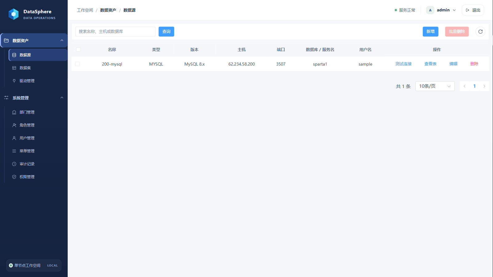
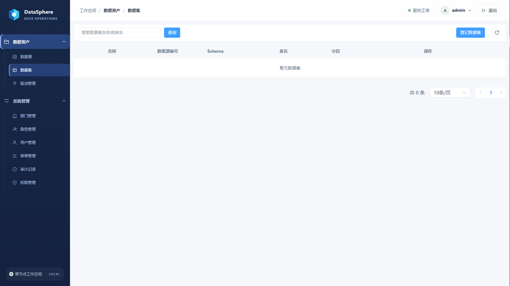
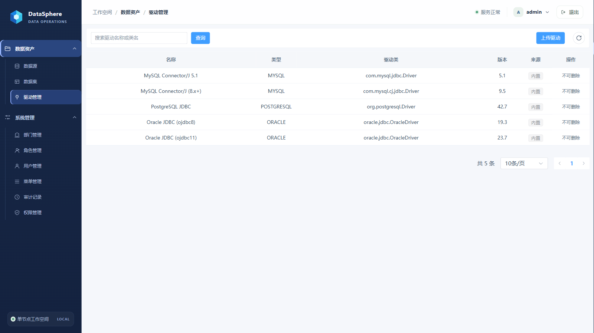
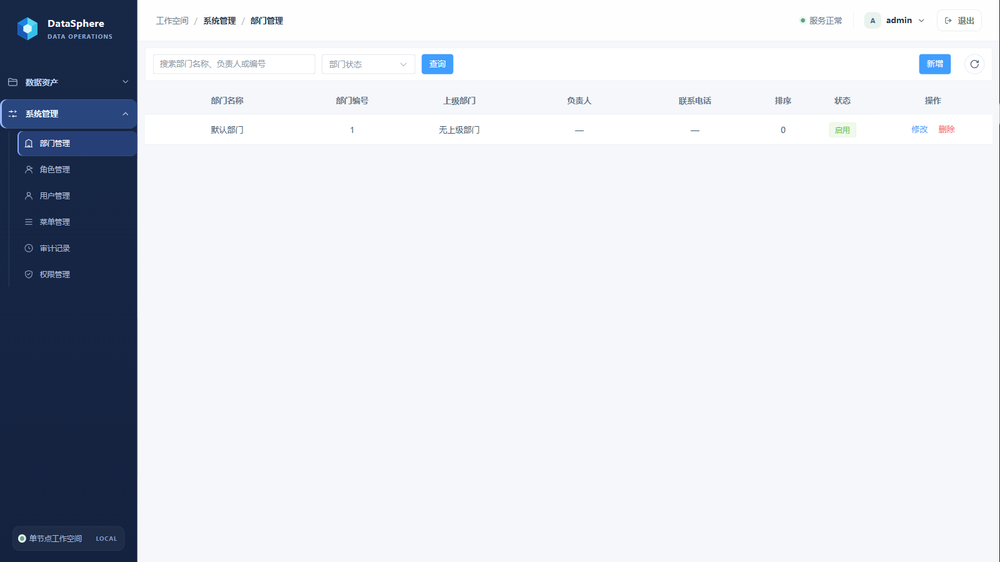
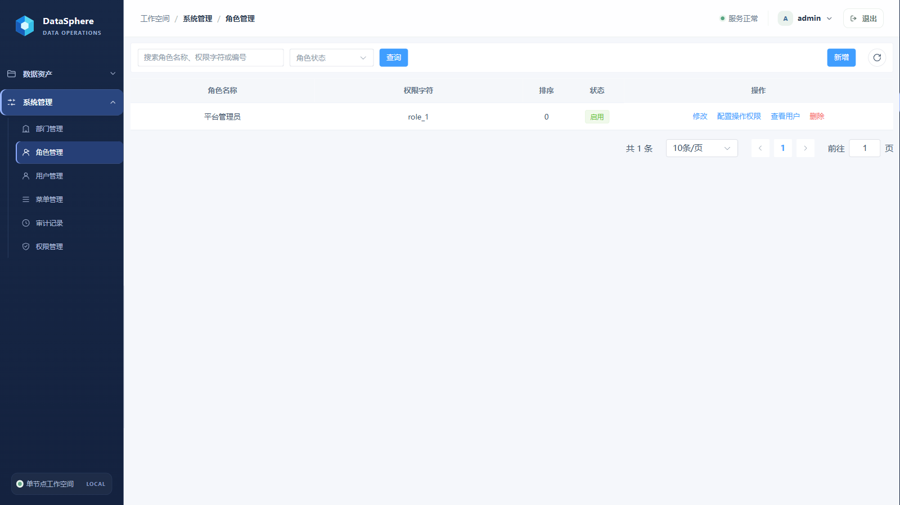
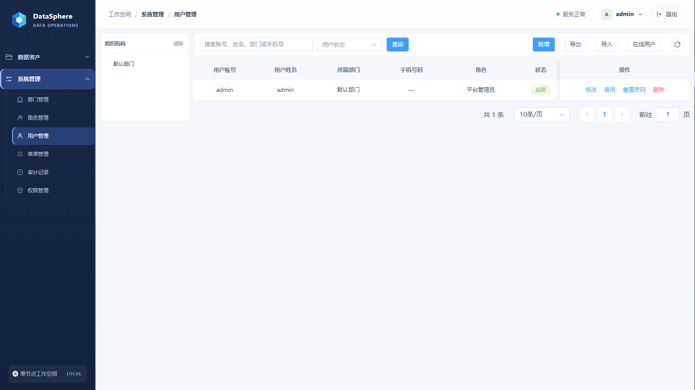
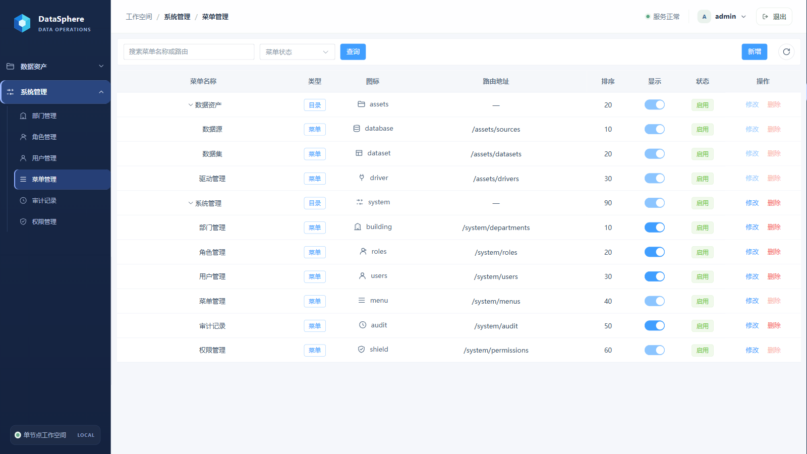
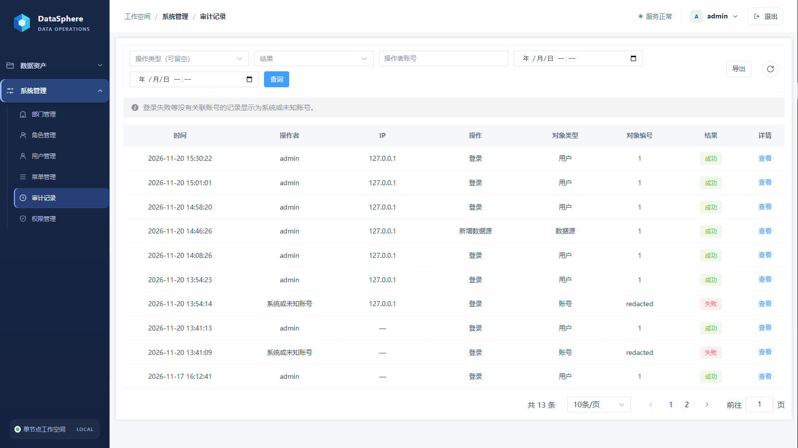
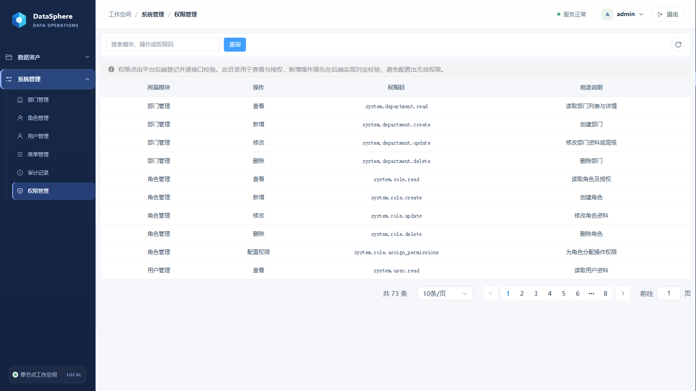

<h1 align="center" style="margin: 30px 0 30px; font-weight: bold;">数据治理平台 v0.1.0</h1>
<h4 align="center">基于 Spring Boot + Apache Camel + Vue 3 的单节点数据治理平台</h4>
<p align="center">
	
	
	
	
	
</p>

> **⚠️ 开发版本，请勿用于生产。** 尚有设计要求未完成，也没有完成真实数据库兼容性及生产环境验证。剩余工作以 [子系统计划](docs/superpowers/plans/2026-11-15-subsystems.md)、[功能进度清单](docs/superpowers/plans/progress-checklist.md) 和 [数据库验证记录](docs/verification/database-matrix.md) 为准。

## 平台简介

数据治理平台是一套面向单个客户企业的单节点数据治理系统，提供统一界面，涵盖组织权限、数据资产、数据处理、数据服务、数据报表和系统管理。首期支持 MySQL、PostgreSQL、Oracle 作为源库和目标库，支持批处理及数据库增量轮询形成的持续同步；Kafka、Flink 留作后续扩展。

* 前端采用 Vue 3、Element Plus，工作流画布基于 Vue Flow，报表图表基于 ECharts。
* 后端采用 Spring Boot 3.5（Java 21）、Spring Security、Apache Camel 4.18 与 Flyway，首期不拆分微服务。
* Apache Camel 作为统一集成与路由层，负责数据库读写、字段映射、过滤和 SQL 加工；SQL 在所选数据库内执行。
* 权限认证使用会话与按需验证码，支持按权限动态加载菜单，数据访问规则可细化到部门和字段。
* 平台元数据保存在 MySQL 元数据库，业务数据保留在配置的业务数据库中；数据源连接凭据加密保存，密钥与数据分开管理。
* 单节点部署不具备节点高可用，进程或主机故障会中断任务；平台元数据和执行记录需持久化并纳入备份恢复。

## 技术栈

| 分类 | 技术 | 说明 |
| :--- | :--- | :--- |
| 前端框架 | Vue 3.5 / Element Plus 2.14 | 统一前端界面 |
| 画布与图表 | Vue Flow 1.48 / ECharts 6 | 工作流编排、报表看板 |
| 前端构建 | Vite 7 | 开发服务器将 `/api` 代理至后端 8080 端口 |
| 后端框架 | Spring Boot 3.5.8（Java 21） | 模块化单体后端 |
| 集成路由 | Apache Camel 4.18 | 数据库读写、字段映射、SQL 加工 |
| 安全 | Spring Security | 会话认证、权限控制、凭据加密 |
| 元数据迁移 | Flyway | 启动时自动执行 MySQL 专用脚本并记录版本 |
| 元数据库 | MySQL 8.0 | 8.0.33 已通过基础迁移验证 |
| 业务源/目标库 | MySQL 5.x / 8.x、PostgreSQL、Oracle 11g / 12c+ | 按“类型+大版本”档案连接，完整兼容性仍待验证 |

## 内置功能

1.  部门管理：配置系统组织机构树，支持部门移动与删除，数据权限按部门划分。
2.  用户管理：用户创建、编辑、启停、密码重置与角色分配，支持用户导入导出。
3.  角色管理：角色维护与功能权限分配，按部门和字段配置数据访问规则。
4.  菜单管理：配置平台导航菜单与图标，按权限动态加载。
5.  数据源管理：数据库连接登记、修改、删除与批量删除，保存前连接测试、表字段发现；按“类型+大版本”档案连接（MySQL 5.x/8.x、PostgreSQL、Oracle 11g/12c+），连接参数仅限档案白名单，Oracle 支持 SID/服务名切换。
6.  驱动管理：内置常用 JDBC 驱动，启动时自动释放注册；管理员可上传驱动 jar，隔离类加载、多版本共存，上传驱动持久保存。
7.  数据集管理：数据集登记、查看、删除及仅新增字段的重新采集，按角色配置行（部门范围）列（字段访问）权限，预览、分析与服务由后端统一执行规则。
8.  数据查询：受权限约束的数据集预览、多条件筛选、分组、聚合和排序。
9.  任务编排：Camel SQL 加工、数据库追加及按目标主键或唯一索引更新插入；不可变任务版本，实例固定版本；有序配置文本、数字、布尔、空值及业务日期参数；任务可独立运行、失败后手动重试。
10. 工作流：DAG 画布拖动连线、顺序及有限并行分支、固定任务版本与节点布局；手动、定时触发，执行记录、有限次数的安全重试和按业务日期补跑，进程重启后中断实例可恢复。
11. 实时同步：基于单调递增水位及主键复合游标的数据库轮询同步，支持启停及停止状态下调整间隔和批次。不能捕获删除和迟到数据，不等同于 CDC。
12. 数据服务：基于授权数据集发布数据 API，调用方令牌鉴权、授权和限流，调用统计。
13. 数据报表：个人报表与看板管理，运行时重新校验数据权限。
14. 审计日志：关键操作事件记录与查询，按操作、操作人、结果、时间筛选，支持导出。
15. 在线用户：当前活跃会话监控，支持强制下线。
16. 登录安全：按需图形验证码（单次使用、两分钟过期），首次登录或密码重置后强制修改密码，个人中心。
17. 资源控制：受控查询、报表及数据服务共用并发、超时与行数上限；批处理任务及工作流节点共用执行并发上限。

## 演示图

以下截图取自本地开发环境（1600×900），展示数据资产与系统管理两组已接入模块；任务编排、数据查询、实时同步、数据服务、数据报表等模块的菜单尚未在演示库中创建，故未列出。

<table>
    <tr>
        <td><p align="center">登录页</p></td>
        <td><p align="center">数据源管理</p></td>
    </tr>
    <tr>
        <td><p align="center">数据集管理</p></td>
        <td><p align="center">驱动管理</p></td>
    </tr>
    <tr>
        <td><p align="center">部门管理</p></td>
        <td><p align="center">角色管理</p></td>
    </tr>
    <tr>
        <td><p align="center">用户管理</p></td>
        <td><p align="center">菜单管理</p></td>
    </tr>
    <tr>
        <td><p align="center">审计记录</p></td>
        <td><p align="center">权限管理</p></td>
    </tr>
</table>

## 快速开始

### 环境要求

- Java 21、Maven
- Node.js（20.19+ 或 22.12+，Vite 7 要求）、npm
- MySQL 元数据库（8.0.33 已通过基础迁移验证）

### 启动后端

```sh
export GOVERNANCE_DB_URL=jdbc:mysql://localhost:3306/governance
export GOVERNANCE_DB_USER=your_database_user
export GOVERNANCE_DB_PASSWORD=your_database_password
export GOVERNANCE_CREDENTIAL_KEY=your_base64_encoded_32_byte_key
cd backend
mvn spring-boot:run
```

后端启动时 Flyway 自动执行元数据库迁移。`GOVERNANCE_CREDENTIAL_KEY` 是 32 字节随机密钥的 Base64 编码，需跨重启保持一致并妥善备份；丢失后无法解密已保存的数据源密码。

### 启动前端

另开终端：

```sh
cd frontend
npm install
npm run dev
```

访问 Vite 开发服务器（默认 `http://localhost:5173`），开发服务器将 `/api` 代理至本机 8080 端口。

### 验证命令

```sh
mvn -f backend/pom.xml test
node --test frontend/tests/*.test.js
npm --prefix frontend run build
```

自动化单元及接口测试主要使用 H2；MySQL 8.0.33 已验证元数据库迁移和基础工作流持久化，业务源/目标数据库的完整兼容性仍待验证。

## 首次管理员初始化

先按上方环境变量配置并启动后端一次，确保数据库迁移完成。仅在受信任的交互终端执行以下命令；数据库必须没有用户，密码通过终端无回显输入，不得放入命令参数。

```sh
cd backend
mvn dependency:build-classpath -Dmdep.outputFile=target/runtime-classpath.txt -DincludeScope=runtime
java -cp "target/classes:$(cat target/runtime-classpath.txt)" com.example.governance.bootstrap.BootstrapCommand
```

初始化使用数据库锁防止并发创建。早期开发数据库中的管理员可能缺少后来新增的权限，需通过现有授权流程补齐。

## 配置说明

| 环境变量 | 默认值 | 说明 |
| :--- | :--- | :--- |
| `GOVERNANCE_DB_URL` | 无（必填） | 元数据库 JDBC 连接地址 |
| `GOVERNANCE_DB_USER` | 无（必填） | 元数据库用户名 |
| `GOVERNANCE_DB_PASSWORD` | 无（必填） | 元数据库密码 |
| `GOVERNANCE_CREDENTIAL_KEY` | 无（必填） | 32 字节随机密钥的 Base64 编码，用于加密数据源凭据，需跨重启保持一致 |
| `GOVERNANCE_DRIVER_DIR` | `./drivers` | 业务数据源驱动目录，内置驱动启动时自动释放注册，上传驱动持久保存，需随部署一起备份 |
| `GOVERNANCE_SESSION_TIMEOUT` | `30m` | 用户会话超时时间 |
| `GOVERNANCE_QUERY_MAX_CONCURRENCY` | `8` | 受控查询、报表及数据服务共用的并发上限，超出时请求立即失败 |
| `GOVERNANCE_QUERY_TIMEOUT_SECONDS` | `30` | 查询超时（秒），由 JDBC 驱动执行，实际取消效果依赖数据库和驱动 |
| `GOVERNANCE_QUERY_MAX_ROWS` | `1000` | 单次查询返回行数上限 |
| `GOVERNANCE_EXECUTION_MAX_CONCURRENT` | `8` | 批处理任务及工作流节点共用的执行并发上限（1–64），不包含持续增量同步；等待执行配额的实例当前可能显示为运行中 |

## 项目结构

```
data-process
├── backend                         -- 后端（Spring Boot + Apache Camel）
│   ├── drivers                     -- 业务数据源驱动目录（运行时）
│   └── src/main
│       ├── java/com/example/governance
│       │   ├── organization        -- 部门、用户、角色、菜单、审计、在线用户
│       │   ├── security            -- 会话认证、验证码、凭据加密
│       │   ├── assets              -- 数据源、数据集、驱动管理
│       │   ├── query               -- 数据预览与聚合分析
│       │   ├── workflow            -- 任务、工作流、调度与执行
│       │   ├── realtime            -- 持续增量同步
│       │   ├── serviceapi          -- 数据服务发布与外部调用
│       │   ├── report              -- 报表与看板
│       │   └── bootstrap           -- 首次管理员初始化
│       └── resources/db/mysql      -- MySQL 专用 Flyway 迁移脚本
├── frontend                        -- 前端（Vue 3 + Element Plus）
│   ├── src                         -- 页面与组件（数据源、查询、任务、画布、报表等）
│   └── tests                       -- 前端单元测试
└── docs                            -- 设计规格、实施计划与验证记录
```

## 已知限制与注意事项

- **未完成能力**：全量覆盖写入、任务级可配置超时与取消，以及设计中其他管理能力仍需实现或完善，详见 [子系统计划](docs/superpowers/plans/2026-11-15-subsystems.md) 与 [功能进度清单](docs/superpowers/plans/progress-checklist.md)。
- **重放风险**：数据库处理和工作流的重试与补跑可能重放数据，使用前必须自行确认写入幂等性和业务日期条件；追加重试可能产生重复。
- **增量同步边界**：轮询同步不能捕获删除和迟到数据，不等同于 CDC。
- **权限快照**：数据权限在查询开始时按一致性快照解析。授权撤销后新查询会使用新规则；已经开始的查询可能继续完成。
- **元数据库迁移**：平台元数据库使用 MySQL 专用 Flyway 脚本（`backend/src/main/resources/db/mysql/`），启动时自动升级并记录版本。原 PostgreSQL 脚本保留在 `db/migration/`，供既有 H2 测试使用；切换已有 PostgreSQL 部署时，不要直接复用其 Flyway 历史表或假设数据会自动转移，需要先备份并单独制定和验证数据迁移方案。
- **部署安全**：部署环境应通过 HTTPS 保护用户会话和数据服务令牌，并限制环境变量及数据库凭据的访问。

## 相关文档

- [平台设计规格](docs/superpowers/specs/2026-11-15-data-governance-platform-design.md)
- [子系统计划](docs/superpowers/plans/2026-11-15-subsystems.md)
- [功能进度清单](docs/superpowers/plans/progress-checklist.md)
- [数据库验证记录](docs/verification/database-matrix.md)