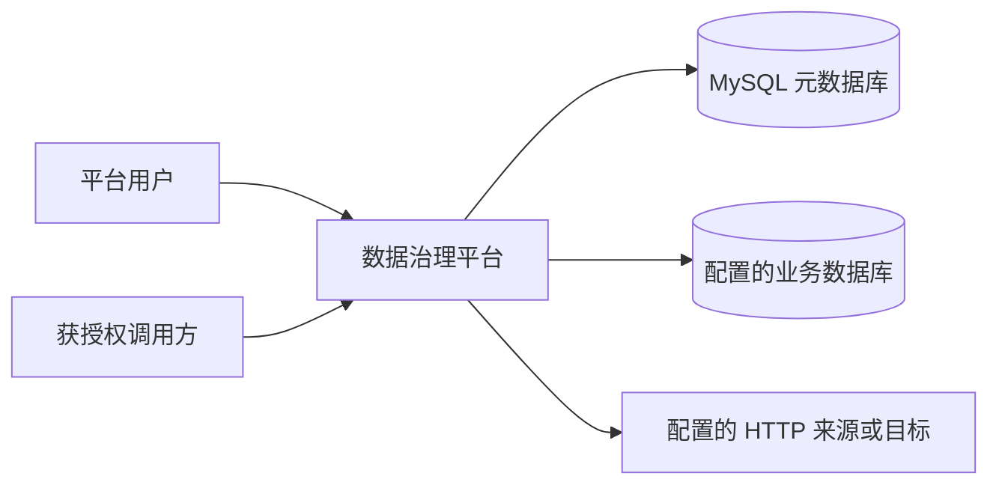

# 数据治理平台 — 系统概述

| 文档属性 | 内容 |
|---|---|
| 文档编号 | DOC-01 |
| 文档版本 | 0.6（草稿） |
| 对应系统版本 | 0.1.0-SNAPSHOT |
| 源码基线 | fb41721778aa17cb7c9b949f9cb3787c9902312d，含未提交工作区更改 |
| 适用环境 | 当前仓库静态分析；实际部署环境另行确认 |
| 文档状态 | 草稿，待审核 |
| 编制日期 | 2026-11-26 |
| 更新日期 | 2026-11-27 |
| 编制 / 审核 / 批准 | 待确认 / 待审核 / 待批准 |

## 修订记录

| 版本 | 日期 | 修订内容 | 影响范围 | 修订人 |
|---|---|---|---|---|
| 0.1 | 2026-11-26 | 根据当前源码快照形成草稿 | 待核对 | 待确认 |
| 0.5 | 2026-11-26 | 按交付模板调整章节结构 | 待核对 | 待确认 |
| 0.6 | 2026-11-27 | 补充系统范围、角色、功能及核心业务场景 | 第 1—8 章 | 待确认 |

## 1. 项目背景与建设目标

### 1.1 项目背景

仓库 README 将项目定位为面向单个客户企业的单节点数据治理系统。客户名称、建设背景、合同范围及验收目标未见可确认材料，须由项目方补充；不由源码推定。

### 1.2 建设目标与系统定位

按现有项目描述，平台集中提供组织权限、数据资产、数据处理、查询、服务与报表工作区，元数据由平台管理，业务数据保留在配置的数据源中。当前版本为开发版，README 明确未完成真实数据库兼容性和生产环境验证，不作为已获生产交付批准的结论。

## 2. 系统范围与边界

| 范围类别 | 内容 | 边界说明 |
|---|---|---|
| 已实现功能 | 会话和权限、资产登记、数据字典、数据对象、主数据记录、处理任务、工作流、查询、报表及数据服务等 | 功能可用性受权限、配置、数据库类型和当前实现约束，逐项见后续文档。 |
| 业务数据库 | 通过配置的数据源读写业务表；主数据管理已登记对象记录。 | 业务源和目标的数据、连接权限及生命周期不由平台元数据库自动替代。 |
| 增量同步 | 按水位或游标进行数据库轮询。 | 不能等同于日志 CDC；删除和迟到数据不在其保证范围。 |
| 未实现 / 不在本次确认范围 | 画布中标记未支持的组件及生产高可用、性能与安全验收。 | 应以注册表和实际环境为准；不能将灰置组件当成已实现。 |

## 3. 用户角色与使用场景

| 角色编号 | 角色名称 | 使用场景 | 实际权限范围 |
|---|---|---|---|
| ROLE-ADMIN | 系统管理职能 | 管理用户、角色、菜单和审计。 | 由实际角色关联的系统管理权限决定；不假定固定角色名称。 |
| ROLE-ASSET | 数据资产管理职能 | 管理数据源、字典、对象及主数据。 | 数据源、目录、对象和主数据权限分别授权；不默认包括所有记录写入。 |
| ROLE-TASK | 数据处理职能 | 设计、发布、运行任务并查看运行记录。 | 按任务读取、修改、发布、执行、重试等权限分别授权。 |
| ROLE-CONSUMER | 数据使用职能 | 查询数据集、运行报表或经授权调用数据服务。 | 管理端用户受会话角色及数据策略限制；外部调用方使用其服务授权。 |

角色名称是按职能归纳的阅读辅助，并非声称数据库中必有同名内置角色。实际用户及角色分配以项目环境为准。

## 4. 系统功能清单

| 功能编号 | 一级模块 | 二级功能 | 功能描述 | 实现及验证状态 |
|---|---|---|---|---|
| FUNC-ASSET-SOURCE | 数据资产 | 数据源与驱动 | 维护连接、测试、发现表字段及管理 JDBC 驱动。 | 源码实现；相关后端默认集测试通过，目标数据库适配待验。 |
| FUNC-DICT | 数据资产 | 数据字典 | 字典目录、条目及导入维护。 | 源码实现；字典相关默认集测试通过。 |
| FUNC-OBJECT | 数据资产 | 数据对象 | 登记与管理表 / 视图，支持建表、字段结构操作及预览。 | 源码实现；当前工作区存在未提交变更。 |
| FUNC-MD-READ | 数据资产 | 主数据查询 | 选择登记对象，动态构建筛选并查询记录。 | 源码实现；完整目标环境和权限组合待验。 |
| FUNC-MD-UPDATE | 数据资产 | 主数据维护 | 按独立权限新增、修改、删除及导入导出记录，查询历史。 | 源码实现；完整链路验收待完成。 |
| FUNC-TASK-PUBLISH | 数据处理 | 任务编排与发布 | 保存草稿、检查 revision、校验定义并冻结发布版本。 | 草稿与发布 H2 自动测试通过。 |
| FUNC-TASK-RUN | 数据处理 | 任务执行与监控 | 手动 / 定时执行版本，查看运行与节点状态、日志、预览，支持停止及有限重试。 | 多项 H2 自动测试通过；真实环境链路待验。 |
| FUNC-WORKFLOW | 数据处理 | 工作流 | 编排任务依赖、工作流调度与执行。 | 源码及自动测试存在；真实场景待验。 |
| FUNC-QUERY | 数据查询 | 预览与分析 | 按数据集权限和行列规则查询。 | 相关默认集测试通过；授权组合待验。 |
| FUNC-SERVICE | 数据服务 | 发布与调用 | 管理服务和调用方授权，数据服务接口验证调用方。 | 源码实现；部署与真实调用链待验。 |
| FUNC-REPORT | 数据应用 | 报表及看板 | 管理及运行报表，运行时检查数据权限。 | 相关默认集测试通过；目标场景待验。 |
| FUNC-SECURITY | 系统管理 | 组织、权限与审计 | 用户、角色、菜单、会话和审计管理。 | 相关默认集测试通过；正式安全验收待完成。 |

## 5. 系统上下文与外部依赖

**图 1 系统上下文图**

| 外部系统 / 依赖 | 用途 | 集成方式 | 适用条件 |
|---|---|---|---|
| MySQL 元数据库 | 保存平台配置、权限、任务和运行记录 | JDBC / Flyway | 后端启动需要有效配置，实际版本和迁移状态须确认。 |
| 业务数据库 | 数据资产采集、查询及任务读写 | JDBC 驱动 | 按数据源类型、驱动和授权配置；完整兼容矩阵待验。 |
| HTTP 数据来源 / 目标 | 编排任务读取或推送 | HTTP / JSON 等节点配置 | 启用对应组件并通过目标地址检查；具体请求依节点配置。 |
| 服务调用方 | 消费平台发布的数据服务 | HTTP / Bearer | 调用方凭证、服务状态及授权有效。 |

## 6. 核心业务场景

### 6.1 数据对象登记与主数据管理

| 项目 | 描述 |
|---|---|
| 参与角色 | 具备对象登记或主数据权限的用户。 |
| 前置条件 | 配置数据源并登记对象；对象和记录操作具备相应授权。 |
| 主要步骤 | 在数据对象中登记表或视图；进入主数据选择对象、设置字段条件并查询；按授权维护记录或导入导出。 |
| 业务结果 | 平台展示符合条件的对象记录；写操作作用于对应业务表并按实现保留操作记录。 |
| 异常场景 | 数据源不可达、表结构变化、主键或数据校验不满足、用户无权限；具体限制以接口和目标数据库为准。 |

### 6.2 任务从编排到执行监控

| 项目 | 描述 |
|---|---|
| 参与角色 | 具备任务创建、修改、发布、执行和读取权限的用户。 |
| 前置条件 | 数据源已配置；任务所用组件可用且对应资源可访问。 |
| 主要步骤 | 创建空白任务，添加并连接组件、配置节点，保存草稿；校验定义并发布版本；手动或定时触发；按运行详情查看状态、节点和日志。 |
| 业务结果 | 运行固定的已发布定义；节点按依赖执行，产生运行记录及可用的日志和预览。 |
| 异常场景 | 草稿冲突、校验失败、节点执行失败、超时或停止；重试和外部写入可能涉及重放，不能假设跨系统自动回滚。 |

任务完整生命周期、Camel 执行分工、监控和异常处理见总体设计与详细设计正文。

### 6.3 受控数据查询与服务调用

| 项目 | 描述 |
|---|---|
| 参与角色 | 拥有数据集访问权限的用户；获授权数据服务调用方。 |
| 前置条件 | 数据集已配置，角色数据策略或调用方服务授权有效。 |
| 主要步骤 | 用户选择数据集进行预览 / 分析，或调用方携带凭证访问已发布服务。 |
| 业务结果 | 查询结果按相应权限和数据范围处理并返回。 |
| 异常场景 | 未授权、数据源不可用或查询受限时返回相应错误；真实环境结果需联调确认。 |

## 7. 术语与缩略语

| 术语 | 含义 | 使用范围 |
|---|---|---|
| 数据对象 | 按数据源及物理对象身份登记的表或视图。 | 数据资产、主数据 |
| 数据集 | 在平台登记并可配置数据访问规则的查询资源。 | 查询、报表与服务 |
| 编排任务 | 由组件节点、连线与配置组成的执行定义。 | 数据处理 |
| 主数据 | 当前项目中管理已登记数据对象记录的功能入口。 | 数据资产 |
| 草稿 revision | 用于控制任务草稿并发保存的修订号。 | 编排任务 |
| 发布版本 | 发布时冻结的任务定义快照。 | 任务运行 |
| Camel | 当前实现中用于部分集成与 SQL 执行的技术组件。 | 数据处理；具体分工见总体和详细设计 |

## 8. 验证范围与待确认事项

| 编号 | 事项 | 当前结论 / 验证状态 | 影响 | 后续确认方式 |
|---|---|---|---|---|
| OVERVIEW-GAP-01 | 客户、建设背景与合同目标 | 缺少已确认材料 | 不能将项目推断当作合同事实 | 项目方提供并确认 |
| OVERVIEW-GAP-02 | 目标环境和兼容性 | 当前项目标注开发版；多数据库和生产环境未完成验收 | 不能据此宣称正式投产 | 按项目验收范围执行隔离测试 |
| OVERVIEW-GAP-03 | 角色和权限分配 | 上述角色按职能归纳，实际分配未知 | 菜单和操作可见性因环境不同而变化 | 核对目标环境角色与授权配置 |
