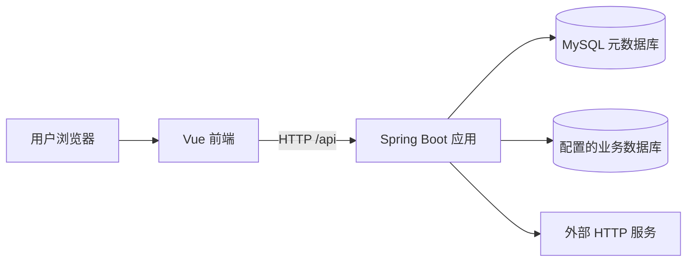
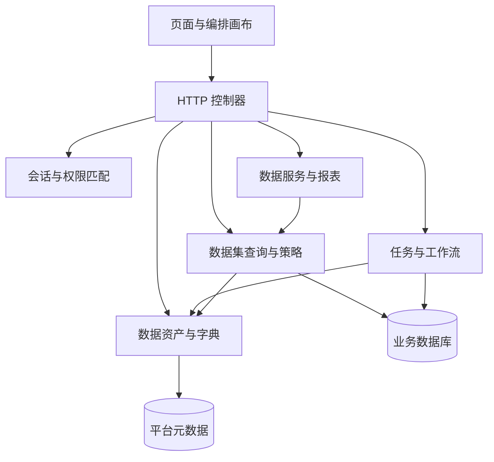
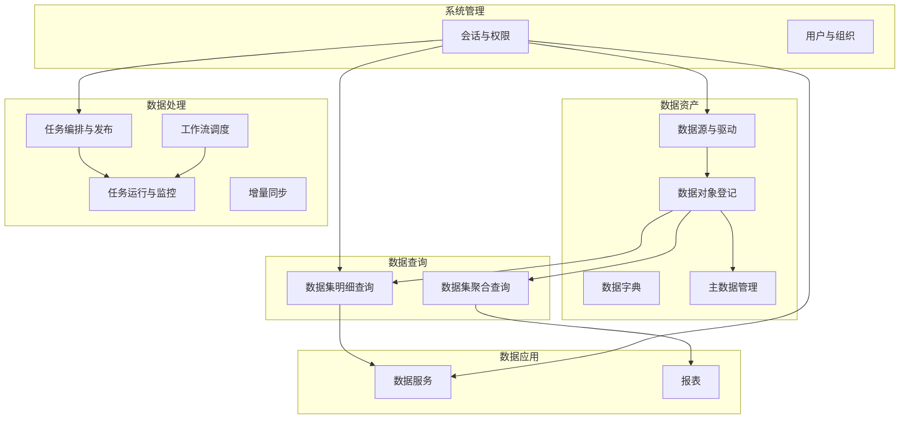
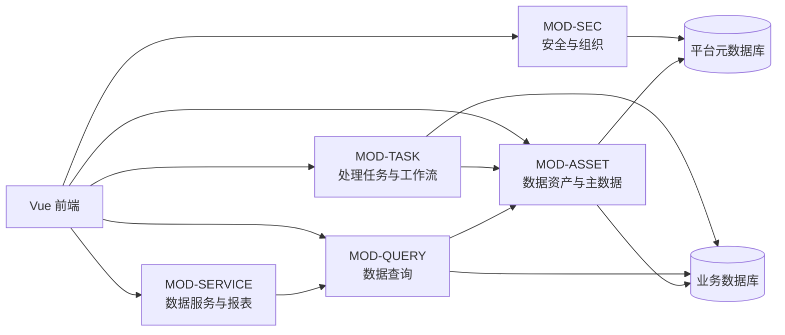
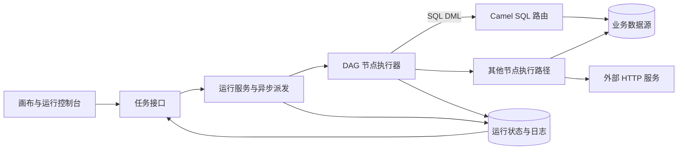
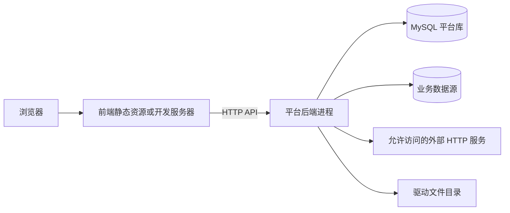

# 数据治理平台 — 总体设计说明书

| 文档属性 | 内容 |
|---|---|
| 文档编号 | DOC-02 |
| 文档版本 | 0.7（草稿） |
| 对应系统版本 | 0.1.0-SNAPSHOT |
| 源码基线 | fb41721778aa17cb7c9b949f9cb3787c9902312d，含未提交工作区更改 |
| 适用环境 | 当前仓库静态分析；实际部署环境另行确认 |
| 文档状态 | 草稿，待审核 |
| 编制日期 | 2026-11-26 |
| 更新日期 | 2026-11-27 |
| 编制 / 审核 / 批准 | 待确认 / 待审核 / 待批准 |

## 修订记录

| 版本 | 日期 | 修订内容 | 影响范围 | 修订人 |
|---|---|---|---|---|
| 0.1 | 2026-11-26 | 根据当前源码快照形成草稿 | 待核对 | 待确认 |
| 0.2 | 2026-11-26 | 扩充分层、数据流与部署视图 | 待核对 | 待确认 |
| 0.3 | 2026-11-26 | 将任务执行与监控纳入总体架构 | 待核对 | 待确认 |
| 0.4 | 2026-11-26 | 区分 Camel SQL 路由与其他节点执行路径 | 待核对 | 待确认 |
| 0.5 | 2026-11-26 | 按交付模板调整章节结构 | 待核对 | 待确认 |
| 0.6 | 2026-11-27 | 补充技术栈、模块边界、横切设计及架构风险 | 第 1—11 章 | 待确认 |
| 0.7 | 2026-11-27 | 补充功能架构图、模块依赖图，修正章节编号，移除模板外子节 | 第 2、4、5、6、9 章 | 待确认 |

## 1. 设计概述

### 1.1 系统目标与边界

系统以模块化单体提供数据治理能力，元数据保存于平台 MySQL，业务数据通过数据源访问。系统为开发版本，生产能力和目标环境未完成验收；业务数据库与平台数据库不构成自动分布式事务。

### 1.2 已确认的设计原则与约束

| 编号 | 原则 / 约束 | 实际表现 | 适用范围 |
|---|---|---|---|
| ARC-C01 | 单节点 | 执行及调度位于同一应用；节点级高可用未实现。 | 当前仓库部署模型 |
| ARC-C02 | 授权分层 | 菜单、功能接口和数据范围分别控制；主数据使用独立权限。 | 管理端和查询场景 |
| ARC-C03 | 任务版本冻结 | 先保存草稿，发布生成不可变版本，运行引用具体版本。 | 处理任务 |
| ARC-C04 | 外部写入边界 | 外部写入可能在平台运行记录之前或失败后已提交。 | 任务及业务数据源 |

## 2. 总体架构

### 2.1 系统上下文

当前仓库表现为模块化单体：Spring Boot 3.5.8、Java 21、Spring Security、JDBC、Flyway、Apache Camel 4.18.5；前端 Vue 3.5.30、Element Plus 2.14.8、Vite 7.3.1。实际部署拓扑与外部服务清单待现场核对。

### 2.2 逻辑技术架构

**图 2 系统总体技术架构图**

| 层级 / 组件 | 职责 | 实际依赖 | 通信方式 |
|---|---|---|---|
| 展示层 | 页面、用户交互与画布 | Vue、Element Plus、Vue Flow | 同源 HTTP API |
| API 与安全层 | 请求处理、会话及权限检查 | Spring Web、Spring Security | HTTP、应用内调用 |
| 领域服务层 | 资产、查询、主数据及任务业务 | 平台存储及执行器 | 进程内方法调用 |
| 数据与集成层 | 元数据读写、外部数据库和 HTTP 交互 | JDBC、Camel、Flyway、外部资源 | JDBC、HTTP；任务按组件执行 |

### 2.3 业务与功能架构

功能范围及边界见系统概述，模块依赖见第 4 章。

### 2.4 应用与数据架构

前端根据服务端导航切换模块；控制器调用领域服务并访问平台元数据库、业务数据源或外部 HTTP。主数据直接通过登记对象操作业务数据，数据集查询另行应用授权与行列策略。

## 3. 技术栈与技术选型

| 层级 | 技术 / 组件 | 声明版本 | 实际确认版本 | 用途 |
|---|---|---|---|---|
| 前端 | Vue | 3.5.30 | `frontend/package.json` 声明；部署实际版本待确认 | 页面及状态 |
| 前端 | Element Plus | 2.14.8 | 同上 | 组件库 |
| 前端 | Vite | 7.3.1 | 本轮前端构建输出 7.3.1 | 构建及开发代理 |
| 后端 | Java | 21 | 本轮测试使用 Java 21.0.12.1 | 后端运行 |
| 后端 | Spring Boot | 3.5.8 | POM 声明；目标部署待确认 | HTTP、持久化与安全基础 |
| 集成执行 | Apache Camel | 4.18.5 | POM 声明；目标部署待确认 | 部分 SQL 集成路径 |
| 元数据库迁移 | Flyway / MySQL | 由依赖管理及环境决定 | 本地元数据快照来自 MySQL 8.4.11；目标环境待确认 | 平台元数据版本迁移 |

以上记录现有技术，不推断历史选型原因。

## 4. 模块划分与依赖关系

| 模块编号 | 模块名称 | 核心职责 | 上游 / 下游依赖 | 关联详细设计 |
|---|---|---|---|---|
| MOD-ASSET | 数据资产与主数据 | 管理数据源、对象、字典及对象记录。 | 前端；平台元数据库及业务数据库 | 第 03 册主数据章节 |
| MOD-QUERY | 数据查询 | 数据集访问和行列策略。 | 数据资产；业务数据库 | 第 03 册查询章节 |
| MOD-TASK | 处理任务与工作流 | 草稿、发布、调度、执行及监控。 | 数据源、执行器、Camel / JDBC / HTTP、平台库 | 第 03 册任务执行与监控章节 |
| MOD-SERVICE | 数据服务与报表 | 已授权数据访问及展示。 | 数据集查询与权限 | 第 03 册相关模块章节 |
| MOD-SEC | 安全与组织 | 账号、会话、权限、组织及审计。 | 平台元数据库 | 第 07 册 |

前端经会话 API 获取权限与导航，再渲染对应模块；其展示控制不替代后端授权。

## 5. 核心运行流程

### 5.1 任务执行与监控

处理任务由前端编排画布、任务接口、运行服务、DAG 编排执行器、Camel 路由、业务数据源及运行监控共同组成。用户发布版本后触发运行；运行服务在平台库记录实例并在事务提交后异步派发。编排执行器根据节点依赖调度，SQL 写操作等具体执行能力通过 Camel 路由和 JDBC 与业务数据库交互。运行、节点状态和日志写入平台库，前端通过运行详情与日志接口轮询展示。

任务定义采用草稿和不可变发布版本；DATA 边传递有界行批，CONTROL 边表达依赖。节点重试可能重放已提交数据；平台库与业务数据库不构成全局原子事务。监控日志和节点状态部分采用尽力写入，数据缺失时需结合业务目标核对。完整步骤、异常处理和接口见详细设计第 3 章“任务执行与监控设计”。图为静态分析，未渲染或执行验证。

## 6. 数据与外部系统集成

| 集成编号 | 数据来源 / 目的 | 方向 | 协议 | 触发机制 | 异常处理 |
|---|---|---|---|---|---|
| INT-META | 平台 MySQL 元数据库 | 应用读写 | JDBC | API、调度、运行记录 | 依调用链和事务处理；不可用时健康检查返回 DOWN |
| INT-DB | 配置业务数据库 | 读 / 写 | JDBC | 查询、主数据或任务执行 | 依场景返回错误并记录；外部已提交数据不保证回滚 |
| INT-HTTP-SOURCE | HTTP 来源 | 平台读取 | HTTP | 编排节点及试运行 | 目标检查；非 2xx 抛错；请求超时依配置 |
| INT-HTTP-SINK | HTTP 目标 | 平台推送 | HTTP | 对应编排节点执行 | 依节点配置和执行器记录失败，重试需评估重复影响 |

## 7. 横切设计

| 设计主题 | 实际实现 | 适用范围 | 限制 |
|---|---|---|---|
| 认证与授权 | 会话和接口权限；服务调用方 Bearer；查询数据集策略；主数据独立授权。 | 管理端、数据查询及数据服务 | 权限不等同于目标数据库本身的访问控制。 |
| 事务与一致性 | 草稿发布等使用应用事务；外部数据库由各执行器操作。 | 具体服务事务边界 | 平台库与业务库不保证全局原子性。 |
| 并发、幂等与重试 | 草稿 revision 检查；执行限额和节点 / 运行重试。 | 编排任务 | 写入重试可重放，不能一概承诺恰好一次。 |
| 缓存、消息及异步处理 | 运行事务提交后异步派发，节点中间数据使用有界内存。 | 任务运行 | 不代表已提供持久化消息队列或无限数据处理能力。 |
| 日志、审计与监控 | 运行和节点状态、日志及关键审计事件入库。 | 已接入的任务和操作 | 部分运行监控尽力写入；不保证所有事件均已覆盖。 |
| 扩展与兼容性 | 数据库驱动、组件注册表按配置选择能力。 | 数据源及编排 | 未支持组件禁用，真实数据库兼容需逐项验证。 |

## 8. 部署视图

### 部署与限制

开发配置由 Vite 把 `/api` 代理至后端 8080。单节点不具备节点高可用；历史架构决策原因未确认。Mermaid 图未渲染验证。

### 部署视图与依赖

图表示代码所需的逻辑依赖，不表示实际生产机器、容器数量或网络边界；这些信息需要部署资料确认。

## 9. 架构决策与质量属性

| 决策编号 | 已确认决策 | 依据 | 影响 / 权衡 |
|---|---|---|---|
| ADR-01 | 单节点模块化单体 | README 部署说明及当前代码组织 | 部署相对集中；没有节点级高可用。 |
| ADR-02 | 草稿和发布版本分离 | `OrchDraftStore`、任务版本实现 | 可在发布后继续修改草稿；需处理修订冲突。 |
| ADR-03 | 节点间有限内存数据交接 | 编排执行器及仓库架构决策 | 处理受行数和资源上限约束。 |

| 质量属性 | 已有机制 | 已验证指标 | 局限 |
|---|---|---|---|
| 功能正确性 | 后端与前端自动化测试 | 2026-11-27 后端默认集 333 通过、10 跳过；前端 71 通过 | 不代表目标环境验收通过。 |
| 安全 | 会话、授权、凭据加密、登录保护 | 部分安全自动测试通过 | 尚无正式渗透测试或生产配置验证。 |
| 可恢复性 | 任务状态与历史记录 | 仓库包含相关自动测试 | 未完成目标环境备份恢复演练。 |
| 性能 | 查询及执行存在约束参数 | 未进行目标负载验证 | 不提供吞吐、容量或时延承诺。 |

## 10. 已知架构风险与技术债务

| 编号 | 实际问题 | 影响 | 当前处理情况 |
|---|---|---|---|
| ARC-R01 | 单节点，无节点级高可用 | 主机或进程故障可中断服务及任务 | 项目注明限制；恢复方案需现场验证 |
| ARC-R02 | 跨平台库和业务库无全局事务 | 失败与重试可能导致已提交外部写入重放 | 需结合写入方式和业务幂等性核对 |
| ARC-R03 | 轮询同步无法捕获删除或迟到数据 | 不能替代完整 CDC | 明确适用范围 |
| ARC-R04 | 中间结果使用有界内存 | 受行数和资源限制 | 按执行器配置限制；容量待测试 |
| ARC-R05 | 部分组件未实现、灰置 | 设计画布可见不代表可执行 | 按注册表状态限制使用 |

## 11. 验证范围与待确认事项

| 编号 | 事项 | 当前结论 / 验证状态 | 影响 | 后续确认方式 |
|---|---|---|---|---|
| ARC-GAP-01 | 部署及非功能指标 | 实际部署和容量未确认 | 不可推断高可用或吞吐承诺 | 在目标环境测试并审核 |
| ARC-GAP-02 | 外部集成与兼容 | 静态源码核对，真实数据源矩阵未完成 | 多数据库行为可能不同 | 隔离环境执行兼容验证 |
| ARC-GAP-03 | 图表与跨文档追溯 | 图表未完成统一渲染检查 | 影响文档阅读和一致性 | 渲染并逐项复核 |

