# 数据治理平台 — 详细设计说明书

| 文档属性 | 内容 |
|---|---|
| 文档编号 | DOC-03 |
| 文档版本 | 0.8（草稿） |
| 对应系统版本 | 0.1.0-SNAPSHOT |
| 源码基线 | fb41721778aa17cb7c9b949f9cb3787c9902312d，含未提交工作区更改 |
| 适用环境 | 当前仓库静态分析；实际部署环境另行确认 |
| 文档状态 | 草稿，待审核 |
| 编制日期 | 2026-11-26 |
| 更新日期 | 2026-11-27 |
| 编制 / 审核 / 批准 | 待确认 / 待审核 / 待批准 |

## 修订记录

| 版本 | 日期 | 修订内容 | 影响范围 | 修订人 |
|---|---|---|---|---|
| 0.1 | 2026-11-26 | 根据当前源码快照形成草稿 | 待核对 | 待确认 |
| 0.2 | 2026-11-26 | 扩充模块流程与设计约束 | 待核对 | 待确认 |
| 0.3 | 2026-11-26 | 将任务执行与监控整合为核心模块详细设计 | 待核对 | 待确认 |
| 0.4 | 2026-11-26 | 补充试运行边界与两层重试计数 | 待核对 | 待确认 |
| 0.5 | 2026-11-26 | 按交付模板调整章节结构 | 待核对 | 待确认 |
| 0.6 | 2026-11-27 | 补充功能清单、公共处理及后台任务，并更新验证结果 | 第 1、2、4—6 章 | 待确认 |
| 0.7 | 2026-11-27 | 重排核心功能结构，补充对象登记及主数据新增设计和任务运行图 | 相关章节 | 待确认 |
| 0.8 | 2026-11-27 | 补充数据源、查询、服务、工作流补跑、增量同步及字典和主数据设计 | 相关章节 | 待确认 |

## 1. 设计范围与组织方式

本文基于当前源码及未提交工作区分析数据资产、主数据、处理任务、查询、安全与应用模块。功能编号与系统概述对应；接口契约见第 05 册，数据结构见第 04 册。核心任务从草稿发布到执行监控的调用链保留在本册正文。当前仅部分功能按模板逐项展开，不能将概要段落视为全量详细设计。

## 2. 模块及功能清单

| 模块编号 | 模块名称 | 功能编号 | 功能名称 | 实现状态 |
|---|---|---|---|---|
| MOD-ASSET | 数据资产 | FUNC-ASSET-SOURCE | 数据源与驱动 | 源码实现；详细结构待补全 |
| MOD-ASSET | 数据资产 | FUNC-ASSET-SOURCE-CREATE | 数据源连接登记 | 已展开功能设计；目标环境连接验证待补 |
| MOD-ASSET | 数据资产 | FUNC-DICT | 数据字典 | 源码实现；详细结构待补全 |
| MOD-ASSET | 数据资产 | FUNC-DICT-ENTRY | 数据字典条目维护 | 已展开功能设计；测试映射待补 |
| MOD-ASSET | 数据资产 | FUNC-DICT-IMPORT | 数据字典批量导入 | 已展开功能设计；目标环境验证待补 |
| MOD-ASSET | 数据资产 | FUNC-OBJECT | 数据对象 | 源码实现，工作区含未提交更改；详细结构待补全 |
| MOD-ASSET | 数据资产 | FUNC-OBJECT-REGISTER | 物理对象批量登记 | 已展开功能设计；测试与目标环境验证待映射 |
| MOD-ASSET | 数据资产 | FUNC-OBJECT-SCHEMA | 数据对象结构预览与发布 | 已展开状态和跨库边界；真实数据库 DDL 待验 |
| MOD-ASSET | 主数据 | FUNC-MD-CREATE | 主数据记录新增 | 已展开功能设计；专用自动测试及目标环境验证待补 |
| MOD-ASSET | 主数据 | FUNC-MD-READ | 主数据记录查询 | 已有功能说明，规则与验证仍需逐项完善 |
| MOD-ASSET | 主数据 | FUNC-MD-UPDATE | 主数据记录修改 | 已有功能说明，规则与验证仍需逐项完善 |
| MOD-ASSET | 主数据 | FUNC-MD-DELETE | 主数据记录删除 | 已展开功能设计；专用测试及目标环境验证待补 |
| MOD-TASK | 数据处理 | FUNC-TASK-PUBLISH | 草稿校验与发布 | 已展开核心流程；H2 自动测试部分覆盖 |
| MOD-TASK | 数据处理 | FUNC-TASK-RUN | 任务运行与监控 | 已展开端到端流程；目标环境待验证 |
| MOD-TASK | 工作流调度 | FUNC-WORKFLOW-BACKFILL | 工作流按日期补跑 | 已展开创建与派发边界；任务类型兼容性待验证 |
| MOD-TASK | 数据处理 | FUNC-REALTIME-POLL | 增量同步轮询 | 已展开游标、目标提交与平台状态边界；目标环境待验 |
| MOD-QUERY | 数据查询 | FUNC-QUERY | 数据集策略查询 | 源码实现；详细结构待补全 |
| MOD-QUERY | 数据查询 | FUNC-QUERY-PREVIEW | 数据集明细查询 | 已展开授权范围和字段脱敏设计；目标环境待验 |
| MOD-QUERY | 数据查询 | FUNC-QUERY-ANALYSIS | 数据集分组聚合查询 | 已展开参数与明文权限规则；目标环境待验 |
| MOD-SERVICE | 数据应用 | FUNC-SERVICE / FUNC-REPORT | 数据服务与报表 | 源码实现；详细结构待补全 |
| MOD-SERVICE | 数据应用 | FUNC-SERVICE-CALL | 数据服务外部调用 | 已展开令牌、授权、限流和调用记录；目标环境待验 |
| MOD-SERVICE | 数据应用 | FUNC-REPORT-RUN | 报表执行 | 已展开运行时重新授权与查询流程；目标环境待验 |
| MOD-SEC | 系统管理 | FUNC-SECURITY-SESSION | 会话登录与权限刷新 | 已展开认证、防护和会话失效；目标环境待验 |
| MOD-SEC | 系统管理 | FUNC-SECURITY | 用户、角色与审计 | 源码实现；详细结构待补全 |

## 3. 数据资产与数据处理模块详细设计

### 3.1 模块概述

| 项目 | 内容 |
|---|---|
| 模块编号 | 数据资产、数据处理；完整模块清单见第 2 章。 |
| 模块职责 | 管理数据对象和主数据记录，配置和执行处理任务并查看运行结果。 |
| 业务边界 | 主数据操作作用于已登记对象关联的业务库；任务执行通过配置的数据源及组件访问外部系统。 |
| 依赖模块 | 身份与权限、数据源、目录、审计及运行记录。 |
| 关联页面 | 数据对象、主数据、处理任务及任务编排画布。 |


### 3.2 主数据记录查询（FUNC-MD-READ）

#### 3.2.1 功能说明

| 项目 | 内容 |
|---|---|
| 功能描述 | 主数据记录查询 |
| 触发条件 | 获授权用户从页面或 API 发起 |
| 前置条件 | 用户会话有效并具有相应权限，资源存在 |
| 执行角色及权限 | `datasource.master_data.read` |
| 输入 | 对象编号、分页和筛选条件 |
| 输出 | 字段元数据与记录页 |
| 后置条件 | 返回记录页与总数；不修改目标业务表。 |

#### 3.2.2 输入与输出规则

| 参数 / 数据项 | 类型 | 必填 | 校验 / 默认值 | 含义 |
|---|---|---|---|---|
| objectId | long | 是 | 已登记对象 | 路径中的对象编号 |
| page | integer | 是 | 1–10000，偏移不超过 100000 | 页码 |
| size | integer | 是 | 1–100 | 每页数量 |
| filters | array | 否 | 最多 30 项；字段来自对象元数据，操作符限允许集合 | 筛选条件 |
| rows / total / page / size | array / long / integer | 查询成功返回 | rows 的列随目标对象变化 | 当前页和总数 |

#### 3.2.3 业务处理流程

权限链校验后，服务检查分页并读取对象身份及字段元数据，依据字段和操作符构造查询，使用参数绑定执行 COUNT 和记录查询；存在主键时按主键排序后返回请求页。

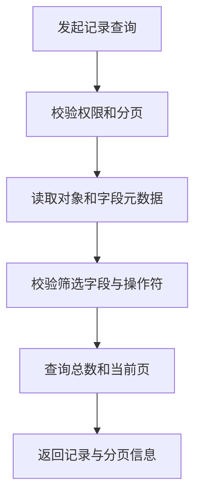


| 步骤 | 执行主体 | 处理动作 | 条件 / 分支 | 输出或副作用 |
|---|---|---|---|---|
| 1 | 权限链和控制器 | 校验会话及主数据读取权限 | 未授权 | 安全链拒绝 |
| 2 | 记录服务 | 校验分页及筛选字段、操作符 | 无效参数或偏移过大 | 返回错误 |
| 3 | 数据源提供器 | 获取只读连接、绑定参数，查询总数及记录 | 源库不可达或 SQL 失败 | 返回错误 |
| 4 | 记录服务 | 生成 rows、total、page、size | 查询成功 | 返回数据，不更新业务表 |

#### 3.2.4 业务规则

| 规则编号 | 触发条件 | 判断逻辑 | 处理结果 |
|---|---|---|---|
| FUNC-MD-READ-01 | 用户发起操作 | 字段必须来自物理元数据；操作符来自固定集合；分页大小 1–100。 | 满足条件进入实际处理，否则拒绝或返回错误。 |

#### 3.2.5 模块交互与时序

由控制器接收请求并委托对应服务，服务访问平台数据或目标数据源。详细调用依据为 MasterDataController.query、MasterDataRecordService.query。

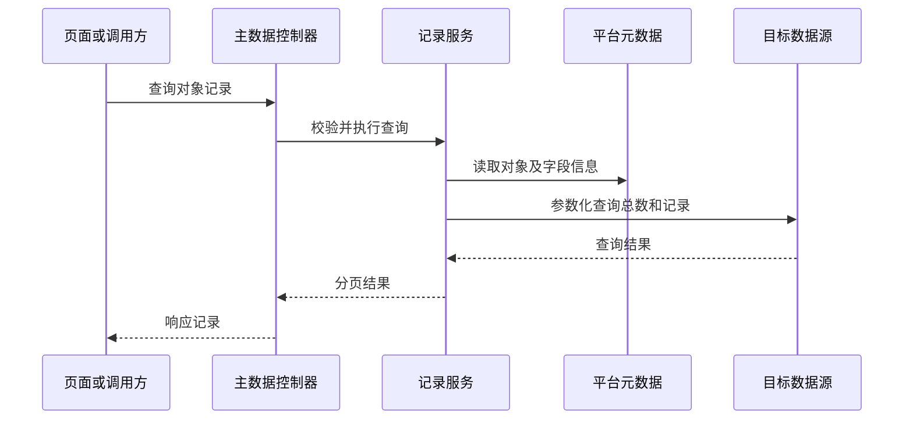


#### 3.2.6 状态及流转

查询本身不创建或推进持久化业务状态；对象与数据库访问状态依实际数据源。

| 当前状态 | 触发事件 | 转移条件 | 目标状态 | 副作用 |
|---|---|---|---|---|
| 不适用 | 执行查询 | 本操作不改变持久化业务状态 | 不适用 | 返回查询结果或错误。 |

此查询没有持久化状态机，状态流转图不适用。


#### 3.2.7 数据访问与一致性

| 设计项 | 实际实现 |
|---|---|
| 读取 / 写入表 | data_objects、data_object_fields；外部业务表 |
| 事务边界与传播 | 数据源连接或查询失败时返回错误；记录仍存在于业务库。 |
| 并发控制 | 查询连接设为只读；本函数未声明跨平台库及业务库的一致性事务。 |
| 幂等机制 | 查询不写业务表，但并发数据变化可能使两次结果不同。 |
| 数据删除与恢复 | 本功能不删除数据；外部业务表由对应业务系统管理。 |

#### 3.2.8 异常与边界场景

| 异常场景 | 实际触发条件 | 处理逻辑 | 错误码 / 提示 | 数据影响 |
|---|---|---|---|---|
| 请求或状态不满足约束 | 字段必须来自物理元数据；操作符来自固定集合；分页大小 1–100。 | 拒绝处理或返回错误 | 按接口约定 | 数据源连接或查询失败时返回错误；记录仍存在于业务库。 |

#### 3.2.9 关联设计与验证

| 关联类型 | 编号 / 名称 | 说明 |
|---|---|---|
| 接口 | API-MD-03，`POST /api/master-data/objects/{id}/query` | 详细字段与操作符见接口设计第 4.6 节。 |
| 数据表 | data_objects、data_object_fields；外部业务表 | 平台元数据与外部业务库分别核对。 |
| 页面 | PAGE-MD | 主数据动态筛选和记录列表。 |
| 测试 | 待逐项对应 | 后端默认测试集已运行；按 masterdata / master.data 搜索测试源码未发现专用测试，不能据此认定该功能已验证。 |

实现依据为 MasterDataController.query、MasterDataRecordService.query。本功能的运行验证覆盖尚待逐项对应。

### 3.3 主数据记录修改（FUNC-MD-UPDATE）

#### 3.3.1 功能说明

| 项目 | 内容 |
|---|---|
| 功能描述 | 主数据记录修改 |
| 触发条件 | 获授权用户从页面或 API 发起 |
| 前置条件 | 用户会话有效并具有相应权限，资源存在 |
| 执行角色及权限 | `datasource.master_data.update` |
| 输入 | 完整主键与待修改字段 |
| 输出 | 影响行数、主键及修改前后快照 |
| 后置条件 | 成功时目标记录已提交，并尝试将平台历史标为成功及记录审计；历史与目标库不构成全局事务。 |

#### 3.3.2 输入与输出规则

| 参数 / 数据项 | 类型 | 必填 | 校验 / 默认值 | 含义 |
|---|---|---|---|---|
| objectId | long | 是 | 已登记对象 | 目标对象编号 |
| key | object | 是 | 包含完整主键，不得包含未知键 | 定位记录 |
| values | object | 是 | 非空，字段必须存在且主键、生成列不可修改 | 变更值 |
| affected | long | 成功时返回 | 必须恰为 1 | 影响行数 |
| key / before / after | object | 成功时返回 | 字段结构依目标表 | 主键及修改前后快照 |

#### 3.3.3 业务处理流程

控制器先在平台库准备历史记录；服务检查对象可写性、完整主键和变更列，然后在目标库事务中锁定并读取记录、执行参数化更新、读取新值并提交；控制器再更新历史状态及审计。

| 步骤 | 执行主体 | 处理动作 | 条件 / 分支 | 输出或副作用 |
|---|---|---|---|---|
| 1 | 控制器 / 历史服务 | 创建 PENDING 历史 | 创建历史失败 | 不执行目标记录变更 |
| 2 | 记录服务 | 检查可写性、主键和变更列 | 视图、结构不一致或输入非法 | 拒绝并尝试标记失败 |
| 3 | 目标数据库 | 锁定并读取记录，按主键更新 | 记录缺失或影响行数不为 1 | 目标事务回滚 |
| 4 | 记录服务 / 历史服务 | 读取变更后记录、提交业务库并更新历史 | 历史更新失败 | 可能已提交，提示核对实际数据与历史 |

#### 3.3.4 业务规则

| 规则编号 | 触发条件 | 判断逻辑 | 处理结果 |
|---|---|---|---|
| FUNC-MD-UPDATE-01 | 用户发起操作 | 对象为表且登记快照一致，主键完整；主键与生成列不可修改；按完整主键定位。 | 满足条件进入实际处理，否则拒绝或返回错误。 |

#### 3.3.5 模块交互与时序

由控制器接收请求并委托对应服务，服务访问平台数据或目标数据源。详细调用依据为 MasterDataController.update、MasterDataRecordService.update。

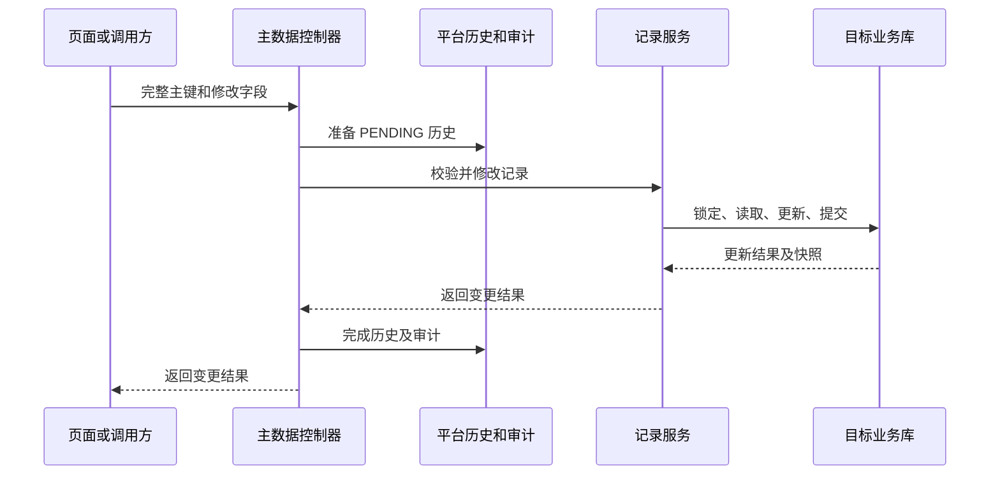


#### 3.3.6 状态及流转

| 当前状态 | 触发事件 | 转移条件 | 目标状态 | 副作用 |
|---|---|---|---|---|
| 未创建历史 | 准备修改 | 成功创建平台历史 | PENDING | 写历史记录 |
| PENDING | 目标变更成功且历史写入成功 | 业务库已提交 | SUCCESS | 写变更前后快照 |
| PENDING | 目标变更失败 | 平台失败状态更新成功 | FAILURE | 记录失败原因 |
| PENDING | 目标已提交但后续历史写入异常 | 无法确认历史结果 | 待核对 | 不能假设目标库回滚 |

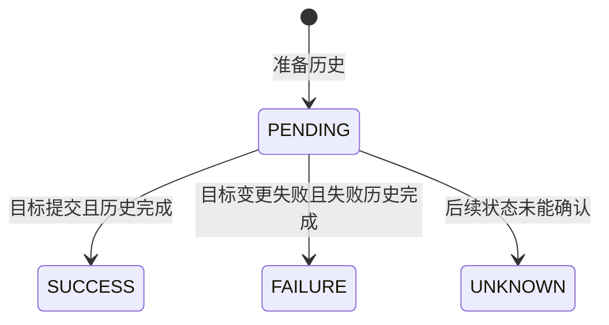

图中 UNKNOWN 表示需要人工核对的文档说明，并非声明数据库持久化的枚举值。


#### 3.3.7 数据访问与一致性

| 设计项 | 实际实现 |
|---|---|
| 读取 / 写入表 | master_data_history；外部业务表 |
| 事务边界与传播 | 目标库变更与平台历史分属独立事务。目标库提交后历史记录异常时需要核对实际记录。 |
| 并发控制 | 目标库事务按完整主键 SELECT FOR UPDATE，更新后检查影响行数为 1；实际锁语义取决于数据库。 |
| 幂等机制 | 不使用通用请求去重；结果不确定时应核对目标数据和历史后再操作。 |
| 数据删除与恢复 | 按对应资源操作实现，异常恢复须核对实际状态。 |

#### 3.3.8 异常与边界场景

| 异常场景 | 实际触发条件 | 处理逻辑 | 错误码 / 提示 | 数据影响 |
|---|---|---|---|---|
| 对象不可修改 | 对象为视图、字段快照过期或主键不可确认 | 拒绝操作并尝试记录失败 | 接口返回对象不可写原因 | 不执行目标记录更新。 |
| 主键或字段无效 | 主键不完整、包含未知字段或试图修改主键及生成列 | 参数校验失败 | 接口返回对应中文错误 | 不执行目标记录更新。 |
| 记录已删除或发生变化 | 锁定查询无记录，或更新影响行数不为 1 | 回滚目标库事务并记录失败 | 提示记录不存在或已变化 | 不应假定其他并发操作已撤销。 |
| 历史或审计完成失败 | 目标库事务已提交后更新平台记录异常 | 抛出异常并尝试记录失败审计 | 提示记录已提交但历史状态未确认 | 目标记录可能已改变，重试前核对。 |

#### 3.3.9 关联设计与验证

| 关联类型 | 编号 / 名称 | 说明 |
|---|---|---|
| 接口 | API-MD-05，`PUT /api/master-data/objects/{id}/records` | 见接口设计第 4.8 节。 |
| 数据表 | master_data_history；外部业务表 | 平台元数据与外部业务库分别核对。 |
| 页面 | PAGE-MD | 主数据记录编辑。 |
| 测试 | 待逐项对应 | 后端默认测试集已运行；按 masterdata / master.data 搜索测试源码未发现专用测试，不能据此认定该功能已验证。 |

实现依据为 MasterDataController.update、MasterDataRecordService.update。本功能的运行验证覆盖尚待逐项对应。

### 3.4 任务发布（FUNC-TASK-PUBLISH）

#### 3.4.1 功能说明

| 项目 | 内容 |
|---|---|
| 功能描述 | 任务发布 |
| 触发条件 | 获授权用户从页面或 API 发起 |
| 前置条件 | 用户会话有效并具有相应权限，资源存在 |
| 执行角色及权限 | `workflow.task.publish` |
| 输入 | 任务编号、expectedRevision、comment |
| 输出 | 已发布版本号 |
| 后置条件 | 发布成功后生成版本快照并返回版本号；草稿修订冲突或校验失败不生成版本。 |

#### 3.4.2 输入与输出规则

| 参数 / 数据项 | 类型 | 必填 | 校验 / 默认值 | 含义 |
|---|---|---|---|---|
| 任务编号 id | long | 是 | 对应任务和草稿须存在 | 目标任务 |
| expectedRevision | long | 是 | 必须等于持锁时的草稿 revision | 防止发布过期草稿 |
| comment | string | 否 | 由存储层处理 | 发布说明 |
| version | integer | 成功时返回 | 由版本存储生成 | 发布版本号 |

#### 3.4.3 业务处理流程

读取草稿并解析定义；校验节点、连线和数据源，锁定所引用的数据源后进入发布过程。发布过程锁定任务及草稿行，复核 revision，写入不可变版本并记录审计。控制器事务覆盖该请求；业务数据库不参与发布。

| 步骤 | 执行主体 | 处理动作 | 条件 / 分支 | 输出或副作用 |
|---|---|---|---|---|
| 1 | TaskController | 读取并解析草稿 | 草稿缺失或解析失败 | 返回 404 或 500 |
| 2 | 校验与数据源服务 | 校验定义并锁定引用数据源 | 校验失败或数据源不存在 | 不发布，返回 422 或 400 |
| 3 | OrchDraftStore | 锁任务与草稿并比较 revision | 不一致 | 返回 409 及 currentRevision |
| 4 | 版本存储和审计 | 写入版本及发布审计 | 校验成功 | 返回 version |

#### 3.4.4 业务规则

| 规则编号 | 触发条件 | 判断逻辑 | 处理结果 |
|---|---|---|---|
| FUNC-TASK-PUBLISH-01 | 用户发起操作 | 先校验草稿定义及数据源，在事务内锁定并复核 revision；冲突返回 409，校验失败返回 422。 | 满足条件进入实际处理，否则拒绝或返回错误。 |

#### 3.4.5 模块交互与时序

由控制器接收请求并委托对应服务，服务访问平台数据或目标数据源。详细调用依据为 TaskController.publish、OrchDraftStore.publish。

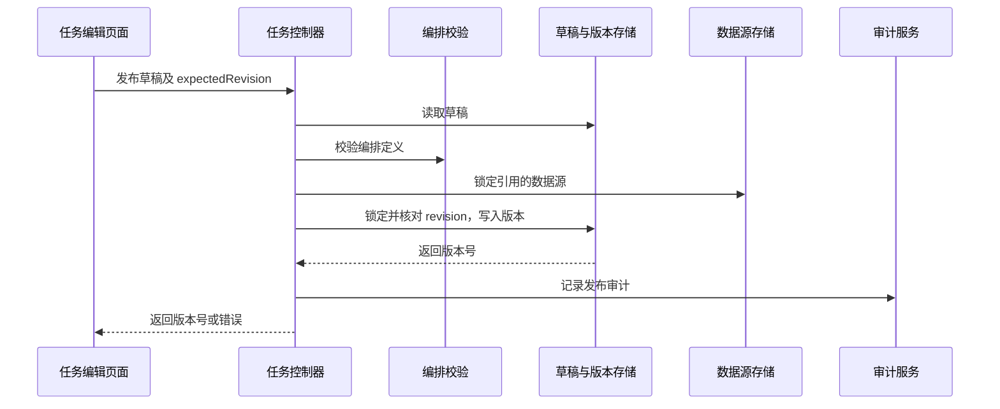


#### 3.4.6 状态及流转

| 当前状态 | 触发事件 | 转移条件 | 目标状态 | 副作用 |
|---|---|---|---|---|
| 草稿 revision N | 发布 | 定义有效，数据源存在，revision 一致 | 草稿仍可编辑，新增发布版本 | 写入版本快照与审计 |
| 草稿 revision N | 旧 revision 发布 | 当前 revision 不等于请求 | 草稿保持不变 | 返回冲突及当前 revision |

#### 3.4.7 数据访问与一致性

| 设计项 | 实际实现 |
|---|---|
| 读取 / 写入表 | task_drafts、processing_task_versions |
| 事务边界与传播 | 控制器发布事务及存储事务处理平台库版本和审计；不会在此步骤运行外部业务写入。 |
| 并发控制 | 锁任务行、草稿行并复核 expectedRevision；数据源在发布前锁定。 |
| 幂等机制 | 未发现基于请求 ID 的幂等去重；重复发布应按实际版本行为处理。 |
| 数据删除与恢复 | 按对应资源操作实现，异常恢复须核对实际状态。 |

#### 3.4.8 异常与边界场景

| 异常场景 | 实际触发条件 | 处理逻辑 | 错误码 / 提示 | 数据影响 |
|---|---|---|---|---|
| 草稿不存在或无法解析 | 对应任务没有草稿，或已存草稿无法解析为 JSON | 拒绝发布 | 分别为 404 或 500 | 不生成发布版本。 |
| 编排校验失败 | 节点、连线或其他定义校验未通过 | 返回校验详情 | 422，包含 `validation` | 不生成发布版本。 |
| 引用数据源无效 | 解析失败或锁定时发现引用数据源不存在 | 拒绝发布 | 400 | 不生成发布版本。 |
| 草稿修订冲突 | 请求修订与锁定后的当前草稿修订不一致 | 返回当前 revision | 409，包含 `currentRevision` | 不生成发布版本；调用方刷新后重新操作。 |
| 事务或审计异常 | 版本写入或审计过程中异常 | 异常交由事务和框架处理 | 依实际异常映射 | 需核对平台事务实际提交结果。 |

#### 3.4.9 关联设计与验证

| 关联类型 | 编号 / 名称 | 说明 |
|---|---|---|
| 接口 | API-DADF3239，`POST /api/tasks/{id}/publish` | 详见接口设计第 4.30 节。 |
| 数据表 | task_drafts、processing_task_versions | 平台元数据与外部业务库分别核对。 |
| 页面 | PAGE-TASK | 处理任务编辑与发布。 |
| 测试 | `OrchDraftApiTest`；任务运行另见 `OrchTaskExecutorTest`、`TaskStopPendingTest` | H2 默认测试集通过；目标数据库和完整联调待验。 |

实现依据为 TaskController.publish、OrchDraftStore.publish。H2 自动测试部分覆盖，目标环境运行验证尚未完成。

### 3.5 任务运行与监控（FUNC-TASK-RUN）

#### 3.5.1 功能说明

| 项目 | 内容 |
|---|---|
| 功能描述 | 任务运行与监控 |
| 触发条件 | 获授权用户从页面或 API 发起 |
| 前置条件 | 用户会话有效并具有相应权限，资源存在 |
| 执行角色及权限 | `workflow.task.execute；监控使用 workflow.task.read` |
| 输入 | 已发布版本、业务日期与运行变量 |
| 输出 | 运行编号、节点状态、日志和预览 |
| 后置条件 | 请求接受时生成运行编号；最终状态由异步执行结果决定，可查询状态、日志和节点预览。 |

#### 3.5.2 输入与输出规则

| 参数 / 数据项 | 类型 | 必填 | 校验 / 默认值 | 含义 |
|---|---|---|---|---|
| id | long | 是 | 任务存在 | 任务编号 |
| version | integer | 否 | 默认当前发布版本；版本必须存在 | 固定运行定义 |
| businessDate | date | 是 | 不允许为空 | 业务日期 |
| variables | object | 否 | 序列化不超过 20000 字符 | 运行变量 |
| id（响应） | long | 接受时返回 | 202 表示已接受，并非执行成功 | 运行编号 |

#### 3.5.3 业务处理流程

服务检查版本、业务日期和变量，锁任务并检查活动运行，创建 PENDING 运行与首次尝试；事务提交后派发。工作线程领取后，编排执行器按依赖执行节点，SQL DML 由 Camel 路由处理；运行、节点、日志和预览由监控接口查询。

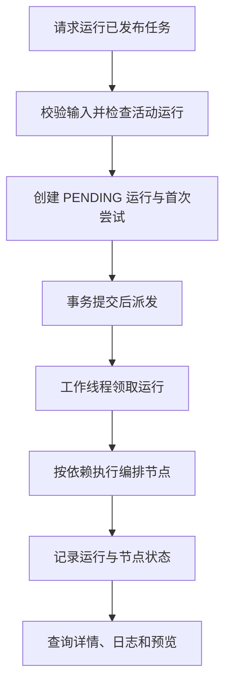


| 步骤 | 执行主体 | 处理动作 | 条件 / 分支 | 输出或副作用 |
|---|---|---|---|---|
| 1 | TaskController / TaskRunService | 检查输入并锁任务 | 版本、日期无效或存在活动运行 | 返回 400 / 409 |
| 2 | TaskRunService | 保存运行及首次尝试 | 事务成功提交 | 写入 PENDING，事务提交后派发 |
| 3 | 工作线程 / 编排执行器 | 领取运行并执行节点 | 停止、失败或执行完成 | 写终态；外部写入可能已提交 |
| 4 | 运行监控接口 | 按运行编号读取详情、日志及预览 | 日志或预览可能不存在 | 展示现有监控数据 |

#### 3.5.4 业务规则

| 规则编号 | 触发条件 | 判断逻辑 | 处理结果 |
|---|---|---|---|
| FUNC-TASK-RUN-01 | 用户发起操作 | 同一任务限制活动运行；提交运行记录后异步派发；节点按依赖执行，SQL 写入由 Camel 路由调用。 | 满足条件进入实际处理，否则拒绝或返回错误。 |

#### 3.5.5 模块交互与时序

由控制器接收请求并委托对应服务，服务访问平台数据或目标数据源。详细调用依据为 TaskRunService.start/execute、OrchTaskExecutor.execute、SqlTaskExecutor.execute。

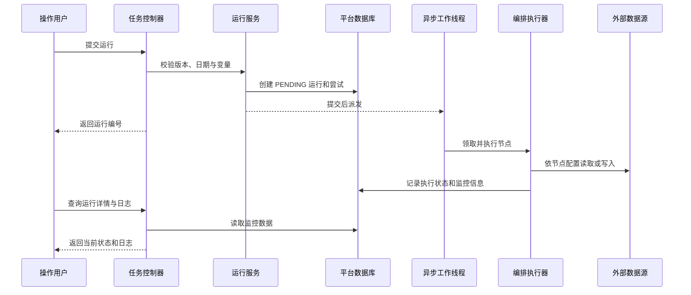

图中为逻辑交互，SQL DML 的 Camel 路由及其他节点执行边界见第 3.6 节；外部数据源不与平台库组成全局事务。


#### 3.5.6 状态及流转

| 当前状态 | 触发事件 | 转移条件 | 目标状态 | 副作用 |
|---|---|---|---|---|
| PENDING | 工作线程领取 | 状态与 attempt 匹配 | RUNNING | 写开始时间 |
| PENDING / RUNNING | 手动停止 | 根据运行上下文取消或落终态 | INTERRUPTED | 记录停止原因；不能承诺撤销已提交外部写入 |
| RUNNING | 执行完成 | 未取消且成功 | SUCCEEDED | 写结束时间 |
| RUNNING | 执行异常 | 未取消 | FAILED | 写失败信息 |
| FAILED / INTERRUPTED | 发起重试 | 无其他活动运行 | PENDING | 新增运行尝试并异步派发 |

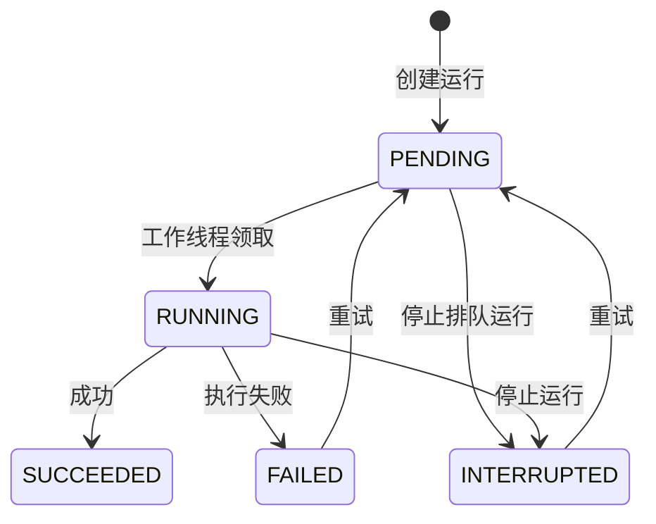


#### 3.5.7 数据访问与一致性

| 设计项 | 实际实现 |
|---|---|
| 读取 / 写入表 | task_runs、task_run_attempts、task_node_runs、execution_logs；外部业务库 |
| 事务边界与传播 | 停止或失败可能留下已提交数据；日志及节点状态尽力写入，预览可能缺失。 |
| 并发控制 | 启动与重试先锁任务行并检查活动运行；工作线程按 PENDING 和 attempt 条件领取。 |
| 幂等机制 | 通用幂等机制未确认；写入重试可能产生重复影响。 |
| 数据删除与恢复 | 按对应资源操作实现，异常恢复须核对实际状态。 |

#### 3.5.8 异常与边界场景

| 异常场景 | 实际触发条件 | 处理逻辑 | 错误码 / 提示 | 数据影响 |
|---|---|---|---|---|
| 版本或业务日期无效 | 版本不存在或未提供业务日期 | 启动前抛出参数异常 | 400，具体响应见启动接口 | 不创建运行记录。 |
| 变量格式或长度无效 | 变量不是对象、无法序列化或序列化超过 20000 字符 | 启动前拒绝 | 400 | 不创建运行记录。 |
| 同一任务已有活动运行 | 持任务锁后发现活动运行 | 拒绝新运行或重试 | 409，具体响应见接口设计 | 原活动运行继续。 |
| 工作线程派发失败 | 事务提交后执行器拒绝或抛运行时异常 | 尝试将本次运行记为 INTERRUPTED | 请求可能已返回接受；通过监控查看最终状态 | 运行记录已提交；若状态写入本身失败，需人工核对。 |
| 节点执行失败或运行被停止 | 执行器抛异常或取消上下文被触发 | 尝试记录 FAILED 或 INTERRUPTED | 异步终态与错误见运行详情 | 已提交的外部写入不自动回滚。 |
| 最终状态记录失败 | 业务执行后写入成功终态时发生异常 | 尝试记录 INTERRUPTED；不直接断定业务写入失败 | 运行状态及平台日志需核对 | 业务结果可能已提交，重试前须核查目标库。 |

#### 3.5.9 关联设计与验证

| 关联类型 | 编号 / 名称 | 说明 |
|---|---|---|
| 接口 | API-TASK-04、API-TASK-RUN-DETAIL、API-TASK-RUN-LOG、API-TASK-NODE-PREVIEW | 分别启动运行、读取详情、日志和预览。 |
| 数据表 | task_runs、task_run_attempts、task_node_runs、execution_logs；外部业务库 | 平台元数据与外部业务库分别核对。 |
| 页面 | PAGE-TASK | 处理任务及运行监控。 |
| 测试 | `OrchDraftApiTest`；任务运行另见 `OrchTaskExecutorTest`、`TaskStopPendingTest` | H2 默认测试集通过；目标数据库和完整联调待验。 |

实现依据为 TaskRunService.start/execute、OrchTaskExecutor.execute、SqlTaskExecutor.execute。H2 自动测试部分覆盖，目标环境运行验证尚未完成。

### 3.6 相关模块与执行链路补充设计


#### 数据对象登记

用户选择数据源及物理对象后，服务读取 JDBC 元数据并保存对象身份、目录和字段快照。身份包含数据源、库、模式、表及对象类型；更新使用版本字段保护并发修改。物理结构变更通过预览与执行流程处理；执行行为以工作区当前实现为准，尚待运行验证。

#### 主数据记录

选择已登记对象后读取物理字段，并对照登记快照。表且字段快照一致时允许新增；修改删除还需要可确认的完整主键。视图只读。查询使用限定字段和操作符、参数绑定以及分页；更新删除按完整主键定位。操作先写平台历史待处理记录，再写外部库并更新历史状态；跨数据库不构成单一原子事务，历史状态未能确认时应核对。

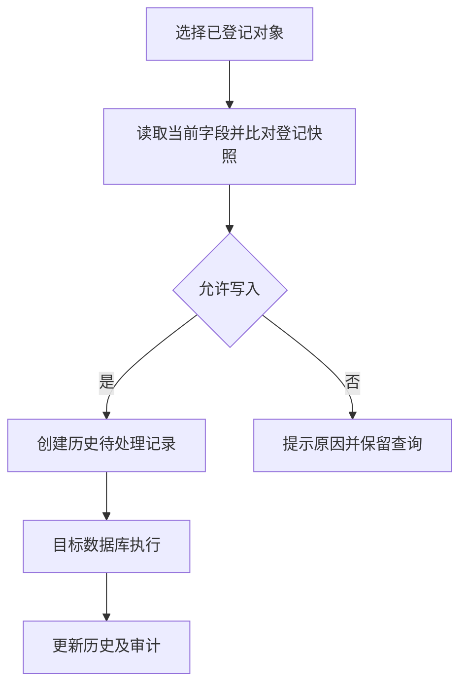

#### 任务编排

新增处理任务默认以空白画布创建草稿；编辑草稿、校验、发布和运行是分开的操作。草稿保存使用 revision 检测冲突。组件库中未实现项禁用，节点和连线构成定义。详细运行异常、重试与幂等行为须逐组件核对，不能统一认定目标写入具备幂等性。

#### 查询与访问

数据集查询检查角色数据访问策略，主数据接口由独立操作权限保护。具体业务处理、外部系统调用和各模块并发语义尚需逐接口核验。

#### 数据源与驱动

**职责与输入：** 管理连接配置、驱动和连接测试。数据源配置包含连接档案、主机、端口、数据库、用户名、驱动和受控参数。驱动按数据库类型和版本适配；密码由凭据服务加密保存，执行连接时才取得。

**主要流程：** 用户提交配置 → 校验连接参数及档案 → 保存平台元数据与加密凭据 → 通过 JDBC 元数据发现表和字段。连接测试失败应返回测试结果，不能据此宣称已保存配置可用。删除数据源前需要检查引用；具体可删除条件以服务端实际约束为准。

**边界：** 数据源指向的数据库和具体驱动行为由外部环境决定；连接成功不代表所有 SQL 方言或事务能力已验证。

#### 数据字典

目录支持创建、排序、重命名及删除；条目按目录与搜索条件分页。条目描述标识、名称、含义、类型、长度、精度和说明。标识全局唯一；导入按目录路径匹配已有目录，逐行报告失败，模板提供可用类型和填写规则。导入限制为 XLSX、5 MB、5000 行；成功和失败行可能同时存在，不能视为整文件原子提交。

#### 数据集策略与查询

策略配置要求数据集、角色、部门字段和可访问字段存在；部门字段须为数值类型。配置流程锁定数据集行，替换角色字段与范围记录；其他角色仍依赖原部门字段时，不能任意更换。查询时根据当前用户与角色在可重复读快照中解析字段及部门范围，然后连接数据源执行。未授权或没有有效策略时拒绝访问；策略和功能权限应同时满足。

#### 主数据写入与历史

| 阶段 | 处理与约束 |
|---|---|
| 发现对象 | 从全部登记对象和目录构建树，读取当前物理列与登记字段比较。 |
| 校验权限与可写性 | 表且快照一致时可新增；修改删除还要求主键信息完整；视图只读。 |
| 构造条件 | 字段来自实际元数据，操作符由固定集合选择，值通过 PreparedStatement 绑定。 |
| 准备历史 | 在平台库创建 PENDING 记录，保存对象身份、主键摘要及操作者。 |
| 目标库操作 | 修改删除按全部主键定位，影响行数必须为 1；变更前后读取快照。 |
| 完成记录 | 成功标记 SUCCESS，失败标记 FAILURE；异常时可能留下 PENDING，须人工核对。 |

平台历史与外部业务库是独立事务。目标库提交后如果历史更新失败，接口提示结果待核对，不能认定全局回滚。导入逐行处理，成功行和失败行可能同时存在；版本快照包含业务字段，应按历史权限保护。

#### 任务编排生命周期

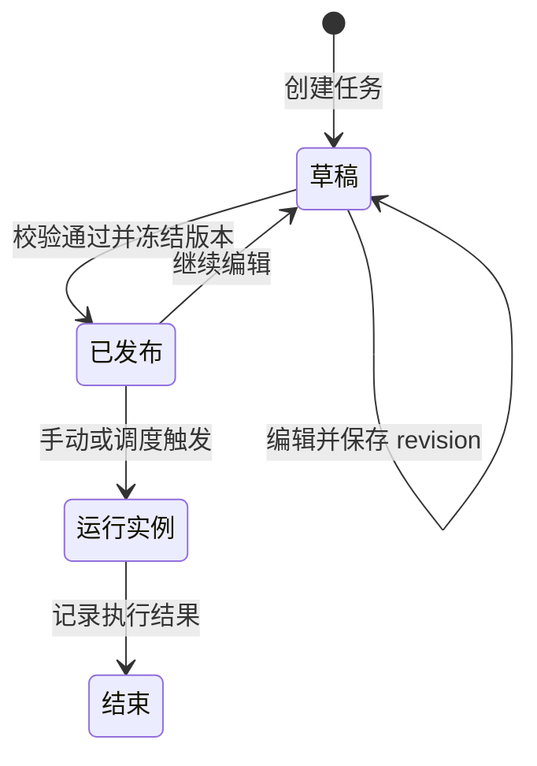

任务草稿以 JSON 保存，保存时先解析定义，再在事务中锁定任务及草稿行并比较 revision；冲突返回当前 revision。发布在校验定义和数据源后再次锁定并核验 revision，创建版本快照。草稿之后可以继续修改，不改变已发布快照。图仅表示主要操作关系，具体运行状态枚举及异常分支以运行服务实现为准。

节点执行按有向无环图和节点依赖运行。DATA 边传递有界行批，CONTROL 边表示依赖；条件分支和汇聚有各自校验规则。运行测试与正式运行的写入行为不同，调用方应明确所选模式。节点重试可能造成目标端重复或部分提交，不保证恰好一次。

#### 报表、服务与轮询同步

报表保存查询配置，运行时重新解析数据集策略。服务创建检查提交者的数据集及字段权限，服务经过提交、审批和调用方授权；调用方密钥的创建响应不缓存。轮询同步在停止状态下允许更新间隔和批大小，基于水位与主键游标读取，不能捕获删除或迟到数据。三个模块的部署配置、异常恢复与跨数据库兼容仍需现场验证。

#### 任务执行与监控设计

##### 3.6.1 范围与角色

本文描述处理任务从画布配置、发布、触发到执行结束及监控的链路。编排定义由节点、连接、变量和布局组成；数据处理执行使用任务发布版本。另有工作流和实时轮询同步，它们有自己的调度与执行入口，不应与单个处理任务运行实例混为一谈。

| 参与部分 | 职责 |
|---|---|
| 编排页面 | 编辑草稿、校验、发布、触发运行、展示控制台 |
| TaskController | 接收请求、选择版本、转换 HTTP 结果 |
| TaskRunService | 创建运行及尝试记录、事务后派发、状态收敛、停止与重试 |
| CamelTaskRunner | 解析已授权的 ORCH 版本定义，创建编排执行上下文 |
| OrchTaskExecutor | 按图关系执行节点、维护节点状态和行批、处理重试与水位 |
| Camel SQL 执行器 | 用 Camel `direct:execute-sql` 路由承载参数化 SQL 写操作 |
| 状态及日志记录器 | 写入运行节点状态、运行日志、统计及有限预览样本 |

##### 3.6.2 执行前准备

1. 用户在画布添加来源、处理、目标或控制节点，配置数据源、字段、SQL、参数和连线。组件注册表标记未启用的组件，未启用组件不能作为已实现能力使用。
2. 草稿保存带 `expectedRevision`；服务端解析定义并在锁内检查 revision。并发编辑冲突返回 409。
3. 发布时读取草稿，执行定义、节点、连线和数据源等校验；失败返回 422。成功后在事务中再次核对 revision，写入已发布版本。运行使用固定版本，后续草稿修改不改变该次运行。
4. “运行测试”使用当前提交的定义进行 dry-run：服务端先校验，在虚拟线程执行，最多等待 30 秒；上下文设置 `dryRun=true`，目标写入被禁用，结果直接返回日志、节点状态和预览。该路径不等同正式运行记录。

##### 3.6.3 正式运行端到端时序

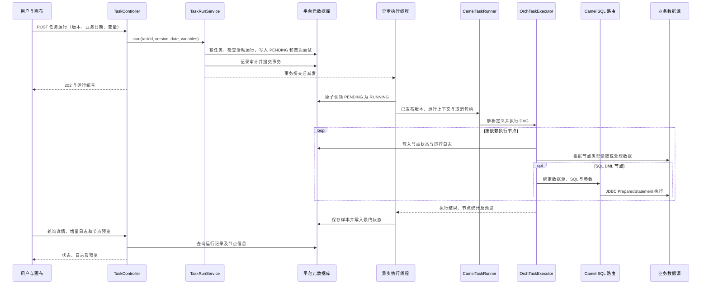

图描述正常路径；实际执行中每个节点适配器不同，并非所有节点都经过 `direct:execute-sql`。图未做 Mermaid 渲染验证。

###### 3.6.3.1 创建与派发

`POST /api/tasks/{id}/runs` 使用请求中的版本或当前发布版本；业务日期与版本必须有效，变量必须是对象且序列化后不超过 20000 字符。服务锁定任务行，检查是否存在 PENDING/RUNNING 实例，防止同一任务并发启动。随后在同一事务内写入 `task_runs`、`task_run_attempts` 首次尝试及审计记录。接口返回 202 和运行编号表示请求已接受，不表示业务执行成功。

事务提交后，执行器才异步派发；派发失败时尝试将运行置为 INTERRUPTED。执行线程先登记取消上下文，再以条件更新认领 PENDING；已被停止等原因导致认领失败时不执行。认领后获取执行并发配额，加载固定版本与保存的运行变量。当前实现先置 RUNNING 再等待配额，因此运行中可能包含等待配额的时间。

###### 3.6.3.2 DAG 与 Camel 的分工

`CamelTaskRunner` 解析 ORCH 定义并委托 `OrchTaskExecutor`；后者按照拓扑顺序逐节点处理依赖、跳过状态、重试、输入输出与预览。DATA 边传递行批，CONTROL 边表达依赖；节点间行批保存在有界内存，默认上限 50000 行，具体受配置与调用限制。

Camel 并不是把整个画布自动转换为一条 Camel 路由。以 SQL 写操作为例，`SqlTaskExecutor` 使用 Camel `ProducerTemplate` 调用 `direct:execute-sql`，路由中的 processor 打开数据源连接，创建 PreparedStatement、绑定参数，执行更新并返回影响行数。其他来源、转换、写入或 HTTP 节点由对应执行路径处理。

每个节点开始、成功、失败或跳过时向节点记录器写状态；成功记录输入输出行数及耗时。节点重试按其配置执行，失败重试可能重放已提交数据，写操作不保证恰好一次。整次运行成功后才尝试推进增量水位；外部数据库写入和平台水位并非全局原子事务。

###### 3.6.3.3 结束、停止和恢复

成功执行后保存有限预览样本并将运行及尝试标记 SUCCEEDED；执行异常标记 FAILED；手动停止或线程中断标记 INTERRUPTED。停止会向活动执行上下文发出取消，可能中断已登记的 JDBC 语句，但已提交的数据不能自动回滚；驱动响应取消的能力也可能不同。运行结束状态写入失败时结果可能需要人工核对。

FAILED 或 INTERRUPTED 的运行可按服务端条件重试：运行 attempt 增加并重新进入 PENDING，使用原固定版本和业务日期；存在其他活动运行时拒绝。进程启动恢复逻辑会将遗留 PENDING/RUNNING 记录标为 INTERRUPTED，而不等于自动重放业务写入。

##### 3.6.4 监控与数据存储

试运行会实际读取配置的来源，HTTP 来源会发送真实请求。SQL DML、数据库写入和 HTTP 推送在试运行中跳过写入。

运行尝试按运行编号和尝试编号记录，重试整个运行时沿用运行编号并增加尝试编号。节点重试由各节点配置控制。节点状态写入使用节点执行尝试编号，详情对每个节点取最大尝试编号的记录。该视图只能用于查看所选节点记录，完整重试过程需结合运行尝试与日志。

| 观察内容 | 来源与用途 |
|---|---|
| 运行列表 | `task_runs` 与 `task_run_attempts`；展示任务版本、业务日期、状态、时间和尝试。 |
| 节点状态 | `task_node_runs`；展示状态、尝试次数、输入输出行数、耗时、错误和时间。 |
| 执行日志 | 运行日志记录器写入的日志；按节点、级别、afterId 和 limit 查询。 |
| 节点数据预览 | 每节点有限样本；正式运行成功后尽力持久化，接口返回列和行。 |
| 任务列表摘要 | 汇总最近一次运行及是否有活动运行。 |

画布控制台和运行记录弹窗在 PENDING/RUNNING 时约每 2 秒轮询详情；日志使用 afterId 增量拉取。节点状态和日志记录采用尽力而为：记录写入失败可能导致监控信息不完整，不能单靠缺失日志断言节点没有执行。正式运行预览样本也采用尽力保存；样本含业务数据，应依据实际权限和数据保留政策管理。

##### 3.6.5 主要接口

| 接口 | 用途 |
|---|---|
| `POST /api/tasks/{id}/runs` | 创建正式运行，返回运行 id。 |
| `POST /api/tasks/{id}/stop` | 请求停止任务运行。 |
| `POST /api/tasks/{id}/runs/{runId}/retry` | 对允许重试的运行创建下一次尝试。 |
| `GET /api/tasks/{id}/runs` | 获取该任务运行列表。 |
| `GET /api/task-runs/{runId}` | 获取运行及节点状态。 |
| `GET /api/task-runs/{runId}/logs` | 按节点、级别、afterId、limit 查询日志。 |
| `GET /api/task-runs/{runId}/nodes/{nodeKey}/preview` | 获取节点预览。 |
| `POST /api/orch/test-run` | 对定义执行有时限的试运行。 |

这些接口仍受权限注册表和安全链控制；请求、响应和异常详情见接口说明书及实际控制器。

##### 3.6.6 校验范围与待确认

本文来自当前代码静态分析和仓库架构记录，未进行实际任务执行、停止竞态、故障恢复、数据库兼容性或 Mermaid 渲染验证。生产级吞吐、时延、日志保留、告警阈值和外部监控系统对接待部署方确认；不得据此认定已具备集中告警。

### 3.7 数据对象批量登记（FUNC-OBJECT-REGISTER）

#### 3.7.1 功能说明

| 项目 | 内容 |
|---|---|
| 功能描述 | 将已有物理表或视图的身份和当前字段快照登记到平台。 |
| 触发条件 | 用户在数据对象页面选择物理对象并提交登记。 |
| 前置条件 | 目录、数据源及物理对象存在，能够读取字段元数据。 |
| 执行角色及权限 | 接口路由需 `datasource.object.register`；控制器额外检查 `datasource.source.read` 和 `datasource.source.test`。 |
| 输入 | 1–100 个对象的目录、物理身份、展示名称和描述。 |
| 输出 | 每项的物理身份、成功标记、对象编号或错误信息。 |
| 后置条件 | 成功项写入对象与字段快照；单项失败通常返回失败结果，不回滚其他已成功项。 |

#### 3.7.2 输入与输出规则

| 参数 / 数据项 | 类型 | 必填 | 校验 / 默认值 | 含义 |
|---|---|---|---|---|
| `objects` | array | 是 | 1–100 项，不允许空元素 | 本次登记对象集合 |
| `directoryId` | long | 是 | 目录必须存在 | 目标对象目录 |
| `identity.sourceId` | long | 是 | 正整数且数据源存在 | 数据源编号 |
| `identity.catalog` / `schema` | string | 否 | 各不超过 255 字符；null 规范化为空串 | 物理对象限定位置 |
| `identity.table` / `type` | string | 是 | 表名非空且不超过 255 字符；类型为 TABLE 或 VIEW | 物理对象身份 |
| `name` / `description` | string | 名称是；描述否 | 名称去空格后 1–200 字符；描述去空格后最多 1000 字符 | 平台显示信息 |
| `identity`、`success`、`id`、`error` | 对象 / 布尔 / long / 字符串 | 响应字段 | 成功项返回 id，失败项返回错误 | 逐项登记结果 |

#### 3.7.3 业务处理流程

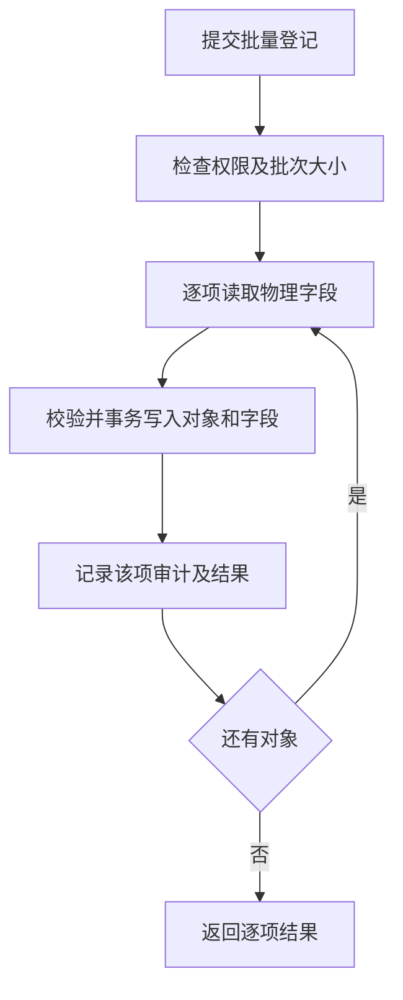

| 步骤 | 执行主体 | 处理动作 | 条件 / 分支 | 输出或副作用 |
|---|---|---|---|---|
| 1 | 安全链与控制器 | 检查登记、数据源读取和测试权限，校验集合 | 集合为空、超过上限或包含空项 | 请求整体拒绝 |
| 2 | 控制器与元数据服务 | 对每项读取物理字段 | 外部元数据读取失败 | 记录该项失败并形成错误结果 |
| 3 | 对象存储 | 校验对象、目录、数据源与字段；锁目录和数据源并写入 | 对象已登记或字段不合规 | 当前项事务失败 |
| 4 | 控制器与审计 | 记录结果并处理下一项 | 当前项成功或失败 | 返回逐项成功与失败信息 |

#### 3.7.4 业务规则

| 规则编号 | 触发条件 | 判断逻辑 | 处理结果 |
|---|---|---|---|
| OBJ-REG-01 | 提交批次 | `objects` 长度为 1–100 且元素不为空 | 不满足则拒绝整个请求。 |
| OBJ-REG-02 | 登记单项 | 物理身份由数据源、catalog、schema、表名和类型计算哈希 | 唯一约束冲突时提示物理对象已登记。 |
| OBJ-REG-03 | 写入字段 | 字段列表非空，序号为正且不重复，名称和类型有效，可空与主键状态取 YES / NO / UNKNOWN | 无效时拒绝当前项。 |
| OBJ-REG-04 | 部分成功 | 每项独立读取和登记，逐项捕获常见异常 | 正常情况下其他项继续处理；审计等基础设施异常仍可能中断请求。 |

#### 3.7.5 模块交互与时序

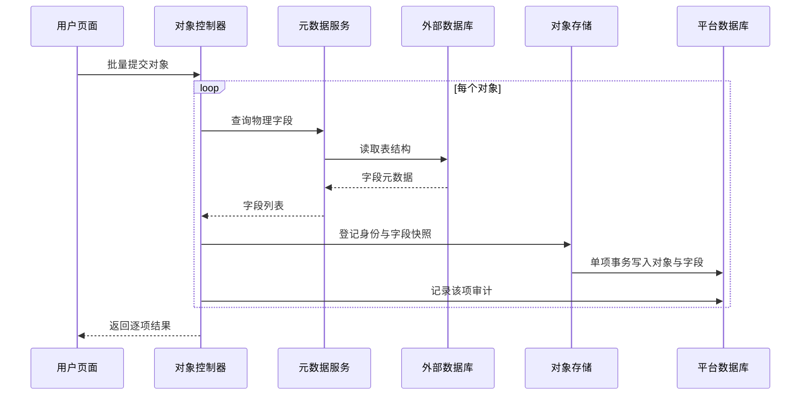

读取外部元数据与平台库登记不在全局事务中；物理结构可能在读取后变化，后续使用需检查快照一致性。

#### 3.7.6 状态及流转

| 当前状态 | 触发事件 | 转移条件 | 目标状态 | 副作用 |
|---|---|---|---|---|
| 未登记 | 提交登记 | 字段读取及平台校验成功 | 已登记 | 插入对象和字段快照，并记录成功审计。 |
| 未登记 | 提交登记 | 元数据读取或单项校验失败 | 未登记 | 当前项返回失败并尝试记录失败审计。 |
| 已登记 | 再次登记相同物理身份 | 唯一约束冲突 | 已登记 | 当前项失败，不创建重复对象。 |

登记结果不是独立的持久化状态机，以上为对象存在性变化，状态机图不适用。

#### 3.7.7 数据访问与一致性

| 设计项 | 实际实现 |
|---|---|
| 读取 / 写入表 | 读取外部数据库字段元数据及平台 `object_directories`、`data_sources`；写入 `data_objects`、`data_object_fields` 和审计记录。 |
| 事务边界与传播 | `ObjectStore.register` 为单项平台库事务；控制器批次没有声明覆盖所有对象和外部数据库的全局事务。 |
| 并发控制 | 登记时锁定目标目录和数据源；身份哈希唯一约束处理重复登记竞争。 |
| 幂等机制 | 重复登记返回冲突类错误，不是返回原对象的幂等成功。 |
| 数据删除与恢复 | 本操作不删除外部业务表；已登记对象的删除另见数据对象接口。 |

#### 3.7.8 异常与边界场景

| 异常场景 | 实际触发条件 | 处理逻辑 | 错误码 / 提示 | 数据影响 |
|---|---|---|---|---|
| 批次无效 | 空列表、超过 100 项或包含 null | 拒绝请求 | 请选择 1 至 100 个对象 | 不进入逐项登记。 |
| 目录、数据源或字段无效 | 平台对象不存在或字段校验失败 | 当前项失败并形成错误结果 | 具体原因见响应 `error` | 当前项事务回滚，先前成功项保留。 |
| 重复对象 | 物理身份哈希违反唯一约束 | 当前项失败 | 该物理对象已登记 | 已存在对象保持不变。 |
| 外部元数据或其他未知异常 | 读取目标库或保存时出错 | 记录失败并返回通用错误 | 无法读取或保存对象元数据 | 当前项未成功；审计写入异常另需检查。 |

#### 3.7.9 关联设计与验证

| 关联类型 | 编号 / 名称 | 说明 |
|---|---|---|
| 接口 | `POST /api/data-objects/register` | 请求及响应字段见接口设计对应章节。 |
| 数据表 | `data_objects`、`data_object_fields`、`object_directories`、`data_sources` | 平台登记与字段快照。 |
| 页面 | PAGE-OBJECT | 数据对象发现及登记。 |
| 测试 | 对应测试及断言待逐项映射 | 后端默认测试已运行；不能仅凭测试总数认定该功能完成目标环境验证。 |

关键实现依据：`ObjectController.register`、`ObjectMetadata.fields`、`ObjectStore.register`。

### 3.8 主数据记录新增（FUNC-MD-CREATE）

#### 3.8.1 功能说明

| 项目 | 内容 |
|---|---|
| 功能描述 | 对已登记且可写的物理表新增一条主数据记录。 |
| 触发条件 | 获授权用户在主数据页面或通过接口提交字段值。 |
| 前置条件 | 对象为表而非视图，平台登记字段与物理字段一致，目标数据源可用。 |
| 执行角色及权限 | `datasource.master_data.create`。 |
| 输入 | 对象编号和 `values` 字段值映射。 |
| 输出 | 影响行数、可取得的主键及插入后快照。 |
| 后置条件 | 目标库成功提交后尝试完成平台历史与审计；两者不在同一个全局事务。 |

#### 3.8.2 输入与输出规则

| 参数 / 数据项 | 类型 | 必填 | 校验 / 默认值 | 含义 |
|---|---|---|---|---|
| `id` | long | 是 | 已登记对象 | 路径中的对象编号 |
| `values` | 对象 | 是 | 非空；字段名必须出现在物理元数据中 | 写入字段及值 |
| 生成列 / 自增列 | 依数据库类型 | 否 | 不允许提供非空值 | 由数据库生成的字段 |
| 非空字段 | 依数据库类型 | 条件必填 | 未提供且无数据库默认值时拒绝；显式空值按可空性校验 | 普通可写字段 |
| `affected`、`key`、`before`、`after` | 数值 / 对象 | 成功时返回 | 新增成功 affected 为 1；before 为 null；生成主键不保证均可获取 | 变更结果 |

#### 3.8.3 业务处理流程

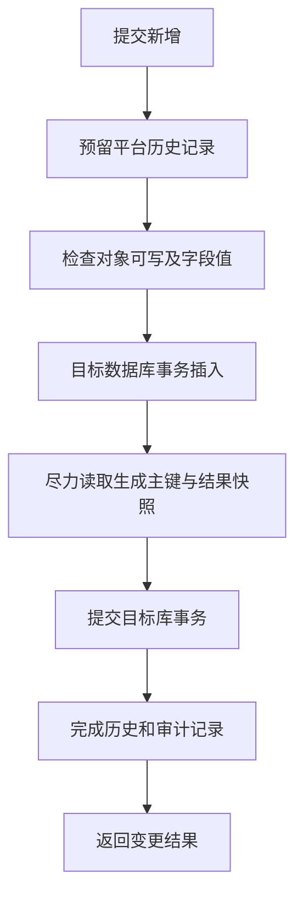

| 步骤 | 执行主体 | 处理动作 | 条件 / 分支 | 输出或副作用 |
|---|---|---|---|---|
| 1 | 控制器与历史存储 | 准备新增历史记录 | 历史准备失败 | 不进入目标库新增 |
| 2 | 记录服务 | 检查对象类型、字段一致性、字段名及值 | 元数据变化、非法字段或缺少必填值 | 拒绝写入，尝试记录失败 |
| 3 | 目标数据库连接 | 参数化 INSERT 并获取可用生成键 | 驱动不支持获取生成键 | 仍可提交，返回的主键信息可能不完整 |
| 4 | 控制器 | 提交后完成历史及审计并返回结果 | 后续记录失败 | 目标库可能已经提交，须核对后再重试 |

#### 3.8.4 业务规则

| 规则编号 | 触发条件 | 判断逻辑 | 处理结果 |
|---|---|---|---|
| MD-CREATE-01 | 写入前检查对象 | 视图或登记快照与物理结构不一致 | 不允许新增。 |
| MD-CREATE-02 | 验证输入 | 拒绝未知字段、生成列的非空手动值以及违反可空性或默认值约束的输入 | 返回错误，不执行 INSERT。 |
| MD-CREATE-03 | 生成键 | 可取得唯一缺失键时尝试填入 key；驱动不支持时捕获异常 | 不因为无法获取生成键单独回滚插入。 |

#### 3.8.5 模块交互与时序

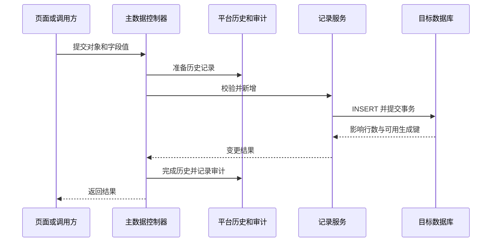

外部库提交和平台历史完成属于不同操作；目标库已提交但后续记录异常时不能假定插入已回滚。

#### 3.8.6 状态及流转

| 当前状态 | 触发事件 | 转移条件 | 目标状态 | 副作用 |
|---|---|---|---|---|
| 无该条记录 | 执行新增 | 校验及目标库事务成功 | 记录已插入 | 尝试记录成功历史和审计。 |
| 未写入 | 输入无效或数据库回滚 | 写入前或提交前发生异常 | 未写入或提交结果需核对 | 尝试记录失败历史和审计。 |

目标业务记录无统一平台状态机，状态机图不适用。

#### 3.8.7 数据访问与一致性

| 设计项 | 实际实现 |
|---|---|
| 读取 / 写入表 | 读取对象登记、物理字段元数据；写入外部业务表及平台主数据历史、审计。 |
| 事务边界与传播 | 目标库连接关闭自动提交并显式提交或回滚；平台历史与目标库之间无全局事务。 |
| 并发控制 | 依目标数据库约束和隔离级别；未发现通用跨库锁。 |
| 幂等机制 | 未发现请求幂等键；失败后重试可能重复插入。 |
| 数据删除与恢复 | 本操作不删除记录；异常恢复应先查询目标数据和历史。 |

#### 3.8.8 异常与边界场景

| 异常场景 | 实际触发条件 | 处理逻辑 | 错误码 / 提示 | 数据影响 |
|---|---|---|---|---|
| 对象不可写 | 视图或字段快照不一致 | 拒绝新增 | 原因由主数据接口返回 | 不写目标表。 |
| 输入字段无效 | 空映射、未知字段、生成列手填或必填字段缺失 | 参数校验失败 | 字段相关中文提示 | 不写目标表。 |
| 写入约束失败 | 目标库拒绝 INSERT 或影响行数不为 1 | 尝试回滚目标库事务并记录失败 | 见接口错误响应 | 提交前失败通常回滚；连接异常时应核实实际结果。 |
| 无法读取生成键 | JDBC 驱动不暴露键 | 捕获获取键的 SQL 异常 | 返回结果中 key 可能不完整 | 插入仍可提交。 |
| 完成历史异常 | 目标库已提交后平台记录失败 | 按控制器异常路径处理 | 不得据此断定目标库无记录 | 先核对目标数据再决定重试。 |

#### 3.8.9 关联设计与验证

| 关联类型 | 编号 / 名称 | 说明 |
|---|---|---|
| 接口 | `POST /api/master-data/objects/{id}/records` | 见接口设计对应章节。 |
| 数据表 | `master_data_history`、外部业务表 | 平台历史与目标业务库分离。 |
| 页面 | PAGE-MD | 主数据新增记录。 |
| 测试 | 尚未发现对应专用自动测试 | 已运行的后端默认测试总数不能证明该功能已验证。 |

关键实现依据：`MasterDataController.create`、`MasterDataRecordService.create`、`MasterDataService.detail`。

### 3.9 数据字典条目维护（FUNC-DICT-ENTRY）

#### 3.9.1 功能说明

| 项目 | 内容 |
|---|---|
| 功能描述 | 在已有字典目录下查询、新增、修改和删除数据字典条目。 |
| 触发条件 | 用户从数据字典页面发起操作。 |
| 前置条件 | 用户已登录，目标目录存在，具备对应的字典操作权限。 |
| 执行角色及权限 | 分别为 `datasource.dictionary.read`、`create`、`update`、`delete`。 |
| 输入 | 目录、字典标识、名称、含义、数据类型、长度、精度和描述。 |
| 输出 | 查询页或新增条目编号；修改和删除成功返回空响应。 |
| 后置条件 | 平台字典条目变更；控制器在成功操作后记录审计。 |

#### 3.9.2 输入与输出规则

| 参数 / 数据项 | 类型 | 必填 | 校验 / 默认值 | 含义 |
|---|---|---|---|---|
| `directoryId` | long | 新增和修改必填 | 目录必须存在 | 所属目录 |
| `code` | string | 是 | 去空格后最多 100 字符；字母或下划线开头，后续仅字母、数字和下划线；全局唯一；修改时不可变 | 字典标识 |
| `name`、`meaning` | string | 是 | 去空格后非空，各最多 200 字符 | 字典名称和含义 |
| `dataType` | string | 是 | 转为小写，允许 varchar、char、integer、bigint、decimal、double、date、datetime、boolean | 字段类型 |
| `length` | integer | 否 | 提供时为正整数 | 字段长度 |
| `precision` | integer | 否 | 仅 decimal / double 可填；不小于 0；必须有长度且不超过长度 | 精度 |
| `description` | string | 否 | 去空格后最多 1000 字符；null 转为空字符串 | 描述 |
| `page` / `size` / `search` | integer / string | 否 | 默认 1 / 10 / 空；page 1–100000、size 1–100、搜索最多 200 字符 | 查询分页和条件 |

#### 3.9.3 业务处理流程

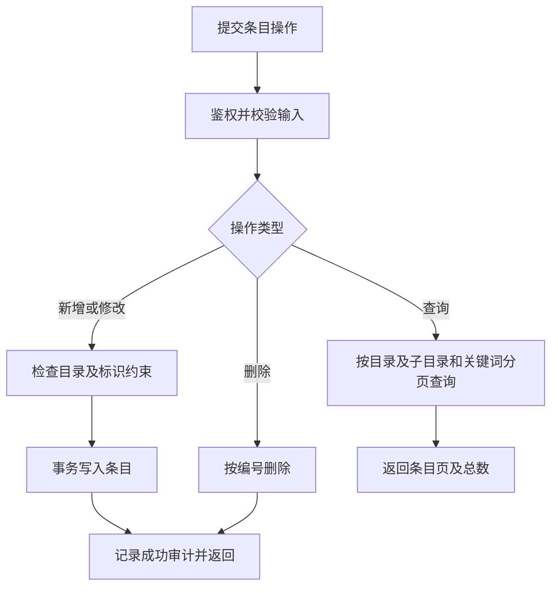

| 步骤 | 执行主体 | 处理动作 | 条件 / 分支 | 输出或副作用 |
|---|---|---|---|---|
| 1 | 权限链 / 控制器 | 校验会话和对应字典权限 | 权限不足 | 拒绝请求 |
| 2 | 字典存储 | 清理并验证条目输入 | 标识、类型、长度或精度不合规 | 返回参数错误 |
| 3 | 字典存储 | 新增或修改时检查目录并写库；删除按编号执行 | 目录不存在、重复标识或条目不存在 | 操作失败 |
| 4 | 控制器 / 审计 | 成功后记录操作审计 | 审计发生异常 | 应核对条目实际变更结果 |
| 5 | 字典存储 | 查询时按目录递归收集子目录并执行分页 | 未传目录或关键词 | 相应条件不限制 |

#### 3.9.4 业务规则

| 规则编号 | 触发条件 | 判断逻辑 | 处理结果 |
|---|---|---|---|
| DICT-ENTRY-01 | 新增或修改 | 标识格式、类型、长度及精度必须符合输入规则 | 无效时拒绝。 |
| DICT-ENTRY-02 | 修改 | 请求的标识与已保存标识不同 | 拒绝修改标识。 |
| DICT-ENTRY-03 | 查询指定目录 | 将该目录及其全部后代目录纳入筛选 | 返回范围内条目。 |
| DICT-ENTRY-04 | 搜索 | 对标识、名称、含义进行不区分大小写的包含匹配，并转义通配符 | 返回匹配结果，不将输入直接作为 SQL 结构。 |

#### 3.9.5 模块交互与时序

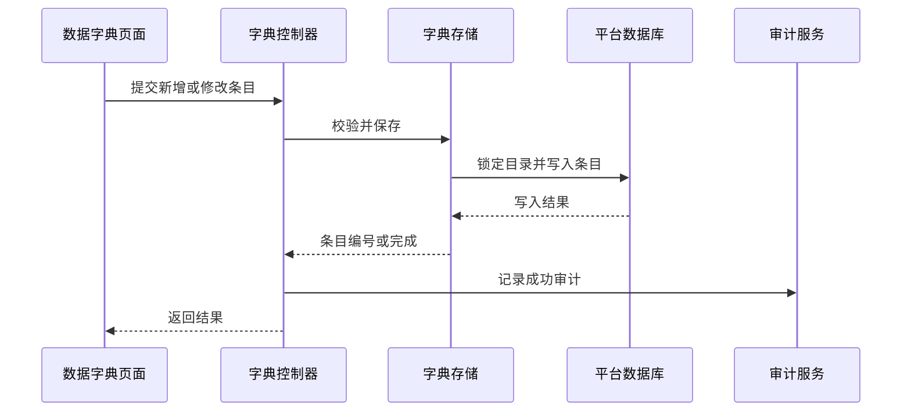

新增和修改由存储层事务处理；控制器在存储调用返回后调用审计，不能据此断言条目和审计处于同一事务。

#### 3.9.6 状态及流转

| 当前状态 | 触发事件 | 转移条件 | 目标状态 | 副作用 |
|---|---|---|---|---|
| 不存在 | 新增 | 校验通过且标识唯一 | 已存在 | 插入条目并尝试记录成功审计。 |
| 已存在 | 修改 | 条目与目录存在且标识不变 | 已存在 | 更新属性和更新时间。 |
| 已存在 | 删除 | 条目编号存在 | 不存在 | 删除平台条目并尝试记录成功审计。 |
| 不存在或已存在 | 输入无效 | 校验失败 | 保持原状态 | 返回错误。 |

字典条目没有独立持久化状态枚举，状态机图不适用。

#### 3.9.7 数据访问与一致性

| 设计项 | 实际实现 |
|---|---|
| 读取 / 写入表 | 读取 `dictionary_directories`；查询及写入 `dictionary_entries`；成功操作调用审计服务。 |
| 事务边界与传播 | 新增、修改使用 `@Transactional`；删除方法未声明事务；控制器成功审计在存储调用之后。 |
| 并发控制 | 新增和修改锁定目标目录行；数据库唯一约束保护标识。 |
| 幂等机制 | 新增重复标识返回错误；重复删除不存在条目返回错误，不属于幂等成功。 |
| 数据删除与恢复 | 条目删除为实际删除；未发现本功能的条目恢复接口。 |

#### 3.9.8 异常与边界场景

| 异常场景 | 实际触发条件 | 处理逻辑 | 错误码 / 提示 | 数据影响 |
|---|---|---|---|---|
| 条目参数无效 | 名称、标识、类型、长度或精度不满足校验 | 拒绝 | 对应中文校验消息 | 不写入条目。 |
| 标识重复 | 新增时违反完整性约束 | 转换为参数异常 | 字典标识已存在 | 当前新增失败。 |
| 目录或条目不存在 | 查无目标目录或修改 / 删除目标条目 | 拒绝 | 目录不存在或字典不存在 | 不产生预期变更。 |
| 审计失败 | 条目存储调用已返回后审计异常 | 异常向调用方传播 | 以接口实际异常处理为准 | 条目可能已变更，重试前应查询。 |

#### 3.9.9 关联设计与验证

| 关联类型 | 编号 / 名称 | 说明 |
|---|---|---|
| 接口 | `/api/dictionary/entries` 及 `/{id}` | 查询、新增、修改和删除契约见接口设计。 |
| 数据表 | `dictionary_directories`、`dictionary_entries` | 目录与字典条目。 |
| 页面 | PAGE-DICT | 字典目录与条目维护。 |
| 测试 | 具体测试及断言待逐项映射 | 后端默认测试已执行；不能仅凭总数认定全部路径已验证。 |

关键实现依据：`DictionaryController` 和 `DictionaryStore.page`、`validate`、`create`、`update`、`delete`。

### 3.10 主数据记录删除（FUNC-MD-DELETE）

#### 3.10.1 功能说明

| 项目 | 内容 |
|---|---|
| 功能描述 | 按完整主键从已登记的物理表删除一条记录，并记录变更历史。 |
| 触发条件 | 获授权用户在主数据页面或通过接口发起删除。 |
| 前置条件 | 目标是表、登记快照与物理字段一致、主键元数据完整可靠。 |
| 执行角色及权限 | `datasource.master_data.delete`。 |
| 输入 | 对象编号及包含全部主键字段的 JSON 对象。 |
| 输出 | 影响行数、主键和删除前快照；删除后快照为空。 |
| 后置条件 | 目标库提交后，控制器尝试完成平台历史及审计；两者不构成跨库全局事务。 |

#### 3.10.2 输入与输出规则

| 参数 / 数据项 | 类型 | 必填 | 校验 / 默认值 | 含义 |
|---|---|---|---|---|
| `id` | long | 是 | 目标对象存在 | 路径中的对象编号 |
| 请求体 | object | 是 | 必须包含完整、有效的主键，不得包含其他键 | 按物理主键定位记录 |
| `affected` | long | 成功返回 | 成功删除时为 1 | 影响行数 |
| `key` / `before` / `after` | object / null | 成功返回 | `before` 为删除前快照，`after` 为 null | 主键及记录变化 |

#### 3.10.3 业务处理流程

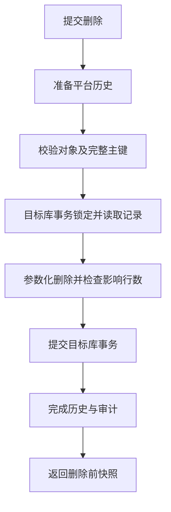

| 步骤 | 执行主体 | 处理动作 | 条件 / 分支 | 输出或副作用 |
|---|---|---|---|---|
| 1 | 控制器 / 历史服务 | 准备删除历史 | 准备失败 | 不进入目标库删除 |
| 2 | 记录服务 | 检查对象可写性及主键 | 视图、结构过期或主键不完整 | 拒绝并尝试记录失败 |
| 3 | 目标数据库 | 锁定读取记录并按完整主键删除 | 无记录或影响行数不为 1 | 抛异常并尝试回滚 |
| 4 | 目标数据库 / 控制器 | 提交事务并完成历史、审计 | 平台历史或审计异常 | 目标删除可能已提交，需核对 |

#### 3.10.4 业务规则

| 规则编号 | 触发条件 | 判断逻辑 | 处理结果 |
|---|---|---|---|
| MD-DELETE-01 | 删除记录 | 仅物理表、字段一致且可确认主键时允许删除 | 不满足条件拒绝。 |
| MD-DELETE-02 | 请求主键 | 需提供完整主键且不包含其他键 | 无效时拒绝。 |
| MD-DELETE-03 | 目标库删除 | 先锁定查询记录，再按主键执行 DELETE，影响行数必须为 1 | 未命中或异常时尝试回滚。 |

#### 3.10.5 模块交互与时序

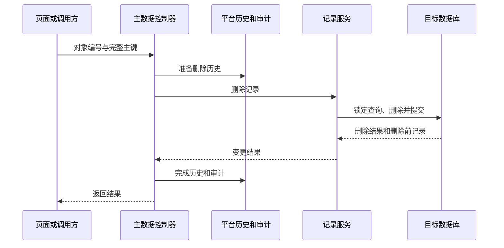

目标数据库和平台历史分属独立事务。无法确认响应结果时应先检查目标库和历史，再考虑重试。

#### 3.10.6 状态及流转

| 当前状态 | 触发事件 | 转移条件 | 目标状态 | 副作用 |
|---|---|---|---|---|
| 记录存在 | 删除并提交 | 主键及可写性有效，影响一行 | 记录不存在 | 记录删除前快照并尝试完成历史。 |
| 记录存在或不存在 | 参数 / 记录校验失败 | 未成功提交 | 保持或待核对 | 尝试回滚并记录失败。 |
| 目标已删除 | 完成历史或审计失败 | 目标事务已提交 | 记录不存在，历史需核对 | 不能假设目标库回滚。 |

记录本身没有平台持久化状态机，状态图不适用。

#### 3.10.7 数据访问与一致性

| 设计项 | 实际实现 |
|---|---|
| 读取 / 写入表 | 平台对象元数据、`master_data_history` 和审计；读取并删除外部业务表记录。 |
| 事务边界与传播 | 目标库显式提交或回滚；平台历史与目标库独立提交。 |
| 并发控制 | 按完整主键读取并锁定记录；锁语义依目标数据库实现。 |
| 幂等机制 | 不提供通用幂等键；重复删除已不存在记录会返回错误。 |
| 数据删除与恢复 | 对目标业务表执行实际 DELETE；历史快照不等同于自动恢复机制。 |

#### 3.10.8 异常与边界场景

| 异常场景 | 实际触发条件 | 处理逻辑 | 错误码 / 提示 | 数据影响 |
|---|---|---|---|---|
| 对象不可写或主键未知 | 视图、字段快照变化或无法确认主键 | 拒绝并记录失败 | 对象不可写原因见响应 | 不执行目标删除。 |
| 主键无效 | 缺少主键或包含未知键 | 参数校验失败 | 对应中文错误 | 不执行目标删除。 |
| 记录不存在或发生变化 | 锁定查询无记录或影响行数不为 1 | 抛异常并尝试回滚 | 提示记录不存在、已删除或变化 | 应核对并发状态。 |
| 提交后历史 / 审计异常 | 目标库提交后平台记录失败 | 异常返回并尝试审计失败 | 记录已提交但历史状态未确认 | 不可据此重试或认定目标删除被撤销。 |

#### 3.10.9 关联设计与验证

| 关联类型 | 编号 / 名称 | 说明 |
|---|---|---|
| 接口 | `DELETE /api/master-data/objects/{id}/records` | 请求体、响应与错误见接口设计。 |
| 数据表 | `master_data_history`、外部业务表 | 平台历史与目标业务数据分离。 |
| 页面 | PAGE-MD | 记录删除。 |
| 测试 | 尚未发现主数据专用自动测试 | 默认测试总数不能证明本功能已验证；目标环境待验。 |

关键实现依据：`MasterDataController.delete`、`MasterDataRecordService.delete`、`MasterDataService.detail`。

### 3.11 数据字典批量导入（FUNC-DICT-IMPORT）

#### 3.11.1 功能说明

| 项目 | 内容 |
|---|---|
| 功能描述 | 根据 Excel 模板将多行字典条目导入已有目录。 |
| 触发条件 | 用户选择文件并提交导入。 |
| 前置条件 | 已登录且有导入权限；文件内目录路径已存在。 |
| 执行角色及权限 | `datasource.dictionary.import`。 |
| 输入 | 一个 `.xlsx` 文件。 |
| 输出 | 成功条数、失败条数及逐行错误。 |
| 后置条件 | 成功行作为独立条目写入；所有行处理结束后记录汇总审计。 |

#### 3.11.2 输入与输出规则

| 参数 / 数据项 | 类型 | 必填 | 校验 / 默认值 | 含义 |
|---|---|---|---|---|
| `file` | multipart 文件 | 是 | 非空，扩展名 `.xlsx`，不超过 5 MiB | 导入文件 |
| 第一个工作表表头 | Excel 行 | 是 | 八列依次为目录路径、字典标识、字典名、字典含义、类型、长度、精度、描述 | 文件整体校验 |
| 数据行 | Excel 行 | 是 | 至少一行；工作表最后行号不得大于 5000；逐行按字典条目规则校验 | 待导入条目 |
| `success` / `failed` | integer | 成功响应 | 分别统计成功和失败行数 | 导入结果 |
| `errors[].row` / `reason` | integer / string | 失败时返回列表项 | 行号为 Excel 行号；非参数异常使用“写入失败” | 定位失败行 |

#### 3.11.3 业务处理流程

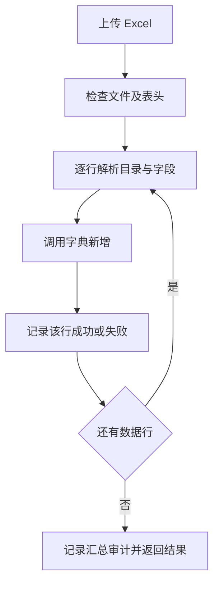

| 步骤 | 执行主体 | 处理动作 | 条件 / 分支 | 输出或副作用 |
|---|---|---|---|---|
| 1 | 控制器 | 校验文件大小、后缀、工作表、表头和行数 | 不满足整体文件规则 | 返回参数错误，不进入逐行导入 |
| 2 | 控制器 / 字典存储 | 按 `/` 分隔的名称从根逐级查找目录 | 路径不存在或行为空 | 记录该行失败，继续下一行 |
| 3 | 字典存储 | 转换长度和精度，校验字段并调用单条新增 | 数据无效、标识重复或存储失败 | 记录失败原因；其他行继续 |
| 4 | 控制器 / 审计 | 汇总数量并记录导入审计 | 审计失败 | 已成功写入的条目可能保留 |

#### 3.11.4 业务规则

| 规则编号 | 触发条件 | 判断逻辑 | 处理结果 |
|---|---|---|---|
| DICT-IMPORT-01 | 解析文件 | 必须匹配模板表头，最多 5000 个数据行 | 文件整体不合法则拒绝。 |
| DICT-IMPORT-02 | 解析目录 | 按名称逐级匹配已有目录 | 不自动创建目录；不存在则该行失败。 |
| DICT-IMPORT-03 | 行写入 | 每行调用 `DictionaryStore.create` 进行独立存储事务 | 单行失败不撤销其他已成功行。 |
| DICT-IMPORT-04 | 行失败 | 参数异常保留对应消息，其他异常使用通用写入失败 | 返回行号及原因。 |

#### 3.11.5 模块交互与时序

```mermaid
sequenceDiagram
    participant U as 数据字典页面
    participant C as 字典控制器
    participant S as 字典存储
    participant D as 平台数据库
    participant A as 审计服务
    U->>C: 上传 XLSX 文件
    C->>C: 检查文件、表头和行数
    loop 每一数据行
        C->>S: 查找目录、校验并新增
        S->>D: 写入条目事务
        S-->>C: 成功或异常
    end
    C->>A: 记录汇总结果
    C-->>U: 成功数、失败数和行错误
```

单行存储事务与汇总审计没有统一的批量事务；页面收到错误后应先核对已登记条目。

#### 3.11.6 状态及流转

| 当前状态 | 触发事件 | 转移条件 | 目标状态 | 副作用 |
|---|---|---|---|---|
| 文件待处理 | 提交导入 | 文件整体校验失败 | 拒绝 | 不进行逐行写入。 |
| 文件校验通过 | 处理数据行 | 行校验及新增成功 | 该行成功 | 写入字典条目。 |
| 文件校验通过 | 处理数据行 | 行校验或新增失败 | 该行失败 | 收集错误并继续其他行。 |
| 行处理结束 | 写汇总审计 | 审计成功 | 返回结果 | 返回计数和错误列表。 |

导入过程未发现独立持久化的导入任务状态机，状态机图不适用。

#### 3.11.7 数据访问与一致性

| 设计项 | 实际实现 |
|---|---|
| 读取 / 写入表 | 读取 `dictionary_directories`；按成功行写入 `dictionary_entries`，处理结束调用审计。 |
| 事务边界与传播 | 每行通过事务化的 `DictionaryStore.create` 写入；无覆盖整个工作簿及审计的总事务。 |
| 并发控制 | 新增时锁定目标目录；唯一约束处理重复标识。 |
| 幂等机制 | 无请求级去重；重传文件中已成功条目会因标识重复而失败。 |
| 数据删除与恢复 | 导入不删除既有条目；无批量回滚或撤销接口。 |

#### 3.11.8 异常与边界场景

| 异常场景 | 实际触发条件 | 处理逻辑 | 错误码 / 提示 | 数据影响 |
|---|---|---|---|---|
| 文件不合法 | 非 xlsx、超限、表头不匹配、无数据或无法解析 | 返回参数错误 | 中文原因见接口响应 | 文件整体检查阶段不写入。 |
| 空行或目录不存在 | 工作表含空行或目录路径无匹配 | 记失败并继续 | 错误列表包含行号和原因 | 不影响已成功行。 |
| 业务字段错误或重复标识 | 单行未通过新增校验 | 记失败并继续 | 返回具体校验原因 | 不撤销其他行。 |
| 汇总审计失败 | 各行已处理，审计调用异常 | 响应可能失败 | 以实际异常处理为准 | 成功行可能已提交，需核对。 |

#### 3.11.9 关联设计与验证

| 关联类型 | 编号 / 名称 | 说明 |
|---|---|---|
| 接口 | API-DICT-10，`POST /api/dictionary/import` | 文件格式和响应见接口设计第 4.28 节。 |
| 数据表 | `dictionary_directories`、`dictionary_entries` | 路径查找和条目写入。 |
| 页面 | PAGE-DICT | 字典 Excel 导入。 |
| 测试 | 对应测试和目标环境待逐项映射 | 不以接口章节存在替代运行验证。 |

关键实现依据：`DictionaryController.importFile`、`DictionaryStore.directoryByPath` 和 `create`。

### 3.12 数据源连接登记（FUNC-ASSET-SOURCE-CREATE）

#### 3.12.1 功能说明

| 项目 | 内容 |
|---|---|
| 功能描述 | 登记数据源连接配置，供数据对象、查询和任务等功能使用。 |
| 触发条件 | 用户提交新增数据源表单或调用新增接口。 |
| 前置条件 | 已登录并具备数据源新增权限；数据库版本、驱动和配置满足服务端校验。 |
| 执行角色及权限 | `datasource.source.create`；连接测试接口另需对应测试权限。 |
| 输入 | 名称、版本配置、主机、端口、数据库、用户名、密码、可选驱动及连接参数。 |
| 输出 | 新数据源编号和名称。 |
| 后置条件 | 平台保存连接配置和加密后的密码，并写入新增成功审计。 |

#### 3.12.2 输入与输出规则

| 参数 / 数据项 | 类型 | 必填 | 校验 / 默认值 | 含义 |
|---|---|---|---|---|
| `name`、`profileId` | string | 是 | 由连接定义及数据库版本注册表校验 | 连接名称及版本配置 |
| `host`、`port`、`database`、`username` | string / integer | 是 | 由连接定义、驱动及版本配置校验 | 数据库连接信息 |
| `password` | string | 是 | 创建时不可为空；服务端加密后持久化 | 数据库访问凭据 |
| `driverId`、`options` | long / object | 否 | 驱动与版本配置及参数由工厂校验 | 可选驱动与高级参数 |
| `id`、`name` | long / string | 成功时返回 | HTTP 201 | 已登记数据源编号及名称 |

#### 3.12.3 业务处理流程

```mermaid
flowchart TD
    A[提交连接配置] --> B[鉴权并构造连接定义]
    B --> C[验证版本、驱动及连接参数]
    C --> D[加密密码并写入平台库]
    D --> E[记录成功审计]
    E --> F[提交事务并返回编号]
```

| 步骤 | 执行主体 | 处理动作 | 条件 / 分支 | 输出或副作用 |
|---|---|---|---|---|
| 1 | 页面 | 用户可测试当前表单连接 | 测试失败或配置变化 | 页面不允许直接保存，具体联动由表单实现 |
| 2 | 控制器 / 连接工厂 | 构造并验证配置 | 配置或驱动不合法 | 返回 HTTP 400 |
| 3 | 数据源存储 | 校验非空密码，加密并插入平台库 | 凭据或平台库处理失败 | 不返回创建成功 |
| 4 | 控制器 / 审计 | 在创建事务中记录审计并返回 | 事务正常提交 | HTTP 201、数据源编号和名称 |

连接测试是页面的保存前交互；新增接口本身执行配置验证和存储，没有要求提交一次成功测试的凭据或结果，因此调用 API 时不能把页面限制视为服务端强制连接测试。

#### 3.12.4 业务规则

| 规则编号 | 触发条件 | 判断逻辑 | 处理结果 |
|---|---|---|---|
| SOURCE-CREATE-01 | 新增配置 | 创建时连接定义和密码不能为空，并进行工厂校验 | 不合法时拒绝。 |
| SOURCE-CREATE-02 | 持久化密码 | 存储层调用凭据加密组件 | 数据库保存密文，普通列表响应不包含密码。 |
| SOURCE-CREATE-03 | 连接测试 | 页面按测试结果控制保存；新增接口并不验证测试结果 | API 调用者应自行执行连接测试。 |

#### 3.12.5 模块交互与时序

```mermaid
sequenceDiagram
    participant U as 页面或调用方
    participant C as 数据源控制器
    participant F as 连接工厂
    participant S as 数据源存储
    participant D as 平台数据库
    participant A as 审计
    U->>C: 提交配置
    C->>F: 校验连接定义
    C->>S: 创建数据源
    S->>S: 加密密码
    S->>D: 插入配置与密文
    S-->>C: 返回编号
    C->>A: 记录成功审计
    C-->>U: 返回 201 和编号
```

控制器方法声明事务；该流程不代表平台库与目标数据库存在分布式事务，也不证明目标数据库连接可用。

#### 3.12.6 状态及流转

| 当前状态 | 触发事件 | 转移条件 | 目标状态 | 副作用 |
|---|---|---|---|---|
| 未登记 | 新增 | 配置、密码和事务处理成功 | 已登记 | 保存配置、密文及成功审计。 |
| 未登记 | 新增 | 参数或配置校验失败 | 未登记 | 返回配置错误。 |

数据源登记本身未定义独立持久化状态机，状态机图不适用；连接测试结果不等同于长期在线状态。

#### 3.12.7 数据访问与一致性

| 设计项 | 实际实现 |
|---|---|
| 读取 / 写入表 | 写入平台 `data_sources`；审计调用写入平台审计记录；配置验证可能查询驱动配置。 |
| 事务边界与传播 | 控制器创建方法声明 `@Transactional`；配置校验、存储和成功审计在该调用内。 |
| 并发控制 | 新增依平台数据库约束；删除及引用检查另有锁定逻辑。 |
| 幂等机制 | 未发现新增请求的幂等键；重复提交可能创建多条记录，具体还受数据库约束影响。 |
| 数据删除与恢复 | 本操作不删除目标业务库；数据源删除需单独验证引用。 |

#### 3.12.8 异常与边界场景

| 异常场景 | 实际触发条件 | 处理逻辑 | 错误码 / 提示 | 数据影响 |
|---|---|---|---|---|
| 配置非法或密码为空 | 构造、工厂校验或存储参数校验失败 | 返回参数错误 | 400，`Invalid data source configuration` | 不返回创建成功。 |
| 加密或平台存储失败 | 密钥不可用或数据库写入异常 | 异常向上传播并由事务管理处理 | 未在本方法中统一定义 | 需核对平台库及日志；不暴露实际凭据。 |
| 目标数据库不可达 | 新增请求未执行连接测试时 | 新增接口本身不以连接成功为前置条件 | 无该接口专属连接测试结果 | 可能登记不可连接配置；后续测试可发现。 |

#### 3.12.9 关联设计与验证

| 关联类型 | 编号 / 名称 | 说明 |
|---|---|---|
| 接口 | `POST /api/data-sources`、`POST /api/data-sources/test-config` | 分别为登记与表单连接测试。 |
| 数据表 | `data_sources` | 保存连接配置和密码密文。 |
| 页面 | PAGE-SOURCE | 数据源新增和连接测试。 |
| 测试 | 测试与目标环境待逐项映射 | 不将前端表单约束当成后端执行证据。 |

关键实现依据：`DataSourceController.create`、`testConfig`、`DataSourceStore.create` 和 `DataSources.vue`。

### 3.13 数据集明细查询（FUNC-QUERY-PREVIEW）

#### 3.13.1 功能说明

| 项目 | 内容 |
|---|---|
| 功能描述 | 按当前用户的数据集授权、部门范围和字段权限读取明细。 |
| 触发条件 | 用户在数据查询页面执行明细查询或调用预览接口。 |
| 前置条件 | 当前会话有效，数据集已登记，用户具有可解析的数据范围和字段授权。 |
| 执行角色及权限 | 路由要求 `datasource.query.read`；数据集和行列权限还由策略解析结果控制。 |
| 输入 | 数据集编号、所选字段和最大返回行数。 |
| 输出 | 按授权范围处理后的记录数组。 |
| 后置条件 | 只读查询，不修改业务表。 |

#### 3.13.2 输入与输出规则

| 参数 / 数据项 | 类型 | 必填 | 校验 / 默认值 | 含义 |
|---|---|---|---|---|
| `id` | long | 是 | 数据集须存在并可解析当前用户策略 | 数据集编号 |
| `fields` | string[] | 是 | 1–100 项、不得重复；必须属于数据集且有字段授权 | 选择的字段 |
| `limit` | integer | 是 | 至少 1，不超过运行配置中的最大行数 | 最大返回行数 |
| 响应 | object[] | 成功时返回 | 字段由选择项决定；无交集时返回空数组 | 授权范围内的结果行 |

#### 3.13.3 业务处理流程

```mermaid
flowchart TD
    A[提交数据集和所选字段] --> B[认证并解析用户数据集策略]
    B --> C[检查字段授权和分页上限]
    C --> D[计算各字段可访问部门交集]
    D --> E{部门交集为空}
    E -->|是| F[返回空数组]
    E -->|否| G[以只读连接和绑定参数查询]
    G --> H[逐行按部门字段授权决定明文或脱敏]
    H --> I[返回结果]
```

| 步骤 | 执行主体 | 处理动作 | 条件 / 分支 | 输出或副作用 |
|---|---|---|---|---|
| 1 | 控制器 / 策略存储 | 从登录主体解析用户、数据集与有效策略 | 身份或数据权限不成立 | 拒绝访问 |
| 2 | 查询引擎 | 校验字段、部门范围与返回行数 | 字段未授权、重复或参数超限 | 拒绝或返回参数错误 |
| 3 | 查询引擎 | 计算所选字段的允许部门交集 | 交集为空 | 返回空数组，不访问目标表 |
| 4 | 目标数据源 | 以只读连接、带引号的标识符和绑定的部门编号执行查询 | 查询失败 | 返回查询失败响应 |
| 5 | 查询引擎 | 核对每行部门并根据字段授权输出或脱敏 | 行部门不在允许范围 | 拒绝该查询 |

#### 3.13.4 业务规则

| 规则编号 | 触发条件 | 判断逻辑 | 处理结果 |
|---|---|---|---|
| QUERY-PREVIEW-01 | 解析策略 | 部门范围为空或超过 1000，或数据集部门字段不可用 | 拒绝访问。 |
| QUERY-PREVIEW-02 | 请求字段 | 字段须存在于数据集并具有相应授权；所选字段不能重复 | 非法参数或无权字段被拒绝。 |
| QUERY-PREVIEW-03 | 组合字段授权 | 对各字段的允许部门取交集 | 交集为空时返回空数组。 |
| QUERY-PREVIEW-04 | 输出每行字段 | FULL 输出安全转换后的值；非 FULL 的可访问值输出 `****`；null 保持 null | 不向页面输出不应明文展示的值。 |
| QUERY-PREVIEW-05 | 主数据与数据查询 | 主数据使用独立主数据权限；本功能使用数据集绑定和行列策略 | 不以主数据授权推导本功能的数据集授权。 |

#### 3.13.5 模块交互与时序

```mermaid
sequenceDiagram
    participant U as 数据查询页面
    participant C as 查询控制器
    participant P as 数据集策略存储
    participant E as 查询引擎
    participant D as 目标数据源
    U->>C: 提交数据集、字段和行数
    C->>P: 解析当前用户数据集策略
    P-->>C: 数据集与授权部门、字段
    C->>E: 执行授权明细查询
    E->>D: 只读查询允许的部门
    D-->>E: 查询结果
    E->>E: 核对部门并处理字段脱敏
    E-->>C: 结果行
    C-->>U: 结果数组
```

策略由服务端解析，不能使用前端传入的部门列表代替授权；目标数据库连接及查询在请求中同步执行。

#### 3.13.6 状态及流转

| 当前状态 | 触发事件 | 转移条件 | 目标状态 | 副作用 |
|---|---|---|---|---|
| 不适用 | 执行明细查询 | 授权通过且目标库查询成功 | 不适用 | 返回明细或空数组，不写目标业务表。 |
| 不适用 | 授权、参数或查询失败 | 不满足条件 | 不适用 | 返回错误，不创建业务状态。 |

该功能不维护持久化查询状态，状态机图不适用。

#### 3.13.7 数据访问与一致性

| 设计项 | 实际实现 |
|---|---|
| 读取 / 写入表 | 读取平台数据集、角色与策略信息，读取外部目标表；本功能不更新外部业务数据。 |
| 事务边界与传播 | 外部连接设置只读；未发现与平台策略读取跨库的一致性事务。 |
| 并发控制 | 使用 `QueryLimits` 控制查询资源；实际并发数、超时和上限以运行配置为准。 |
| 幂等机制 | 查询不写目标表；业务数据及授权变化可能导致重复查询结果不同。 |
| 数据删除与恢复 | 不适用，本功能不执行删除。 |

#### 3.13.8 异常与边界场景

| 异常场景 | 实际触发条件 | 处理逻辑 | 错误码 / 提示 | 数据影响 |
|---|---|---|---|---|
| 无数据集或字段权限 | 无有效策略、部门范围或字段授权 | 安全异常映射为 403 | HTTP 403 | 不返回受限字段数据。 |
| 参数无效 | 字段为空、重复、超过 100 项或行数越界 | 参数异常映射为 400 | HTTP 400，Invalid query | 不执行有效查询。 |
| 各字段部门交集为空 | 用户对所选字段的允许部门无交集 | 返回空数组 | HTTP 200，`[]` | 不访问目标表。 |
| 目标库异常 | 连接、标识符引用或 SQL 执行失败 | 映射为上游查询错误 | HTTP 502，Dataset query failed | 不写目标业务表。 |

#### 3.13.9 关联设计与验证

| 关联类型 | 编号 / 名称 | 说明 |
|---|---|---|
| 接口 | `POST /api/datasets/{id}/preview` | 字段和错误响应见接口设计。 |
| 数据表 | 平台数据集和角色策略表、外部业务表 | 策略与数据位于不同数据源。 |
| 页面 | PAGE-QUERY | 数据集明细查询。 |
| 测试 | 数据集查询测试及目标环境待逐项映射 | 不能用主数据权限测试替代本功能的数据范围验证。 |

关键实现依据：`DatasetQueryController.preview`、`DatasetPolicyStore.resolve`、`DatasetQueryEngine.query`。

### 3.14 数据服务外部调用（FUNC-SERVICE-CALL）

#### 3.14.1 功能说明

| 项目 | 内容 |
|---|---|
| 功能描述 | 调用方使用令牌访问已发布且已授权的数据服务，按绑定用户的数据集策略查询。 |
| 触发条件 | 外部客户端提交服务调用请求。 |
| 前置条件 | 调用方启用，绑定用户启用且安全版本一致；服务已发布并授权该调用方。 |
| 执行角色及权限 | Bearer 令牌、服务授权及绑定用户当前数据集权限共同决定访问；不使用浏览器会话替代令牌。 |
| 输入 | 服务编号和 `Authorization: Bearer` 令牌。 |
| 输出 | 受数据集策略约束的结果行数组。 |
| 后置条件 | 已接收的调用写入调用记录；处理结束时尝试标记成功或失败和耗时。 |

#### 3.14.2 输入与输出规则

| 参数 / 数据项 | 类型 | 必填 | 校验 / 默认值 | 含义 |
|---|---|---|---|---|
| `id` | long | 是 | 服务存在、已发布且授权当前调用方 | 服务编号 |
| `Authorization` | Header | 是 | `Bearer ` 前缀，后接 43 位 URL-safe 令牌 | 调用方凭据；不在文档记录真实值 |
| 结果 | object[] | 成功返回 | 字段和行数来自服务配置；行列权限由绑定用户当前策略决定 | 数据服务查询结果 |
| 每分钟上限 | integer | 调用方配置 | 范围 1–10000 | 调用方计数限制，按分钟窗口计算 |

#### 3.14.3 业务处理流程

```mermaid
flowchart TD
    A[提交服务编号和 Bearer 令牌] --> B[校验调用方 用户版本和服务授权]
    B --> C[检查分钟限流并创建调用记录]
    C --> D[解析绑定用户当前数据集策略]
    D --> E[执行字段与部门受限查询]
    E --> F[记录结果状态和耗时]
    F --> G[返回查询结果]
```

| 步骤 | 执行主体 | 处理动作 | 条件 / 分支 | 输出或副作用 |
|---|---|---|---|---|
| 1 | 外部服务控制器 / 服务存储 | 校验令牌、调用方、绑定用户安全版本及发布授权 | 认证或授权关系无效 | 返回 401 |
| 2 | 服务存储 | 锁调用方并检查分钟窗口，更新计数及创建 PENDING 调用记录 | 达到上限 | 返回 429，不进入查询 |
| 3 | 策略存储 / 查询引擎 | 解析绑定用户当前策略并执行数据集明细查询 | 权限不足或查询失败 | 分别返回 403 或 502 |
| 4 | 控制器 / 服务存储 | 在 finally 中将调用记录标记 SUCCESS / FAILED 并记录耗时 | 状态写入失败 | 可能影响最终响应，需核对调用记录 |

#### 3.14.4 业务规则

| 规则编号 | 触发条件 | 判断逻辑 | 处理结果 |
|---|---|---|---|
| SERVICE-CALL-01 | 验证令牌 | 令牌格式有效，哈希匹配启用调用方，绑定用户启用且安全版本相同 | 不满足返回 401。 |
| SERVICE-CALL-02 | 检查服务 | 服务为 PUBLISHED，且存在当前调用方授权 | 不满足返回 401。 |
| SERVICE-CALL-03 | 检查限流 | 在事务内锁定调用方并按分钟窗口计数 | 超过每分钟上限返回 429。 |
| SERVICE-CALL-04 | 查询数据 | 使用绑定用户当前数据集行列策略以及服务保存的字段、行数上限 | 结果仍受部门和字段权限约束。 |
| SERVICE-CALL-05 | 调用统计 | 已接收调用先记 PENDING，结束后更新为 SUCCESS 或 FAILED | 进行中或中断调用可能仍为 PENDING，计入已接收总数。 |

#### 3.14.5 模块交互与时序

```mermaid
sequenceDiagram
    participant U as 外部调用方
    participant C as 外部服务控制器
    participant S as 服务目录存储
    participant P as 数据集策略存储
    participant E as 明细查询引擎
    participant D as 目标数据库
    U->>C: 服务编号和 Bearer 令牌
    C->>S: 校验令牌 授权和限流并登记调用
    S-->>C: 绑定用户 数据集和调用编号
    C->>P: 解析绑定用户当前权限
    C->>E: 按服务字段及行数查询
    E->>D: 只读查询授权部门
    D-->>E: 返回记录
    E-->>C: 脱敏后的结果
    C->>S: 记录结果和耗时
    C-->>U: 返回结果或错误
```

调用登记和目标数据查询分别执行；请求完成时记录状态的异常可能覆盖原响应，不能仅凭客户端错误推断查询是否曾执行。

#### 3.14.6 状态及流转

| 当前状态 | 触发事件 | 转移条件 | 目标状态 | 副作用 |
|---|---|---|---|---|
| 无调用记录 | 授权及限流检查通过 | 调用登记事务成功 | PENDING | 计数增加，插入调用记录。 |
| PENDING | 查询成功并完成状态写入 | 调用记录仍处于 PENDING | SUCCESS | 更新耗时。 |
| PENDING | 查询失败并完成状态写入 | 调用记录仍处于 PENDING | FAILED | 更新耗时。 |
| PENDING | 进程中断或完成状态写入失败 | 未完成终态更新 | PENDING / 待核对 | 已接收统计可能大于成功与失败之和。 |

```mermaid
stateDiagram-v2
    [*] --> PENDING: 授权通过并登记
    PENDING --> SUCCESS: 查询成功并记录
    PENDING --> FAILED: 查询失败并记录
```

#### 3.14.7 数据访问与一致性

| 设计项 | 实际实现 |
|---|---|
| 读取 / 写入表 | 读取调用方、用户、服务、授权及数据集策略；写入调用方计数和 `service_invocations`；只读查询外部业务表。 |
| 事务边界与传播 | `begin` 使用事务锁定调用方并写入计数及 PENDING 调用；外部数据源查询和 `complete` 不与其构成全局事务。 |
| 并发控制 | 对调用方行使用 `FOR UPDATE` 串行化窗口计数；查询还受 `QueryLimits` 限制。 |
| 幂等机制 | 未发现调用请求幂等键；重试作为新的调用并再次计数。 |
| 数据删除与恢复 | 本功能不删除目标业务记录；调用状态异常需要结合日志和平台记录排查。 |

#### 3.14.8 异常与边界场景

| 异常场景 | 实际触发条件 | 处理逻辑 | 错误码 / 提示 | 数据影响 |
|---|---|---|---|---|
| 令牌或授权无效 | 无 Bearer、令牌无效、用户或调用方停用、安全版本变化、服务未授权或未发布 | 调用初始化拒绝 | HTTP 401 | 不进入数据集查询。 |
| 超过调用上限 | 当前分钟计数达到调用方上限 | 拒绝 | HTTP 429 | 不创建有效查询结果。 |
| 绑定用户数据集权限不足 | 调用已登记后策略或字段权限检查失败 | 标记失败并返回 | HTTP 403 | 不返回受限数据。 |
| 目标查询或完成记录异常 | 连接或查询失败，或最终状态更新失败 | 查询错误映射为 502；最终更新异常可能影响响应 | HTTP 502 或未统一定义异常 | 调用记录可能保留 PENDING，应核对。 |

#### 3.14.9 关联设计与验证

| 关联类型 | 编号 / 名称 | 说明 |
|---|---|---|
| 接口 | `GET /api/service-call/{id}` | 令牌格式和响应见接口设计。 |
| 数据表 | `data_services`、`service_callers`、`service_grants`、`service_invocations` | 服务、调用方、授权和调用记录。 |
| 页面 | PAGE-SERVICE | 管理服务、调用方、授权及统计。 |
| 测试 | 相关测试与目标环境待逐项映射 | 不将静态分析等同于对外服务正式安全验收。 |

关键实现依据：`ExternalServiceController.call`、`ServiceCatalogStore.begin/complete`、`DatasetPolicyStore.resolve`、`DatasetQueryEngine.query`。

### 3.15 报表执行（FUNC-REPORT-RUN）

#### 3.15.1 功能说明

| 项目 | 内容 |
|---|---|
| 功能描述 | 按当前用户保存的报表配置重新执行明细或聚合查询。 |
| 触发条件 | 用户查看报表或看板中关联的报表。 |
| 前置条件 | 会话有效，报表属于当前用户，当前用户仍可解析所绑定数据集策略。 |
| 执行角色及权限 | 路由需 `report.report.execute`；数据集策略解析要求角色具备 `datasource.query.read` 及相应行列授权。 |
| 输入 | 报表编号。 |
| 输出 | 依据报表配置计算的数据行数组。 |
| 后置条件 | 读取报表配置及目标数据，不修改目标业务表。 |

#### 3.15.2 输入与输出规则

| 参数 / 数据项 | 类型 | 必填 | 校验 / 默认值 | 含义 |
|---|---|---|---|---|
| `id` | long | 是 | 当前用户可访问的报表编号 | 路径参数 |
| `kind` | string | 已保存配置 | PREVIEW 或 ANALYSIS | 决定使用明细或聚合查询引擎 |
| `configuration` | JSON 对象 | 已保存配置 | 保存时反序列化为对应请求结构；执行时进一步应用查询规则 | 所选字段、筛选及行数等 |
| 响应 | object[] | 成功时返回 | 动态字段和数量由配置及当前数据权限决定 | 查询结果 |

#### 3.15.3 业务处理流程

```mermaid
flowchart TD
    A[发起报表执行] --> B[识别当前用户并读取所属报表]
    B --> C[重新解析当前数据集策略]
    C --> D{报表类型}
    D -->|PREVIEW| E[解析明细配置并执行]
    D -->|ANALYSIS| F[解析聚合配置并执行]
    E --> G[返回受限结果]
    F --> G
```

| 步骤 | 执行主体 | 处理动作 | 条件 / 分支 | 输出或副作用 |
|---|---|---|---|---|
| 1 | 控制器 / 报表存储 | 从会话确定用户并读取该用户的报表 | 报表不存在或不属于用户 | 返回 404 |
| 2 | 数据集策略存储 | 重新解析当前角色、部门和字段授权 | 当前权限不足 | 返回 403 |
| 3 | 控制器 / 查询引擎 | 根据已保存类型解析配置并执行明细或聚合 | 参数无效或外部查询失败 | 分别返回 400 或 502 |
| 4 | 控制器 | 返回查询结果 | 查询成功 | 返回动态行数组 |

#### 3.15.4 业务规则

| 规则编号 | 触发条件 | 判断逻辑 | 处理结果 |
|---|---|---|---|
| REPORT-RUN-01 | 查找报表 | 以当前用户和报表编号读取 | 找不到返回 404。 |
| REPORT-RUN-02 | 执行报表 | 每次重新解析当前数据集策略 | 以前可访问不保证现在仍有权限。 |
| REPORT-RUN-03 | 查询类型 | PREVIEW 使用明细引擎；其他已保存有效类型使用聚合引擎 | 结果仍受字段、部门及查询限制。 |
| REPORT-RUN-04 | 保存配置与运行 | 创建 / 修改时检查 JSON 类型及可反序列化；运行时仍会执行查询引擎校验 | 保存成功不等于所有运行参数和目标库查询已验证。 |

#### 3.15.5 模块交互与时序

```mermaid
sequenceDiagram
    participant U as 报表页面
    participant C as 报表控制器
    participant R as 报表存储
    participant P as 数据集策略存储
    participant E as 明细或聚合查询引擎
    participant D as 目标数据库
    U->>C: 执行报表编号
    C->>R: 读取当前用户报表
    R-->>C: 数据集和已保存查询配置
    C->>P: 解析当前数据范围和字段授权
    C->>E: 根据类型执行查询
    E->>D: 在授权范围内只读查询
    D-->>E: 查询结果
    E-->>C: 处理后的结果
    C-->>U: 返回行数组
```

报表执行不会因保存时曾通过授权而绕过执行时授权；平台元数据与外部业务库不构成跨库全局事务。

#### 3.15.6 状态及流转

| 当前状态 | 触发事件 | 转移条件 | 目标状态 | 副作用 |
|---|---|---|---|---|
| 不适用 | 执行报表 | 报表及当前授权有效，查询成功 | 不适用 | 返回结果，不写业务表。 |
| 不适用 | 执行报表 | 报表缺失、授权失效或查询失败 | 不适用 | 返回对应错误。 |

报表执行不创建持久化运行状态机，状态机图不适用。

#### 3.15.7 数据访问与一致性

| 设计项 | 实际实现 |
|---|---|
| 读取 / 写入表 | 读取当前用户报表及数据集授权，并查询外部业务表；执行不修改业务表。 |
| 事务边界与传播 | 报表配置、策略和外部查询不声明跨库全局事务。 |
| 并发控制 | 明细及聚合引擎使用受控查询限制；实际参数以环境配置为准。 |
| 幂等机制 | 不提供查询结果快照；数据或授权变化时重复执行结果可能不同。 |
| 数据删除与恢复 | 执行过程不删除数据。 |

#### 3.15.8 异常与边界场景

| 异常场景 | 实际触发条件 | 处理逻辑 | 错误码 / 提示 | 数据影响 |
|---|---|---|---|---|
| 报表不存在或非当前用户所有 | 查询用户所属报表失败 | 拒绝执行 | HTTP 404 | 无目标业务写入。 |
| 数据集授权失效 | 当前用户不满足策略或字段权限 | 拒绝查询 | HTTP 403 | 不返回受限数据。 |
| 配置不符合查询规则 | 运行阶段引擎参数校验失败 | 返回参数错误 | HTTP 400，Invalid report query | 无目标业务写入。 |
| 目标库或配置解析异常 | 查询或解析发生其他异常 | 映射为上游错误 | HTTP 502，Report query failed | 无目标业务写入。 |

#### 3.15.9 关联设计与验证

| 关联类型 | 编号 / 名称 | 说明 |
|---|---|---|
| 接口 | `POST /api/reports/{id}/run` | 报表执行契约见接口设计。 |
| 数据表 | `reports`、数据集策略表及外部业务表 | 报表配置和数据查询分别读取。 |
| 页面 | PAGE-REPORT | 报表和看板查看。 |
| 测试 | 报表及查询测试需逐项映射 | 目标环境数据权限组合尚未验收。 |

关键实现依据：`ReportController.run`、`ReportStore.report`、`DatasetPolicyStore.resolve`、`DatasetQueryEngine` 和 `AnalysisQueryEngine`。

### 3.16 工作流按日期补跑（FUNC-WORKFLOW-BACKFILL）

#### 3.16.1 功能说明

| 项目 | 内容 |
|---|---|
| 功能描述 | 为指定工作流版本的每个业务日期创建运行实例，并在事务提交后派发。 |
| 触发条件 | 获授权用户通过工作流页面或接口提交日期范围。 |
| 前置条件 | 工作流版本及其引用的任务版本存在，任务配置通过校验并按实现包含业务日期参数。 |
| 执行角色及权限 | `workflow.schedule.backfill`。 |
| 输入 | 工作流编号、工作流版本、开始日期和结束日期。 |
| 输出 | 已创建的工作流运行编号列表，HTTP 202 表示接受而非运行成功。 |
| 后置条件 | 平台保存每个日期的运行记录及审计；提交后逐个派发。 |

#### 3.16.2 输入与输出规则

| 参数 / 数据项 | 类型 | 必填 | 校验 / 默认值 | 含义 |
|---|---|---|---|---|
| `id` | long | 是 | 工作流及指定版本须存在 | 工作流编号 |
| `version` | integer | 是 | 指定有效的工作流版本 | 固定工作流定义 |
| `startDate`、`endDate` | date | 是 | 不得为空、结束不早于开始；两日期相差小于 31 天 | 包含起止日期，最多 31 个业务日期 |
| `ids` | long[] | 成功时返回 | 对应每个日期创建的运行记录 | 运行编号列表 |

#### 3.16.3 业务处理流程

```mermaid
flowchart TD
    A[提交工作流版本和日期范围] --> B[检查日期及工作流版本]
    B --> C[逐节点校验固定任务版本及业务日期参数]
    C --> D[逐日期创建运行和审计]
    D --> E[平台事务提交]
    E --> F[逐个派发运行]
    F --> G[通过运行详情查看最终结果]
```

| 步骤 | 执行主体 | 处理动作 | 条件 / 分支 | 输出或副作用 |
|---|---|---|---|---|
| 1 | 控制器 / 运行服务 | 检查起止日期及工作流版本 | 日期非法、范围超限或版本不存在 | 返回参数错误 |
| 2 | 运行服务 | 逐节点读取固定任务版本、校验配置并检查业务日期参数 | 任务版本缺失或不符合参数检查 | 不创建补跑实例 |
| 3 | 运行存储 / 审计 | 在事务中按日期创建实例并记录审计 | 事务回滚 | 不应将实例视为已成功提交 |
| 4 | 事务提交回调 / 派发器 | 提交后逐个派发已创建实例 | 派发器拒绝或执行失败 | 根据运行记录查看状态；202 不代表运行成功 |

#### 3.16.4 业务规则

| 规则编号 | 触发条件 | 判断逻辑 | 处理结果 |
|---|---|---|---|
| WF-BACKFILL-01 | 检查范围 | 日期均非空，结束不早于开始，日期差小于 31 天 | 最多创建包含起止日期的 31 个实例。 |
| WF-BACKFILL-02 | 检查节点 | 每个节点的固定任务版本须存在且通过任务配置校验 | 不满足则拒绝整个请求。 |
| WF-BACKFILL-03 | 检查业务日期 | 代码对 SQL 任务读取 `parameters`，其他类型读取 `sourceParameters`，要求存在 `type=BUSINESS_DATE` 的参数 | 不满足则拒绝；不同任务类型的实际配置兼容性须以验证结果为准。 |
| WF-BACKFILL-04 | 派发 | 所有实例和审计在事务内创建，提交后异步逐个派发 | 已接受不等于实例执行成功；补跑可能重复写入。 |


**当前实现的兼容性风险（静态发现，未做端到端复现）：** `TaskDefinitionValidator` 当前只接受 `ORCH` 类型；补跑对非 SQL 任务检查根节点的 `sourceParameters[].type=BUSINESS_DATE`。而当前编排定义使用 `nodes`、`edges` 和 `variables`，执行器将 `business_date` 作为内置变量注入；前端源码搜索未发现生成 `sourceParameters`。因此，缺少该额外字段的常规 ORCH 配置即使使用了内置业务日期，也会在补跑参数检查时被拒绝。应在隔离环境复现并由开发人员确认修复，不应将补跑能力描述为已验证可用。


#### 3.16.5 模块交互与时序

```mermaid
sequenceDiagram
    participant U as 工作流页面
    participant C as 工作流控制器
    participant S as 工作流运行服务
    participant D as 平台数据库
    participant W as 派发器
    U->>C: 提交版本和日期范围
    C->>S: 校验并创建补跑实例
    S->>D: 读取定义与任务版本
    S->>D: 逐日期创建运行及审计
    S->>D: 提交事务
    S-->>W: 提交后逐个派发
    C-->>U: 返回运行编号列表
    U->>C: 查询实例详情
```

补跑只记录业务日期及运行实例；各任务对业务日期的使用及目标库写入由任务配置和执行器决定。请求返回与实际运行完成之间存在异步边界。

#### 3.16.6 状态及流转

| 当前状态 | 触发事件 | 转移条件 | 目标状态 | 副作用 |
|---|---|---|---|---|
| 无运行实例 | 校验并创建 | 整个创建事务提交成功 | 实例已创建 | 按日期写入运行及审计，并安排提交后派发。 |
| 已创建 | 派发器接受 | 可正常调度 | 按运行记录执行 | 节点及实例状态继续变化。 |
| 已创建 | 派发失败或执行异常 | 具体状态取决于派发器和运行记录 | 待查询 | 不能以 HTTP 202 认定成功。 |

补跑没有独立持久化批次状态机，逐实例状态以工作流运行记录为准。

#### 3.16.7 数据访问与一致性

| 设计项 | 实际实现 |
|---|---|
| 读取 / 写入表 | 读取工作流定义、节点和任务版本；写入工作流运行及审计记录；派发后节点可能访问外部业务数据源。 |
| 事务边界与传播 | 日期范围内实例和审计的创建由运行服务事务处理；实际派发在提交后执行。 |
| 并发控制 | 创建及执行以运行存储、派发器和共享执行限额的实现为准；未发现补跑请求的全局去重。 |
| 幂等机制 | 未发现按工作流、版本、业务日期的请求去重；重复补跑可能重复执行业务写入。 |
| 数据删除与恢复 | 补跑本身不回滚外部系统已提交数据；需在执行前确认目标业务幂等和恢复方案。 |

#### 3.16.8 异常与边界场景

| 异常场景 | 实际触发条件 | 处理逻辑 | 错误码 / 提示 | 数据影响 |
|---|---|---|---|---|
| 日期范围无效 | 日期为空、结束早于开始或日期差达到 31 天 | 拒绝 | HTTP 400，Invalid backfill configuration | 不创建实例。 |
| 工作流或任务版本无效 | 版本不存在或任务配置校验失败 | 拒绝 | HTTP 400 | 不创建实例。 |
| 未检测到业务日期参数 | 按任务类型对应的参数数组未找到 BUSINESS_DATE | 拒绝 | HTTP 400 | 不创建实例；需核对任务类型与配置。 |
| 派发拒绝或任务失败 | 创建事务已提交后出现执行异常 | 派发器处理；客户端查看实例状态 | 请求可能已返回 202 | 外部系统可能存在已提交写入。 |

#### 3.16.9 关联设计与验证

| 关联类型 | 编号 / 名称 | 说明 |
|---|---|---|
| 接口 | `POST /api/workflows/{id}/backfill`、`GET /api/runs/{id}` | 创建补跑和查询实例详情。 |
| 数据表 | 工作流定义、版本和运行相关表 | 具体字段见数据库设计。 |
| 页面 | PAGE-WORKFLOW | 按日期补跑及实例查看。 |
| 测试 | 工作流补跑测试和目标环境待逐项映射 | 特别需要验证当前各任务类型的日期参数兼容性及写入幂等。 |

关键实现依据：`WorkflowController.backfill`、`WorkflowRunService.backfill`、`WorkflowDispatcher`。

### 3.17 增量同步轮询（FUNC-REALTIME-POLL）

#### 3.17.1 功能说明

| 项目 | 内容 |
|---|---|
| 功能描述 | 对处于运行状态的同步任务按游标轮询来源，并按目标键更新或插入目标表。 |
| 触发条件 | 应用就绪后定时轮询，任务处于 RUNNING 且到达下次轮询时间。 |
| 前置条件 | 源和目标数据源、映射、水位字段和目标键配置有效；任务已启动。 |
| 执行角色及权限 | 后台定时器执行；创建、启动、停止、设置分别受实时任务权限控制。 |
| 输入 | 任务配置、已保存水位和同水位排序键。 |
| 输出 | 目标表写入、任务游标、累计条数、最近成功时间或错误状态。 |
| 后置条件 | 成功后更新平台游标及下次轮询时间；失败时尽力记录 ERROR。 |

#### 3.17.2 输入与输出规则

| 参数 / 数据项 | 类型 | 必填 | 校验 / 默认值 | 含义 |
|---|---|---|---|---|
| `sourceId`、`targetId` | long | 是 | 创建时必须为正数并存在 | 来源及目标数据源 |
| `intervalSeconds` | integer | 是 | 5–3600 | 每次成功处理后的轮询间隔 |
| `mapping.batchSize` | integer | 是 | 1–1000 | 单批读取上限 |
| `mapping.sourceColumns` / `targetColumns` | string[] | 是 | 非空、数量相同、最多 200 项且名称有效并不重复 | 字段映射 |
| 水位、排序键与目标键 | string / string[] | 是 | 类型 LONG 或 TIMESTAMP；标识符有效，目标键非空且属于目标字段 | 游标和目标行定位 |
| `watermark`、`tie`、`processed`、`lastSuccess`、`lastError` | 动态 / long / 时间 / string | 运行视图返回 | 水位及时间可能为空 | 任务进度与异常 |

#### 3.17.3 业务处理流程

```mermaid
flowchart TD
    A[应用就绪后的定时扫描] --> B[查找已到期 RUNNING 任务]
    B --> C[锁定任务并重新检查状态与到期时间]
    C --> D[按游标读取来源批次]
    D --> E[按目标键更新或插入并提交目标库]
    E --> F[校验结果及游标推进]
    F --> G[更新平台游标 数量及下次轮询时间]
    D -->|执行异常| H[记录 ERROR 与通用错误]
```

| 步骤 | 执行主体 | 处理动作 | 条件 / 分支 | 输出或副作用 |
|---|---|---|---|---|
| 1 | 定时轮询器 | 应用就绪后查询到期任务，单次最多 100 项 | 应用尚未就绪或无到期任务 | 本轮不处理 |
| 2 | 任务存储 | 锁定任务，再核对 RUNNING 状态与到期时间 | 状态改变或尚未到期 | 跳过该任务 |
| 3 | 增量执行器 | 只读来源，按映射及目标键更新或插入，提交目标库事务 | 目标写入失败 | 尝试回滚目标事务，任务记录 ERROR |
| 4 | 任务存储 | 校验返回条数、游标与映射，更新平台水位和进度 | 空批次必须保留原游标；非空结果游标须前进 | 更新累计数、最近成功及下次轮询时间 |

#### 3.17.4 业务规则

| 规则编号 | 触发条件 | 判断逻辑 | 处理结果 |
|---|---|---|---|
| RT-POLL-01 | 轮询扫描 | 任务为 RUNNING 且下次时间已到；持锁后再次确认 | 已停止或未到期时跳过。 |
| RT-POLL-02 | 处理结果 | 返回条数在 0 到 batchSize 之间；空批次游标不变化，非空批次游标严格前进 | 结果无效时标记 ERROR。 |
| RT-POLL-03 | 目标写入 | 按目标键先更新，未命中则插入，目标连接显式事务提交 | 失败时尝试回滚目标连接。 |
| RT-POLL-04 | 调整运行参数 | 仅 STOPPED / ERROR 可调整；间隔 5–3600 秒、批大小 1–1000 | 运行中修改返回冲突。 |
| RT-POLL-05 | 目标库与平台库 | 目标提交发生在平台游标更新之前 | 平台更新失败时可能重复读取；不得承诺跨库恰好一次。 |

#### 3.17.5 模块交互与时序

```mermaid
sequenceDiagram
    participant T as 定时轮询器
    participant S as 任务存储
    participant M as 平台数据库
    participant E as 增量执行器
    participant A as 来源数据库
    participant B as 目标数据库
    T->>S: 获取到期任务并逐个轮询
    S->>M: 锁定任务并读取游标
    S->>E: 按配置执行一批
    E->>A: 按游标只读来源
    E->>B: 按目标键更新或插入
    E->>B: 提交目标事务
    E-->>S: 返回条数和新游标
    S->>M: 校验并更新游标与状态
```

平台库持有任务记录锁期间执行增量处理；目标事务与平台游标事务独立，不能仅凭任务状态推断目标库写入是否已提交。

#### 3.17.6 状态及流转

| 当前状态 | 触发事件 | 转移条件 | 目标状态 | 副作用 |
|---|---|---|---|---|
| 无任务 | 创建 | 配置通过校验 | STOPPED | 保存配置，初始计数为 0。 |
| STOPPED / ERROR | 启动 | 任务存在且当前非 RUNNING | RUNNING | 下次轮询时间设为当前时间，清除错误。 |
| RUNNING | 轮询失败 | 处理器异常或返回结果不合法 | ERROR | 保存通用错误信息。 |
| RUNNING / ERROR / STOPPED | 停止 | 任务存在 | STOPPED | 修改状态；不宣称撤销已提交的目标写入。 |
| STOPPED / ERROR | 修改设置 | 间隔与批大小合法 | 原状态 | 保留来源、目标及游标。 |

```mermaid
stateDiagram-v2
    [*] --> STOPPED: 创建
    STOPPED --> RUNNING: 启动
    RUNNING --> ERROR: 轮询失败
    RUNNING --> STOPPED: 停止
    ERROR --> RUNNING: 启动
    ERROR --> STOPPED: 停止
```

#### 3.17.7 数据访问与一致性

| 设计项 | 实际实现 |
|---|---|
| 读取 / 写入表 | 平台 `realtime_jobs` 保存配置、状态和游标；读取来源业务表并写入目标业务表。 |
| 事务边界与传播 | 平台 `poll` 通过事务模板持锁；执行器对目标连接单独提交或回滚，不存在全局事务。 |
| 并发控制 | 处理前锁定任务行并重新校验状态与时间；定时扫描批量选择上限 100。 |
| 幂等机制 | 按目标键更新或插入可减少重复写入影响，但跨库失败、目标约束与并发条件下不能承诺恰好一次。 |
| 数据删除与恢复 | 不自动撤销已提交目标数据；恢复应核对游标和目标数据后决定是否重启。 |

#### 3.17.8 异常与边界场景

| 异常场景 | 实际触发条件 | 处理逻辑 | 错误码 / 提示 | 数据影响 |
|---|---|---|---|---|
| 配置不合法 | 数据源、字段映射、水位、间隔或批大小不满足校验 | 创建或设置被拒绝 | HTTP 400 | 不创建或不更新有效配置。 |
| 运行中调整设置 | 任务状态不是 STOPPED 或 ERROR | 拒绝修改 | HTTP 409 | 配置保持不变。 |
| 处理器或结果异常 | 数据库错误、游标不前进或结果不合规 | 标记 ERROR 并记录通用错误 | 同步失败，请检查连接、主键和任务配置 | 目标事务是否已提交应按具体阶段核对。 |
| 平台游标更新失败 | 目标事务提交后平台事务异常 | 异常记录到应用日志并回滚平台事务 | 以实际错误日志为准 | 下次可能重读；需核对目标表与平台游标。 |

#### 3.17.9 关联设计与验证

| 关联类型 | 编号 / 名称 | 说明 |
|---|---|---|
| 接口 | `/api/realtime-jobs` 及 `/{id}/start`、`stop`、`settings` | 创建及运行控制见接口设计。 |
| 数据表 | `realtime_jobs` 和外部来源 / 目标表 | 平台游标与业务表分别持久化。 |
| 页面 | PAGE-REALTIME | 任务配置、启停和状态查看。 |
| 测试 | 对应测试和目标数据库验证待逐项映射 | 实际跨库中断与恢复须在隔离环境验证。 |

关键实现依据：`RealtimePoller.poll`、`RealtimeJobStore.poll/start/stop/updateSettings` 和 `IncrementalSyncExecutor`。

### 3.18 会话登录与权限刷新（FUNC-SECURITY-SESSION）

#### 3.18.1 功能说明

| 项目 | 内容 |
|---|---|
| 功能描述 | 通过用户名、密码及必要时的验证码建立会话，并在后续请求时重新核对账户和权限。 |
| 触发条件 | 用户提交登录或使用已有会话访问平台 API。 |
| 前置条件 | 用户已初始化且未删除、未停用；登录及写操作满足适用的 CSRF 要求。 |
| 执行角色及权限 | 登录入口允许匿名访问；业务请求按会话与各接口操作权限验证。 |
| 输入 | 登录表单用户名、密码，以及触发验证码要求时的验证码。 |
| 输出 | 登录成功返回 204；失败返回认证错误；后续请求使用服务端会话。 |
| 后置条件 | 成功时更新登录记录、登记在线会话并审计；后续请求动态刷新当前账户权限。 |

#### 3.18.2 输入与输出规则

| 参数 / 数据项 | 类型 | 必填 | 校验 / 默认值 | 含义 |
|---|---|---|---|---|
| `username`、`password` | 表单字符串 | 是 | 按认证实现验证账户与密码 | 登录凭据 |
| `captcha` | 表单字符串 | 条件必填 | 已知账户失败次数达到 2 次后，须匹配当前会话未过期验证码，不区分大小写 | 渐进式验证码 |
| HTTP 204 | 状态码 | 成功时返回 | 不含响应体 | 已建立认证会话 |
| `error`、`captchaRequired` | JSON 字段 | 认证失败时可能返回 | 具体内容依失败阶段 | 登录失败或验证码提示 |

#### 3.18.3 业务处理流程

```mermaid
flowchart TD
    A[提交登录] --> B[检查已知账户锁定和验证码]
    B --> C[用户名密码认证]
    C -->|失败| D[更新已知账户失败次数并审计]
    C -->|成功| E[更新登录时间 登记会话并审计]
    E --> F[后续请求重载账户及权限]
    F --> G{账户及安全版本有效}
    G -->|否| H[清除认证并使会话失效]
    G -->|是| I[检查初始密码及接口权限]
```

| 步骤 | 执行主体 | 处理动作 | 条件 / 分支 | 输出或副作用 |
|---|---|---|---|---|
| 1 | 登录防护过滤器 | 检查已知账户锁定及验证码 | 锁定中或验证码错误 | 返回 401 并记录登录失败 |
| 2 | 认证过滤器 | 按账户密码进行认证 | 凭据无效或账户不可用 | 已知账户失败计数增加；达到阈值后锁定 |
| 3 | 登录成功处理器 | 更新登录时间、登记在线会话、清理验证码并审计 | 成功处理过程异常 | 清除认证并使会话失效，返回 503 |
| 4 | 活跃用户过滤器 | 后续请求重新加载账户与权限，核对用户编号、安全版本与启用状态 | 账户不存在、停用或安全版本变化 | 清除认证、注销会话并返回 401 |
| 5 | 权限链 | 检查强制修改初始密码与目标接口权限 | 需要改密码或无权限 | 拒绝相应请求 |

#### 3.18.4 业务规则

| 规则编号 | 触发条件 | 判断逻辑 | 处理结果 |
|---|---|---|---|
| SESSION-01 | 已知账户登录 | 失败次数达到 2 时要求验证码 | 验证码从会话读取、使用后清除；错误返回 401。 |
| SESSION-02 | 已知账户密码认证失败 | 失败达到 5 次 | 记录 15 分钟锁定；锁定期请求被拒绝。 |
| SESSION-03 | 登录成功 | 重置失败计数和锁定时间，更新前次及本次登录时间 | 登记在线会话、审计并返回 204。 |
| SESSION-04 | 已认证会话请求 | 重新读取账户及启用角色权限，并比较账户编号及安全版本 | 账户失效或版本不符时注销会话。 |
| SESSION-05 | 需要修改初始密码 | 只允许会话、改密、登出和少数基础端点 | 其他端点返回 403 和改密提示。 |
| SESSION-06 | 并发会话 | 安全配置限制每个主体最多一个会话 | 被标记过期的会话后续访问返回 401。 |

#### 3.18.5 模块交互与时序

```mermaid
sequenceDiagram
    participant U as 浏览器
    participant G as 登录防护过滤器
    participant A as 认证处理器
    participant D as 平台数据库
    participant S as 服务端会话
    U->>G: 提交登录表单
    G->>D: 检查已知账户失败次数和锁定
    G->>S: 按需校验并清理验证码
    G->>A: 允许继续认证
    A->>D: 验证账户并读取权限
    A->>D: 更新登录信息和审计
    A->>S: 登记认证会话
    A-->>U: 返回 204 或错误
```

后续业务请求由活跃用户过滤器重新加载主体和权限；外部数据服务调用使用独立的无状态令牌链，详见第 3.14 节。

#### 3.18.6 状态及流转

| 当前状态 | 触发事件 | 转移条件 | 目标状态 | 副作用 |
|---|---|---|---|---|
| 未认证 | 登录认证成功 | 成功处理及审计完成 | 已认证 | 更新账户登录信息，登记会话。 |
| 未认证 | 登录认证失败 | 已知账户达到失败阈值 | 锁定中 | 设置锁定到期时间并记录失败。 |
| 已认证 | 账户停用、删除或安全版本变化 | 后续请求触发活跃用户检查 | 未认证 | 清除认证并使会话失效。 |
| 已认证 | 登录主体需修改初始密码 | 请求不属于允许端点 | 已认证但受限制 | 返回 403 改密提示。 |

账户锁定时间到期不等同于自动重置失败计数；具体后续处理以源码和登录结果为准。

#### 3.18.7 数据访问与一致性

| 设计项 | 实际实现 |
|---|---|
| 读取 / 写入表 | 读取用户、角色和角色权限；成功或失败时更新用户登录安全信息并调用审计。 |
| 事务边界与传播 | 登录处理器的更新、在线会话登记与审计未声明统一跨资源事务；异常时会清除当前会话。 |
| 并发控制 | 会话管理配置每个主体最多一个会话；失败计数及锁定使用平台数据库。 |
| 幂等机制 | 登录、失败计数和审计不是幂等查询；重复失败请求会产生安全状态变化。 |
| 数据删除与恢复 | 登录不删除账户；会话失效不恢复已删除或停用账户。 |

#### 3.18.8 异常与边界场景

| 异常场景 | 实际触发条件 | 处理逻辑 | 错误码 / 提示 | 数据影响 |
|---|---|---|---|---|
| 凭据错误 | 用户名或密码未通过认证 | 已知账户增加失败计数并审计 | 401 | 可能达到锁定阈值。 |
| 验证码错误或失效 | 已知账户达到验证码阈值且验证码无效 | 清理本次会话验证码并拒绝 | 401，验证码错误或已失效 | 不进入密码认证；记录登录失败。 |
| 成功处理异常 | 更新账户、登记会话或审计抛运行时异常 | 清除认证、使会话失效 | 503 | 需要核对账户更新与审计实际状态。 |
| 账户或安全版本变化 | 后续请求重新加载发现身份失效 | 注销原会话 | 401 | 原会话不能继续访问。 |

#### 3.18.9 关联设计与验证

| 关联类型 | 编号 / 名称 | 说明 |
|---|---|---|
| 接口 | `POST /api/login`、`GET /api/session`、`POST /api/logout` | 登录、会话和登出契约见接口设计。 |
| 数据表 | `users`、`roles`、`user_roles`、`role_permissions`、`audit_events` | 用户安全状态、权限和审计。 |
| 页面 | 登录及 PAGE-ORG | 登录及用户管理。 |
| 测试 | 安全测试和目标环境待逐项映射 | H2 测试不能替代正式安全评估。 |

关键实现依据：`SecurityConfiguration`、`LoginGuardFilter`、`ActiveUserFilter` 和 `SessionController`。

### 3.19 数据集分组聚合查询（FUNC-QUERY-ANALYSIS）

#### 3.19.1 功能说明

| 项目 | 内容 |
|---|---|
| 功能描述 | 在用户被授权的数据范围内执行分组、统计、筛选和排序查询。 |
| 触发条件 | 用户提交数据查询的聚合条件，或报表按已保存的聚合配置执行。 |
| 前置条件 | 数据集有可解析的部门策略；所有实际使用字段在参与计算的部门具有明文权限。 |
| 执行角色及权限 | 接口需 `datasource.query.read`；报表调用另需报表执行权限。 |
| 输入 | 数据集编号、分组、统计项、筛选、排序及最大行数。 |
| 输出 | 分组字段和以 `metric_0` 起编号的统计结果行。 |
| 后置条件 | 使用只读连接，不修改目标业务表。 |

#### 3.19.2 输入与输出规则

| 参数 / 数据项 | 类型 | 必填 | 校验 / 默认值 | 含义 |
|---|---|---|---|---|
| `groups` | string[] | 是，可为空数组 | 最多 20 项且不能重复 | 分组字段 |
| `metrics` | object[] | 是 | 1–20 项；操作为 COUNT、SUM、AVG、MIN、MAX | 统计项目 |
| `metrics[].field` | string | 除 COUNT 外是 | COUNT 可为空并使用 `*` | 被统计字段 |
| `filters` | object[] | 是，可为空数组 | 最多 20 项；操作为 EQ、NE、GT、GTE、LT、LTE、IS_NULL、IS_NOT_NULL | 全部满足的筛选条件 |
| `filters[].value` | string / number / boolean | 非空判断操作时是 | 字符串最多 4096 字符；空值判断不需要值 | 参数化筛选值 |
| `sort` | object[] | 否 | null 视为空；最多 20 项，字段须为分组字段或 `metric_N`，方向 ASC / DESC 且字段不重复 | 排序配置 |
| `limit` | integer | 是 | 1 至查询配置最大行数 | 结果行数上限 |
| 响应 | object[] | 成功时返回 | 含分组字段和 `metric_N`；数据库聚合结果可为 null | 统计结果 |

#### 3.19.3 业务处理流程

```mermaid
flowchart TD
    A[提交聚合条件] --> B[解析数据集和用户策略]
    B --> C[校验分组 指标 筛选 排序及行数]
    C --> D[计算所有使用字段的明文授权部门交集]
    D --> E{交集为空}
    E -->|是| F[拒绝访问]
    E -->|否| G[只读连接执行参数化聚合]
    G --> H[转换结果并返回]
```

| 步骤 | 执行主体 | 处理动作 | 条件 / 分支 | 输出或副作用 |
|---|---|---|---|---|
| 1 | 查询控制器 / 策略存储 | 解析当前用户与数据集策略 | 数据集、用户或授权不满足 | 拒绝访问 |
| 2 | 聚合引擎 | 检查分组、指标、筛选、排序及行数 | 参数不合规或字段冲突 | 返回参数错误 |
| 3 | 聚合引擎 | 对实际使用字段计算具备 FULL 权限的部门交集 | 交集为空或字段无权 | 拒绝访问 |
| 4 | 聚合引擎 / 目标数据库 | 使用只读连接与绑定参数执行 SQL | 查询失败 | 返回上游错误 |
| 5 | 聚合引擎 | 将指标按 `metric_N` 映射并转换安全值 | 无匹配记录或聚合值为空 | 以数据库实际结果返回，空聚合值可为 null |

#### 3.19.4 业务规则

| 规则编号 | 触发条件 | 判断逻辑 | 处理结果 |
|---|---|---|---|
| ANALYSIS-01 | 使用分组、指标或筛选字段 | 字段必须登记且在允许部门具备 FULL 授权 | 脱敏字段不能用于相应计算；交集为空返回 403。 |
| ANALYSIS-02 | 设置统计项 | 至少 1 项；无字段仅 COUNT 允许 | 非法统计配置返回 400。 |
| ANALYSIS-03 | 设置排序 | 只允许分组字段或对应 `metric_N`，不能重复 | 非法排序返回 400。 |
| ANALYSIS-04 | SQL 构造 | 标识符使用驱动提供的引用符，部门和筛选值通过参数绑定 | 不把筛选值拼接成 SQL 结构。 |
| ANALYSIS-05 | 分组字段名称 | 不得与生成的 `metric_N` 输出名称冲突 | 有冲突时拒绝。 |

#### 3.19.5 模块交互与时序

```mermaid
sequenceDiagram
    participant U as 查询页面或报表
    participant C as 查询控制器
    participant P as 数据集策略存储
    participant E as 聚合查询引擎
    participant D as 目标数据源
    U->>C: 提交聚合条件
    C->>P: 解析当前用户数据策略
    C->>E: 校验并执行聚合
    E->>E: 计算使用字段的 FULL 部门交集
    E->>D: 绑定参数并只读查询
    D-->>E: 聚合结果
    E-->>C: 安全转换后的行数组
    C-->>U: 返回结果
```

报表运行时也会重新解析当前用户的数据集策略；平台元数据读取与目标库查询不构成全局事务。

#### 3.19.6 状态及流转

| 当前状态 | 触发事件 | 转移条件 | 目标状态 | 副作用 |
|---|---|---|---|---|
| 不适用 | 聚合查询 | 授权及查询成功 | 不适用 | 返回结果，不改变业务数据。 |
| 不适用 | 聚合查询 | 参数、授权或目标库异常 | 不适用 | 返回相应错误。 |

聚合查询没有持久化状态机，状态图不适用。

#### 3.19.7 数据访问与一致性

| 设计项 | 实际实现 |
|---|---|
| 读取 / 写入表 | 读取数据集与权限配置，查询外部业务表；不写目标业务表。 |
| 事务边界与传播 | 目标连接只读；平台权限快照与目标库查询之间无跨库全局事务。 |
| 并发控制 | 与明细查询共用 `QueryLimits` 并发许可、超时和最大行数。 |
| 幂等机制 | 不保存查询快照；数据或策略变化会影响重复查询结果。 |
| 数据删除与恢复 | 不适用。 |

#### 3.19.8 异常与边界场景

| 异常场景 | 实际触发条件 | 处理逻辑 | 错误码 / 提示 | 数据影响 |
|---|---|---|---|---|
| 参数无效 | 数量、统计、筛选值或排序违反限制 | 参数异常 | HTTP 400，Invalid analysis query | 不写业务表。 |
| 无明文权限 | 所用字段不存在、无授权或 FULL 部门交集为空 | 安全异常 | HTTP 403 | 不返回受限结果。 |
| 无匹配记录 | 聚合数据库结果为空或聚合值为 null | 按数据库结果映射 | HTTP 200 | 例如无行 SUM 可返回 null；无需视为失败。 |
| 目标查询异常 | 连接或 SQL 执行失败 | 统一查询失败 | HTTP 502，Dataset query failed | 不写业务表。 |

#### 3.19.9 关联设计与验证

| 关联类型 | 编号 / 名称 | 说明 |
|---|---|---|
| 接口 | `POST /api/datasets/{id}/analysis` | 参数、操作符及错误见接口设计。 |
| 数据表 | 数据集策略表与外部业务表 | 授权在平台侧解析。 |
| 页面 | PAGE-QUERY、PAGE-REPORT | 查询分析及报表执行。 |
| 测试 | TEST-ANALYSIS-001—004、TEST-POLICY-001—003 | H2 测试已执行；实际数据库和目标授权待验。 |

关键实现依据：`DatasetQueryController.analysis`、`AnalysisQueryEngine.query`、`DatasetPolicyStore.resolve`。

### 3.20 数据对象结构预览与发布（FUNC-OBJECT-SCHEMA）

#### 3.20.1 功能说明

| 项目 | 内容 |
|---|---|
| 功能描述 | 对已登记物理表预览结构变更、执行 DDL，并在结果不确定时核对实际结构。 |
| 触发条件 | 用户提交目标字段预览、执行、取消或对不确定操作进行核对。 |
| 前置条件 | 目标为可访问的物理表；用户具备结构发布及接口额外要求的数据源权限。 |
| 执行角色及权限 | `datasource.object.publish_schema`；预览、执行及检查实际结构等接口按控制器额外检查数据源读取和测试权限。 |
| 输入 | 对象编号、目标字段列表，或已保存操作编号。 |
| 输出 | 带操作编号、目标身份、变更步骤及状态的计划，或核对时的实际字段。 |
| 后置条件 | 预览保存平台操作；执行可能修改目标数据库结构；完成或核对后更新平台字段快照。 |

#### 3.20.2 输入与输出规则

| 参数 / 数据项 | 类型 | 必填 | 校验 / 默认值 | 含义 |
|---|---|---|---|---|
| 对象编号 `id` | long | 预览时是 | 对象须存在且为 TABLE；视图不可发布结构 | 待修改的已登记对象 |
| `fields` | array<object> | 预览时是 | 字段定义由方言计划和元数据校验；未知可空或主键状态不能作为可发布基线 | 目标字段结构 |
| 操作编号 | string | 执行 / 检查 / 确认 / 取消时是 | 状态须允许对应动作；执行与检查使用操作锁 | 已保存计划编号 |
| `changes` | array<object> | 预览 / 执行返回 | 每项包括 SQL 和风险信息 | 计划变更步骤 |
| `status` | string | 操作返回 | PREPARED、SUCCEEDED、STALE、PARTIAL、UNKNOWN、RECONCILED、CANCELLED 等实际状态 | 操作进度和处理结果 |

#### 3.20.3 业务处理流程

```mermaid
flowchart TD
    A[提交目标字段] --> B[读取物理结构并生成方言变更计划]
    B --> C[保存 PREPARED 操作与原结构指纹]
    C --> D[执行前重新读取结构及比较计划]
    D --> E{结构或计划已变化}
    E -->|是| F[拒绝执行并要求重新预览]
    E -->|否| G[标记 EXECUTING 并逐步执行 DDL]
    G --> H{执行及结构核对结果}
    H -->|一致| I[更新字段快照并标记 SUCCEEDED]
    H -->|部分或不确定| J[标记 PARTIAL 或 UNKNOWN]
    J --> K[读取实际结构并由用户确认核对]
    K --> L[更新快照并标记 RECONCILED]
```

| 步骤 | 执行主体 | 处理动作 | 条件 / 分支 | 输出或副作用 |
|---|---|---|---|---|
| 1 | 结构服务 / 元数据 | 读取对象和物理字段，校验并按数据库方言生成 DDL 及风险 | 对象为视图、字段未知或目标无效 | 拒绝预览 |
| 2 | 平台库 | 保存目标定义、原结构指纹及步骤，状态 PREPARED | 同物理身份已有待处理操作 | 唯一约束拒绝新预览 |
| 3 | 结构服务 | 加锁后重新读取物理结构、比对指纹与预览步骤 | 指纹变化或步骤不一致 | 拒绝执行；指纹变化时标记 STALE |
| 4 | 外部数据库 | 标记 EXECUTING 后逐步执行 DDL，每条设置查询超时 | 执行异常 | 根据已完成步骤标记 PARTIAL 或 UNKNOWN |
| 5 | 结构服务 / 平台库 | 重新读取目标结构并核对，更新平台字段及操作状态 | 结果不一致或核对异常 | 标记 UNKNOWN，需人工核对 |
| 6 | 检查 / 确认流程 | 读取实际结构；确认后更新平台字段快照并释放活动身份 | 状态不允许或操作正被持有 | 拒绝核对或确认 |

#### 3.20.4 业务规则

| 规则编号 | 触发条件 | 判断逻辑 | 处理结果 |
|---|---|---|---|
| OBJECT-SCHEMA-01 | 预览 | 必须是物理表，原字段可空和主键元数据不能为 UNKNOWN | 无法安全生成计划时拒绝。 |
| OBJECT-SCHEMA-02 | 并发预览 | 同一物理对象活动身份受唯一约束保护 | 已有待处理操作时拒绝新预览。 |
| OBJECT-SCHEMA-03 | 执行前检查 | 原结构指纹及重新计算的计划须与保存内容一致 | 结构过期或计划变化时不执行 DDL。 |
| OBJECT-SCHEMA-04 | DDL 执行异常 | 按已完成步骤数量判断为 PARTIAL 或 UNKNOWN | 不自动重放 DDL，要求核对实际结构。 |
| OBJECT-SCHEMA-05 | 检查中断操作 | 读取实际结构前，EXECUTING 操作可先改为 UNKNOWN | 虽为 GET 接口，可能更新平台操作状态。 |
| OBJECT-SCHEMA-06 | 用户确认核对 | 只允许 UNKNOWN / PARTIAL；读取实际字段并更新平台快照 | 状态设为 RECONCILED 并释放活动身份，不重放 DDL。 |

#### 3.20.5 模块交互与时序

```mermaid
sequenceDiagram
    participant U as 数据对象页面
    participant C as 对象控制器
    participant S as 结构服务
    participant M as 平台数据库
    participant D as 目标数据库
    U->>C: 提交结构预览
    C->>S: 校验并生成计划
    S->>D: 读取物理字段
    S->>M: 保存计划及指纹
    S-->>U: 返回 PREPARED 和变更步骤
    U->>C: 执行操作
    C->>S: 持操作锁并重新校验
    S->>D: 逐条执行 DDL 并重读结构
    S->>M: 保存步骤状态及核对结果
    S-->>U: 返回 SUCCEEDED PARTIAL 或 UNKNOWN
```

目标数据库 DDL 与平台操作记录不属于统一跨库事务；数据库方言、DDL 自动提交和驱动行为需要在目标环境验证。

#### 3.20.6 状态及流转

| 当前状态 | 触发事件 | 转移条件 | 目标状态 | 副作用 |
|---|---|---|---|---|
| 无活动操作 | 预览 | 计划合法且身份可用 | PREPARED | 保存草稿、原结构指纹和待执行步骤。 |
| PREPARED | 执行前检查 | 物理结构指纹变化 | STALE | 释放活动身份并拒绝 DDL。 |
| PREPARED | 执行 | 指纹及计划一致 | EXECUTING | 开始逐条执行 DDL。 |
| EXECUTING | 执行异常 | 已完成部分步骤 | PARTIAL | 保留活动身份以便核对。 |
| EXECUTING | 执行或最终核对异常 | 结果无法确认 | UNKNOWN | 需核对物理结构。 |
| EXECUTING | 检查中断操作 | 获取操作锁成功 | UNKNOWN | GET 检查前写入不确定状态。 |
| EXECUTING | 全部执行及核对通过 | 目标结构与目标定义一致 | SUCCEEDED | 刷新字段快照、清理草稿并释放活动身份。 |
| UNKNOWN / PARTIAL | 确认核对 | 再次读取实际结构并提交平台更新 | RECONCILED | 以实际字段刷新平台快照，不重放 DDL。 |
| PREPARED | 取消 | 仍处待执行状态 | CANCELLED | 释放活动身份。 |

```mermaid
stateDiagram-v2
    [*] --> PREPARED: 预览
    PREPARED --> STALE: 原结构变化
    PREPARED --> CANCELLED: 取消
    PREPARED --> EXECUTING: 执行
    EXECUTING --> SUCCEEDED: 执行及核对通过
    EXECUTING --> PARTIAL: 部分步骤完成后失败
    EXECUTING --> UNKNOWN: 结果不确定或检查中断
    PARTIAL --> RECONCILED: 确认实际结构
    UNKNOWN --> RECONCILED: 确认实际结构
```

#### 3.20.7 数据访问与一致性

| 设计项 | 实际实现 |
|---|---|
| 读取 / 写入表 | 平台 `data_objects`、`data_object_fields`、`data_object_drafts`、`data_object_operations`、`data_object_operation_steps`；目标业务表结构。 |
| 事务边界与传播 | 计划保存和平台快照刷新各使用平台事务；DDL 通过目标连接逐条执行，不能假设与平台记录原子提交。 |
| 并发控制 | 活动物理身份唯一约束、操作锁及 PREPARED 状态条件更新共同防止并发重复执行。 |
| 幂等机制 | 执行仅接受 PREPARED；失败或不确定时不直接重试相同 DDL，先核对实际结构。 |
| 数据删除与恢复 | DDL 可能有不可逆影响；确认核对仅同步实际结构快照，不是数据库结构或业务数据回滚。 |

#### 3.20.8 异常与边界场景

| 异常场景 | 实际触发条件 | 处理逻辑 | 错误码 / 提示 | 数据影响 |
|---|---|---|---|---|
| 基线结构变化 | 执行前字段或方言属性指纹与预览不一致 | 标记 STALE 并拒绝执行 | 提示刷新并重新预览 | 不执行本计划 DDL。 |
| 预览步骤变化 | 按当前结构重算的步骤与保存步骤不一致 | 拒绝执行 | 提示预览内容已变化 | 不执行本计划 DDL。 |
| DDL 执行失败 | 一条或多条 DDL 执行异常 | 已完成步骤后为 PARTIAL，否则 UNKNOWN | 提示重新读取物理表 | 某些 DDL 可能已提交，不能假设自动回滚。 |
| 发布后核对失败 | 读取的实际结构与目标不一致或平台更新异常 | 标记 UNKNOWN | 发布后结构需要核实 | 目标结构可能已改变。 |
| 中断操作被检查 | 获取操作锁后发现状态 EXECUTING | 先改为 UNKNOWN，再读取实际字段 | 检查接口可能产生状态更新 | 不自动执行或重放 DDL。 |

#### 3.20.9 关联设计与验证

| 关联类型 | 编号 / 名称 | 说明 |
|---|---|---|
| 接口 | `/api/data-objects/{id}/schema-preview`、`/api/data-object-schema-operations/{id}` 系列 | 预览、执行、检查和确认契约见接口设计。 |
| 数据表 | `data_object_operations`、`data_object_operation_steps`、`data_object_fields` | 平台计划、步骤和字段快照。 |
| 页面 | PAGE-OBJECT | 对象结构变更与操作记录。 |
| 测试 | TEST-OBJECT-007—010 | H2 / 模拟测试已执行；真实数据库 DDL 自动提交及恢复待验。 |

关键实现依据：`ObjectController`、`ObjectSchemaService`、`ObjectOperationGuard`、`ObjectDialect`。

## 4. 公共组件与共性处理逻辑

| 组件 | 职责 | 使用模块 | 实际约束 |
|---|---|---|---|
| `PermissionAuthorizationManager` | 按方法和路径检查功能权限 | 管理 API | 外部服务使用独立安全链；数据权限需另行检查 |
| `CredentialCipher` | 加密和解密数据源凭据 | 数据源、任务及查询 | 依赖稳定保管的应用密钥 |
| `DirectoryTree.vue` | 目录展示、搜索及交互 | 数据对象、数据字典等前端页面 | 操作由父组件实现并受权限控制 |
| `AuditLog` | 持久化接入的安全与业务操作事件 | 登录、任务、主数据等 | 覆盖范围依各调用点，不代表所有异常均记录 |

## 5. 后台任务、事件与异步流程

| 任务 / 事件 | 触发条件 | 执行逻辑 | 重试 / 超时 | 失败处理 |
|---|---|---|---|---|
| 任务运行派发 | 手动或定时创建运行 | 平台库记录运行后，事务提交后异步执行 | 运行和节点重试分别计数；试运行等待上限 30 秒 | 记录运行状态及日志，外部已提交数据需核对 |
| 审计保留清理 | 定时触发，保留天数大于 0 | 删除过期审计，删除成功有记录时写清理事件 | 默认每天 03:30、保留 180 天；均可配置 | 故障处理和告警依运行环境，未实测 |
| 数据库轮询同步 | 配置启用的同步任务 | 根据游标增量读取和写入 | 周期与批次按配置；不能捕获删除或迟到数据 | 具体失败及重试依实现和任务配置 |


## 6. 验证范围与待确认事项

| 编号 | 事项 | 当前结论 / 验证状态 | 影响 | 后续确认方式 |
|---|---|---|---|---|
| DETAIL-GAP-01 | 模块逐功能详细结构 | 仅部分核心功能已展开，其他仍为摘要；已有条目亦有待细化的规则和时序 | 尚不满足全量模板逐项要求 | 对照源码按模块和功能重复完整结构 |
| DETAIL-GAP-02 | 真实运行及事务 | H2 测试覆盖部分任务流程；外部数据源与生产环境未验 | 无法推断全部目标库行为 | 在授权隔离环境执行端到端验证 |
| DETAIL-GAP-03 | 流程图、状态和交叉引用 | 尚未完成全部图表渲染及编号核对 | 设计追溯仍不完整 | 渲染图表并逐条核对接口、表和测试 |
| DETAIL-GAP-04 | 工作流补跑与 ORCH 参数兼容 | 静态检查发现参数路径和内置变量不一致；尚未端到端复现 | 常规 ORCH 配置可能无法按日期补跑 | 隔离环境复现并由开发人员确认修复 |

