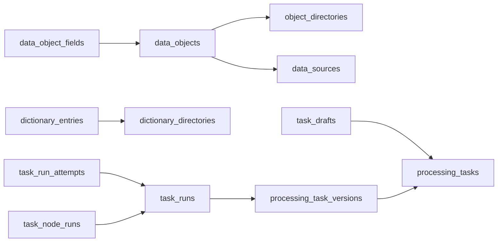

# 数据治理平台 — 数据库设计说明书

| 文档属性 | 内容 |
|---|---|
| 文档编号 | DOC-04 |
| 文档版本 | 0.7（草稿） |
| 对应系统版本 | 0.1.0-SNAPSHOT |
| 源码基线 | fb41721778aa17cb7c9b949f9cb3787c9902312d，含未提交工作区更改 |
| 适用环境 | 当前仓库静态分析；实际部署环境另行确认 |
| 文档状态 | 草稿，待审核 |
| 编制日期 | 2026-11-26 |
| 更新日期 | 2026-11-27 |
| 编制 / 审核 / 批准 | 待确认 / 待审核 / 待批准 |

## 修订记录

| 版本 | 日期 | 修订内容 | 影响范围 | 修订人 |
|---|---|---|---|---|
| 0.2 | 2026-11-26 | 增补本地库只读结构快照 | 待核对 | 待确认 |
| 0.3 | 2026-11-26 | 补记任务监控表约束核对 | 待核对 | 待确认 |
| 0.5 | 2026-11-26 | 按交付模板调整章节结构 | 待核对 | 待确认 |
| 0.6 | 2026-11-27 | 补充数据库关系、迁移与逐表模板表头 | 第 1—10 章 | 待确认 |
| 0.7 | 2026-11-27 | 补充 MySQL SQL 迁移列级静态重放及 Java 迁移差异说明 | 第 9—10 章 | 待确认 |

## 1. 数据库概述与验证范围

| 属性 | 内容 |
|---|---|
| 数据库产品及版本 | 本地平台元数据库 MySQL 8.4.11。 |
| 数据库 / Schema | 本地快照的当前平台库；其他环境待确认。 |
| 字符集、排序规则、时区 | 本次快照未完整采集，待确认。 |
| ORM / 数据访问方式 | 应用使用 JDBC / Spring JdbcTemplate；另有数据库驱动与连接管理。 |
| 迁移工具及版本基线 | Flyway 使用 `backend/src/main/resources/db/mysql`；实际各环境迁移版本待核对。 |
| 结构来源 | 2026-11-26 JDBC 只读结构元数据；脚本中 CREATE / ALTER 为静态线索。 |
| 适用环境及验证时间 | 本地环境 2026-11-26；其他环境未验证。 |

以下为本地快照，未读取业务数据；主键、索引与外键依据驱动返回值，未把元数据缺失视作不存在。迁移文件可能包含后续变更，建表来源不是完整数据血缘。

## 2. 数据架构与命名规范

平台元数据表位于配置的 MySQL 元数据库；被登记的业务表位于各业务数据源，不属于本节 52 张平台表清单。快照中多数表、字段采用小写下划线命名，部分表使用自增主键，关联表也存在复合主键；这些是观察结果，不推断为所有项目的强制命名规范。敏感凭据和审计信息的保护与保留参见安全及运维说明书。

## 3. 数据模型与 ER 图

下图箭头表示本地 JDBC 元数据返回的物理外键指向，省略字段时不表达基数；它不是完整数据库 ER 图。任务运行到任务版本为组合外键，包含 task_id 与 version。跨库主数据业务记录及历史属于逻辑关联，未在图中画成物理外键。

**图 1 部分平台数据实体物理关联图**

## 4. 数据对象清单

| 表编号 | Schema | 表名 | 中文名称 | 所属模块 | 用途 | 对象类型 |
|---|---|---|---|---|---|---|
| DB-001 | 当前平台库 | `audit_events` | 审计事件（归纳） | 系统管理（按名称归类） | 见第 5 章，详细用途待核对 | 表 |
| DB-002 | 当前平台库 | `dashboard_reports` | 看板报表关联（归纳） | 报表（按名称归类） | 见第 5 章，详细用途待核对 | 表 |
| DB-003 | 当前平台库 | `dashboards` | 看板（归纳） | 报表（按名称归类） | 见第 5 章，详细用途待核对 | 表 |
| DB-004 | 当前平台库 | `data_object_drafts` | 数据对象草稿（归纳） | 数据对象（按名称归类） | 见第 5 章，详细用途待核对 | 表 |
| DB-005 | 当前平台库 | `data_object_fields` | 数据对象字段（归纳） | 数据对象（按名称归类） | 见第 5 章，详细用途待核对 | 表 |
| DB-006 | 当前平台库 | `data_object_operation_steps` | 数据对象操作步骤（归纳） | 数据对象（按名称归类） | 见第 5 章，详细用途待核对 | 表 |
| DB-007 | 当前平台库 | `data_object_operations` | 数据对象操作（归纳） | 数据对象（按名称归类） | 见第 5 章，详细用途待核对 | 表 |
| DB-008 | 当前平台库 | `data_objects` | 数据对象（归纳） | 数据对象（按名称归类） | 见第 5 章，详细用途待核对 | 表 |
| DB-009 | 当前平台库 | `data_services` | 数据服务（归纳） | 数据服务（按名称归类） | 见第 5 章，详细用途待核对 | 表 |
| DB-010 | 当前平台库 | `data_sources` | 数据源（归纳） | 数据源 / 驱动（按名称归类） | 见第 5 章，详细用途待核对 | 表 |
| DB-011 | 当前平台库 | `dataset_fields` | 数据集字段（归纳） | 数据集 / 查询（按名称归类） | 见第 5 章，详细用途待核对 | 表 |
| DB-012 | 当前平台库 | `dataset_role_fields` | 角色数据集字段权限（归纳） | 数据集 / 查询（按名称归类） | 见第 5 章，详细用途待核对 | 表 |
| DB-013 | 当前平台库 | `dataset_role_rules` | 角色数据集规则（归纳） | 数据集 / 查询（按名称归类） | 见第 5 章，详细用途待核对 | 表 |
| DB-014 | 当前平台库 | `datasets` | 数据集（归纳） | 数据集 / 查询（按名称归类） | 见第 5 章，详细用途待核对 | 表 |
| DB-015 | 当前平台库 | `departments` | 部门（归纳） | 系统管理（按名称归类） | 见第 5 章，详细用途待核对 | 表 |
| DB-016 | 当前平台库 | `dictionary_directories` | 字典目录（归纳） | 数据字典（按名称归类） | 见第 5 章，详细用途待核对 | 表 |
| DB-017 | 当前平台库 | `dictionary_entries` | 字典条目（归纳） | 数据字典（按名称归类） | 见第 5 章，详细用途待核对 | 表 |
| DB-018 | 当前平台库 | `execution_logs` | 执行日志（归纳） | 数据处理（按名称归类） | 见第 5 章，详细用途待核对 | 表 |
| DB-019 | 当前平台库 | `flyway_schema_history` | Flyway 迁移历史（归纳） | 迁移管理（按名称归类） | 见第 5 章，详细用途待核对 | 表 |
| DB-020 | 当前平台库 | `jdbc_drivers` | JDBC 驱动（归纳） | 数据源 / 驱动（按名称归类） | 见第 5 章，详细用途待核对 | 表 |
| DB-021 | 当前平台库 | `master_data_history` | 主数据历史（归纳） | 主数据（按名称归类） | 见第 5 章，详细用途待核对 | 表 |
| DB-022 | 当前平台库 | `menus` | 菜单（归纳） | 系统管理（按名称归类） | 见第 5 章，详细用途待核对 | 表 |
| DB-023 | 当前平台库 | `object_directories` | 对象目录（归纳） | 数据对象（按名称归类） | 见第 5 章，详细用途待核对 | 表 |
| DB-024 | 当前平台库 | `permission_catalog` | 权限目录（归纳） | 系统管理（按名称归类） | 见第 5 章，详细用途待核对 | 表 |
| DB-025 | 当前平台库 | `platform_settings` | 平台设置（归纳） | 平台基础（按名称归类） | 见第 5 章，详细用途待核对 | 表 |
| DB-026 | 当前平台库 | `processing_task_versions` | 处理任务版本（归纳） | 数据处理（按名称归类） | 见第 5 章，详细用途待核对 | 表 |
| DB-027 | 当前平台库 | `processing_tasks` | 处理任务（归纳） | 数据处理（按名称归类） | 见第 5 章，详细用途待核对 | 表 |
| DB-028 | 当前平台库 | `realtime_jobs` | 实时同步任务（归纳） | 实时同步（按名称归类） | 见第 5 章，详细用途待核对 | 表 |
| DB-029 | 当前平台库 | `reports` | 报表（归纳） | 报表（按名称归类） | 见第 5 章，详细用途待核对 | 表 |
| DB-030 | 当前平台库 | `role_menus` | 角色菜单关联（归纳） | 系统管理（按名称归类） | 见第 5 章，详细用途待核对 | 表 |
| DB-031 | 当前平台库 | `role_permissions` | 角色权限关联（归纳） | 系统管理（按名称归类） | 见第 5 章，详细用途待核对 | 表 |
| DB-032 | 当前平台库 | `roles` | 角色（归纳） | 系统管理（按名称归类） | 见第 5 章，详细用途待核对 | 表 |
| DB-033 | 当前平台库 | `service_callers` | 服务调用方（归纳） | 数据服务（按名称归类） | 见第 5 章，详细用途待核对 | 表 |
| DB-034 | 当前平台库 | `service_grants` | 服务授权（归纳） | 数据服务（按名称归类） | 见第 5 章，详细用途待核对 | 表 |
| DB-035 | 当前平台库 | `service_invocations` | 服务调用记录（归纳） | 数据服务（按名称归类） | 见第 5 章，详细用途待核对 | 表 |
| DB-036 | 当前平台库 | `task_directories` | 任务目录（归纳） | 数据处理（按名称归类） | 见第 5 章，详细用途待核对 | 表 |
| DB-037 | 当前平台库 | `task_drafts` | 任务草稿（归纳） | 数据处理（按名称归类） | 见第 5 章，详细用途待核对 | 表 |
| DB-038 | 当前平台库 | `task_node_runs` | 任务节点运行（归纳） | 数据处理（按名称归类） | 见第 5 章，详细用途待核对 | 表 |
| DB-039 | 当前平台库 | `task_run_attempts` | 任务运行尝试（归纳） | 数据处理（按名称归类） | 见第 5 章，详细用途待核对 | 表 |
| DB-040 | 当前平台库 | `task_runs` | 任务运行（归纳） | 数据处理（按名称归类） | 见第 5 章，详细用途待核对 | 表 |
| DB-041 | 当前平台库 | `task_schedules` | 任务调度（归纳） | 数据处理（按名称归类） | 见第 5 章，详细用途待核对 | 表 |
| DB-042 | 当前平台库 | `task_watermarks` | 任务水位（归纳） | 数据处理（按名称归类） | 见第 5 章，详细用途待核对 | 表 |
| DB-043 | 当前平台库 | `user_roles` | 用户角色关联（归纳） | 系统管理（按名称归类） | 见第 5 章，详细用途待核对 | 表 |
| DB-044 | 当前平台库 | `users` | 用户（归纳） | 系统管理（按名称归类） | 见第 5 章，详细用途待核对 | 表 |
| DB-045 | 当前平台库 | `workflow_definitions` | 工作流定义（归纳） | 数据处理（按名称归类） | 见第 5 章，详细用途待核对 | 表 |
| DB-046 | 当前平台库 | `workflow_edges` | 工作流连线（归纳） | 数据处理（按名称归类） | 见第 5 章，详细用途待核对 | 表 |
| DB-047 | 当前平台库 | `workflow_node_attempts` | 工作流节点尝试（归纳） | 数据处理（按名称归类） | 见第 5 章，详细用途待核对 | 表 |
| DB-048 | 当前平台库 | `workflow_nodes` | 工作流节点（归纳） | 数据处理（按名称归类） | 见第 5 章，详细用途待核对 | 表 |
| DB-049 | 当前平台库 | `workflow_run_nodes` | 工作流运行节点（归纳） | 数据处理（按名称归类） | 见第 5 章，详细用途待核对 | 表 |
| DB-050 | 当前平台库 | `workflow_runs` | 工作流运行（归纳） | 数据处理（按名称归类） | 见第 5 章，详细用途待核对 | 表 |
| DB-051 | 当前平台库 | `workflow_schedules` | 工作流调度（归纳） | 数据处理（按名称归类） | 见第 5 章，详细用途待核对 | 表 |
| DB-052 | 当前平台库 | `workflow_versions` | 工作流版本（归纳） | 数据处理（按名称归类） | 见第 5 章，详细用途待核对 | 表 |

表中文名和模块是依据表名、迁移及相关代码归纳的便于阅读的标签，不是数据库物理注释或项目方正式术语；业务用途及逐表迁移线索见第 5 章。

## 5. 数据表详细设计

### 5.1 audit_events（DB-001）

| 属性 | 内容 |
|---|---|
| 中文名称 | 审计事件（归纳，非数据库注释） |
| 所属模块 | 系统管理（按名称归类） |
| 表用途 | 与审计事件相关；具体生命周期和业务定义待逐项确认。 |
| 主键策略 | id |
| 分区 / 存储策略 | 待确认 |
| 数据生命周期 | 待确认 |

#### 5.1.1 字段结构与数据字典

| 序号 | 字段名称 | 中文名称 | 数据类型 | 长度 / 精度 | 主键 | 可空 | 默认值 | 约束 | 字段说明 |
|---|---|---|---|---|---|---|---|---|---|
| 1 | `id` | 待确认 | BIGINT | 19 / 0 | 是 | 否 | 元数据未返回，需区分 NULL 与无默认值 | 自增 | 待确认 |
| 2 | `actor_id` | 待确认 | BIGINT | 19 / 0 | 否 | 是 | 元数据未返回，需区分 NULL 与无默认值 | 待核验 | 待确认 |
| 3 | `occurred_at` | 待确认 | TIMESTAMP | 19 / 0 | 否 | 否 | 元数据未返回，需区分 NULL 与无默认值 | 待核验 | 待确认 |
| 4 | `action` | 待确认 | VARCHAR | 160 / 0 | 否 | 否 | 元数据未返回，需区分 NULL 与无默认值 | 待核验 | 待确认 |
| 5 | `object_type` | 待确认 | VARCHAR | 160 / 0 | 否 | 否 | 元数据未返回，需区分 NULL 与无默认值 | 待核验 | 待确认 |
| 6 | `object_id` | 待确认 | VARCHAR | 160 / 0 | 否 | 否 | 元数据未返回，需区分 NULL 与无默认值 | 待核验 | 待确认 |
| 7 | `result` | 待确认 | VARCHAR | 32 / 0 | 否 | 否 | 元数据未返回，需区分 NULL 与无默认值 | 待核验 | 待确认 |
| 8 | `ip` | 待确认 | VARCHAR | 45 / 0 | 否 | 否 | 元数据未返回，需区分 NULL 与无默认值 | 待核验 | 待确认 |
| 9 | `user_agent` | 待确认 | VARCHAR | 255 / 0 | 否 | 否 | 元数据未返回，需区分 NULL 与无默认值 | 待核验 | 待确认 |
| 10 | `message` | 待确认 | VARCHAR | 255 / 0 | 否 | 否 | 元数据未返回，需区分 NULL 与无默认值 | 待核验 | 待确认 |

#### 5.1.2 主键、唯一约束及索引

| 名称 | 类型 | 字段 / 表达式（按序） | 唯一 | 条件 / 排序 | 用途 |
|---|---|---|---|---|---|
| PRIMARY | 索引 | id | 是 | 待确认 | 待确认 |
| actor_id | 索引 | actor_id | 否 | 待确认 | 待确认 |

#### 5.1.3 外键与关联关系

| 关系编号 | 当前字段 | 目标表及字段 | 关系类型 | 基数 | 更新 / 删除规则 |
|---|---|---|---|---|---|
| DB-001-FK-01 | actor_id | users.id | 物理外键 | 待确认 | 待确认 |

#### 5.1.4 其他约束

| 约束名称 | 约束类型 | 表达式 / 字段 | 实际作用 |
|---|---|---|---|
| 待核验 | CHECK 等其他约束 | 尚未完整提取 | 不可将未知视为不存在 |

#### 5.1.5 字段枚举与业务含义

| 字段 | 存储值 | 含义 | 约束来源 |
|---|---|---|---|
| 待核验 | 待核验 | 尚未逐字段核对 | 实际代码与迁移待核对 |

#### 5.1.6 DDL 与迁移依据

迁移文件：V26__login_security_and_audit_context.sql, V2__organization.sql。本地结构与迁移差异尚未逐字段核对。

### 5.2 dashboard_reports（DB-002）

| 属性 | 内容 |
|---|---|
| 中文名称 | 看板报表关联（归纳，非数据库注释） |
| 所属模块 | 报表（按名称归类） |
| 表用途 | 与看板报表关联相关；具体生命周期和业务定义待逐项确认。 |
| 主键策略 | dashboard_id, report_id |
| 分区 / 存储策略 | 待确认 |
| 数据生命周期 | 待确认 |

#### 5.2.1 字段结构与数据字典

| 序号 | 字段名称 | 中文名称 | 数据类型 | 长度 / 精度 | 主键 | 可空 | 默认值 | 约束 | 字段说明 |
|---|---|---|---|---|---|---|---|---|---|
| 1 | `dashboard_id` | 待确认 | BIGINT | 19 / 0 | 是 | 否 | 元数据未返回，需区分 NULL 与无默认值 | 待核验 | 待确认 |
| 2 | `report_id` | 待确认 | BIGINT | 19 / 0 | 是 | 否 | 元数据未返回，需区分 NULL 与无默认值 | 待核验 | 待确认 |
| 3 | `ordinal_no` | 待确认 | INT | 10 / 0 | 否 | 否 | 元数据未返回，需区分 NULL 与无默认值 | 待核验 | 待确认 |

#### 5.2.2 主键、唯一约束及索引

| 名称 | 类型 | 字段 / 表达式（按序） | 唯一 | 条件 / 排序 | 用途 |
|---|---|---|---|---|---|
| dashboard_id | 索引 | dashboard_id, ordinal_no | 是 | 待确认 | 待确认 |
| PRIMARY | 索引 | dashboard_id, report_id | 是 | 待确认 | 待确认 |
| report_id | 索引 | report_id | 否 | 待确认 | 待确认 |

#### 5.2.3 外键与关联关系

| 关系编号 | 当前字段 | 目标表及字段 | 关系类型 | 基数 | 更新 / 删除规则 |
|---|---|---|---|---|---|
| DB-002-FK-01 | dashboard_id | dashboards.id | 物理外键 | 待确认 | 待确认 |
| DB-002-FK-02 | report_id | reports.id | 物理外键 | 待确认 | 待确认 |

#### 5.2.4 其他约束

| 约束名称 | 约束类型 | 表达式 / 字段 | 实际作用 |
|---|---|---|---|
| 待核验 | CHECK 等其他约束 | 尚未完整提取 | 不可将未知视为不存在 |

#### 5.2.5 字段枚举与业务含义

| 字段 | 存储值 | 含义 | 约束来源 |
|---|---|---|---|
| 待核验 | 待核验 | 尚未逐字段核对 | 实际代码与迁移待核对 |

#### 5.2.6 DDL 与迁移依据

迁移文件：V15__reports.sql。本地结构与迁移差异尚未逐字段核对。

### 5.3 dashboards（DB-003）

| 属性 | 内容 |
|---|---|
| 中文名称 | 看板（归纳，非数据库注释） |
| 所属模块 | 报表（按名称归类） |
| 表用途 | 与看板相关；具体生命周期和业务定义待逐项确认。 |
| 主键策略 | id |
| 分区 / 存储策略 | 待确认 |
| 数据生命周期 | 待确认 |

#### 5.3.1 字段结构与数据字典

| 序号 | 字段名称 | 中文名称 | 数据类型 | 长度 / 精度 | 主键 | 可空 | 默认值 | 约束 | 字段说明 |
|---|---|---|---|---|---|---|---|---|---|
| 1 | `id` | 待确认 | BIGINT | 19 / 0 | 是 | 否 | 元数据未返回，需区分 NULL 与无默认值 | 自增 | 待确认 |
| 2 | `owner_id` | 待确认 | BIGINT | 19 / 0 | 否 | 否 | 元数据未返回，需区分 NULL 与无默认值 | 待核验 | 待确认 |
| 3 | `name` | 待确认 | VARCHAR | 160 / 0 | 否 | 否 | 元数据未返回，需区分 NULL 与无默认值 | 待核验 | 待确认 |
| 4 | `created_at` | 待确认 | TIMESTAMP | 19 / 0 | 否 | 否 | 元数据未返回，需区分 NULL 与无默认值 | 待核验 | 待确认 |

#### 5.3.2 主键、唯一约束及索引

| 名称 | 类型 | 字段 / 表达式（按序） | 唯一 | 条件 / 排序 | 用途 |
|---|---|---|---|---|---|
| PRIMARY | 索引 | id | 是 | 待确认 | 待确认 |
| owner_id | 索引 | owner_id | 否 | 待确认 | 待确认 |

#### 5.3.3 外键与关联关系

| 关系编号 | 当前字段 | 目标表及字段 | 关系类型 | 基数 | 更新 / 删除规则 |
|---|---|---|---|---|---|
| DB-003-FK-01 | owner_id | users.id | 物理外键 | 待确认 | 待确认 |

#### 5.3.4 其他约束

| 约束名称 | 约束类型 | 表达式 / 字段 | 实际作用 |
|---|---|---|---|
| 待核验 | CHECK 等其他约束 | 尚未完整提取 | 不可将未知视为不存在 |

#### 5.3.5 字段枚举与业务含义

| 字段 | 存储值 | 含义 | 约束来源 |
|---|---|---|---|
| 待核验 | 待核验 | 尚未逐字段核对 | 实际代码与迁移待核对 |

#### 5.3.6 DDL 与迁移依据

迁移文件：V15__reports.sql。本地结构与迁移差异尚未逐字段核对。

### 5.4 data_object_drafts（DB-004）

| 属性 | 内容 |
|---|---|
| 中文名称 | 数据对象草稿（归纳，非数据库注释） |
| 所属模块 | 数据对象（按名称归类） |
| 表用途 | 与数据对象草稿相关；具体生命周期和业务定义待逐项确认。 |
| 主键策略 | object_id |
| 分区 / 存储策略 | 待确认 |
| 数据生命周期 | 待确认 |

#### 5.4.1 字段结构与数据字典

| 序号 | 字段名称 | 中文名称 | 数据类型 | 长度 / 精度 | 主键 | 可空 | 默认值 | 约束 | 字段说明 |
|---|---|---|---|---|---|---|---|---|---|
| 1 | `object_id` | 待确认 | BIGINT | 19 / 0 | 是 | 否 | 元数据未返回，需区分 NULL 与无默认值 | 待核验 | 待确认 |
| 2 | `definition_json` | 待确认 | TEXT | 65535 / 0 | 否 | 否 | 元数据未返回，需区分 NULL 与无默认值 | 待核验 | 待确认 |
| 3 | `updated_at` | 待确认 | TIMESTAMP | 19 / 0 | 否 | 否 | CURRENT_TIMESTAMP | 待核验 | 待确认 |

#### 5.4.2 主键、唯一约束及索引

| 名称 | 类型 | 字段 / 表达式（按序） | 唯一 | 条件 / 排序 | 用途 |
|---|---|---|---|---|---|
| PRIMARY | 索引 | object_id | 是 | 待确认 | 待确认 |

#### 5.4.3 外键与关联关系

| 关系编号 | 当前字段 | 目标表及字段 | 关系类型 | 基数 | 更新 / 删除规则 |
|---|---|---|---|---|---|
| DB-004-FK-01 | object_id | data_objects.id | 物理外键 | 待确认 | 待确认 |

#### 5.4.4 其他约束

| 约束名称 | 约束类型 | 表达式 / 字段 | 实际作用 |
|---|---|---|---|
| 待核验 | CHECK 等其他约束 | 尚未完整提取 | 不可将未知视为不存在 |

#### 5.4.5 字段枚举与业务含义

| 字段 | 存储值 | 含义 | 约束来源 |
|---|---|---|---|
| 待核验 | 待核验 | 尚未逐字段核对 | 实际代码与迁移待核对 |

#### 5.4.6 DDL 与迁移依据

迁移文件：V40__data_objects.sql。已比较列名、基础类型及可空性，未发现差异；显式 CHAR/VARCHAR 长度已局部核对，其他长度、默认值、索引和约束等尚未完整核对，见第 9 章。

### 5.5 data_object_fields（DB-005）

| 属性 | 内容 |
|---|---|
| 中文名称 | 数据对象字段（归纳，非数据库注释） |
| 所属模块 | 数据对象（按名称归类） |
| 表用途 | 与数据对象字段相关；具体生命周期和业务定义待逐项确认。 |
| 主键策略 | id |
| 分区 / 存储策略 | 待确认 |
| 数据生命周期 | 待确认 |

#### 5.5.1 字段结构与数据字典

| 序号 | 字段名称 | 中文名称 | 数据类型 | 长度 / 精度 | 主键 | 可空 | 默认值 | 约束 | 字段说明 |
|---|---|---|---|---|---|---|---|---|---|
| 1 | `id` | 待确认 | BIGINT | 19 / 0 | 是 | 否 | 元数据未返回，需区分 NULL 与无默认值 | 自增 | 待确认 |
| 2 | `object_id` | 待确认 | BIGINT | 19 / 0 | 否 | 否 | 元数据未返回，需区分 NULL 与无默认值 | 待核验 | 待确认 |
| 3 | `ordinal_position` | 待确认 | INT | 10 / 0 | 否 | 否 | 元数据未返回，需区分 NULL 与无默认值 | 待核验 | 待确认 |
| 4 | `field_name` | 待确认 | VARCHAR | 255 / 0 | 否 | 否 | 元数据未返回，需区分 NULL 与无默认值 | 待核验 | 待确认 |
| 5 | `native_type` | 待确认 | VARCHAR | 255 / 0 | 否 | 否 | 元数据未返回，需区分 NULL 与无默认值 | 待核验 | 待确认 |
| 6 | `field_length` | 待确认 | INT | 10 / 0 | 否 | 是 | 元数据未返回，需区分 NULL 与无默认值 | 待核验 | 待确认 |
| 7 | `field_scale` | 待确认 | INT | 10 / 0 | 否 | 是 | 元数据未返回，需区分 NULL 与无默认值 | 待核验 | 待确认 |
| 8 | `nullable_state` | 待确认 | VARCHAR | 10 / 0 | 否 | 否 | 元数据未返回，需区分 NULL 与无默认值 | 待核验 | 待确认 |
| 9 | `primary_key_state` | 待确认 | VARCHAR | 10 / 0 | 否 | 否 | 元数据未返回，需区分 NULL 与无默认值 | 待核验 | 待确认 |
| 10 | `remarks` | 待确认 | VARCHAR | 1000 / 0 | 否 | 是 | 元数据未返回，需区分 NULL 与无默认值 | 待核验 | 待确认 |

#### 5.5.2 主键、唯一约束及索引

| 名称 | 类型 | 字段 / 表达式（按序） | 唯一 | 条件 / 排序 | 用途 |
|---|---|---|---|---|---|
| object_id | 索引 | object_id, ordinal_position | 是 | 待确认 | 待确认 |
| PRIMARY | 索引 | id | 是 | 待确认 | 待确认 |

#### 5.5.3 外键与关联关系

| 关系编号 | 当前字段 | 目标表及字段 | 关系类型 | 基数 | 更新 / 删除规则 |
|---|---|---|---|---|---|
| DB-005-FK-01 | object_id | data_objects.id | 物理外键 | 待确认 | 待确认 |

#### 5.5.4 其他约束

| 约束名称 | 约束类型 | 表达式 / 字段 | 实际作用 |
|---|---|---|---|
| 待核验 | CHECK 等其他约束 | 尚未完整提取 | 不可将未知视为不存在 |

#### 5.5.5 字段枚举与业务含义

| 字段 | 存储值 | 含义 | 约束来源 |
|---|---|---|---|
| 待核验 | 待核验 | 尚未逐字段核对 | 实际代码与迁移待核对 |

#### 5.5.6 DDL 与迁移依据

迁移文件：V40__data_objects.sql。已比较列名、基础类型及可空性，未发现差异；显式 CHAR/VARCHAR 长度已局部核对，其他长度、默认值、索引和约束等尚未完整核对，见第 9 章。

### 5.6 data_object_operation_steps（DB-006）

| 属性 | 内容 |
|---|---|
| 中文名称 | 数据对象操作步骤（归纳，非数据库注释） |
| 所属模块 | 数据对象（按名称归类） |
| 表用途 | 与数据对象操作步骤相关；具体生命周期和业务定义待逐项确认。 |
| 主键策略 | operation_id, step_number |
| 分区 / 存储策略 | 待确认 |
| 数据生命周期 | 待确认 |

#### 5.6.1 字段结构与数据字典

| 序号 | 字段名称 | 中文名称 | 数据类型 | 长度 / 精度 | 主键 | 可空 | 默认值 | 约束 | 字段说明 |
|---|---|---|---|---|---|---|---|---|---|
| 1 | `operation_id` | 待确认 | VARCHAR | 36 / 0 | 是 | 否 | 元数据未返回，需区分 NULL 与无默认值 | 待核验 | 待确认 |
| 2 | `step_number` | 待确认 | INT | 10 / 0 | 是 | 否 | 元数据未返回，需区分 NULL 与无默认值 | 待核验 | 待确认 |
| 3 | `statement_text` | 待确认 | TEXT | 65535 / 0 | 否 | 否 | 元数据未返回，需区分 NULL 与无默认值 | 待核验 | 待确认 |
| 4 | `risk_text` | 待确认 | VARCHAR | 1000 / 0 | 否 | 是 | 元数据未返回，需区分 NULL 与无默认值 | 待核验 | 待确认 |
| 5 | `status` | 待确认 | VARCHAR | 32 / 0 | 否 | 否 | 元数据未返回，需区分 NULL 与无默认值 | 待核验 | 待确认 |
| 6 | `error_message` | 待确认 | VARCHAR | 1000 / 0 | 否 | 是 | 元数据未返回，需区分 NULL 与无默认值 | 待核验 | 待确认 |

#### 5.6.2 主键、唯一约束及索引

| 名称 | 类型 | 字段 / 表达式（按序） | 唯一 | 条件 / 排序 | 用途 |
|---|---|---|---|---|---|
| PRIMARY | 索引 | operation_id, step_number | 是 | 待确认 | 待确认 |

#### 5.6.3 外键与关联关系

| 关系编号 | 当前字段 | 目标表及字段 | 关系类型 | 基数 | 更新 / 删除规则 |
|---|---|---|---|---|---|
| DB-006-FK-01 | operation_id | data_object_operations.id | 物理外键 | 待确认 | 待确认 |

#### 5.6.4 其他约束

| 约束名称 | 约束类型 | 表达式 / 字段 | 实际作用 |
|---|---|---|---|
| 待核验 | CHECK 等其他约束 | 尚未完整提取 | 不可将未知视为不存在 |

#### 5.6.5 字段枚举与业务含义

| 字段 | 存储值 | 含义 | 约束来源 |
|---|---|---|---|
| 待核验 | 待核验 | 尚未逐字段核对 | 实际代码与迁移待核对 |

#### 5.6.6 DDL 与迁移依据

迁移文件：V40__data_objects.sql。已比较列名、基础类型及可空性，未发现差异；显式 CHAR/VARCHAR 长度已局部核对，其他长度、默认值、索引和约束等尚未完整核对，见第 9 章。

### 5.7 data_object_operations（DB-007）

| 属性 | 内容 |
|---|---|
| 中文名称 | 数据对象操作（归纳，非数据库注释） |
| 所属模块 | 数据对象（按名称归类） |
| 表用途 | 与数据对象操作相关；具体生命周期和业务定义待逐项确认。 |
| 主键策略 | id |
| 分区 / 存储策略 | 待确认 |
| 数据生命周期 | 待确认 |

#### 5.7.1 字段结构与数据字典

| 序号 | 字段名称 | 中文名称 | 数据类型 | 长度 / 精度 | 主键 | 可空 | 默认值 | 约束 | 字段说明 |
|---|---|---|---|---|---|---|---|---|---|
| 1 | `id` | 待确认 | VARCHAR | 36 / 0 | 是 | 否 | 元数据未返回，需区分 NULL 与无默认值 | 待核验 | 待确认 |
| 2 | `object_id` | 待确认 | BIGINT | 19 / 0 | 否 | 是 | 元数据未返回，需区分 NULL 与无默认值 | 待核验 | 待确认 |
| 3 | `source_id` | 待确认 | BIGINT | 19 / 0 | 否 | 否 | 元数据未返回，需区分 NULL 与无默认值 | 待核验 | 待确认 |
| 4 | `identity_hash` | 待确认 | CHAR | 64 / 0 | 否 | 否 | 元数据未返回，需区分 NULL 与无默认值 | 待核验 | 待确认 |
| 5 | `active_identity` | 待确认 | CHAR | 64 / 0 | 否 | 是 | 元数据未返回，需区分 NULL 与无默认值 | 待核验 | 待确认 |
| 6 | `operation_type` | 待确认 | VARCHAR | 16 / 0 | 否 | 否 | 元数据未返回，需区分 NULL 与无默认值 | 待核验 | 待确认 |
| 7 | `status` | 待确认 | VARCHAR | 32 / 0 | 否 | 否 | 元数据未返回，需区分 NULL 与无默认值 | 待核验 | 待确认 |
| 8 | `target_json` | 待确认 | TEXT | 65535 / 0 | 否 | 否 | 元数据未返回，需区分 NULL 与无默认值 | 待核验 | 待确认 |
| 9 | `original_fingerprint` | 待确认 | CHAR | 64 / 0 | 否 | 是 | 元数据未返回，需区分 NULL 与无默认值 | 待核验 | 待确认 |
| 10 | `error_message` | 待确认 | VARCHAR | 1000 / 0 | 否 | 是 | 元数据未返回，需区分 NULL 与无默认值 | 待核验 | 待确认 |
| 11 | `created_at` | 待确认 | TIMESTAMP | 19 / 0 | 否 | 否 | CURRENT_TIMESTAMP | 待核验 | 待确认 |
| 12 | `updated_at` | 待确认 | TIMESTAMP | 19 / 0 | 否 | 否 | CURRENT_TIMESTAMP | 待核验 | 待确认 |

#### 5.7.2 主键、唯一约束及索引

| 名称 | 类型 | 字段 / 表达式（按序） | 唯一 | 条件 / 排序 | 用途 |
|---|---|---|---|---|---|
| active_identity | 索引 | active_identity | 是 | 待确认 | 待确认 |
| PRIMARY | 索引 | id | 是 | 待确认 | 待确认 |
| object_id | 索引 | object_id | 否 | 待确认 | 待确认 |
| source_id | 索引 | source_id | 否 | 待确认 | 待确认 |

#### 5.7.3 外键与关联关系

| 关系编号 | 当前字段 | 目标表及字段 | 关系类型 | 基数 | 更新 / 删除规则 |
|---|---|---|---|---|---|
| DB-007-FK-01 | object_id | data_objects.id | 物理外键 | 待确认 | 待确认 |
| DB-007-FK-02 | source_id | data_sources.id | 物理外键 | 待确认 | 待确认 |

#### 5.7.4 其他约束

| 约束名称 | 约束类型 | 表达式 / 字段 | 实际作用 |
|---|---|---|---|
| 待核验 | CHECK 等其他约束 | 尚未完整提取 | 不可将未知视为不存在 |

#### 5.7.5 字段枚举与业务含义

| 字段 | 存储值 | 含义 | 约束来源 |
|---|---|---|---|
| 待核验 | 待核验 | 尚未逐字段核对 | 实际代码与迁移待核对 |

#### 5.7.6 DDL 与迁移依据

迁移文件：V40__data_objects.sql。已比较列名、基础类型及可空性，未发现差异；显式 CHAR/VARCHAR 长度已局部核对，其他长度、默认值、索引和约束等尚未完整核对，见第 9 章。

### 5.8 data_objects（DB-008）

| 属性 | 内容 |
|---|---|
| 中文名称 | 数据对象（归纳，非数据库注释） |
| 所属模块 | 数据对象（按名称归类） |
| 表用途 | 与数据对象相关；具体生命周期和业务定义待逐项确认。 |
| 主键策略 | id |
| 分区 / 存储策略 | 待确认 |
| 数据生命周期 | 待确认 |

#### 5.8.1 字段结构与数据字典

| 序号 | 字段名称 | 中文名称 | 数据类型 | 长度 / 精度 | 主键 | 可空 | 默认值 | 约束 | 字段说明 |
|---|---|---|---|---|---|---|---|---|---|
| 1 | `id` | 待确认 | BIGINT | 19 / 0 | 是 | 否 | 元数据未返回，需区分 NULL 与无默认值 | 自增 | 待确认 |
| 2 | `directory_id` | 待确认 | BIGINT | 19 / 0 | 否 | 否 | 元数据未返回，需区分 NULL 与无默认值 | 待核验 | 待确认 |
| 3 | `source_id` | 待确认 | BIGINT | 19 / 0 | 否 | 否 | 元数据未返回，需区分 NULL 与无默认值 | 待核验 | 待确认 |
| 4 | `catalog_name` | 待确认 | VARCHAR | 255 / 0 | 否 | 否 | 元数据未返回，需区分 NULL 与无默认值 | 待核验 | 待确认 |
| 5 | `schema_name` | 待确认 | VARCHAR | 255 / 0 | 否 | 否 | 元数据未返回，需区分 NULL 与无默认值 | 待核验 | 待确认 |
| 6 | `table_name` | 待确认 | VARCHAR | 255 / 0 | 否 | 否 | 元数据未返回，需区分 NULL 与无默认值 | 待核验 | 待确认 |
| 7 | `object_type` | 待确认 | VARCHAR | 16 / 0 | 否 | 否 | 元数据未返回，需区分 NULL 与无默认值 | 待核验 | 待确认 |
| 8 | `identity_hash` | 待确认 | CHAR | 64 / 0 | 否 | 否 | 元数据未返回，需区分 NULL 与无默认值 | 待核验 | 待确认 |
| 9 | `display_name` | 待确认 | VARCHAR | 200 / 0 | 否 | 否 | 元数据未返回，需区分 NULL 与无默认值 | 待核验 | 待确认 |
| 10 | `description` | 待确认 | VARCHAR | 1000 / 0 | 否 | 否 | 元数据未返回，需区分 NULL 与无默认值 | 待核验 | 待确认 |
| 11 | `dataset_id` | 待确认 | BIGINT | 19 / 0 | 否 | 是 | 元数据未返回，需区分 NULL 与无默认值 | 待核验 | 待确认 |
| 12 | `version` | 待确认 | BIGINT | 19 / 0 | 否 | 否 | 1 | 待核验 | 待确认 |
| 13 | `created_at` | 待确认 | TIMESTAMP | 19 / 0 | 否 | 否 | CURRENT_TIMESTAMP | 待核验 | 待确认 |
| 14 | `updated_at` | 待确认 | TIMESTAMP | 19 / 0 | 否 | 否 | CURRENT_TIMESTAMP | 待核验 | 待确认 |

#### 5.8.2 主键、唯一约束及索引

| 名称 | 类型 | 字段 / 表达式（按序） | 唯一 | 条件 / 排序 | 用途 |
|---|---|---|---|---|---|
| identity_hash | 索引 | identity_hash | 是 | 待确认 | 待确认 |
| PRIMARY | 索引 | id | 是 | 待确认 | 待确认 |
| dataset_id | 索引 | dataset_id | 否 | 待确认 | 待确认 |
| directory_id | 索引 | directory_id | 否 | 待确认 | 待确认 |
| source_id | 索引 | source_id | 否 | 待确认 | 待确认 |

#### 5.8.3 外键与关联关系

| 关系编号 | 当前字段 | 目标表及字段 | 关系类型 | 基数 | 更新 / 删除规则 |
|---|---|---|---|---|---|
| DB-008-FK-01 | source_id | data_sources.id | 物理外键 | 待确认 | 待确认 |
| DB-008-FK-02 | dataset_id | datasets.id | 物理外键 | 待确认 | 待确认 |
| DB-008-FK-03 | directory_id | object_directories.id | 物理外键 | 待确认 | 待确认 |

#### 5.8.4 其他约束

| 约束名称 | 约束类型 | 表达式 / 字段 | 实际作用 |
|---|---|---|---|
| 待核验 | CHECK 等其他约束 | 尚未完整提取 | 不可将未知视为不存在 |

#### 5.8.5 字段枚举与业务含义

| 字段 | 存储值 | 含义 | 约束来源 |
|---|---|---|---|
| 待核验 | 待核验 | 尚未逐字段核对 | 实际代码与迁移待核对 |

#### 5.8.6 DDL 与迁移依据

迁移文件：V40__data_objects.sql。已比较列名、基础类型及可空性，未发现差异；显式 CHAR/VARCHAR 长度已局部核对，其他长度、默认值、索引和约束等尚未完整核对，见第 9 章。

### 5.9 data_services（DB-009）

| 属性 | 内容 |
|---|---|
| 中文名称 | 数据服务（归纳，非数据库注释） |
| 所属模块 | 数据服务（按名称归类） |
| 表用途 | 与数据服务相关；具体生命周期和业务定义待逐项确认。 |
| 主键策略 | id |
| 分区 / 存储策略 | 待确认 |
| 数据生命周期 | 待确认 |

#### 5.9.1 字段结构与数据字典

| 序号 | 字段名称 | 中文名称 | 数据类型 | 长度 / 精度 | 主键 | 可空 | 默认值 | 约束 | 字段说明 |
|---|---|---|---|---|---|---|---|---|---|
| 1 | `id` | 待确认 | BIGINT | 19 / 0 | 是 | 否 | 元数据未返回，需区分 NULL 与无默认值 | 自增 | 待确认 |
| 2 | `creator_id` | 待确认 | BIGINT | 19 / 0 | 否 | 否 | 元数据未返回，需区分 NULL 与无默认值 | 待核验 | 待确认 |
| 3 | `dataset_id` | 待确认 | BIGINT | 19 / 0 | 否 | 否 | 元数据未返回，需区分 NULL 与无默认值 | 待核验 | 待确认 |
| 4 | `name` | 待确认 | VARCHAR | 160 / 0 | 否 | 否 | 元数据未返回，需区分 NULL 与无默认值 | 待核验 | 待确认 |
| 5 | `fields_json` | 待确认 | LONGTEXT | 2147483647 / 0 | 否 | 否 | 元数据未返回，需区分 NULL 与无默认值 | 待核验 | 待确认 |
| 6 | `row_limit` | 待确认 | INT | 10 / 0 | 否 | 否 | 元数据未返回，需区分 NULL 与无默认值 | 待核验 | 待确认 |
| 7 | `state` | 待确认 | VARCHAR | 16 / 0 | 否 | 否 | 元数据未返回，需区分 NULL 与无默认值 | 待核验 | 待确认 |
| 8 | `created_at` | 待确认 | TIMESTAMP | 19 / 0 | 否 | 否 | 元数据未返回，需区分 NULL 与无默认值 | 待核验 | 待确认 |

#### 5.9.2 主键、唯一约束及索引

| 名称 | 类型 | 字段 / 表达式（按序） | 唯一 | 条件 / 排序 | 用途 |
|---|---|---|---|---|---|
| PRIMARY | 索引 | id | 是 | 待确认 | 待确认 |
| creator_id | 索引 | creator_id | 否 | 待确认 | 待确认 |
| dataset_id | 索引 | dataset_id | 否 | 待确认 | 待确认 |

#### 5.9.3 外键与关联关系

| 关系编号 | 当前字段 | 目标表及字段 | 关系类型 | 基数 | 更新 / 删除规则 |
|---|---|---|---|---|---|
| DB-009-FK-01 | dataset_id | datasets.id | 物理外键 | 待确认 | 待确认 |
| DB-009-FK-02 | creator_id | users.id | 物理外键 | 待确认 | 待确认 |

#### 5.9.4 其他约束

| 约束名称 | 约束类型 | 表达式 / 字段 | 实际作用 |
|---|---|---|---|
| 待核验 | CHECK 等其他约束 | 尚未完整提取 | 不可将未知视为不存在 |

#### 5.9.5 字段枚举与业务含义

| 字段 | 存储值 | 含义 | 约束来源 |
|---|---|---|---|
| 待核验 | 待核验 | 尚未逐字段核对 | 实际代码与迁移待核对 |

#### 5.9.6 DDL 与迁移依据

迁移文件：V16__data_services.sql。本地结构与迁移差异尚未逐字段核对。

### 5.10 data_sources（DB-010）

| 属性 | 内容 |
|---|---|
| 中文名称 | 数据源（归纳，非数据库注释） |
| 所属模块 | 数据源 / 驱动（按名称归类） |
| 表用途 | 与数据源相关；具体生命周期和业务定义待逐项确认。 |
| 主键策略 | id |
| 分区 / 存储策略 | 待确认 |
| 数据生命周期 | 待确认 |

#### 5.10.1 字段结构与数据字典

| 序号 | 字段名称 | 中文名称 | 数据类型 | 长度 / 精度 | 主键 | 可空 | 默认值 | 约束 | 字段说明 |
|---|---|---|---|---|---|---|---|---|---|
| 1 | `id` | 待确认 | BIGINT | 19 / 0 | 是 | 否 | 元数据未返回，需区分 NULL 与无默认值 | 自增 | 待确认 |
| 2 | `name` | 待确认 | VARCHAR | 120 / 0 | 否 | 否 | 元数据未返回，需区分 NULL 与无默认值 | 待核验 | 待确认 |
| 3 | `source_type` | 待确认 | VARCHAR | 20 / 0 | 否 | 否 | 元数据未返回，需区分 NULL 与无默认值 | 待核验 | 待确认 |
| 4 | `host` | 待确认 | VARCHAR | 253 / 0 | 否 | 否 | 元数据未返回，需区分 NULL 与无默认值 | 待核验 | 待确认 |
| 5 | `port` | 待确认 | INT | 10 / 0 | 否 | 否 | 元数据未返回，需区分 NULL 与无默认值 | 待核验 | 待确认 |
| 6 | `database_name` | 待确认 | VARCHAR | 128 / 0 | 否 | 否 | 元数据未返回，需区分 NULL 与无默认值 | 待核验 | 待确认 |
| 7 | `username` | 待确认 | VARCHAR | 128 / 0 | 否 | 否 | 元数据未返回，需区分 NULL 与无默认值 | 待核验 | 待确认 |
| 8 | `password_cipher` | 待确认 | VARCHAR | 4096 / 0 | 否 | 否 | 元数据未返回，需区分 NULL 与无默认值 | 待核验 | 待确认 |
| 9 | `version_profile` | 待确认 | VARCHAR | 80 / 0 | 否 | 否 | 元数据未返回，需区分 NULL 与无默认值 | 待核验 | 待确认 |
| 10 | `driver_id` | 待确认 | BIGINT | 19 / 0 | 否 | 是 | 元数据未返回，需区分 NULL 与无默认值 | 待核验 | 待确认 |
| 11 | `extra_options` | 待确认 | TEXT | 65535 / 0 | 否 | 是 | 元数据未返回，需区分 NULL 与无默认值 | 待核验 | 待确认 |

#### 5.10.2 主键、唯一约束及索引

| 名称 | 类型 | 字段 / 表达式（按序） | 唯一 | 条件 / 排序 | 用途 |
|---|---|---|---|---|---|
| name | 索引 | name | 是 | 待确认 | 待确认 |
| PRIMARY | 索引 | id | 是 | 待确认 | 待确认 |
| fk_data_sources_driver | 索引 | driver_id | 否 | 待确认 | 待确认 |

#### 5.10.3 外键与关联关系

| 关系编号 | 当前字段 | 目标表及字段 | 关系类型 | 基数 | 更新 / 删除规则 |
|---|---|---|---|---|---|
| DB-010-FK-01 | driver_id | jdbc_drivers.id | 物理外键 | 待确认 | 待确认 |

#### 5.10.4 其他约束

| 约束名称 | 约束类型 | 表达式 / 字段 | 实际作用 |
|---|---|---|---|
| 待核验 | CHECK 等其他约束 | 尚未完整提取 | 不可将未知视为不存在 |

#### 5.10.5 字段枚举与业务含义

| 字段 | 存储值 | 含义 | 约束来源 |
|---|---|---|---|
| 待核验 | 待核验 | 尚未逐字段核对 | 实际代码与迁移待核对 |

#### 5.10.6 DDL 与迁移依据

迁移文件：V30__jdbc_driver_management.sql, V5__data_sources.sql。本地结构与迁移差异尚未逐字段核对。

### 5.11 dataset_fields（DB-011）

| 属性 | 内容 |
|---|---|
| 中文名称 | 数据集字段（归纳，非数据库注释） |
| 所属模块 | 数据集 / 查询（按名称归类） |
| 表用途 | 与数据集字段相关；具体生命周期和业务定义待逐项确认。 |
| 主键策略 | dataset_id, field_name |
| 分区 / 存储策略 | 待确认 |
| 数据生命周期 | 待确认 |

#### 5.11.1 字段结构与数据字典

| 序号 | 字段名称 | 中文名称 | 数据类型 | 长度 / 精度 | 主键 | 可空 | 默认值 | 约束 | 字段说明 |
|---|---|---|---|---|---|---|---|---|---|
| 1 | `dataset_id` | 待确认 | BIGINT | 19 / 0 | 是 | 否 | 元数据未返回，需区分 NULL 与无默认值 | 待核验 | 待确认 |
| 2 | `ordinal_no` | 待确认 | INT | 10 / 0 | 否 | 否 | 元数据未返回，需区分 NULL 与无默认值 | 待核验 | 待确认 |
| 3 | `field_name` | 待确认 | VARCHAR | 255 / 0 | 是 | 否 | 元数据未返回，需区分 NULL 与无默认值 | 待核验 | 待确认 |
| 4 | `data_type` | 待确认 | VARCHAR | 128 / 0 | 否 | 否 | 元数据未返回，需区分 NULL 与无默认值 | 待核验 | 待确认 |
| 5 | `nullable` | 待确认 | BIT | 1 / 0 | 否 | 否 | 元数据未返回，需区分 NULL 与无默认值 | 待核验 | 待确认 |

#### 5.11.2 主键、唯一约束及索引

| 名称 | 类型 | 字段 / 表达式（按序） | 唯一 | 条件 / 排序 | 用途 |
|---|---|---|---|---|---|
| dataset_id | 索引 | dataset_id, ordinal_no | 是 | 待确认 | 待确认 |
| PRIMARY | 索引 | dataset_id, field_name | 是 | 待确认 | 待确认 |

#### 5.11.3 外键与关联关系

| 关系编号 | 当前字段 | 目标表及字段 | 关系类型 | 基数 | 更新 / 删除规则 |
|---|---|---|---|---|---|
| DB-011-FK-01 | dataset_id | datasets.id | 物理外键 | 待确认 | 待确认 |

#### 5.11.4 其他约束

| 约束名称 | 约束类型 | 表达式 / 字段 | 实际作用 |
|---|---|---|---|
| 待核验 | CHECK 等其他约束 | 尚未完整提取 | 不可将未知视为不存在 |

#### 5.11.5 字段枚举与业务含义

| 字段 | 存储值 | 含义 | 约束来源 |
|---|---|---|---|
| 待核验 | 待核验 | 尚未逐字段核对 | 实际代码与迁移待核对 |

#### 5.11.6 DDL 与迁移依据

迁移文件：V6__datasets.sql。本地结构与迁移差异尚未逐字段核对。

### 5.12 dataset_role_fields（DB-012）

| 属性 | 内容 |
|---|---|
| 中文名称 | 角色数据集字段权限（归纳，非数据库注释） |
| 所属模块 | 数据集 / 查询（按名称归类） |
| 表用途 | 与角色数据集字段权限相关；具体生命周期和业务定义待逐项确认。 |
| 主键策略 | dataset_id, field_name, role_id |
| 分区 / 存储策略 | 待确认 |
| 数据生命周期 | 待确认 |

#### 5.12.1 字段结构与数据字典

| 序号 | 字段名称 | 中文名称 | 数据类型 | 长度 / 精度 | 主键 | 可空 | 默认值 | 约束 | 字段说明 |
|---|---|---|---|---|---|---|---|---|---|
| 1 | `dataset_id` | 待确认 | BIGINT | 19 / 0 | 是 | 否 | 元数据未返回，需区分 NULL 与无默认值 | 待核验 | 待确认 |
| 2 | `role_id` | 待确认 | BIGINT | 19 / 0 | 是 | 否 | 元数据未返回，需区分 NULL 与无默认值 | 待核验 | 待确认 |
| 3 | `field_name` | 待确认 | VARCHAR | 255 / 0 | 是 | 否 | 元数据未返回，需区分 NULL 与无默认值 | 待核验 | 待确认 |
| 4 | `access_mode` | 待确认 | VARCHAR | 16 / 0 | 否 | 否 | 元数据未返回，需区分 NULL 与无默认值 | 待核验 | 待确认 |

#### 5.12.2 主键、唯一约束及索引

| 名称 | 类型 | 字段 / 表达式（按序） | 唯一 | 条件 / 排序 | 用途 |
|---|---|---|---|---|---|
| PRIMARY | 索引 | dataset_id, role_id, field_name | 是 | 待确认 | 待确认 |
| dataset_id | 索引 | dataset_id, field_name | 否 | 待确认 | 待确认 |

#### 5.12.3 外键与关联关系

| 关系编号 | 当前字段 | 目标表及字段 | 关系类型 | 基数 | 更新 / 删除规则 |
|---|---|---|---|---|---|
| DB-012-FK-01 | dataset_id | dataset_fields.dataset_id | 物理外键 | 待确认 | 待确认 |
| DB-012-FK-02 | field_name | dataset_fields.field_name | 物理外键 | 待确认 | 待确认 |
| DB-012-FK-03 | dataset_id | dataset_role_rules.dataset_id | 物理外键 | 待确认 | 待确认 |
| DB-012-FK-04 | role_id | dataset_role_rules.role_id | 物理外键 | 待确认 | 待确认 |

#### 5.12.4 其他约束

| 约束名称 | 约束类型 | 表达式 / 字段 | 实际作用 |
|---|---|---|---|
| 待核验 | CHECK 等其他约束 | 尚未完整提取 | 不可将未知视为不存在 |

#### 5.12.5 字段枚举与业务含义

| 字段 | 存储值 | 含义 | 约束来源 |
|---|---|---|---|
| 待核验 | 待核验 | 尚未逐字段核对 | 实际代码与迁移待核对 |

#### 5.12.6 DDL 与迁移依据

迁移文件：V13__dataset_policies.sql。本地结构与迁移差异尚未逐字段核对。

### 5.13 dataset_role_rules（DB-013）

| 属性 | 内容 |
|---|---|
| 中文名称 | 角色数据集规则（归纳，非数据库注释） |
| 所属模块 | 数据集 / 查询（按名称归类） |
| 表用途 | 与角色数据集规则相关；具体生命周期和业务定义待逐项确认。 |
| 主键策略 | dataset_id, role_id |
| 分区 / 存储策略 | 待确认 |
| 数据生命周期 | 待确认 |

#### 5.13.1 字段结构与数据字典

| 序号 | 字段名称 | 中文名称 | 数据类型 | 长度 / 精度 | 主键 | 可空 | 默认值 | 约束 | 字段说明 |
|---|---|---|---|---|---|---|---|---|---|
| 1 | `dataset_id` | 待确认 | BIGINT | 19 / 0 | 是 | 否 | 元数据未返回，需区分 NULL 与无默认值 | 待核验 | 待确认 |
| 2 | `role_id` | 待确认 | BIGINT | 19 / 0 | 是 | 否 | 元数据未返回，需区分 NULL 与无默认值 | 待核验 | 待确认 |
| 3 | `scope` | 待确认 | VARCHAR | 32 / 0 | 否 | 否 | 元数据未返回，需区分 NULL 与无默认值 | 待核验 | 待确认 |

#### 5.13.2 主键、唯一约束及索引

| 名称 | 类型 | 字段 / 表达式（按序） | 唯一 | 条件 / 排序 | 用途 |
|---|---|---|---|---|---|
| PRIMARY | 索引 | dataset_id, role_id | 是 | 待确认 | 待确认 |
| role_id | 索引 | role_id | 否 | 待确认 | 待确认 |

#### 5.13.3 外键与关联关系

| 关系编号 | 当前字段 | 目标表及字段 | 关系类型 | 基数 | 更新 / 删除规则 |
|---|---|---|---|---|---|
| DB-013-FK-01 | dataset_id | datasets.id | 物理外键 | 待确认 | 待确认 |
| DB-013-FK-02 | role_id | roles.id | 物理外键 | 待确认 | 待确认 |

#### 5.13.4 其他约束

| 约束名称 | 约束类型 | 表达式 / 字段 | 实际作用 |
|---|---|---|---|
| 待核验 | CHECK 等其他约束 | 尚未完整提取 | 不可将未知视为不存在 |

#### 5.13.5 字段枚举与业务含义

| 字段 | 存储值 | 含义 | 约束来源 |
|---|---|---|---|
| 待核验 | 待核验 | 尚未逐字段核对 | 实际代码与迁移待核对 |

#### 5.13.6 DDL 与迁移依据

迁移文件：V13__dataset_policies.sql。本地结构与迁移差异尚未逐字段核对。

### 5.14 datasets（DB-014）

| 属性 | 内容 |
|---|---|
| 中文名称 | 数据集（归纳，非数据库注释） |
| 所属模块 | 数据集 / 查询（按名称归类） |
| 表用途 | 与数据集相关；具体生命周期和业务定义待逐项确认。 |
| 主键策略 | id |
| 分区 / 存储策略 | 待确认 |
| 数据生命周期 | 待确认 |

#### 5.14.1 字段结构与数据字典

| 序号 | 字段名称 | 中文名称 | 数据类型 | 长度 / 精度 | 主键 | 可空 | 默认值 | 约束 | 字段说明 |
|---|---|---|---|---|---|---|---|---|---|
| 1 | `id` | 待确认 | BIGINT | 19 / 0 | 是 | 否 | 元数据未返回，需区分 NULL 与无默认值 | 自增 | 待确认 |
| 2 | `source_id` | 待确认 | BIGINT | 19 / 0 | 否 | 否 | 元数据未返回，需区分 NULL 与无默认值 | 待核验 | 待确认 |
| 3 | `name` | 待确认 | VARCHAR | 160 / 0 | 否 | 否 | 元数据未返回，需区分 NULL 与无默认值 | 待核验 | 待确认 |
| 4 | `catalog_name` | 待确认 | VARCHAR | 255 / 0 | 否 | 是 | 元数据未返回，需区分 NULL 与无默认值 | 待核验 | 待确认 |
| 5 | `schema_name` | 待确认 | VARCHAR | 255 / 0 | 否 | 是 | 元数据未返回，需区分 NULL 与无默认值 | 待核验 | 待确认 |
| 6 | `table_name` | 待确认 | VARCHAR | 255 / 0 | 否 | 否 | 元数据未返回，需区分 NULL 与无默认值 | 待核验 | 待确认 |
| 7 | `department_field` | 待确认 | VARCHAR | 255 / 0 | 否 | 是 | 元数据未返回，需区分 NULL 与无默认值 | 待核验 | 待确认 |

#### 5.14.2 主键、唯一约束及索引

| 名称 | 类型 | 字段 / 表达式（按序） | 唯一 | 条件 / 排序 | 用途 |
|---|---|---|---|---|---|
| name | 索引 | name | 是 | 待确认 | 待确认 |
| PRIMARY | 索引 | id | 是 | 待确认 | 待确认 |
| source_id | 索引 | source_id | 否 | 待确认 | 待确认 |

#### 5.14.3 外键与关联关系

| 关系编号 | 当前字段 | 目标表及字段 | 关系类型 | 基数 | 更新 / 删除规则 |
|---|---|---|---|---|---|
| DB-014-FK-01 | source_id | data_sources.id | 物理外键 | 待确认 | 待确认 |

#### 5.14.4 其他约束

| 约束名称 | 约束类型 | 表达式 / 字段 | 实际作用 |
|---|---|---|---|
| 待核验 | CHECK 等其他约束 | 尚未完整提取 | 不可将未知视为不存在 |

#### 5.14.5 字段枚举与业务含义

| 字段 | 存储值 | 含义 | 约束来源 |
|---|---|---|---|
| 待核验 | 待核验 | 尚未逐字段核对 | 实际代码与迁移待核对 |

#### 5.14.6 DDL 与迁移依据

迁移文件：V13__dataset_policies.sql, V6__datasets.sql。本地结构与迁移差异尚未逐字段核对。

### 5.15 departments（DB-015）

| 属性 | 内容 |
|---|---|
| 中文名称 | 部门（归纳，非数据库注释） |
| 所属模块 | 系统管理（按名称归类） |
| 表用途 | 与部门相关；具体生命周期和业务定义待逐项确认。 |
| 主键策略 | id |
| 分区 / 存储策略 | 待确认 |
| 数据生命周期 | 待确认 |

#### 5.15.1 字段结构与数据字典

| 序号 | 字段名称 | 中文名称 | 数据类型 | 长度 / 精度 | 主键 | 可空 | 默认值 | 约束 | 字段说明 |
|---|---|---|---|---|---|---|---|---|---|
| 1 | `id` | 待确认 | BIGINT | 19 / 0 | 是 | 否 | 元数据未返回，需区分 NULL 与无默认值 | 待核验 | 待确认 |
| 2 | `name` | 待确认 | VARCHAR | 160 / 0 | 否 | 否 | 元数据未返回，需区分 NULL 与无默认值 | 待核验 | 待确认 |
| 3 | `parent_id` | 待确认 | BIGINT | 19 / 0 | 否 | 是 | 元数据未返回，需区分 NULL 与无默认值 | 待核验 | 待确认 |
| 4 | `sort_order` | 待确认 | INT | 10 / 0 | 否 | 否 | 0 | 待核验 | 待确认 |
| 5 | `leader` | 待确认 | VARCHAR | 160 / 0 | 否 | 是 | 元数据未返回，需区分 NULL 与无默认值 | 待核验 | 待确认 |
| 6 | `phone` | 待确认 | VARCHAR | 48 / 0 | 否 | 是 | 元数据未返回，需区分 NULL 与无默认值 | 待核验 | 待确认 |
| 7 | `email` | 待确认 | VARCHAR | 160 / 0 | 否 | 是 | 元数据未返回，需区分 NULL 与无默认值 | 待核验 | 待确认 |
| 8 | `enabled` | 待确认 | BIT | 1 / 0 | 否 | 否 | 1 | 待核验 | 待确认 |

#### 5.15.2 主键、唯一约束及索引

| 名称 | 类型 | 字段 / 表达式（按序） | 唯一 | 条件 / 排序 | 用途 |
|---|---|---|---|---|---|
| PRIMARY | 索引 | id | 是 | 待确认 | 待确认 |
| parent_id | 索引 | parent_id | 否 | 待确认 | 待确认 |

#### 5.15.3 外键与关联关系

| 关系编号 | 当前字段 | 目标表及字段 | 关系类型 | 基数 | 更新 / 删除规则 |
|---|---|---|---|---|---|
| DB-015-FK-01 | parent_id | departments.id | 物理外键 | 待确认 | 待确认 |

#### 5.15.4 其他约束

| 约束名称 | 约束类型 | 表达式 / 字段 | 实际作用 |
|---|---|---|---|
| 待核验 | CHECK 等其他约束 | 尚未完整提取 | 不可将未知视为不存在 |

#### 5.15.5 字段枚举与业务含义

| 字段 | 存储值 | 含义 | 约束来源 |
|---|---|---|---|
| 待核验 | 待核验 | 尚未逐字段核对 | 实际代码与迁移待核对 |

#### 5.15.6 DDL 与迁移依据

迁移文件：V23__organization_admin_console.sql, V2__organization.sql。本地结构与迁移差异尚未逐字段核对。

### 5.16 dictionary_directories（DB-016）

| 属性 | 内容 |
|---|---|
| 中文名称 | 字典目录（归纳，非数据库注释） |
| 所属模块 | 数据字典（按名称归类） |
| 表用途 | 与字典目录相关；具体生命周期和业务定义待逐项确认。 |
| 主键策略 | id |
| 分区 / 存储策略 | 待确认 |
| 数据生命周期 | 待确认 |

#### 5.16.1 字段结构与数据字典

| 序号 | 字段名称 | 中文名称 | 数据类型 | 长度 / 精度 | 主键 | 可空 | 默认值 | 约束 | 字段说明 |
|---|---|---|---|---|---|---|---|---|---|
| 1 | `id` | 待确认 | BIGINT | 19 / 0 | 是 | 否 | 元数据未返回，需区分 NULL 与无默认值 | 自增 | 待确认 |
| 2 | `parent_id` | 待确认 | BIGINT | 19 / 0 | 否 | 是 | 元数据未返回，需区分 NULL 与无默认值 | 待核验 | 待确认 |
| 3 | `name` | 待确认 | VARCHAR | 120 / 0 | 否 | 否 | 元数据未返回，需区分 NULL 与无默认值 | 待核验 | 待确认 |
| 4 | `sort_order` | 待确认 | INT | 10 / 0 | 否 | 否 | 0 | 待核验 | 待确认 |

#### 5.16.2 主键、唯一约束及索引

| 名称 | 类型 | 字段 / 表达式（按序） | 唯一 | 条件 / 排序 | 用途 |
|---|---|---|---|---|---|
| PRIMARY | 索引 | id | 是 | 待确认 | 待确认 |
| parent_id | 索引 | parent_id | 否 | 待确认 | 待确认 |

#### 5.16.3 外键与关联关系

| 关系编号 | 当前字段 | 目标表及字段 | 关系类型 | 基数 | 更新 / 删除规则 |
|---|---|---|---|---|---|
| DB-016-FK-01 | parent_id | dictionary_directories.id | 物理外键 | 待确认 | 待确认 |

#### 5.16.4 其他约束

| 约束名称 | 约束类型 | 表达式 / 字段 | 实际作用 |
|---|---|---|---|
| 待核验 | CHECK 等其他约束 | 尚未完整提取 | 不可将未知视为不存在 |

#### 5.16.5 字段枚举与业务含义

| 字段 | 存储值 | 含义 | 约束来源 |
|---|---|---|---|
| 待核验 | 待核验 | 尚未逐字段核对 | 实际代码与迁移待核对 |

#### 5.16.6 DDL 与迁移依据

迁移文件：V39__data_dictionary.sql。已比较列名、基础类型及可空性，未发现差异；显式 CHAR/VARCHAR 长度已局部核对，其他长度、默认值、索引和约束等尚未完整核对，见第 9 章。

### 5.17 dictionary_entries（DB-017）

| 属性 | 内容 |
|---|---|
| 中文名称 | 字典条目（归纳，非数据库注释） |
| 所属模块 | 数据字典（按名称归类） |
| 表用途 | 与字典条目相关；具体生命周期和业务定义待逐项确认。 |
| 主键策略 | id |
| 分区 / 存储策略 | 待确认 |
| 数据生命周期 | 待确认 |

#### 5.17.1 字段结构与数据字典

| 序号 | 字段名称 | 中文名称 | 数据类型 | 长度 / 精度 | 主键 | 可空 | 默认值 | 约束 | 字段说明 |
|---|---|---|---|---|---|---|---|---|---|
| 1 | `id` | 待确认 | BIGINT | 19 / 0 | 是 | 否 | 元数据未返回，需区分 NULL 与无默认值 | 自增 | 待确认 |
| 2 | `directory_id` | 待确认 | BIGINT | 19 / 0 | 否 | 否 | 元数据未返回，需区分 NULL 与无默认值 | 待核验 | 待确认 |
| 3 | `code` | 待确认 | VARCHAR | 100 / 0 | 否 | 否 | 元数据未返回，需区分 NULL 与无默认值 | 待核验 | 待确认 |
| 4 | `name` | 待确认 | VARCHAR | 200 / 0 | 否 | 否 | 元数据未返回，需区分 NULL 与无默认值 | 待核验 | 待确认 |
| 5 | `meaning` | 待确认 | VARCHAR | 200 / 0 | 否 | 否 | 元数据未返回，需区分 NULL 与无默认值 | 待核验 | 待确认 |
| 6 | `data_type` | 待确认 | VARCHAR | 20 / 0 | 否 | 否 | 元数据未返回，需区分 NULL 与无默认值 | 待核验 | 待确认 |
| 7 | `field_length` | 待确认 | INT | 10 / 0 | 否 | 是 | 元数据未返回，需区分 NULL 与无默认值 | 待核验 | 待确认 |
| 8 | `field_precision` | 待确认 | INT | 10 / 0 | 否 | 是 | 元数据未返回，需区分 NULL 与无默认值 | 待核验 | 待确认 |
| 9 | `description` | 待确认 | VARCHAR | 1000 / 0 | 否 | 是 | 元数据未返回，需区分 NULL 与无默认值 | 待核验 | 待确认 |
| 10 | `created_at` | 待确认 | TIMESTAMP | 19 / 0 | 否 | 否 | CURRENT_TIMESTAMP | 待核验 | 待确认 |
| 11 | `updated_at` | 待确认 | TIMESTAMP | 19 / 0 | 否 | 否 | CURRENT_TIMESTAMP | 待核验 | 待确认 |

#### 5.17.2 主键、唯一约束及索引

| 名称 | 类型 | 字段 / 表达式（按序） | 唯一 | 条件 / 排序 | 用途 |
|---|---|---|---|---|---|
| code | 索引 | code | 是 | 待确认 | 待确认 |
| PRIMARY | 索引 | id | 是 | 待确认 | 待确认 |
| directory_id | 索引 | directory_id | 否 | 待确认 | 待确认 |

#### 5.17.3 外键与关联关系

| 关系编号 | 当前字段 | 目标表及字段 | 关系类型 | 基数 | 更新 / 删除规则 |
|---|---|---|---|---|---|
| DB-017-FK-01 | directory_id | dictionary_directories.id | 物理外键 | 待确认 | 待确认 |

#### 5.17.4 其他约束

| 约束名称 | 约束类型 | 表达式 / 字段 | 实际作用 |
|---|---|---|---|
| 待核验 | CHECK 等其他约束 | 尚未完整提取 | 不可将未知视为不存在 |

#### 5.17.5 字段枚举与业务含义

| 字段 | 存储值 | 含义 | 约束来源 |
|---|---|---|---|
| 待核验 | 待核验 | 尚未逐字段核对 | 实际代码与迁移待核对 |

#### 5.17.6 DDL 与迁移依据

迁移文件：V39__data_dictionary.sql。已比较列名、基础类型及可空性，未发现差异；显式 CHAR/VARCHAR 长度已局部核对，其他长度、默认值、索引和约束等尚未完整核对，见第 9 章。

### 5.18 execution_logs（DB-018）

| 属性 | 内容 |
|---|---|
| 中文名称 | 执行日志（归纳，非数据库注释） |
| 所属模块 | 数据处理（按名称归类） |
| 表用途 | 与执行日志相关；具体生命周期和业务定义待逐项确认。 |
| 主键策略 | id |
| 分区 / 存储策略 | 待确认 |
| 数据生命周期 | 待确认 |

#### 5.18.1 字段结构与数据字典

| 序号 | 字段名称 | 中文名称 | 数据类型 | 长度 / 精度 | 主键 | 可空 | 默认值 | 约束 | 字段说明 |
|---|---|---|---|---|---|---|---|---|---|
| 1 | `id` | 待确认 | BIGINT | 19 / 0 | 是 | 否 | 元数据未返回，需区分 NULL 与无默认值 | 自增 | 待确认 |
| 2 | `owner_type` | 待确认 | VARCHAR | 20 / 0 | 否 | 否 | 元数据未返回，需区分 NULL 与无默认值 | 待核验 | 待确认 |
| 3 | `owner_id` | 待确认 | BIGINT | 19 / 0 | 否 | 否 | 元数据未返回，需区分 NULL 与无默认值 | 待核验 | 待确认 |
| 4 | `node_key` | 待确认 | VARCHAR | 128 / 0 | 否 | 是 | 元数据未返回，需区分 NULL 与无默认值 | 待核验 | 待确认 |
| 5 | `attempt_no` | 待确认 | INT | 10 / 0 | 否 | 否 | 元数据未返回，需区分 NULL 与无默认值 | 待核验 | 待确认 |
| 6 | `line_no` | 待确认 | INT | 10 / 0 | 否 | 否 | 元数据未返回，需区分 NULL 与无默认值 | 待核验 | 待确认 |
| 7 | `level` | 待确认 | VARCHAR | 10 / 0 | 否 | 否 | 元数据未返回，需区分 NULL 与无默认值 | 待核验 | 待确认 |
| 8 | `message` | 待确认 | VARCHAR | 2000 / 0 | 否 | 否 | 元数据未返回，需区分 NULL 与无默认值 | 待核验 | 待确认 |
| 9 | `created_at` | 待确认 | TIMESTAMP | 19 / 0 | 否 | 否 | CURRENT_TIMESTAMP | 待核验 | 待确认 |

#### 5.18.2 主键、唯一约束及索引

| 名称 | 类型 | 字段 / 表达式（按序） | 唯一 | 条件 / 排序 | 用途 |
|---|---|---|---|---|---|
| PRIMARY | 索引 | id | 是 | 待确认 | 待确认 |
| idx_execution_logs_owner | 索引 | owner_type, owner_id, node_key, attempt_no, line_no | 否 | 待确认 | 待确认 |

#### 5.18.3 外键与关联关系

| 关系编号 | 当前字段 | 目标表及字段 | 关系类型 | 基数 | 更新 / 删除规则 |
|---|---|---|---|---|---|
| 不适用 | 元数据未返回物理外键 | 待确认 | 逻辑关联待核实 | 待确认 | 待确认 |

#### 5.18.4 其他约束

| 约束名称 | 约束类型 | 表达式 / 字段 | 实际作用 |
|---|---|---|---|
| 待核验 | CHECK 等其他约束 | 尚未完整提取 | 不可将未知视为不存在 |

#### 5.18.5 字段枚举与业务含义

| 字段 | 存储值 | 含义 | 约束来源 |
|---|---|---|---|
| 待核验 | 待核验 | 尚未逐字段核对 | 实际代码与迁移待核对 |

#### 5.18.6 DDL 与迁移依据

迁移文件：V34__execution_logs_and_stats.sql。本地结构与迁移差异尚未逐字段核对。

### 5.19 flyway_schema_history（DB-019）

| 属性 | 内容 |
|---|---|
| 中文名称 | Flyway 迁移历史（归纳，非数据库注释） |
| 所属模块 | 迁移管理（按名称归类） |
| 表用途 | 与Flyway 迁移历史相关；具体生命周期和业务定义待逐项确认。 |
| 主键策略 | installed_rank |
| 分区 / 存储策略 | 待确认 |
| 数据生命周期 | 待确认 |

#### 5.19.1 字段结构与数据字典

| 序号 | 字段名称 | 中文名称 | 数据类型 | 长度 / 精度 | 主键 | 可空 | 默认值 | 约束 | 字段说明 |
|---|---|---|---|---|---|---|---|---|---|
| 1 | `installed_rank` | 待确认 | INT | 10 / 0 | 是 | 否 | 元数据未返回，需区分 NULL 与无默认值 | 待核验 | 待确认 |
| 2 | `version` | 待确认 | VARCHAR | 50 / 0 | 否 | 是 | 元数据未返回，需区分 NULL 与无默认值 | 待核验 | 待确认 |
| 3 | `description` | 待确认 | VARCHAR | 200 / 0 | 否 | 否 | 元数据未返回，需区分 NULL 与无默认值 | 待核验 | 待确认 |
| 4 | `type` | 待确认 | VARCHAR | 20 / 0 | 否 | 否 | 元数据未返回，需区分 NULL 与无默认值 | 待核验 | 待确认 |
| 5 | `script` | 待确认 | VARCHAR | 1000 / 0 | 否 | 否 | 元数据未返回，需区分 NULL 与无默认值 | 待核验 | 待确认 |
| 6 | `checksum` | 待确认 | INT | 10 / 0 | 否 | 是 | 元数据未返回，需区分 NULL 与无默认值 | 待核验 | 待确认 |
| 7 | `installed_by` | 待确认 | VARCHAR | 100 / 0 | 否 | 否 | 元数据未返回，需区分 NULL 与无默认值 | 待核验 | 待确认 |
| 8 | `installed_on` | 待确认 | TIMESTAMP | 19 / 0 | 否 | 否 | CURRENT_TIMESTAMP | 待核验 | 待确认 |
| 9 | `execution_time` | 待确认 | INT | 10 / 0 | 否 | 否 | 元数据未返回，需区分 NULL 与无默认值 | 待核验 | 待确认 |
| 10 | `success` | 待确认 | BIT | 1 / 0 | 否 | 否 | 元数据未返回，需区分 NULL 与无默认值 | 待核验 | 待确认 |

#### 5.19.2 主键、唯一约束及索引

| 名称 | 类型 | 字段 / 表达式（按序） | 唯一 | 条件 / 排序 | 用途 |
|---|---|---|---|---|---|
| PRIMARY | 索引 | installed_rank | 是 | 待确认 | 待确认 |
| flyway_schema_history_s_idx | 索引 | success | 否 | 待确认 | 待确认 |

#### 5.19.3 外键与关联关系

| 关系编号 | 当前字段 | 目标表及字段 | 关系类型 | 基数 | 更新 / 删除规则 |
|---|---|---|---|---|---|
| 不适用 | 元数据未返回物理外键 | 待确认 | 逻辑关联待核实 | 待确认 | 待确认 |

#### 5.19.4 其他约束

| 约束名称 | 约束类型 | 表达式 / 字段 | 实际作用 |
|---|---|---|---|
| 待核验 | CHECK 等其他约束 | 尚未完整提取 | 不可将未知视为不存在 |

#### 5.19.5 字段枚举与业务含义

| 字段 | 存储值 | 含义 | 约束来源 |
|---|---|---|---|
| 待核验 | 待核验 | 尚未逐字段核对 | 实际代码与迁移待核对 |

#### 5.19.6 DDL 与迁移依据

迁移文件：待核验。本地结构与迁移差异尚未逐字段核对。

### 5.20 jdbc_drivers（DB-020）

| 属性 | 内容 |
|---|---|
| 中文名称 | JDBC 驱动（归纳，非数据库注释） |
| 所属模块 | 数据源 / 驱动（按名称归类） |
| 表用途 | 与JDBC 驱动相关；具体生命周期和业务定义待逐项确认。 |
| 主键策略 | id |
| 分区 / 存储策略 | 待确认 |
| 数据生命周期 | 待确认 |

#### 5.20.1 字段结构与数据字典

| 序号 | 字段名称 | 中文名称 | 数据类型 | 长度 / 精度 | 主键 | 可空 | 默认值 | 约束 | 字段说明 |
|---|---|---|---|---|---|---|---|---|---|
| 1 | `id` | 待确认 | BIGINT | 19 / 0 | 是 | 否 | 元数据未返回，需区分 NULL 与无默认值 | 自增 | 待确认 |
| 2 | `driver_key` | 待确认 | VARCHAR | 80 / 0 | 否 | 否 | 元数据未返回，需区分 NULL 与无默认值 | 待核验 | 待确认 |
| 3 | `name` | 待确认 | VARCHAR | 120 / 0 | 否 | 否 | 元数据未返回，需区分 NULL 与无默认值 | 待核验 | 待确认 |
| 4 | `db_type` | 待确认 | VARCHAR | 40 / 0 | 否 | 否 | 元数据未返回，需区分 NULL 与无默认值 | 待核验 | 待确认 |
| 5 | `driver_class` | 待确认 | VARCHAR | 200 / 0 | 否 | 否 | 元数据未返回，需区分 NULL 与无默认值 | 待核验 | 待确认 |
| 6 | `version_label` | 待确认 | VARCHAR | 60 / 0 | 否 | 是 | 元数据未返回，需区分 NULL 与无默认值 | 待核验 | 待确认 |
| 7 | `original_filename` | 待确认 | VARCHAR | 255 / 0 | 否 | 是 | 元数据未返回，需区分 NULL 与无默认值 | 待核验 | 待确认 |
| 8 | `jar_path` | 待确认 | VARCHAR | 500 / 0 | 否 | 否 | 元数据未返回，需区分 NULL 与无默认值 | 待核验 | 待确认 |
| 9 | `sha256` | 待确认 | CHAR | 64 / 0 | 否 | 否 | 元数据未返回，需区分 NULL 与无默认值 | 待核验 | 待确认 |
| 10 | `builtin` | 待确认 | BIT | 1 / 0 | 否 | 否 | 0 | 待核验 | 待确认 |
| 11 | `uploaded_by` | 待确认 | BIGINT | 19 / 0 | 否 | 是 | 元数据未返回，需区分 NULL 与无默认值 | 待核验 | 待确认 |
| 12 | `created_at` | 待确认 | TIMESTAMP | 19 / 0 | 否 | 否 | CURRENT_TIMESTAMP | 待核验 | 待确认 |

#### 5.20.2 主键、唯一约束及索引

| 名称 | 类型 | 字段 / 表达式（按序） | 唯一 | 条件 / 排序 | 用途 |
|---|---|---|---|---|---|
| driver_key | 索引 | driver_key | 是 | 待确认 | 待确认 |
| PRIMARY | 索引 | id | 是 | 待确认 | 待确认 |
| sha256 | 索引 | sha256 | 是 | 待确认 | 待确认 |

#### 5.20.3 外键与关联关系

| 关系编号 | 当前字段 | 目标表及字段 | 关系类型 | 基数 | 更新 / 删除规则 |
|---|---|---|---|---|---|
| 不适用 | 元数据未返回物理外键 | 待确认 | 逻辑关联待核实 | 待确认 | 待确认 |

#### 5.20.4 其他约束

| 约束名称 | 约束类型 | 表达式 / 字段 | 实际作用 |
|---|---|---|---|
| 待核验 | CHECK 等其他约束 | 尚未完整提取 | 不可将未知视为不存在 |

#### 5.20.5 字段枚举与业务含义

| 字段 | 存储值 | 含义 | 约束来源 |
|---|---|---|---|
| 待核验 | 待核验 | 尚未逐字段核对 | 实际代码与迁移待核对 |

#### 5.20.6 DDL 与迁移依据

迁移文件：V30__jdbc_driver_management.sql。本地结构与迁移差异尚未逐字段核对。

### 5.21 master_data_history（DB-021）

| 属性 | 内容 |
|---|---|
| 中文名称 | 主数据历史（归纳，非数据库注释） |
| 所属模块 | 主数据（按名称归类） |
| 表用途 | 与主数据历史相关；具体生命周期和业务定义待逐项确认。 |
| 主键策略 | id |
| 分区 / 存储策略 | 待确认 |
| 数据生命周期 | 待确认 |

#### 5.21.1 字段结构与数据字典

| 序号 | 字段名称 | 中文名称 | 数据类型 | 长度 / 精度 | 主键 | 可空 | 默认值 | 约束 | 字段说明 |
|---|---|---|---|---|---|---|---|---|---|
| 1 | `id` | 待确认 | BIGINT | 19 / 0 | 是 | 否 | 元数据未返回，需区分 NULL 与无默认值 | 自增 | 待确认 |
| 2 | `object_id` | 待确认 | BIGINT | 19 / 0 | 否 | 否 | 元数据未返回，需区分 NULL 与无默认值 | 待核验 | 待确认 |
| 3 | `source_id` | 待确认 | BIGINT | 19 / 0 | 否 | 否 | 元数据未返回，需区分 NULL 与无默认值 | 待核验 | 待确认 |
| 4 | `identity_hash` | 待确认 | CHAR | 64 / 0 | 否 | 否 | 元数据未返回，需区分 NULL 与无默认值 | 待核验 | 待确认 |
| 5 | `catalog_name` | 待确认 | VARCHAR | 255 / 0 | 否 | 否 | 元数据未返回，需区分 NULL 与无默认值 | 待核验 | 待确认 |
| 6 | `schema_name` | 待确认 | VARCHAR | 255 / 0 | 否 | 否 | 元数据未返回，需区分 NULL 与无默认值 | 待核验 | 待确认 |
| 7 | `table_name` | 待确认 | VARCHAR | 255 / 0 | 否 | 否 | 元数据未返回，需区分 NULL 与无默认值 | 待核验 | 待确认 |
| 8 | `operation_type` | 待确认 | VARCHAR | 24 / 0 | 否 | 否 | 元数据未返回，需区分 NULL 与无默认值 | 待核验 | 待确认 |
| 9 | `operation_status` | 待确认 | VARCHAR | 16 / 0 | 否 | 否 | SUCCESS | 待核验 | 待确认 |
| 10 | `record_key_json` | 待确认 | LONGTEXT | 2147483647 / 0 | 否 | 否 | 元数据未返回，需区分 NULL 与无默认值 | 待核验 | 待确认 |
| 11 | `record_key_hash` | 待确认 | CHAR | 64 / 0 | 否 | 否 | 元数据未返回，需区分 NULL 与无默认值 | 待核验 | 待确认 |
| 12 | `before_json` | 待确认 | LONGTEXT | 2147483647 / 0 | 否 | 是 | 元数据未返回，需区分 NULL 与无默认值 | 待核验 | 待确认 |
| 13 | `after_json` | 待确认 | LONGTEXT | 2147483647 / 0 | 否 | 是 | 元数据未返回，需区分 NULL 与无默认值 | 待核验 | 待确认 |
| 14 | `actor_id` | 待确认 | BIGINT | 19 / 0 | 否 | 是 | 元数据未返回，需区分 NULL 与无默认值 | 待核验 | 待确认 |
| 15 | `actor_name` | 待确认 | VARCHAR | 160 / 0 | 否 | 否 | 元数据未返回，需区分 NULL 与无默认值 | 待核验 | 待确认 |
| 16 | `error_message` | 待确认 | VARCHAR | 1000 / 0 | 否 | 是 | 元数据未返回，需区分 NULL 与无默认值 | 待核验 | 待确认 |
| 17 | `occurred_at` | 待确认 | TIMESTAMP | 19 / 0 | 否 | 否 | CURRENT_TIMESTAMP | 待核验 | 待确认 |

#### 5.21.2 主键、唯一约束及索引

| 名称 | 类型 | 字段 / 表达式（按序） | 唯一 | 条件 / 排序 | 用途 |
|---|---|---|---|---|---|
| PRIMARY | 索引 | id | 是 | 待确认 | 待确认 |
| master_data_history_identity_idx | 索引 | identity_hash, id | 否 | 待确认 | 待确认 |
| master_data_history_key_idx | 索引 | object_id, record_key_hash, id | 否 | 待确认 | 待确认 |
| master_data_history_object_idx | 索引 | object_id, id | 否 | 待确认 | 待确认 |

#### 5.21.3 外键与关联关系

| 关系编号 | 当前字段 | 目标表及字段 | 关系类型 | 基数 | 更新 / 删除规则 |
|---|---|---|---|---|---|
| 不适用 | 元数据未返回物理外键 | 待确认 | 逻辑关联待核实 | 待确认 | 待确认 |

#### 5.21.4 其他约束

| 约束名称 | 约束类型 | 表达式 / 字段 | 实际作用 |
|---|---|---|---|
| 待核验 | CHECK 等其他约束 | 尚未完整提取 | 不可将未知视为不存在 |

#### 5.21.5 字段枚举与业务含义

| 字段 | 存储值 | 含义 | 约束来源 |
|---|---|---|---|
| 待核验 | 待核验 | 尚未逐字段核对 | 实际代码与迁移待核对 |

#### 5.21.6 DDL 与迁移依据

迁移文件：V41__master_data.sql。已比较列名、基础类型及可空性，未发现差异；显式 CHAR/VARCHAR 长度已局部核对，其他长度、默认值、索引和约束等尚未完整核对，见第 9 章。

### 5.22 menus（DB-022）

| 属性 | 内容 |
|---|---|
| 中文名称 | 菜单（归纳，非数据库注释） |
| 所属模块 | 系统管理（按名称归类） |
| 表用途 | 与菜单相关；具体生命周期和业务定义待逐项确认。 |
| 主键策略 | id |
| 分区 / 存储策略 | 待确认 |
| 数据生命周期 | 待确认 |

#### 5.22.1 字段结构与数据字典

| 序号 | 字段名称 | 中文名称 | 数据类型 | 长度 / 精度 | 主键 | 可空 | 默认值 | 约束 | 字段说明 |
|---|---|---|---|---|---|---|---|---|---|
| 1 | `id` | 待确认 | BIGINT | 19 / 0 | 是 | 否 | 元数据未返回，需区分 NULL 与无默认值 | 待核验 | 待确认 |
| 2 | `parent_id` | 待确认 | BIGINT | 19 / 0 | 否 | 是 | 元数据未返回，需区分 NULL 与无默认值 | 待核验 | 待确认 |
| 3 | `name` | 待确认 | VARCHAR | 160 / 0 | 否 | 否 | 元数据未返回，需区分 NULL 与无默认值 | 待核验 | 待确认 |
| 4 | `menu_type` | 待确认 | VARCHAR | 16 / 0 | 否 | 否 | 元数据未返回，需区分 NULL 与无默认值 | 待核验 | 待确认 |
| 5 | `route_path` | 待确认 | VARCHAR | 255 / 0 | 否 | 否 | 元数据未返回，需区分 NULL 与无默认值 | 待核验 | 待确认 |
| 6 | `component` | 待确认 | VARCHAR | 160 / 0 | 否 | 否 | 元数据未返回，需区分 NULL 与无默认值 | 待核验 | 待确认 |
| 7 | `permission` | 待确认 | VARCHAR | 160 / 0 | 否 | 否 | 元数据未返回，需区分 NULL 与无默认值 | 待核验 | 待确认 |
| 8 | `icon` | 待确认 | VARCHAR | 80 / 0 | 否 | 否 | 元数据未返回，需区分 NULL 与无默认值 | 待核验 | 待确认 |
| 9 | `sort_order` | 待确认 | INT | 10 / 0 | 否 | 否 | 0 | 待核验 | 待确认 |
| 10 | `visible` | 待确认 | BIT | 1 / 0 | 否 | 否 | 1 | 待核验 | 待确认 |
| 11 | `enabled` | 待确认 | BIT | 1 / 0 | 否 | 否 | 1 | 待核验 | 待确认 |

#### 5.22.2 主键、唯一约束及索引

| 名称 | 类型 | 字段 / 表达式（按序） | 唯一 | 条件 / 排序 | 用途 |
|---|---|---|---|---|---|
| PRIMARY | 索引 | id | 是 | 待确认 | 待确认 |
| parent_id | 索引 | parent_id | 否 | 待确认 | 待确认 |

#### 5.22.3 外键与关联关系

| 关系编号 | 当前字段 | 目标表及字段 | 关系类型 | 基数 | 更新 / 删除规则 |
|---|---|---|---|---|---|
| DB-022-FK-01 | parent_id | menus.id | 物理外键 | 待确认 | 待确认 |

#### 5.22.4 其他约束

| 约束名称 | 约束类型 | 表达式 / 字段 | 实际作用 |
|---|---|---|---|
| 待核验 | CHECK 等其他约束 | 尚未完整提取 | 不可将未知视为不存在 |

#### 5.22.5 字段枚举与业务含义

| 字段 | 存储值 | 含义 | 约束来源 |
|---|---|---|---|
| 待核验 | 待核验 | 尚未逐字段核对 | 实际代码与迁移待核对 |

#### 5.22.6 DDL 与迁移依据

迁移文件：V23__organization_admin_console.sql。本地结构与迁移差异尚未逐字段核对。

### 5.23 object_directories（DB-023）

| 属性 | 内容 |
|---|---|
| 中文名称 | 对象目录（归纳，非数据库注释） |
| 所属模块 | 数据对象（按名称归类） |
| 表用途 | 与对象目录相关；具体生命周期和业务定义待逐项确认。 |
| 主键策略 | id |
| 分区 / 存储策略 | 待确认 |
| 数据生命周期 | 待确认 |

#### 5.23.1 字段结构与数据字典

| 序号 | 字段名称 | 中文名称 | 数据类型 | 长度 / 精度 | 主键 | 可空 | 默认值 | 约束 | 字段说明 |
|---|---|---|---|---|---|---|---|---|---|
| 1 | `id` | 待确认 | BIGINT | 19 / 0 | 是 | 否 | 元数据未返回，需区分 NULL 与无默认值 | 自增 | 待确认 |
| 2 | `parent_id` | 待确认 | BIGINT | 19 / 0 | 否 | 是 | 元数据未返回，需区分 NULL 与无默认值 | 待核验 | 待确认 |
| 3 | `name` | 待确认 | VARCHAR | 120 / 0 | 否 | 否 | 元数据未返回，需区分 NULL 与无默认值 | 待核验 | 待确认 |
| 4 | `sort_order` | 待确认 | INT | 10 / 0 | 否 | 否 | 0 | 待核验 | 待确认 |

#### 5.23.2 主键、唯一约束及索引

| 名称 | 类型 | 字段 / 表达式（按序） | 唯一 | 条件 / 排序 | 用途 |
|---|---|---|---|---|---|
| PRIMARY | 索引 | id | 是 | 待确认 | 待确认 |
| parent_id | 索引 | parent_id | 否 | 待确认 | 待确认 |

#### 5.23.3 外键与关联关系

| 关系编号 | 当前字段 | 目标表及字段 | 关系类型 | 基数 | 更新 / 删除规则 |
|---|---|---|---|---|---|
| DB-023-FK-01 | parent_id | object_directories.id | 物理外键 | 待确认 | 待确认 |

#### 5.23.4 其他约束

| 约束名称 | 约束类型 | 表达式 / 字段 | 实际作用 |
|---|---|---|---|
| 待核验 | CHECK 等其他约束 | 尚未完整提取 | 不可将未知视为不存在 |

#### 5.23.5 字段枚举与业务含义

| 字段 | 存储值 | 含义 | 约束来源 |
|---|---|---|---|
| 待核验 | 待核验 | 尚未逐字段核对 | 实际代码与迁移待核对 |

#### 5.23.6 DDL 与迁移依据

迁移文件：V40__data_objects.sql。已比较列名、基础类型及可空性，未发现差异；显式 CHAR/VARCHAR 长度已局部核对，其他长度、默认值、索引和约束等尚未完整核对，见第 9 章。

### 5.24 permission_catalog（DB-024）

| 属性 | 内容 |
|---|---|
| 中文名称 | 权限目录（归纳，非数据库注释） |
| 所属模块 | 系统管理（按名称归类） |
| 表用途 | 与权限目录相关；具体生命周期和业务定义待逐项确认。 |
| 主键策略 | permission_code |
| 分区 / 存储策略 | 待确认 |
| 数据生命周期 | 待确认 |

#### 5.24.1 字段结构与数据字典

| 序号 | 字段名称 | 中文名称 | 数据类型 | 长度 / 精度 | 主键 | 可空 | 默认值 | 约束 | 字段说明 |
|---|---|---|---|---|---|---|---|---|---|
| 1 | `permission_code` | 待确认 | VARCHAR | 160 / 0 | 是 | 否 | 元数据未返回，需区分 NULL 与无默认值 | 待核验 | 待确认 |
| 2 | `module_code` | 待确认 | VARCHAR | 120 / 0 | 否 | 否 | 元数据未返回，需区分 NULL 与无默认值 | 待核验 | 待确认 |
| 3 | `module_name` | 待确认 | VARCHAR | 120 / 0 | 否 | 否 | 元数据未返回，需区分 NULL 与无默认值 | 待核验 | 待确认 |
| 4 | `action_code` | 待确认 | VARCHAR | 80 / 0 | 否 | 否 | 元数据未返回，需区分 NULL 与无默认值 | 待核验 | 待确认 |
| 5 | `action_name` | 待确认 | VARCHAR | 120 / 0 | 否 | 否 | 元数据未返回，需区分 NULL 与无默认值 | 待核验 | 待确认 |
| 6 | `description` | 待确认 | VARCHAR | 255 / 0 | 否 | 否 | 元数据未返回，需区分 NULL 与无默认值 | 待核验 | 待确认 |
| 7 | `sort_order` | 待确认 | INT | 10 / 0 | 否 | 否 | 元数据未返回，需区分 NULL 与无默认值 | 待核验 | 待确认 |

#### 5.24.2 主键、唯一约束及索引

| 名称 | 类型 | 字段 / 表达式（按序） | 唯一 | 条件 / 排序 | 用途 |
|---|---|---|---|---|---|
| permission_catalog_module_action_unique | 索引 | module_code, action_code | 是 | 待确认 | 待确认 |
| PRIMARY | 索引 | permission_code | 是 | 待确认 | 待确认 |

#### 5.24.3 外键与关联关系

| 关系编号 | 当前字段 | 目标表及字段 | 关系类型 | 基数 | 更新 / 删除规则 |
|---|---|---|---|---|---|
| 不适用 | 元数据未返回物理外键 | 待确认 | 逻辑关联待核实 | 待确认 | 待确认 |

#### 5.24.4 其他约束

| 约束名称 | 约束类型 | 表达式 / 字段 | 实际作用 |
|---|---|---|---|
| 待核验 | CHECK 等其他约束 | 尚未完整提取 | 不可将未知视为不存在 |

#### 5.24.5 字段枚举与业务含义

| 字段 | 存储值 | 含义 | 约束来源 |
|---|---|---|---|
| 待核验 | 待核验 | 尚未逐字段核对 | 实际代码与迁移待核对 |

#### 5.24.6 DDL 与迁移依据

迁移文件：V25__granular_module_permissions.sql, V27__user_timestamps_and_catalog_cleanup.sql。本地结构与迁移差异尚未逐字段核对。

### 5.25 platform_settings（DB-025）

| 属性 | 内容 |
|---|---|
| 中文名称 | 平台设置（归纳，非数据库注释） |
| 所属模块 | 平台基础（按名称归类） |
| 表用途 | 与平台设置相关；具体生命周期和业务定义待逐项确认。 |
| 主键策略 | setting_key |
| 分区 / 存储策略 | 待确认 |
| 数据生命周期 | 待确认 |

#### 5.25.1 字段结构与数据字典

| 序号 | 字段名称 | 中文名称 | 数据类型 | 长度 / 精度 | 主键 | 可空 | 默认值 | 约束 | 字段说明 |
|---|---|---|---|---|---|---|---|---|---|
| 1 | `setting_key` | 待确认 | VARCHAR | 128 / 0 | 是 | 否 | 元数据未返回，需区分 NULL 与无默认值 | 待核验 | 待确认 |
| 2 | `setting_value` | 待确认 | VARCHAR | 2048 / 0 | 否 | 否 | 元数据未返回，需区分 NULL 与无默认值 | 待核验 | 待确认 |

#### 5.25.2 主键、唯一约束及索引

| 名称 | 类型 | 字段 / 表达式（按序） | 唯一 | 条件 / 排序 | 用途 |
|---|---|---|---|---|---|
| PRIMARY | 索引 | setting_key | 是 | 待确认 | 待确认 |

#### 5.25.3 外键与关联关系

| 关系编号 | 当前字段 | 目标表及字段 | 关系类型 | 基数 | 更新 / 删除规则 |
|---|---|---|---|---|---|
| 不适用 | 元数据未返回物理外键 | 待确认 | 逻辑关联待核实 | 待确认 | 待确认 |

#### 5.25.4 其他约束

| 约束名称 | 约束类型 | 表达式 / 字段 | 实际作用 |
|---|---|---|---|
| 待核验 | CHECK 等其他约束 | 尚未完整提取 | 不可将未知视为不存在 |

#### 5.25.5 字段枚举与业务含义

| 字段 | 存储值 | 含义 | 约束来源 |
|---|---|---|---|
| 待核验 | 待核验 | 尚未逐字段核对 | 实际代码与迁移待核对 |

#### 5.25.6 DDL 与迁移依据

迁移文件：V1__platform_settings.sql。本地结构与迁移差异尚未逐字段核对。

### 5.26 processing_task_versions（DB-026）

| 属性 | 内容 |
|---|---|
| 中文名称 | 处理任务版本（归纳，非数据库注释） |
| 所属模块 | 数据处理（按名称归类） |
| 表用途 | 与处理任务版本相关；具体生命周期和业务定义待逐项确认。 |
| 主键策略 | task_id, version |
| 分区 / 存储策略 | 待确认 |
| 数据生命周期 | 待确认 |

#### 5.26.1 字段结构与数据字典

| 序号 | 字段名称 | 中文名称 | 数据类型 | 长度 / 精度 | 主键 | 可空 | 默认值 | 约束 | 字段说明 |
|---|---|---|---|---|---|---|---|---|---|
| 1 | `task_id` | 待确认 | BIGINT | 19 / 0 | 是 | 否 | 元数据未返回，需区分 NULL 与无默认值 | 待核验 | 待确认 |
| 2 | `version` | 待确认 | INT | 10 / 0 | 是 | 否 | 元数据未返回，需区分 NULL 与无默认值 | 待核验 | 待确认 |
| 3 | `configuration` | 待确认 | LONGTEXT | 2147483647 / 0 | 否 | 否 | 元数据未返回，需区分 NULL 与无默认值 | 待核验 | 待确认 |
| 4 | `comment` | 待确认 | VARCHAR | 500 / 0 | 否 | 是 | 元数据未返回，需区分 NULL 与无默认值 | 待核验 | 待确认 |
| 5 | `published_by` | 待确认 | VARCHAR | 160 / 0 | 否 | 是 | 元数据未返回，需区分 NULL 与无默认值 | 待核验 | 待确认 |
| 6 | `published_at` | 待确认 | TIMESTAMP | 19 / 0 | 否 | 是 | 元数据未返回，需区分 NULL 与无默认值 | 待核验 | 待确认 |

#### 5.26.2 主键、唯一约束及索引

| 名称 | 类型 | 字段 / 表达式（按序） | 唯一 | 条件 / 排序 | 用途 |
|---|---|---|---|---|---|
| PRIMARY | 索引 | task_id, version | 是 | 待确认 | 待确认 |

#### 5.26.3 外键与关联关系

| 关系编号 | 当前字段 | 目标表及字段 | 关系类型 | 基数 | 更新 / 删除规则 |
|---|---|---|---|---|---|
| DB-026-FK-01 | task_id | processing_tasks.id | 物理外键 | 待确认 | 待确认 |

#### 5.26.4 其他约束

| 约束名称 | 约束类型 | 表达式 / 字段 | 实际作用 |
|---|---|---|---|
| 待核验 | CHECK 等其他约束 | 尚未完整提取 | 不可将未知视为不存在 |

#### 5.26.5 字段枚举与业务含义

| 字段 | 存储值 | 含义 | 约束来源 |
|---|---|---|---|
| 待核验 | 待核验 | 尚未逐字段核对 | 实际代码与迁移待核对 |

#### 5.26.6 DDL 与迁移依据

迁移文件：V35__orchestration_rebuild.sql, V7__task_versions.sql。本地结构与迁移差异尚未逐字段核对。

### 5.27 processing_tasks（DB-027）

| 属性 | 内容 |
|---|---|
| 中文名称 | 处理任务（归纳，非数据库注释） |
| 所属模块 | 数据处理（按名称归类） |
| 表用途 | 与处理任务相关；具体生命周期和业务定义待逐项确认。 |
| 主键策略 | id |
| 分区 / 存储策略 | 待确认 |
| 数据生命周期 | 待确认 |

#### 5.27.1 字段结构与数据字典

| 序号 | 字段名称 | 中文名称 | 数据类型 | 长度 / 精度 | 主键 | 可空 | 默认值 | 约束 | 字段说明 |
|---|---|---|---|---|---|---|---|---|---|
| 1 | `id` | 待确认 | BIGINT | 19 / 0 | 是 | 否 | 元数据未返回，需区分 NULL 与无默认值 | 自增 | 待确认 |
| 2 | `name` | 待确认 | VARCHAR | 160 / 0 | 否 | 否 | 元数据未返回，需区分 NULL 与无默认值 | 待核验 | 待确认 |
| 3 | `task_type` | 待确认 | VARCHAR | 32 / 0 | 否 | 否 | 元数据未返回，需区分 NULL 与无默认值 | 待核验 | 待确认 |
| 4 | `current_version` | 待确认 | INT | 10 / 0 | 否 | 否 | 元数据未返回，需区分 NULL 与无默认值 | 待核验 | 待确认 |
| 5 | `directory_id` | 待确认 | BIGINT | 19 / 0 | 否 | 是 | 元数据未返回，需区分 NULL 与无默认值 | 待核验 | 待确认 |
| 6 | `description` | 待确认 | VARCHAR | 500 / 0 | 否 | 是 | 元数据未返回，需区分 NULL 与无默认值 | 待核验 | 待确认 |

#### 5.27.2 主键、唯一约束及索引

| 名称 | 类型 | 字段 / 表达式（按序） | 唯一 | 条件 / 排序 | 用途 |
|---|---|---|---|---|---|
| PRIMARY | 索引 | id | 是 | 待确认 | 待确认 |
| fk_tasks_directory | 索引 | directory_id | 否 | 待确认 | 待确认 |

#### 5.27.3 外键与关联关系

| 关系编号 | 当前字段 | 目标表及字段 | 关系类型 | 基数 | 更新 / 删除规则 |
|---|---|---|---|---|---|
| DB-027-FK-01 | directory_id | task_directories.id | 物理外键 | 待确认 | 待确认 |

#### 5.27.4 其他约束

| 约束名称 | 约束类型 | 表达式 / 字段 | 实际作用 |
|---|---|---|---|
| 待核验 | CHECK 等其他约束 | 尚未完整提取 | 不可将未知视为不存在 |

#### 5.27.5 字段枚举与业务含义

| 字段 | 存储值 | 含义 | 约束来源 |
|---|---|---|---|
| 待核验 | 待核验 | 尚未逐字段核对 | 实际代码与迁移待核对 |

#### 5.27.6 DDL 与迁移依据

迁移文件：V32__processing_menu_and_directories.sql, V7__task_versions.sql。本地结构与迁移差异尚未逐字段核对。

### 5.28 realtime_jobs（DB-028）

| 属性 | 内容 |
|---|---|
| 中文名称 | 实时同步任务（归纳，非数据库注释） |
| 所属模块 | 实时同步（按名称归类） |
| 表用途 | 与实时同步任务相关；具体生命周期和业务定义待逐项确认。 |
| 主键策略 | id |
| 分区 / 存储策略 | 待确认 |
| 数据生命周期 | 待确认 |

#### 5.28.1 字段结构与数据字典

| 序号 | 字段名称 | 中文名称 | 数据类型 | 长度 / 精度 | 主键 | 可空 | 默认值 | 约束 | 字段说明 |
|---|---|---|---|---|---|---|---|---|---|
| 1 | `id` | 待确认 | BIGINT | 19 / 0 | 是 | 否 | 元数据未返回，需区分 NULL 与无默认值 | 自增 | 待确认 |
| 2 | `name` | 待确认 | VARCHAR | 160 / 0 | 否 | 否 | 元数据未返回，需区分 NULL 与无默认值 | 待核验 | 待确认 |
| 3 | `source_id` | 待确认 | BIGINT | 19 / 0 | 否 | 否 | 元数据未返回，需区分 NULL 与无默认值 | 待核验 | 待确认 |
| 4 | `target_id` | 待确认 | BIGINT | 19 / 0 | 否 | 否 | 元数据未返回，需区分 NULL 与无默认值 | 待核验 | 待确认 |
| 5 | `config` | 待确认 | LONGTEXT | 2147483647 / 0 | 否 | 否 | 元数据未返回，需区分 NULL 与无默认值 | 待核验 | 待确认 |
| 6 | `interval_seconds` | 待确认 | INT | 10 / 0 | 否 | 否 | 元数据未返回，需区分 NULL 与无默认值 | 待核验 | 待确认 |
| 7 | `state` | 待确认 | VARCHAR | 16 / 0 | 否 | 否 | 元数据未返回，需区分 NULL 与无默认值 | 待核验 | 待确认 |
| 8 | `next_poll_epoch` | 待确认 | BIGINT | 19 / 0 | 否 | 否 | 元数据未返回，需区分 NULL 与无默认值 | 待核验 | 待确认 |
| 9 | `cursor_watermark` | 待确认 | VARCHAR | 128 / 0 | 否 | 是 | 元数据未返回，需区分 NULL 与无默认值 | 待核验 | 待确认 |
| 10 | `cursor_tie` | 待确认 | BIGINT | 19 / 0 | 否 | 是 | 元数据未返回，需区分 NULL 与无默认值 | 待核验 | 待确认 |
| 11 | `processed` | 待确认 | BIGINT | 19 / 0 | 否 | 否 | 元数据未返回，需区分 NULL 与无默认值 | 待核验 | 待确认 |
| 12 | `last_success` | 待确认 | TIMESTAMP | 19 / 0 | 否 | 是 | 元数据未返回，需区分 NULL 与无默认值 | 待核验 | 待确认 |
| 13 | `last_error` | 待确认 | VARCHAR | 255 / 0 | 否 | 是 | 元数据未返回，需区分 NULL 与无默认值 | 待核验 | 待确认 |

#### 5.28.2 主键、唯一约束及索引

| 名称 | 类型 | 字段 / 表达式（按序） | 唯一 | 条件 / 排序 | 用途 |
|---|---|---|---|---|---|
| PRIMARY | 索引 | id | 是 | 待确认 | 待确认 |
| source_id | 索引 | source_id | 否 | 待确认 | 待确认 |
| target_id | 索引 | target_id | 否 | 待确认 | 待确认 |

#### 5.28.3 外键与关联关系

| 关系编号 | 当前字段 | 目标表及字段 | 关系类型 | 基数 | 更新 / 删除规则 |
|---|---|---|---|---|---|
| DB-028-FK-01 | source_id | data_sources.id | 物理外键 | 待确认 | 待确认 |
| DB-028-FK-02 | target_id | data_sources.id | 物理外键 | 待确认 | 待确认 |

#### 5.28.4 其他约束

| 约束名称 | 约束类型 | 表达式 / 字段 | 实际作用 |
|---|---|---|---|
| 待核验 | CHECK 等其他约束 | 尚未完整提取 | 不可将未知视为不存在 |

#### 5.28.5 字段枚举与业务含义

| 字段 | 存储值 | 含义 | 约束来源 |
|---|---|---|---|
| 待核验 | 待核验 | 尚未逐字段核对 | 实际代码与迁移待核对 |

#### 5.28.6 DDL 与迁移依据

迁移文件：V19__realtime_jobs.sql。本地结构与迁移差异尚未逐字段核对。

### 5.29 reports（DB-029）

| 属性 | 内容 |
|---|---|
| 中文名称 | 报表（归纳，非数据库注释） |
| 所属模块 | 报表（按名称归类） |
| 表用途 | 与报表相关；具体生命周期和业务定义待逐项确认。 |
| 主键策略 | id |
| 分区 / 存储策略 | 待确认 |
| 数据生命周期 | 待确认 |

#### 5.29.1 字段结构与数据字典

| 序号 | 字段名称 | 中文名称 | 数据类型 | 长度 / 精度 | 主键 | 可空 | 默认值 | 约束 | 字段说明 |
|---|---|---|---|---|---|---|---|---|---|
| 1 | `id` | 待确认 | BIGINT | 19 / 0 | 是 | 否 | 元数据未返回，需区分 NULL 与无默认值 | 自增 | 待确认 |
| 2 | `owner_id` | 待确认 | BIGINT | 19 / 0 | 否 | 否 | 元数据未返回，需区分 NULL 与无默认值 | 待核验 | 待确认 |
| 3 | `dataset_id` | 待确认 | BIGINT | 19 / 0 | 否 | 否 | 元数据未返回，需区分 NULL 与无默认值 | 待核验 | 待确认 |
| 4 | `name` | 待确认 | VARCHAR | 160 / 0 | 否 | 否 | 元数据未返回，需区分 NULL 与无默认值 | 待核验 | 待确认 |
| 5 | `chart_type` | 待确认 | VARCHAR | 16 / 0 | 否 | 否 | 元数据未返回，需区分 NULL 与无默认值 | 待核验 | 待确认 |
| 6 | `query_kind` | 待确认 | VARCHAR | 16 / 0 | 否 | 否 | 元数据未返回，需区分 NULL 与无默认值 | 待核验 | 待确认 |
| 7 | `query_config` | 待确认 | LONGTEXT | 2147483647 / 0 | 否 | 否 | 元数据未返回，需区分 NULL 与无默认值 | 待核验 | 待确认 |
| 8 | `created_at` | 待确认 | TIMESTAMP | 19 / 0 | 否 | 否 | 元数据未返回，需区分 NULL 与无默认值 | 待核验 | 待确认 |

#### 5.29.2 主键、唯一约束及索引

| 名称 | 类型 | 字段 / 表达式（按序） | 唯一 | 条件 / 排序 | 用途 |
|---|---|---|---|---|---|
| PRIMARY | 索引 | id | 是 | 待确认 | 待确认 |
| dataset_id | 索引 | dataset_id | 否 | 待确认 | 待确认 |
| owner_id | 索引 | owner_id | 否 | 待确认 | 待确认 |

#### 5.29.3 外键与关联关系

| 关系编号 | 当前字段 | 目标表及字段 | 关系类型 | 基数 | 更新 / 删除规则 |
|---|---|---|---|---|---|
| DB-029-FK-01 | dataset_id | datasets.id | 物理外键 | 待确认 | 待确认 |
| DB-029-FK-02 | owner_id | users.id | 物理外键 | 待确认 | 待确认 |

#### 5.29.4 其他约束

| 约束名称 | 约束类型 | 表达式 / 字段 | 实际作用 |
|---|---|---|---|
| 待核验 | CHECK 等其他约束 | 尚未完整提取 | 不可将未知视为不存在 |

#### 5.29.5 字段枚举与业务含义

| 字段 | 存储值 | 含义 | 约束来源 |
|---|---|---|---|
| 待核验 | 待核验 | 尚未逐字段核对 | 实际代码与迁移待核对 |

#### 5.29.6 DDL 与迁移依据

迁移文件：V15__reports.sql。本地结构与迁移差异尚未逐字段核对。

### 5.30 role_menus（DB-030）

| 属性 | 内容 |
|---|---|
| 中文名称 | 角色菜单关联（归纳，非数据库注释） |
| 所属模块 | 系统管理（按名称归类） |
| 表用途 | 与角色菜单关联相关；具体生命周期和业务定义待逐项确认。 |
| 主键策略 | menu_id, role_id |
| 分区 / 存储策略 | 待确认 |
| 数据生命周期 | 待确认 |

#### 5.30.1 字段结构与数据字典

| 序号 | 字段名称 | 中文名称 | 数据类型 | 长度 / 精度 | 主键 | 可空 | 默认值 | 约束 | 字段说明 |
|---|---|---|---|---|---|---|---|---|---|
| 1 | `role_id` | 待确认 | BIGINT | 19 / 0 | 是 | 否 | 元数据未返回，需区分 NULL 与无默认值 | 待核验 | 待确认 |
| 2 | `menu_id` | 待确认 | BIGINT | 19 / 0 | 是 | 否 | 元数据未返回，需区分 NULL 与无默认值 | 待核验 | 待确认 |

#### 5.30.2 主键、唯一约束及索引

| 名称 | 类型 | 字段 / 表达式（按序） | 唯一 | 条件 / 排序 | 用途 |
|---|---|---|---|---|---|
| PRIMARY | 索引 | role_id, menu_id | 是 | 待确认 | 待确认 |
| menu_id | 索引 | menu_id | 否 | 待确认 | 待确认 |

#### 5.30.3 外键与关联关系

| 关系编号 | 当前字段 | 目标表及字段 | 关系类型 | 基数 | 更新 / 删除规则 |
|---|---|---|---|---|---|
| DB-030-FK-01 | menu_id | menus.id | 物理外键 | 待确认 | 待确认 |
| DB-030-FK-02 | role_id | roles.id | 物理外键 | 待确认 | 待确认 |

#### 5.30.4 其他约束

| 约束名称 | 约束类型 | 表达式 / 字段 | 实际作用 |
|---|---|---|---|
| 待核验 | CHECK 等其他约束 | 尚未完整提取 | 不可将未知视为不存在 |

#### 5.30.5 字段枚举与业务含义

| 字段 | 存储值 | 含义 | 约束来源 |
|---|---|---|---|
| 待核验 | 待核验 | 尚未逐字段核对 | 实际代码与迁移待核对 |

#### 5.30.6 DDL 与迁移依据

迁移文件：V23__organization_admin_console.sql。本地结构与迁移差异尚未逐字段核对。

### 5.31 role_permissions（DB-031）

| 属性 | 内容 |
|---|---|
| 中文名称 | 角色权限关联（归纳，非数据库注释） |
| 所属模块 | 系统管理（按名称归类） |
| 表用途 | 与角色权限关联相关；具体生命周期和业务定义待逐项确认。 |
| 主键策略 | permission, role_id |
| 分区 / 存储策略 | 待确认 |
| 数据生命周期 | 待确认 |

#### 5.31.1 字段结构与数据字典

| 序号 | 字段名称 | 中文名称 | 数据类型 | 长度 / 精度 | 主键 | 可空 | 默认值 | 约束 | 字段说明 |
|---|---|---|---|---|---|---|---|---|---|
| 1 | `role_id` | 待确认 | BIGINT | 19 / 0 | 是 | 否 | 元数据未返回，需区分 NULL 与无默认值 | 待核验 | 待确认 |
| 2 | `permission` | 待确认 | VARCHAR | 160 / 0 | 是 | 否 | 元数据未返回，需区分 NULL 与无默认值 | 待核验 | 待确认 |

#### 5.31.2 主键、唯一约束及索引

| 名称 | 类型 | 字段 / 表达式（按序） | 唯一 | 条件 / 排序 | 用途 |
|---|---|---|---|---|---|
| PRIMARY | 索引 | role_id, permission | 是 | 待确认 | 待确认 |

#### 5.31.3 外键与关联关系

| 关系编号 | 当前字段 | 目标表及字段 | 关系类型 | 基数 | 更新 / 删除规则 |
|---|---|---|---|---|---|
| DB-031-FK-01 | role_id | roles.id | 物理外键 | 待确认 | 待确认 |

#### 5.31.4 其他约束

| 约束名称 | 约束类型 | 表达式 / 字段 | 实际作用 |
|---|---|---|---|
| 待核验 | CHECK 等其他约束 | 尚未完整提取 | 不可将未知视为不存在 |

#### 5.31.5 字段枚举与业务含义

| 字段 | 存储值 | 含义 | 约束来源 |
|---|---|---|---|
| 待核验 | 待核验 | 尚未逐字段核对 | 实际代码与迁移待核对 |

#### 5.31.6 DDL 与迁移依据

迁移文件：V2__organization.sql。本地结构与迁移差异尚未逐字段核对。

### 5.32 roles（DB-032）

| 属性 | 内容 |
|---|---|
| 中文名称 | 角色（归纳，非数据库注释） |
| 所属模块 | 系统管理（按名称归类） |
| 表用途 | 与角色相关；具体生命周期和业务定义待逐项确认。 |
| 主键策略 | id |
| 分区 / 存储策略 | 待确认 |
| 数据生命周期 | 待确认 |

#### 5.32.1 字段结构与数据字典

| 序号 | 字段名称 | 中文名称 | 数据类型 | 长度 / 精度 | 主键 | 可空 | 默认值 | 约束 | 字段说明 |
|---|---|---|---|---|---|---|---|---|---|
| 1 | `id` | 待确认 | BIGINT | 19 / 0 | 是 | 否 | 元数据未返回，需区分 NULL 与无默认值 | 待核验 | 待确认 |
| 2 | `name` | 待确认 | VARCHAR | 160 / 0 | 否 | 否 | 元数据未返回，需区分 NULL 与无默认值 | 待核验 | 待确认 |
| 3 | `role_key` | 待确认 | VARCHAR | 160 / 0 | 否 | 是 | 元数据未返回，需区分 NULL 与无默认值 | 待核验 | 待确认 |
| 4 | `description` | 待确认 | VARCHAR | 500 / 0 | 否 | 是 | 元数据未返回，需区分 NULL 与无默认值 | 待核验 | 待确认 |
| 5 | `sort_order` | 待确认 | INT | 10 / 0 | 否 | 否 | 0 | 待核验 | 待确认 |
| 6 | `enabled` | 待确认 | BIT | 1 / 0 | 否 | 否 | 1 | 待核验 | 待确认 |

#### 5.32.2 主键、唯一约束及索引

| 名称 | 类型 | 字段 / 表达式（按序） | 唯一 | 条件 / 排序 | 用途 |
|---|---|---|---|---|---|
| name | 索引 | name | 是 | 待确认 | 待确认 |
| PRIMARY | 索引 | id | 是 | 待确认 | 待确认 |
| roles_role_key_unique | 索引 | role_key | 是 | 待确认 | 待确认 |

#### 5.32.3 外键与关联关系

| 关系编号 | 当前字段 | 目标表及字段 | 关系类型 | 基数 | 更新 / 删除规则 |
|---|---|---|---|---|---|
| 不适用 | 元数据未返回物理外键 | 待确认 | 逻辑关联待核实 | 待确认 | 待确认 |

#### 5.32.4 其他约束

| 约束名称 | 约束类型 | 表达式 / 字段 | 实际作用 |
|---|---|---|---|
| 待核验 | CHECK 等其他约束 | 尚未完整提取 | 不可将未知视为不存在 |

#### 5.32.5 字段枚举与业务含义

| 字段 | 存储值 | 含义 | 约束来源 |
|---|---|---|---|
| 待核验 | 待核验 | 尚未逐字段核对 | 实际代码与迁移待核对 |

#### 5.32.6 DDL 与迁移依据

迁移文件：V23__organization_admin_console.sql, V2__organization.sql。本地结构与迁移差异尚未逐字段核对。

### 5.33 service_callers（DB-033）

| 属性 | 内容 |
|---|---|
| 中文名称 | 服务调用方（归纳，非数据库注释） |
| 所属模块 | 数据服务（按名称归类） |
| 表用途 | 与服务调用方相关；具体生命周期和业务定义待逐项确认。 |
| 主键策略 | id |
| 分区 / 存储策略 | 待确认 |
| 数据生命周期 | 待确认 |

#### 5.33.1 字段结构与数据字典

| 序号 | 字段名称 | 中文名称 | 数据类型 | 长度 / 精度 | 主键 | 可空 | 默认值 | 约束 | 字段说明 |
|---|---|---|---|---|---|---|---|---|---|
| 1 | `id` | 待确认 | BIGINT | 19 / 0 | 是 | 否 | 元数据未返回，需区分 NULL 与无默认值 | 自增 | 待确认 |
| 2 | `name` | 待确认 | VARCHAR | 160 / 0 | 否 | 否 | 元数据未返回，需区分 NULL 与无默认值 | 待核验 | 待确认 |
| 3 | `user_id` | 待确认 | BIGINT | 19 / 0 | 否 | 否 | 元数据未返回，需区分 NULL 与无默认值 | 待核验 | 待确认 |
| 4 | `token_hash` | 待确认 | VARCHAR | 64 / 0 | 否 | 否 | 元数据未返回，需区分 NULL 与无默认值 | 待核验 | 待确认 |
| 5 | `enabled` | 待确认 | BIT | 1 / 0 | 否 | 否 | 元数据未返回，需区分 NULL 与无默认值 | 待核验 | 待确认 |
| 6 | `limit_per_minute` | 待确认 | INT | 10 / 0 | 否 | 否 | 元数据未返回，需区分 NULL 与无默认值 | 待核验 | 待确认 |
| 7 | `window_epoch` | 待确认 | BIGINT | 19 / 0 | 否 | 否 | 元数据未返回，需区分 NULL 与无默认值 | 待核验 | 待确认 |
| 8 | `window_count` | 待确认 | INT | 10 / 0 | 否 | 否 | 元数据未返回，需区分 NULL 与无默认值 | 待核验 | 待确认 |
| 9 | `user_security_version` | 待确认 | VARCHAR | 36 / 0 | 否 | 否 | 元数据未返回，需区分 NULL 与无默认值 | 待核验 | 待确认 |

#### 5.33.2 主键、唯一约束及索引

| 名称 | 类型 | 字段 / 表达式（按序） | 唯一 | 条件 / 排序 | 用途 |
|---|---|---|---|---|---|
| name | 索引 | name | 是 | 待确认 | 待确认 |
| PRIMARY | 索引 | id | 是 | 待确认 | 待确认 |
| token_hash | 索引 | token_hash | 是 | 待确认 | 待确认 |
| user_id | 索引 | user_id | 否 | 待确认 | 待确认 |

#### 5.33.3 外键与关联关系

| 关系编号 | 当前字段 | 目标表及字段 | 关系类型 | 基数 | 更新 / 删除规则 |
|---|---|---|---|---|---|
| DB-033-FK-01 | user_id | users.id | 物理外键 | 待确认 | 待确认 |

#### 5.33.4 其他约束

| 约束名称 | 约束类型 | 表达式 / 字段 | 实际作用 |
|---|---|---|---|
| 待核验 | CHECK 等其他约束 | 尚未完整提取 | 不可将未知视为不存在 |

#### 5.33.5 字段枚举与业务含义

| 字段 | 存储值 | 含义 | 约束来源 |
|---|---|---|---|
| 待核验 | 待核验 | 尚未逐字段核对 | 实际代码与迁移待核对 |

#### 5.33.6 DDL 与迁移依据

迁移文件：V16__data_services.sql, V17__caller_security_version.sql。本地结构与迁移差异尚未逐字段核对。

### 5.34 service_grants（DB-034）

| 属性 | 内容 |
|---|---|
| 中文名称 | 服务授权（归纳，非数据库注释） |
| 所属模块 | 数据服务（按名称归类） |
| 表用途 | 与服务授权相关；具体生命周期和业务定义待逐项确认。 |
| 主键策略 | caller_id, service_id |
| 分区 / 存储策略 | 待确认 |
| 数据生命周期 | 待确认 |

#### 5.34.1 字段结构与数据字典

| 序号 | 字段名称 | 中文名称 | 数据类型 | 长度 / 精度 | 主键 | 可空 | 默认值 | 约束 | 字段说明 |
|---|---|---|---|---|---|---|---|---|---|
| 1 | `service_id` | 待确认 | BIGINT | 19 / 0 | 是 | 否 | 元数据未返回，需区分 NULL 与无默认值 | 待核验 | 待确认 |
| 2 | `caller_id` | 待确认 | BIGINT | 19 / 0 | 是 | 否 | 元数据未返回，需区分 NULL 与无默认值 | 待核验 | 待确认 |

#### 5.34.2 主键、唯一约束及索引

| 名称 | 类型 | 字段 / 表达式（按序） | 唯一 | 条件 / 排序 | 用途 |
|---|---|---|---|---|---|
| PRIMARY | 索引 | service_id, caller_id | 是 | 待确认 | 待确认 |
| caller_id | 索引 | caller_id | 否 | 待确认 | 待确认 |

#### 5.34.3 外键与关联关系

| 关系编号 | 当前字段 | 目标表及字段 | 关系类型 | 基数 | 更新 / 删除规则 |
|---|---|---|---|---|---|
| DB-034-FK-01 | service_id | data_services.id | 物理外键 | 待确认 | 待确认 |
| DB-034-FK-02 | caller_id | service_callers.id | 物理外键 | 待确认 | 待确认 |

#### 5.34.4 其他约束

| 约束名称 | 约束类型 | 表达式 / 字段 | 实际作用 |
|---|---|---|---|
| 待核验 | CHECK 等其他约束 | 尚未完整提取 | 不可将未知视为不存在 |

#### 5.34.5 字段枚举与业务含义

| 字段 | 存储值 | 含义 | 约束来源 |
|---|---|---|---|
| 待核验 | 待核验 | 尚未逐字段核对 | 实际代码与迁移待核对 |

#### 5.34.6 DDL 与迁移依据

迁移文件：V16__data_services.sql。本地结构与迁移差异尚未逐字段核对。

### 5.35 service_invocations（DB-035）

| 属性 | 内容 |
|---|---|
| 中文名称 | 服务调用记录（归纳，非数据库注释） |
| 所属模块 | 数据服务（按名称归类） |
| 表用途 | 与服务调用记录相关；具体生命周期和业务定义待逐项确认。 |
| 主键策略 | id |
| 分区 / 存储策略 | 待确认 |
| 数据生命周期 | 待确认 |

#### 5.35.1 字段结构与数据字典

| 序号 | 字段名称 | 中文名称 | 数据类型 | 长度 / 精度 | 主键 | 可空 | 默认值 | 约束 | 字段说明 |
|---|---|---|---|---|---|---|---|---|---|
| 1 | `id` | 待确认 | BIGINT | 19 / 0 | 是 | 否 | 元数据未返回，需区分 NULL 与无默认值 | 自增 | 待确认 |
| 2 | `service_id` | 待确认 | BIGINT | 19 / 0 | 否 | 否 | 元数据未返回，需区分 NULL 与无默认值 | 待核验 | 待确认 |
| 3 | `caller_id` | 待确认 | BIGINT | 19 / 0 | 否 | 否 | 元数据未返回，需区分 NULL 与无默认值 | 待核验 | 待确认 |
| 4 | `started_at` | 待确认 | TIMESTAMP | 19 / 0 | 否 | 否 | 元数据未返回，需区分 NULL 与无默认值 | 待核验 | 待确认 |
| 5 | `duration_ms` | 待确认 | BIGINT | 19 / 0 | 否 | 是 | 元数据未返回，需区分 NULL 与无默认值 | 待核验 | 待确认 |
| 6 | `outcome` | 待确认 | VARCHAR | 20 / 0 | 否 | 否 | 元数据未返回，需区分 NULL 与无默认值 | 待核验 | 待确认 |

#### 5.35.2 主键、唯一约束及索引

| 名称 | 类型 | 字段 / 表达式（按序） | 唯一 | 条件 / 排序 | 用途 |
|---|---|---|---|---|---|
| PRIMARY | 索引 | id | 是 | 待确认 | 待确认 |
| caller_id | 索引 | caller_id | 否 | 待确认 | 待确认 |
| service_id | 索引 | service_id | 否 | 待确认 | 待确认 |

#### 5.35.3 外键与关联关系

| 关系编号 | 当前字段 | 目标表及字段 | 关系类型 | 基数 | 更新 / 删除规则 |
|---|---|---|---|---|---|
| DB-035-FK-01 | service_id | data_services.id | 物理外键 | 待确认 | 待确认 |
| DB-035-FK-02 | caller_id | service_callers.id | 物理外键 | 待确认 | 待确认 |

#### 5.35.4 其他约束

| 约束名称 | 约束类型 | 表达式 / 字段 | 实际作用 |
|---|---|---|---|
| 待核验 | CHECK 等其他约束 | 尚未完整提取 | 不可将未知视为不存在 |

#### 5.35.5 字段枚举与业务含义

| 字段 | 存储值 | 含义 | 约束来源 |
|---|---|---|---|
| 待核验 | 待核验 | 尚未逐字段核对 | 实际代码与迁移待核对 |

#### 5.35.6 DDL 与迁移依据

迁移文件：V16__data_services.sql。本地结构与迁移差异尚未逐字段核对。

### 5.36 task_directories（DB-036）

| 属性 | 内容 |
|---|---|
| 中文名称 | 任务目录（归纳，非数据库注释） |
| 所属模块 | 数据处理（按名称归类） |
| 表用途 | 与任务目录相关；具体生命周期和业务定义待逐项确认。 |
| 主键策略 | id |
| 分区 / 存储策略 | 待确认 |
| 数据生命周期 | 待确认 |

#### 5.36.1 字段结构与数据字典

| 序号 | 字段名称 | 中文名称 | 数据类型 | 长度 / 精度 | 主键 | 可空 | 默认值 | 约束 | 字段说明 |
|---|---|---|---|---|---|---|---|---|---|
| 1 | `id` | 待确认 | BIGINT | 19 / 0 | 是 | 否 | 元数据未返回，需区分 NULL 与无默认值 | 自增 | 待确认 |
| 2 | `parent_id` | 待确认 | BIGINT | 19 / 0 | 否 | 是 | 元数据未返回，需区分 NULL 与无默认值 | 待核验 | 待确认 |
| 3 | `name` | 待确认 | VARCHAR | 120 / 0 | 否 | 否 | 元数据未返回，需区分 NULL 与无默认值 | 待核验 | 待确认 |
| 4 | `sort_order` | 待确认 | INT | 10 / 0 | 否 | 否 | 0 | 待核验 | 待确认 |
| 5 | `created_at` | 待确认 | TIMESTAMP | 19 / 0 | 否 | 否 | CURRENT_TIMESTAMP | 待核验 | 待确认 |

#### 5.36.2 主键、唯一约束及索引

| 名称 | 类型 | 字段 / 表达式（按序） | 唯一 | 条件 / 排序 | 用途 |
|---|---|---|---|---|---|
| PRIMARY | 索引 | id | 是 | 待确认 | 待确认 |
| parent_id | 索引 | parent_id | 否 | 待确认 | 待确认 |

#### 5.36.3 外键与关联关系

| 关系编号 | 当前字段 | 目标表及字段 | 关系类型 | 基数 | 更新 / 删除规则 |
|---|---|---|---|---|---|
| DB-036-FK-01 | parent_id | task_directories.id | 物理外键 | 待确认 | 待确认 |

#### 5.36.4 其他约束

| 约束名称 | 约束类型 | 表达式 / 字段 | 实际作用 |
|---|---|---|---|
| 待核验 | CHECK 等其他约束 | 尚未完整提取 | 不可将未知视为不存在 |

#### 5.36.5 字段枚举与业务含义

| 字段 | 存储值 | 含义 | 约束来源 |
|---|---|---|---|
| 待核验 | 待核验 | 尚未逐字段核对 | 实际代码与迁移待核对 |

#### 5.36.6 DDL 与迁移依据

迁移文件：V32__processing_menu_and_directories.sql。本地结构与迁移差异尚未逐字段核对。

### 5.37 task_drafts（DB-037）

| 属性 | 内容 |
|---|---|
| 中文名称 | 任务草稿（归纳，非数据库注释） |
| 所属模块 | 数据处理（按名称归类） |
| 表用途 | 与任务草稿相关；具体生命周期和业务定义待逐项确认。 |
| 主键策略 | task_id |
| 分区 / 存储策略 | 待确认 |
| 数据生命周期 | 待确认 |

#### 5.37.1 字段结构与数据字典

| 序号 | 字段名称 | 中文名称 | 数据类型 | 长度 / 精度 | 主键 | 可空 | 默认值 | 约束 | 字段说明 |
|---|---|---|---|---|---|---|---|---|---|
| 1 | `task_id` | 待确认 | BIGINT | 19 / 0 | 是 | 否 | 元数据未返回，需区分 NULL 与无默认值 | 待核验 | 待确认 |
| 2 | `revision` | 待确认 | BIGINT | 19 / 0 | 否 | 否 | 1 | 待核验 | 待确认 |
| 3 | `definition` | 待确认 | LONGTEXT | 2147483647 / 0 | 否 | 否 | 元数据未返回，需区分 NULL 与无默认值 | 待核验 | 待确认 |
| 4 | `updated_by` | 待确认 | VARCHAR | 160 / 0 | 否 | 否 | 元数据未返回，需区分 NULL 与无默认值 | 待核验 | 待确认 |
| 5 | `updated_at` | 待确认 | TIMESTAMP | 19 / 0 | 否 | 否 | CURRENT_TIMESTAMP | 待核验 | 待确认 |

#### 5.37.2 主键、唯一约束及索引

| 名称 | 类型 | 字段 / 表达式（按序） | 唯一 | 条件 / 排序 | 用途 |
|---|---|---|---|---|---|
| PRIMARY | 索引 | task_id | 是 | 待确认 | 待确认 |

#### 5.37.3 外键与关联关系

| 关系编号 | 当前字段 | 目标表及字段 | 关系类型 | 基数 | 更新 / 删除规则 |
|---|---|---|---|---|---|
| DB-037-FK-01 | task_id | processing_tasks.id | 物理外键 | 待确认 | 待确认 |

#### 5.37.4 其他约束

| 约束名称 | 约束类型 | 表达式 / 字段 | 实际作用 |
|---|---|---|---|
| 待核验 | CHECK 等其他约束 | 尚未完整提取 | 不可将未知视为不存在 |

#### 5.37.5 字段枚举与业务含义

| 字段 | 存储值 | 含义 | 约束来源 |
|---|---|---|---|
| 待核验 | 待核验 | 尚未逐字段核对 | 实际代码与迁移待核对 |

#### 5.37.6 DDL 与迁移依据

迁移文件：V35__orchestration_rebuild.sql。本地结构与迁移差异尚未逐字段核对。

### 5.38 task_node_runs（DB-038）

| 属性 | 内容 |
|---|---|
| 中文名称 | 任务节点运行（归纳，非数据库注释） |
| 所属模块 | 数据处理（按名称归类） |
| 表用途 | 与任务节点运行相关；具体生命周期和业务定义待逐项确认。 |
| 主键策略 | id |
| 分区 / 存储策略 | 待确认 |
| 数据生命周期 | 待确认 |

#### 5.38.1 字段结构与数据字典

| 序号 | 字段名称 | 中文名称 | 数据类型 | 长度 / 精度 | 主键 | 可空 | 默认值 | 约束 | 字段说明 |
|---|---|---|---|---|---|---|---|---|---|
| 1 | `id` | 待确认 | BIGINT | 19 / 0 | 是 | 否 | 元数据未返回，需区分 NULL 与无默认值 | 自增 | 待确认 |
| 2 | `run_id` | 待确认 | BIGINT | 19 / 0 | 否 | 否 | 元数据未返回，需区分 NULL 与无默认值 | 待核验 | 待确认 |
| 3 | `attempt_no` | 待确认 | INT | 10 / 0 | 否 | 否 | 元数据未返回，需区分 NULL 与无默认值 | 待核验 | 待确认 |
| 4 | `node_key` | 待确认 | VARCHAR | 128 / 0 | 否 | 否 | 元数据未返回，需区分 NULL 与无默认值 | 待核验 | 待确认 |
| 5 | `state` | 待确认 | VARCHAR | 20 / 0 | 否 | 否 | 元数据未返回，需区分 NULL 与无默认值 | 待核验 | 待确认 |
| 6 | `rows_in` | 待确认 | BIGINT | 19 / 0 | 否 | 是 | 元数据未返回，需区分 NULL 与无默认值 | 待核验 | 待确认 |
| 7 | `rows_out` | 待确认 | BIGINT | 19 / 0 | 否 | 是 | 元数据未返回，需区分 NULL 与无默认值 | 待核验 | 待确认 |
| 8 | `duration_ms` | 待确认 | BIGINT | 19 / 0 | 否 | 是 | 元数据未返回，需区分 NULL 与无默认值 | 待核验 | 待确认 |
| 9 | `error_message` | 待确认 | VARCHAR | 500 / 0 | 否 | 是 | 元数据未返回，需区分 NULL 与无默认值 | 待核验 | 待确认 |
| 10 | `started_at` | 待确认 | TIMESTAMP | 19 / 0 | 否 | 是 | 元数据未返回，需区分 NULL 与无默认值 | 待核验 | 待确认 |
| 11 | `finished_at` | 待确认 | TIMESTAMP | 19 / 0 | 否 | 是 | 元数据未返回，需区分 NULL 与无默认值 | 待核验 | 待确认 |
| 12 | `sample_json` | 待确认 | LONGTEXT | 2147483647 / 0 | 否 | 是 | 元数据未返回，需区分 NULL 与无默认值 | 待核验 | 待确认 |

#### 5.38.2 主键、唯一约束及索引

| 名称 | 类型 | 字段 / 表达式（按序） | 唯一 | 条件 / 排序 | 用途 |
|---|---|---|---|---|---|
| PRIMARY | 索引 | id | 是 | 待确认 | 待确认 |
| uq_task_node_runs | 索引 | run_id, attempt_no, node_key | 是 | 待确认 | 待确认 |

#### 5.38.3 外键与关联关系

| 关系编号 | 当前字段 | 目标表及字段 | 关系类型 | 基数 | 更新 / 删除规则 |
|---|---|---|---|---|---|
| DB-038-FK-01 | run_id | task_runs.id | 物理外键 | 待确认 | 待确认 |

#### 5.38.4 其他约束

| 约束名称 | 约束类型 | 表达式 / 字段 | 实际作用 |
|---|---|---|---|
| 待核验 | CHECK 等其他约束 | 尚未完整提取 | 不可将未知视为不存在 |

#### 5.38.5 字段枚举与业务含义

| 字段 | 存储值 | 含义 | 约束来源 |
|---|---|---|---|
| 待核验 | 待核验 | 尚未逐字段核对 | 实际代码与迁移待核对 |

#### 5.38.6 DDL 与迁移依据

迁移文件：V35__orchestration_rebuild.sql, V36__node_run_samples.sql。本地结构与迁移差异尚未逐字段核对。

### 5.39 task_run_attempts（DB-039）

| 属性 | 内容 |
|---|---|
| 中文名称 | 任务运行尝试（归纳，非数据库注释） |
| 所属模块 | 数据处理（按名称归类） |
| 表用途 | 与任务运行尝试相关；具体生命周期和业务定义待逐项确认。 |
| 主键策略 | attempt_no, run_id |
| 分区 / 存储策略 | 待确认 |
| 数据生命周期 | 待确认 |

#### 5.39.1 字段结构与数据字典

| 序号 | 字段名称 | 中文名称 | 数据类型 | 长度 / 精度 | 主键 | 可空 | 默认值 | 约束 | 字段说明 |
|---|---|---|---|---|---|---|---|---|---|
| 1 | `run_id` | 待确认 | BIGINT | 19 / 0 | 是 | 否 | 元数据未返回，需区分 NULL 与无默认值 | 待核验 | 待确认 |
| 2 | `attempt_no` | 待确认 | INT | 10 / 0 | 是 | 否 | 元数据未返回，需区分 NULL 与无默认值 | 待核验 | 待确认 |
| 3 | `state` | 待确认 | VARCHAR | 20 / 0 | 否 | 否 | 元数据未返回，需区分 NULL 与无默认值 | 待核验 | 待确认 |
| 4 | `started_at` | 待确认 | TIMESTAMP | 19 / 0 | 否 | 是 | 元数据未返回，需区分 NULL 与无默认值 | 待核验 | 待确认 |
| 5 | `finished_at` | 待确认 | TIMESTAMP | 19 / 0 | 否 | 是 | 元数据未返回，需区分 NULL 与无默认值 | 待核验 | 待确认 |
| 6 | `error_message` | 待确认 | VARCHAR | 255 / 0 | 否 | 是 | 元数据未返回，需区分 NULL 与无默认值 | 待核验 | 待确认 |
| 7 | `stats` | 待确认 | TEXT | 65535 / 0 | 否 | 是 | 元数据未返回，需区分 NULL 与无默认值 | 待核验 | 待确认 |

#### 5.39.2 主键、唯一约束及索引

| 名称 | 类型 | 字段 / 表达式（按序） | 唯一 | 条件 / 排序 | 用途 |
|---|---|---|---|---|---|
| PRIMARY | 索引 | run_id, attempt_no | 是 | 待确认 | 待确认 |

#### 5.39.3 外键与关联关系

| 关系编号 | 当前字段 | 目标表及字段 | 关系类型 | 基数 | 更新 / 删除规则 |
|---|---|---|---|---|---|
| DB-039-FK-01 | run_id | task_runs.id | 物理外键 | 待确认 | 待确认 |

#### 5.39.4 其他约束

| 约束名称 | 约束类型 | 表达式 / 字段 | 实际作用 |
|---|---|---|---|
| 待核验 | CHECK 等其他约束 | 尚未完整提取 | 不可将未知视为不存在 |

#### 5.39.5 字段枚举与业务含义

| 字段 | 存储值 | 含义 | 约束来源 |
|---|---|---|---|
| 待核验 | 待核验 | 尚未逐字段核对 | 实际代码与迁移待核对 |

#### 5.39.6 DDL 与迁移依据

迁移文件：V22__task_run_attempts.sql, V34__execution_logs_and_stats.sql。本地结构与迁移差异尚未逐字段核对。

### 5.40 task_runs（DB-040）

| 属性 | 内容 |
|---|---|
| 中文名称 | 任务运行（归纳，非数据库注释） |
| 所属模块 | 数据处理（按名称归类） |
| 表用途 | 与任务运行相关；具体生命周期和业务定义待逐项确认。 |
| 主键策略 | id |
| 分区 / 存储策略 | 待确认 |
| 数据生命周期 | 待确认 |

#### 5.40.1 字段结构与数据字典

| 序号 | 字段名称 | 中文名称 | 数据类型 | 长度 / 精度 | 主键 | 可空 | 默认值 | 约束 | 字段说明 |
|---|---|---|---|---|---|---|---|---|---|
| 1 | `id` | 待确认 | BIGINT | 19 / 0 | 是 | 否 | 元数据未返回，需区分 NULL 与无默认值 | 自增 | 待确认 |
| 2 | `task_id` | 待确认 | BIGINT | 19 / 0 | 否 | 否 | 元数据未返回，需区分 NULL 与无默认值 | 待核验 | 待确认 |
| 3 | `task_version` | 待确认 | INT | 10 / 0 | 否 | 否 | 元数据未返回，需区分 NULL 与无默认值 | 待核验 | 待确认 |
| 4 | `business_date` | 待确认 | DATE | 10 / 0 | 否 | 否 | 元数据未返回，需区分 NULL 与无默认值 | 待核验 | 待确认 |
| 5 | `state` | 待确认 | VARCHAR | 20 / 0 | 否 | 否 | 元数据未返回，需区分 NULL 与无默认值 | 待核验 | 待确认 |
| 6 | `created_at` | 待确认 | TIMESTAMP | 19 / 0 | 否 | 否 | 元数据未返回，需区分 NULL 与无默认值 | 待核验 | 待确认 |
| 7 | `started_at` | 待确认 | TIMESTAMP | 19 / 0 | 否 | 是 | 元数据未返回，需区分 NULL 与无默认值 | 待核验 | 待确认 |
| 8 | `finished_at` | 待确认 | TIMESTAMP | 19 / 0 | 否 | 是 | 元数据未返回，需区分 NULL 与无默认值 | 待核验 | 待确认 |
| 9 | `error_message` | 待确认 | VARCHAR | 255 / 0 | 否 | 是 | 元数据未返回，需区分 NULL 与无默认值 | 待核验 | 待确认 |
| 10 | `attempt_no` | 待确认 | INT | 10 / 0 | 否 | 否 | 1 | 待核验 | 待确认 |
| 11 | `parameters` | 待确认 | LONGTEXT | 2147483647 / 0 | 否 | 是 | 元数据未返回，需区分 NULL 与无默认值 | 待核验 | 待确认 |

#### 5.40.2 主键、唯一约束及索引

| 名称 | 类型 | 字段 / 表达式（按序） | 唯一 | 条件 / 排序 | 用途 |
|---|---|---|---|---|---|
| PRIMARY | 索引 | id | 是 | 待确认 | 待确认 |
| task_id | 索引 | task_id, task_version | 否 | 待确认 | 待确认 |

#### 5.40.3 外键与关联关系

| 关系编号 | 当前字段 | 目标表及字段 | 关系类型 | 基数 | 更新 / 删除规则 |
|---|---|---|---|---|---|
| DB-040-FK-01 | task_id | processing_task_versions.task_id | 物理外键 | 待确认 | 待确认 |
| DB-040-FK-02 | task_version | processing_task_versions.version | 物理外键 | 待确认 | 待确认 |

#### 5.40.4 其他约束

| 约束名称 | 约束类型 | 表达式 / 字段 | 实际作用 |
|---|---|---|---|
| 待核验 | CHECK 等其他约束 | 尚未完整提取 | 不可将未知视为不存在 |

#### 5.40.5 字段枚举与业务含义

| 字段 | 存储值 | 含义 | 约束来源 |
|---|---|---|---|
| 待核验 | 待核验 | 尚未逐字段核对 | 实际代码与迁移待核对 |

#### 5.40.6 DDL 与迁移依据

迁移文件：V21__task_runs.sql, V22__task_run_attempts.sql, V35__orchestration_rebuild.sql。本地结构与迁移差异尚未逐字段核对。

### 5.41 task_schedules（DB-041）

| 属性 | 内容 |
|---|---|
| 中文名称 | 任务调度（归纳，非数据库注释） |
| 所属模块 | 数据处理（按名称归类） |
| 表用途 | 与任务调度相关；具体生命周期和业务定义待逐项确认。 |
| 主键策略 | id |
| 分区 / 存储策略 | 待确认 |
| 数据生命周期 | 待确认 |

#### 5.41.1 字段结构与数据字典

| 序号 | 字段名称 | 中文名称 | 数据类型 | 长度 / 精度 | 主键 | 可空 | 默认值 | 约束 | 字段说明 |
|---|---|---|---|---|---|---|---|---|---|
| 1 | `id` | 待确认 | BIGINT | 19 / 0 | 是 | 否 | 元数据未返回，需区分 NULL 与无默认值 | 自增 | 待确认 |
| 2 | `task_id` | 待确认 | BIGINT | 19 / 0 | 否 | 否 | 元数据未返回，需区分 NULL 与无默认值 | 待核验 | 待确认 |
| 3 | `cron_expression` | 待确认 | VARCHAR | 120 / 0 | 否 | 否 | 元数据未返回，需区分 NULL 与无默认值 | 待核验 | 待确认 |
| 4 | `zone` | 待确认 | VARCHAR | 64 / 0 | 否 | 否 | Asia/Shanghai | 待核验 | 待确认 |
| 5 | `enabled` | 待确认 | BIT | 1 / 0 | 否 | 否 | 1 | 待核验 | 待确认 |
| 6 | `next_fire_epoch` | 待确认 | BIGINT | 19 / 0 | 否 | 是 | 元数据未返回，需区分 NULL 与无默认值 | 待核验 | 待确认 |
| 7 | `created_at` | 待确认 | TIMESTAMP | 19 / 0 | 否 | 否 | CURRENT_TIMESTAMP | 待核验 | 待确认 |

#### 5.41.2 主键、唯一约束及索引

| 名称 | 类型 | 字段 / 表达式（按序） | 唯一 | 条件 / 排序 | 用途 |
|---|---|---|---|---|---|
| PRIMARY | 索引 | id | 是 | 待确认 | 待确认 |
| task_id | 索引 | task_id | 是 | 待确认 | 待确认 |

#### 5.41.3 外键与关联关系

| 关系编号 | 当前字段 | 目标表及字段 | 关系类型 | 基数 | 更新 / 删除规则 |
|---|---|---|---|---|---|
| DB-041-FK-01 | task_id | processing_tasks.id | 物理外键 | 待确认 | 待确认 |

#### 5.41.4 其他约束

| 约束名称 | 约束类型 | 表达式 / 字段 | 实际作用 |
|---|---|---|---|
| 待核验 | CHECK 等其他约束 | 尚未完整提取 | 不可将未知视为不存在 |

#### 5.41.5 字段枚举与业务含义

| 字段 | 存储值 | 含义 | 约束来源 |
|---|---|---|---|
| 待核验 | 待核验 | 尚未逐字段核对 | 实际代码与迁移待核对 |

#### 5.41.6 DDL 与迁移依据

迁移文件：V35__orchestration_rebuild.sql。本地结构与迁移差异尚未逐字段核对。

### 5.42 task_watermarks（DB-042）

| 属性 | 内容 |
|---|---|
| 中文名称 | 任务水位（归纳，非数据库注释） |
| 所属模块 | 数据处理（按名称归类） |
| 表用途 | 与任务水位相关；具体生命周期和业务定义待逐项确认。 |
| 主键策略 | node_key, task_id |
| 分区 / 存储策略 | 待确认 |
| 数据生命周期 | 待确认 |

#### 5.42.1 字段结构与数据字典

| 序号 | 字段名称 | 中文名称 | 数据类型 | 长度 / 精度 | 主键 | 可空 | 默认值 | 约束 | 字段说明 |
|---|---|---|---|---|---|---|---|---|---|
| 1 | `task_id` | 待确认 | BIGINT | 19 / 0 | 是 | 否 | 元数据未返回，需区分 NULL 与无默认值 | 待核验 | 待确认 |
| 2 | `node_key` | 待确认 | VARCHAR | 128 / 0 | 是 | 否 | 元数据未返回，需区分 NULL 与无默认值 | 待核验 | 待确认 |
| 3 | `watermark_value` | 待确认 | VARCHAR | 200 / 0 | 否 | 是 | 元数据未返回，需区分 NULL 与无默认值 | 待核验 | 待确认 |
| 4 | `tie_breaker_value` | 待确认 | VARCHAR | 200 / 0 | 否 | 是 | 元数据未返回，需区分 NULL 与无默认值 | 待核验 | 待确认 |
| 5 | `committed_run_id` | 待确认 | BIGINT | 19 / 0 | 否 | 是 | 元数据未返回，需区分 NULL 与无默认值 | 待核验 | 待确认 |
| 6 | `updated_at` | 待确认 | TIMESTAMP | 19 / 0 | 否 | 否 | CURRENT_TIMESTAMP | 待核验 | 待确认 |

#### 5.42.2 主键、唯一约束及索引

| 名称 | 类型 | 字段 / 表达式（按序） | 唯一 | 条件 / 排序 | 用途 |
|---|---|---|---|---|---|
| PRIMARY | 索引 | task_id, node_key | 是 | 待确认 | 待确认 |

#### 5.42.3 外键与关联关系

| 关系编号 | 当前字段 | 目标表及字段 | 关系类型 | 基数 | 更新 / 删除规则 |
|---|---|---|---|---|---|
| DB-042-FK-01 | task_id | processing_tasks.id | 物理外键 | 待确认 | 待确认 |

#### 5.42.4 其他约束

| 约束名称 | 约束类型 | 表达式 / 字段 | 实际作用 |
|---|---|---|---|
| 待核验 | CHECK 等其他约束 | 尚未完整提取 | 不可将未知视为不存在 |

#### 5.42.5 字段枚举与业务含义

| 字段 | 存储值 | 含义 | 约束来源 |
|---|---|---|---|
| 待核验 | 待核验 | 尚未逐字段核对 | 实际代码与迁移待核对 |

#### 5.42.6 DDL 与迁移依据

迁移文件：V35__orchestration_rebuild.sql。本地结构与迁移差异尚未逐字段核对。

### 5.43 user_roles（DB-043）

| 属性 | 内容 |
|---|---|
| 中文名称 | 用户角色关联（归纳，非数据库注释） |
| 所属模块 | 系统管理（按名称归类） |
| 表用途 | 与用户角色关联相关；具体生命周期和业务定义待逐项确认。 |
| 主键策略 | role_id, user_id |
| 分区 / 存储策略 | 待确认 |
| 数据生命周期 | 待确认 |

#### 5.43.1 字段结构与数据字典

| 序号 | 字段名称 | 中文名称 | 数据类型 | 长度 / 精度 | 主键 | 可空 | 默认值 | 约束 | 字段说明 |
|---|---|---|---|---|---|---|---|---|---|
| 1 | `user_id` | 待确认 | BIGINT | 19 / 0 | 是 | 否 | 元数据未返回，需区分 NULL 与无默认值 | 待核验 | 待确认 |
| 2 | `role_id` | 待确认 | BIGINT | 19 / 0 | 是 | 否 | 元数据未返回，需区分 NULL 与无默认值 | 待核验 | 待确认 |

#### 5.43.2 主键、唯一约束及索引

| 名称 | 类型 | 字段 / 表达式（按序） | 唯一 | 条件 / 排序 | 用途 |
|---|---|---|---|---|---|
| PRIMARY | 索引 | user_id, role_id | 是 | 待确认 | 待确认 |
| role_id | 索引 | role_id | 否 | 待确认 | 待确认 |

#### 5.43.3 外键与关联关系

| 关系编号 | 当前字段 | 目标表及字段 | 关系类型 | 基数 | 更新 / 删除规则 |
|---|---|---|---|---|---|
| DB-043-FK-01 | role_id | roles.id | 物理外键 | 待确认 | 待确认 |
| DB-043-FK-02 | user_id | users.id | 物理外键 | 待确认 | 待确认 |

#### 5.43.4 其他约束

| 约束名称 | 约束类型 | 表达式 / 字段 | 实际作用 |
|---|---|---|---|
| 待核验 | CHECK 等其他约束 | 尚未完整提取 | 不可将未知视为不存在 |

#### 5.43.5 字段枚举与业务含义

| 字段 | 存储值 | 含义 | 约束来源 |
|---|---|---|---|
| 待核验 | 待核验 | 尚未逐字段核对 | 实际代码与迁移待核对 |

#### 5.43.6 DDL 与迁移依据

迁移文件：V2__organization.sql。本地结构与迁移差异尚未逐字段核对。

### 5.44 users（DB-044）

| 属性 | 内容 |
|---|---|
| 中文名称 | 用户（归纳，非数据库注释） |
| 所属模块 | 系统管理（按名称归类） |
| 表用途 | 与用户相关；具体生命周期和业务定义待逐项确认。 |
| 主键策略 | id |
| 分区 / 存储策略 | 待确认 |
| 数据生命周期 | 待确认 |

#### 5.44.1 字段结构与数据字典

| 序号 | 字段名称 | 中文名称 | 数据类型 | 长度 / 精度 | 主键 | 可空 | 默认值 | 约束 | 字段说明 |
|---|---|---|---|---|---|---|---|---|---|
| 1 | `id` | 待确认 | BIGINT | 19 / 0 | 是 | 否 | 元数据未返回，需区分 NULL 与无默认值 | 待核验 | 待确认 |
| 2 | `username` | 待确认 | VARCHAR | 160 / 0 | 否 | 否 | 元数据未返回，需区分 NULL 与无默认值 | 待核验 | 待确认 |
| 3 | `password_hash` | 待确认 | VARCHAR | 255 / 0 | 否 | 否 | 元数据未返回，需区分 NULL 与无默认值 | 待核验 | 待确认 |
| 4 | `department_id` | 待确认 | BIGINT | 19 / 0 | 否 | 否 | 元数据未返回，需区分 NULL 与无默认值 | 待核验 | 待确认 |
| 5 | `enabled` | 待确认 | BIT | 1 / 0 | 否 | 否 | 元数据未返回，需区分 NULL 与无默认值 | 待核验 | 待确认 |
| 6 | `security_version` | 待确认 | VARCHAR | 36 / 0 | 否 | 否 | 元数据未返回，需区分 NULL 与无默认值 | 待核验 | 待确认 |
| 7 | `nickname` | 待确认 | VARCHAR | 160 / 0 | 否 | 是 | 元数据未返回，需区分 NULL 与无默认值 | 待核验 | 待确认 |
| 8 | `phone` | 待确认 | VARCHAR | 48 / 0 | 否 | 是 | 元数据未返回，需区分 NULL 与无默认值 | 待核验 | 待确认 |
| 9 | `email` | 待确认 | VARCHAR | 160 / 0 | 否 | 是 | 元数据未返回，需区分 NULL 与无默认值 | 待核验 | 待确认 |
| 10 | `deleted` | 待确认 | BIT | 1 / 0 | 否 | 否 | 0 | 待核验 | 待确认 |
| 11 | `failed_attempts` | 待确认 | INT | 10 / 0 | 否 | 否 | 0 | 待核验 | 待确认 |
| 12 | `locked_until` | 待确认 | TIMESTAMP | 19 / 0 | 否 | 是 | 元数据未返回，需区分 NULL 与无默认值 | 待核验 | 待确认 |
| 13 | `must_change_password` | 待确认 | BIT | 1 / 0 | 否 | 否 | 已隐藏，待核对 | 待核验 | 待确认 |
| 14 | `created_at` | 待确认 | TIMESTAMP | 19 / 0 | 否 | 否 | CURRENT_TIMESTAMP | 待核验 | 待确认 |
| 15 | `last_login_at` | 待确认 | TIMESTAMP | 19 / 0 | 否 | 是 | 元数据未返回，需区分 NULL 与无默认值 | 待核验 | 待确认 |
| 16 | `prev_login_at` | 待确认 | TIMESTAMP | 19 / 0 | 否 | 是 | 元数据未返回，需区分 NULL 与无默认值 | 待核验 | 待确认 |

#### 5.44.2 主键、唯一约束及索引

| 名称 | 类型 | 字段 / 表达式（按序） | 唯一 | 条件 / 排序 | 用途 |
|---|---|---|---|---|---|
| PRIMARY | 索引 | id | 是 | 待确认 | 待确认 |
| username | 索引 | username | 是 | 待确认 | 待确认 |
| department_id | 索引 | department_id | 否 | 待确认 | 待确认 |

#### 5.44.3 外键与关联关系

| 关系编号 | 当前字段 | 目标表及字段 | 关系类型 | 基数 | 更新 / 删除规则 |
|---|---|---|---|---|---|
| DB-044-FK-01 | department_id | departments.id | 物理外键 | 待确认 | 待确认 |

#### 5.44.4 其他约束

| 约束名称 | 约束类型 | 表达式 / 字段 | 实际作用 |
|---|---|---|---|
| 待核验 | CHECK 等其他约束 | 尚未完整提取 | 不可将未知视为不存在 |

#### 5.44.5 字段枚举与业务含义

| 字段 | 存储值 | 含义 | 约束来源 |
|---|---|---|---|
| 待核验 | 待核验 | 尚未逐字段核对 | 实际代码与迁移待核对 |

#### 5.44.6 DDL 与迁移依据

迁移文件：V23__organization_admin_console.sql, V26__login_security_and_audit_context.sql, V27__user_timestamps_and_catalog_cleanup.sql, V28__previous_login_timestamp.sql, V2__organization.sql。本地结构与迁移差异尚未逐字段核对。

### 5.45 workflow_definitions（DB-045）

| 属性 | 内容 |
|---|---|
| 中文名称 | 工作流定义（归纳，非数据库注释） |
| 所属模块 | 数据处理（按名称归类） |
| 表用途 | 与工作流定义相关；具体生命周期和业务定义待逐项确认。 |
| 主键策略 | id |
| 分区 / 存储策略 | 待确认 |
| 数据生命周期 | 待确认 |

#### 5.45.1 字段结构与数据字典

| 序号 | 字段名称 | 中文名称 | 数据类型 | 长度 / 精度 | 主键 | 可空 | 默认值 | 约束 | 字段说明 |
|---|---|---|---|---|---|---|---|---|---|
| 1 | `id` | 待确认 | BIGINT | 19 / 0 | 是 | 否 | 元数据未返回，需区分 NULL 与无默认值 | 自增 | 待确认 |
| 2 | `name` | 待确认 | VARCHAR | 160 / 0 | 否 | 否 | 元数据未返回，需区分 NULL 与无默认值 | 待核验 | 待确认 |
| 3 | `current_version` | 待确认 | INT | 10 / 0 | 否 | 否 | 元数据未返回，需区分 NULL 与无默认值 | 待核验 | 待确认 |

#### 5.45.2 主键、唯一约束及索引

| 名称 | 类型 | 字段 / 表达式（按序） | 唯一 | 条件 / 排序 | 用途 |
|---|---|---|---|---|---|
| PRIMARY | 索引 | id | 是 | 待确认 | 待确认 |

#### 5.45.3 外键与关联关系

| 关系编号 | 当前字段 | 目标表及字段 | 关系类型 | 基数 | 更新 / 删除规则 |
|---|---|---|---|---|---|
| 不适用 | 元数据未返回物理外键 | 待确认 | 逻辑关联待核实 | 待确认 | 待确认 |

#### 5.45.4 其他约束

| 约束名称 | 约束类型 | 表达式 / 字段 | 实际作用 |
|---|---|---|---|
| 待核验 | CHECK 等其他约束 | 尚未完整提取 | 不可将未知视为不存在 |

#### 5.45.5 字段枚举与业务含义

| 字段 | 存储值 | 含义 | 约束来源 |
|---|---|---|---|
| 待核验 | 待核验 | 尚未逐字段核对 | 实际代码与迁移待核对 |

#### 5.45.6 DDL 与迁移依据

迁移文件：V8__workflow_definitions.sql。本地结构与迁移差异尚未逐字段核对。

### 5.46 workflow_edges（DB-046）

| 属性 | 内容 |
|---|---|
| 中文名称 | 工作流连线（归纳，非数据库注释） |
| 所属模块 | 数据处理（按名称归类） |
| 表用途 | 与工作流连线相关；具体生命周期和业务定义待逐项确认。 |
| 主键策略 | from_key, to_key, workflow_id, workflow_version |
| 分区 / 存储策略 | 待确认 |
| 数据生命周期 | 待确认 |

#### 5.46.1 字段结构与数据字典

| 序号 | 字段名称 | 中文名称 | 数据类型 | 长度 / 精度 | 主键 | 可空 | 默认值 | 约束 | 字段说明 |
|---|---|---|---|---|---|---|---|---|---|
| 1 | `workflow_id` | 待确认 | BIGINT | 19 / 0 | 是 | 否 | 元数据未返回，需区分 NULL 与无默认值 | 待核验 | 待确认 |
| 2 | `workflow_version` | 待确认 | INT | 10 / 0 | 是 | 否 | 元数据未返回，需区分 NULL 与无默认值 | 待核验 | 待确认 |
| 3 | `ordinal_no` | 待确认 | INT | 10 / 0 | 否 | 否 | 元数据未返回，需区分 NULL 与无默认值 | 待核验 | 待确认 |
| 4 | `from_key` | 待确认 | VARCHAR | 128 / 0 | 是 | 否 | 元数据未返回，需区分 NULL 与无默认值 | 待核验 | 待确认 |
| 5 | `to_key` | 待确认 | VARCHAR | 128 / 0 | 是 | 否 | 元数据未返回，需区分 NULL 与无默认值 | 待核验 | 待确认 |

#### 5.46.2 主键、唯一约束及索引

| 名称 | 类型 | 字段 / 表达式（按序） | 唯一 | 条件 / 排序 | 用途 |
|---|---|---|---|---|---|
| PRIMARY | 索引 | workflow_id, workflow_version, from_key, to_key | 是 | 待确认 | 待确认 |
| workflow_id | 索引 | workflow_id, workflow_version, ordinal_no | 是 | 待确认 | 待确认 |
| workflow_id_2 | 索引 | workflow_id, workflow_version, to_key | 否 | 待确认 | 待确认 |

#### 5.46.3 外键与关联关系

| 关系编号 | 当前字段 | 目标表及字段 | 关系类型 | 基数 | 更新 / 删除规则 |
|---|---|---|---|---|---|
| DB-046-FK-01 | workflow_id | workflow_nodes.workflow_id | 物理外键 | 待确认 | 待确认 |
| DB-046-FK-02 | workflow_id | workflow_nodes.workflow_id | 物理外键 | 待确认 | 待确认 |
| DB-046-FK-03 | workflow_version | workflow_nodes.workflow_version | 物理外键 | 待确认 | 待确认 |
| DB-046-FK-04 | workflow_version | workflow_nodes.workflow_version | 物理外键 | 待确认 | 待确认 |
| DB-046-FK-05 | from_key | workflow_nodes.node_key | 物理外键 | 待确认 | 待确认 |
| DB-046-FK-06 | to_key | workflow_nodes.node_key | 物理外键 | 待确认 | 待确认 |

#### 5.46.4 其他约束

| 约束名称 | 约束类型 | 表达式 / 字段 | 实际作用 |
|---|---|---|---|
| 待核验 | CHECK 等其他约束 | 尚未完整提取 | 不可将未知视为不存在 |

#### 5.46.5 字段枚举与业务含义

| 字段 | 存储值 | 含义 | 约束来源 |
|---|---|---|---|
| 待核验 | 待核验 | 尚未逐字段核对 | 实际代码与迁移待核对 |

#### 5.46.6 DDL 与迁移依据

迁移文件：V8__workflow_definitions.sql。本地结构与迁移差异尚未逐字段核对。

### 5.47 workflow_node_attempts（DB-047）

| 属性 | 内容 |
|---|---|
| 中文名称 | 工作流节点尝试（归纳，非数据库注释） |
| 所属模块 | 数据处理（按名称归类） |
| 表用途 | 与工作流节点尝试相关；具体生命周期和业务定义待逐项确认。 |
| 主键策略 | attempt_no, node_key, run_id |
| 分区 / 存储策略 | 待确认 |
| 数据生命周期 | 待确认 |

#### 5.47.1 字段结构与数据字典

| 序号 | 字段名称 | 中文名称 | 数据类型 | 长度 / 精度 | 主键 | 可空 | 默认值 | 约束 | 字段说明 |
|---|---|---|---|---|---|---|---|---|---|
| 1 | `run_id` | 待确认 | BIGINT | 19 / 0 | 是 | 否 | 元数据未返回，需区分 NULL 与无默认值 | 待核验 | 待确认 |
| 2 | `node_key` | 待确认 | VARCHAR | 128 / 0 | 是 | 否 | 元数据未返回，需区分 NULL 与无默认值 | 待核验 | 待确认 |
| 3 | `attempt_no` | 待确认 | INT | 10 / 0 | 是 | 否 | 元数据未返回，需区分 NULL 与无默认值 | 待核验 | 待确认 |
| 4 | `state` | 待确认 | VARCHAR | 20 / 0 | 否 | 否 | 元数据未返回，需区分 NULL 与无默认值 | 待核验 | 待确认 |
| 5 | `started_at` | 待确认 | TIMESTAMP | 19 / 0 | 否 | 否 | 元数据未返回，需区分 NULL 与无默认值 | 待核验 | 待确认 |
| 6 | `finished_at` | 待确认 | TIMESTAMP | 19 / 0 | 否 | 是 | 元数据未返回，需区分 NULL 与无默认值 | 待核验 | 待确认 |
| 7 | `error_message` | 待确认 | VARCHAR | 1000 / 0 | 否 | 是 | 元数据未返回，需区分 NULL 与无默认值 | 待核验 | 待确认 |
| 8 | `stats` | 待确认 | TEXT | 65535 / 0 | 否 | 是 | 元数据未返回，需区分 NULL 与无默认值 | 待核验 | 待确认 |

#### 5.47.2 主键、唯一约束及索引

| 名称 | 类型 | 字段 / 表达式（按序） | 唯一 | 条件 / 排序 | 用途 |
|---|---|---|---|---|---|
| PRIMARY | 索引 | run_id, node_key, attempt_no | 是 | 待确认 | 待确认 |

#### 5.47.3 外键与关联关系

| 关系编号 | 当前字段 | 目标表及字段 | 关系类型 | 基数 | 更新 / 删除规则 |
|---|---|---|---|---|---|
| DB-047-FK-01 | run_id | workflow_run_nodes.run_id | 物理外键 | 待确认 | 待确认 |
| DB-047-FK-02 | node_key | workflow_run_nodes.node_key | 物理外键 | 待确认 | 待确认 |

#### 5.47.4 其他约束

| 约束名称 | 约束类型 | 表达式 / 字段 | 实际作用 |
|---|---|---|---|
| 待核验 | CHECK 等其他约束 | 尚未完整提取 | 不可将未知视为不存在 |

#### 5.47.5 字段枚举与业务含义

| 字段 | 存储值 | 含义 | 约束来源 |
|---|---|---|---|
| 待核验 | 待核验 | 尚未逐字段核对 | 实际代码与迁移待核对 |

#### 5.47.6 DDL 与迁移依据

迁移文件：V10__workflow_attempts.sql, V11__attempt_error.sql, V34__execution_logs_and_stats.sql。本地结构与迁移差异尚未逐字段核对。

### 5.48 workflow_nodes（DB-048）

| 属性 | 内容 |
|---|---|
| 中文名称 | 工作流节点（归纳，非数据库注释） |
| 所属模块 | 数据处理（按名称归类） |
| 表用途 | 与工作流节点相关；具体生命周期和业务定义待逐项确认。 |
| 主键策略 | node_key, workflow_id, workflow_version |
| 分区 / 存储策略 | 待确认 |
| 数据生命周期 | 待确认 |

#### 5.48.1 字段结构与数据字典

| 序号 | 字段名称 | 中文名称 | 数据类型 | 长度 / 精度 | 主键 | 可空 | 默认值 | 约束 | 字段说明 |
|---|---|---|---|---|---|---|---|---|---|
| 1 | `workflow_id` | 待确认 | BIGINT | 19 / 0 | 是 | 否 | 元数据未返回，需区分 NULL 与无默认值 | 待核验 | 待确认 |
| 2 | `workflow_version` | 待确认 | INT | 10 / 0 | 是 | 否 | 元数据未返回，需区分 NULL 与无默认值 | 待核验 | 待确认 |
| 3 | `node_key` | 待确认 | VARCHAR | 128 / 0 | 是 | 否 | 元数据未返回，需区分 NULL 与无默认值 | 待核验 | 待确认 |
| 4 | `ordinal_no` | 待确认 | INT | 10 / 0 | 否 | 否 | 元数据未返回，需区分 NULL 与无默认值 | 待核验 | 待确认 |
| 5 | `task_id` | 待确认 | BIGINT | 19 / 0 | 否 | 否 | 元数据未返回，需区分 NULL 与无默认值 | 待核验 | 待确认 |
| 6 | `task_version` | 待确认 | INT | 10 / 0 | 否 | 否 | 元数据未返回，需区分 NULL 与无默认值 | 待核验 | 待确认 |
| 7 | `position_x` | 待确认 | DOUBLE | 22 / 0 | 否 | 是 | 元数据未返回，需区分 NULL 与无默认值 | 待核验 | 待确认 |
| 8 | `position_y` | 待确认 | DOUBLE | 22 / 0 | 否 | 是 | 元数据未返回，需区分 NULL 与无默认值 | 待核验 | 待确认 |

#### 5.48.2 主键、唯一约束及索引

| 名称 | 类型 | 字段 / 表达式（按序） | 唯一 | 条件 / 排序 | 用途 |
|---|---|---|---|---|---|
| PRIMARY | 索引 | workflow_id, workflow_version, node_key | 是 | 待确认 | 待确认 |
| workflow_id | 索引 | workflow_id, workflow_version, ordinal_no | 是 | 待确认 | 待确认 |
| task_id | 索引 | task_id, task_version | 否 | 待确认 | 待确认 |

#### 5.48.3 外键与关联关系

| 关系编号 | 当前字段 | 目标表及字段 | 关系类型 | 基数 | 更新 / 删除规则 |
|---|---|---|---|---|---|
| DB-048-FK-01 | task_id | processing_task_versions.task_id | 物理外键 | 待确认 | 待确认 |
| DB-048-FK-02 | task_version | processing_task_versions.version | 物理外键 | 待确认 | 待确认 |
| DB-048-FK-03 | workflow_id | workflow_versions.workflow_id | 物理外键 | 待确认 | 待确认 |
| DB-048-FK-04 | workflow_version | workflow_versions.version | 物理外键 | 待确认 | 待确认 |

#### 5.48.4 其他约束

| 约束名称 | 约束类型 | 表达式 / 字段 | 实际作用 |
|---|---|---|---|
| 待核验 | CHECK 等其他约束 | 尚未完整提取 | 不可将未知视为不存在 |

#### 5.48.5 字段枚举与业务含义

| 字段 | 存储值 | 含义 | 约束来源 |
|---|---|---|---|
| 待核验 | 待核验 | 尚未逐字段核对 | 实际代码与迁移待核对 |

#### 5.48.6 DDL 与迁移依据

迁移文件：V20__workflow_node_positions.sql, V8__workflow_definitions.sql。本地结构与迁移差异尚未逐字段核对。

### 5.49 workflow_run_nodes（DB-049）

| 属性 | 内容 |
|---|---|
| 中文名称 | 工作流运行节点（归纳，非数据库注释） |
| 所属模块 | 数据处理（按名称归类） |
| 表用途 | 与工作流运行节点相关；具体生命周期和业务定义待逐项确认。 |
| 主键策略 | node_key, run_id |
| 分区 / 存储策略 | 待确认 |
| 数据生命周期 | 待确认 |

#### 5.49.1 字段结构与数据字典

| 序号 | 字段名称 | 中文名称 | 数据类型 | 长度 / 精度 | 主键 | 可空 | 默认值 | 约束 | 字段说明 |
|---|---|---|---|---|---|---|---|---|---|
| 1 | `run_id` | 待确认 | BIGINT | 19 / 0 | 是 | 否 | 元数据未返回，需区分 NULL 与无默认值 | 待核验 | 待确认 |
| 2 | `node_key` | 待确认 | VARCHAR | 128 / 0 | 是 | 否 | 元数据未返回，需区分 NULL 与无默认值 | 待核验 | 待确认 |
| 3 | `state` | 待确认 | VARCHAR | 20 / 0 | 否 | 否 | 元数据未返回，需区分 NULL 与无默认值 | 待核验 | 待确认 |
| 4 | `started_at` | 待确认 | TIMESTAMP | 19 / 0 | 否 | 是 | 元数据未返回，需区分 NULL 与无默认值 | 待核验 | 待确认 |
| 5 | `finished_at` | 待确认 | TIMESTAMP | 19 / 0 | 否 | 是 | 元数据未返回，需区分 NULL 与无默认值 | 待核验 | 待确认 |
| 6 | `next_retry_epoch` | 待确认 | BIGINT | 19 / 0 | 否 | 是 | 元数据未返回，需区分 NULL 与无默认值 | 待核验 | 待确认 |

#### 5.49.2 主键、唯一约束及索引

| 名称 | 类型 | 字段 / 表达式（按序） | 唯一 | 条件 / 排序 | 用途 |
|---|---|---|---|---|---|
| PRIMARY | 索引 | run_id, node_key | 是 | 待确认 | 待确认 |

#### 5.49.3 外键与关联关系

| 关系编号 | 当前字段 | 目标表及字段 | 关系类型 | 基数 | 更新 / 删除规则 |
|---|---|---|---|---|---|
| DB-049-FK-01 | run_id | workflow_runs.id | 物理外键 | 待确认 | 待确认 |

#### 5.49.4 其他约束

| 约束名称 | 约束类型 | 表达式 / 字段 | 实际作用 |
|---|---|---|---|
| 待核验 | CHECK 等其他约束 | 尚未完整提取 | 不可将未知视为不存在 |

#### 5.49.5 字段枚举与业务含义

| 字段 | 存储值 | 含义 | 约束来源 |
|---|---|---|---|
| 待核验 | 待核验 | 尚未逐字段核对 | 实际代码与迁移待核对 |

#### 5.49.6 DDL 与迁移依据

迁移文件：V18__workflow_retry_wait.sql, V9__workflow_runs.sql。本地结构与迁移差异尚未逐字段核对。

### 5.50 workflow_runs（DB-050）

| 属性 | 内容 |
|---|---|
| 中文名称 | 工作流运行（归纳，非数据库注释） |
| 所属模块 | 数据处理（按名称归类） |
| 表用途 | 与工作流运行相关；具体生命周期和业务定义待逐项确认。 |
| 主键策略 | id |
| 分区 / 存储策略 | 待确认 |
| 数据生命周期 | 待确认 |

#### 5.50.1 字段结构与数据字典

| 序号 | 字段名称 | 中文名称 | 数据类型 | 长度 / 精度 | 主键 | 可空 | 默认值 | 约束 | 字段说明 |
|---|---|---|---|---|---|---|---|---|---|
| 1 | `id` | 待确认 | BIGINT | 19 / 0 | 是 | 否 | 元数据未返回，需区分 NULL 与无默认值 | 自增 | 待确认 |
| 2 | `workflow_id` | 待确认 | BIGINT | 19 / 0 | 否 | 否 | 元数据未返回，需区分 NULL 与无默认值 | 待核验 | 待确认 |
| 3 | `workflow_version` | 待确认 | INT | 10 / 0 | 否 | 否 | 元数据未返回，需区分 NULL 与无默认值 | 待核验 | 待确认 |
| 4 | `business_date` | 待确认 | DATE | 10 / 0 | 否 | 否 | 元数据未返回，需区分 NULL 与无默认值 | 待核验 | 待确认 |
| 5 | `state` | 待确认 | VARCHAR | 20 / 0 | 否 | 否 | 元数据未返回，需区分 NULL 与无默认值 | 待核验 | 待确认 |
| 6 | `created_at` | 待确认 | TIMESTAMP | 19 / 0 | 否 | 否 | 元数据未返回，需区分 NULL 与无默认值 | 待核验 | 待确认 |

#### 5.50.2 主键、唯一约束及索引

| 名称 | 类型 | 字段 / 表达式（按序） | 唯一 | 条件 / 排序 | 用途 |
|---|---|---|---|---|---|
| PRIMARY | 索引 | id | 是 | 待确认 | 待确认 |
| workflow_id | 索引 | workflow_id, workflow_version | 否 | 待确认 | 待确认 |

#### 5.50.3 外键与关联关系

| 关系编号 | 当前字段 | 目标表及字段 | 关系类型 | 基数 | 更新 / 删除规则 |
|---|---|---|---|---|---|
| DB-050-FK-01 | workflow_id | workflow_versions.workflow_id | 物理外键 | 待确认 | 待确认 |
| DB-050-FK-02 | workflow_version | workflow_versions.version | 物理外键 | 待确认 | 待确认 |

#### 5.50.4 其他约束

| 约束名称 | 约束类型 | 表达式 / 字段 | 实际作用 |
|---|---|---|---|
| 待核验 | CHECK 等其他约束 | 尚未完整提取 | 不可将未知视为不存在 |

#### 5.50.5 字段枚举与业务含义

| 字段 | 存储值 | 含义 | 约束来源 |
|---|---|---|---|
| 待核验 | 待核验 | 尚未逐字段核对 | 实际代码与迁移待核对 |

#### 5.50.6 DDL 与迁移依据

迁移文件：V9__workflow_runs.sql。本地结构与迁移差异尚未逐字段核对。

### 5.51 workflow_schedules（DB-051）

| 属性 | 内容 |
|---|---|
| 中文名称 | 工作流调度（归纳，非数据库注释） |
| 所属模块 | 数据处理（按名称归类） |
| 表用途 | 与工作流调度相关；具体生命周期和业务定义待逐项确认。 |
| 主键策略 | id |
| 分区 / 存储策略 | 待确认 |
| 数据生命周期 | 待确认 |

#### 5.51.1 字段结构与数据字典

| 序号 | 字段名称 | 中文名称 | 数据类型 | 长度 / 精度 | 主键 | 可空 | 默认值 | 约束 | 字段说明 |
|---|---|---|---|---|---|---|---|---|---|
| 1 | `id` | 待确认 | BIGINT | 19 / 0 | 是 | 否 | 元数据未返回，需区分 NULL 与无默认值 | 自增 | 待确认 |
| 2 | `workflow_id` | 待确认 | BIGINT | 19 / 0 | 否 | 否 | 元数据未返回，需区分 NULL 与无默认值 | 待核验 | 待确认 |
| 3 | `workflow_version` | 待确认 | INT | 10 / 0 | 否 | 否 | 元数据未返回，需区分 NULL 与无默认值 | 待核验 | 待确认 |
| 4 | `cron_expression` | 待确认 | VARCHAR | 128 / 0 | 否 | 否 | 元数据未返回，需区分 NULL 与无默认值 | 待核验 | 待确认 |
| 5 | `zone_id` | 待确认 | VARCHAR | 128 / 0 | 否 | 否 | 元数据未返回，需区分 NULL 与无默认值 | 待核验 | 待确认 |
| 6 | `next_fire_epoch` | 待确认 | BIGINT | 19 / 0 | 否 | 否 | 元数据未返回，需区分 NULL 与无默认值 | 待核验 | 待确认 |
| 7 | `enabled` | 待确认 | BIT | 1 / 0 | 否 | 否 | 元数据未返回，需区分 NULL 与无默认值 | 待核验 | 待确认 |

#### 5.51.2 主键、唯一约束及索引

| 名称 | 类型 | 字段 / 表达式（按序） | 唯一 | 条件 / 排序 | 用途 |
|---|---|---|---|---|---|
| PRIMARY | 索引 | id | 是 | 待确认 | 待确认 |
| workflow_id | 索引 | workflow_id, workflow_version | 否 | 待确认 | 待确认 |

#### 5.51.3 外键与关联关系

| 关系编号 | 当前字段 | 目标表及字段 | 关系类型 | 基数 | 更新 / 删除规则 |
|---|---|---|---|---|---|
| DB-051-FK-01 | workflow_id | workflow_versions.workflow_id | 物理外键 | 待确认 | 待确认 |
| DB-051-FK-02 | workflow_version | workflow_versions.version | 物理外键 | 待确认 | 待确认 |

#### 5.51.4 其他约束

| 约束名称 | 约束类型 | 表达式 / 字段 | 实际作用 |
|---|---|---|---|
| 待核验 | CHECK 等其他约束 | 尚未完整提取 | 不可将未知视为不存在 |

#### 5.51.5 字段枚举与业务含义

| 字段 | 存储值 | 含义 | 约束来源 |
|---|---|---|---|
| 待核验 | 待核验 | 尚未逐字段核对 | 实际代码与迁移待核对 |

#### 5.51.6 DDL 与迁移依据

迁移文件：V12__workflow_schedules.sql。本地结构与迁移差异尚未逐字段核对。

### 5.52 workflow_versions（DB-052）

| 属性 | 内容 |
|---|---|
| 中文名称 | 工作流版本（归纳，非数据库注释） |
| 所属模块 | 数据处理（按名称归类） |
| 表用途 | 与工作流版本相关；具体生命周期和业务定义待逐项确认。 |
| 主键策略 | version, workflow_id |
| 分区 / 存储策略 | 待确认 |
| 数据生命周期 | 待确认 |

#### 5.52.1 字段结构与数据字典

| 序号 | 字段名称 | 中文名称 | 数据类型 | 长度 / 精度 | 主键 | 可空 | 默认值 | 约束 | 字段说明 |
|---|---|---|---|---|---|---|---|---|---|
| 1 | `workflow_id` | 待确认 | BIGINT | 19 / 0 | 是 | 否 | 元数据未返回，需区分 NULL 与无默认值 | 待核验 | 待确认 |
| 2 | `version` | 待确认 | INT | 10 / 0 | 是 | 否 | 元数据未返回，需区分 NULL 与无默认值 | 待核验 | 待确认 |

#### 5.52.2 主键、唯一约束及索引

| 名称 | 类型 | 字段 / 表达式（按序） | 唯一 | 条件 / 排序 | 用途 |
|---|---|---|---|---|---|
| PRIMARY | 索引 | workflow_id, version | 是 | 待确认 | 待确认 |

#### 5.52.3 外键与关联关系

| 关系编号 | 当前字段 | 目标表及字段 | 关系类型 | 基数 | 更新 / 删除规则 |
|---|---|---|---|---|---|
| DB-052-FK-01 | workflow_id | workflow_definitions.id | 物理外键 | 待确认 | 待确认 |

#### 5.52.4 其他约束

| 约束名称 | 约束类型 | 表达式 / 字段 | 实际作用 |
|---|---|---|---|
| 待核验 | CHECK 等其他约束 | 尚未完整提取 | 不可将未知视为不存在 |

#### 5.52.5 字段枚举与业务含义

| 字段 | 存储值 | 含义 | 约束来源 |
|---|---|---|---|
| 待核验 | 待核验 | 尚未逐字段核对 | 实际代码与迁移待核对 |

#### 5.52.6 DDL 与迁移依据

迁移文件：V8__workflow_definitions.sql。本地结构与迁移差异尚未逐字段核对。

## 6. 视图、序列、触发器与存储过程

| 对象名称 | 类型 | 作用 | 依赖对象 | 验证状态 |
|---|---|---|---|---|
| 未完整采集 | 视图、触发器、过程等 | 待确认 | 待确认 | 当前快照以表和字段为主，不可据此认定不存在 |

## 7. 数据初始化与迁移

| 版本 / 脚本 | 变更内容 | 执行条件 | 顺序 | 回滚能力 |
|---|---|---|---|---|
| `db/mysql/V1...V42` | 平台元数据、权限、任务、字典、对象与主数据等逐版本变更 | 应用按配置启动并连接可迁移的 MySQL | Flyway 按版本管理，具体脚本以仓库为准 | 未确认配套自动回滚；执行前需备份并验证 |
| `BootstrapCommand` | 空用户库首次管理员初始化 | 迁移完成且满足程序校验，在可信交互终端操作 | 迁移后按需执行 | 未提供自动回滚方案；不得将密码放入命令参数 |

具体脚本以仓库目录为准；本轮未在目标库运行迁移或初始化。

## 8. 数据安全、完整性与维护

数据源凭据使用应用密钥加密，用户密码使用散列；本地快照记录了数据库返回的主键、索引与物理外键。主数据历史、外部业务库和平台库之间不能仅凭物理外键推断事务一致性。审计清理、密钥管理、备份和恢复的依据与未验证事项见第 07、08 册。

## 9. Schema 差异记录

| 对象 | 实际环境结构 | 仓库定义 | 差异及影响 | 处理状态 |
|---|---|---|---|---|
| 本地平台表名 | 52 张表，包括 `flyway_schema_history` | 51 个 CREATE TABLE 静态候选 | 候选表名均出现；Flyway 表由工具管理 | 仅表名级核对，未覆盖全量字段和约束 |
| 任务监控部分结构 | 见下表 5 项 | V22、V34—V36 | 所列项目一致 | 其余结构待核对 |
| 数据字典两表 | 15 列 | V39 的 CREATE TABLE | 列名、基础类型及可空性未发现差异 | 长度、默认值、索引、外键等仍待逐项核验 |
| 数据对象与主数据七表 | 66 列 | V40、V41 的 CREATE TABLE | 列名、基础类型及可空性未发现差异 | 长度、默认值、索引、外键等仍待逐项核验 |

### 迁移与差异

Flyway 使用 MySQL 迁移脚本。对 CREATE TABLE 文本候选和本地结构进行表名级比较，51 个候选均在本地库中出现；本地额外的 flyway_schema_history 是 Flyway 管理表。该比较不覆盖 ALTER 后字段、索引、约束差异，不能作为完整迁移一致性结论。数据库命名规范、各字段业务含义和状态枚举须由源码及业务负责人确认。

### 任务运行与监控表结构核对

以下对照本地只读元数据快照与 MySQL 迁移，只覆盖列出的结构项。

| 核对项 | 本地结构 | 迁移依据 |
|---|---|---|
| task_run_attempts 主键 | run_id、attempt_no，顺序一致 | V22 |
| task_node_runs 唯一索引 | uq_task_node_runs 依次包含 run_id、attempt_no、node_key | V35 |
| task_node_runs 物理外键 | run_id 引用 task_runs.id | V35 |
| 节点样本字段 | sample_json 为可空 LONGTEXT | V36 |
| 执行日志索引 | idx_execution_logs_owner 为非唯一索引，依次包含 owner_type、owner_id、node_key、attempt_no、line_no | V34 |

上述项目一致。其余字段、默认值、索引与约束的逐项比对仍待完成。

### MySQL SQL 迁移列级静态重放

按版本顺序静态分析 SQL 迁移中的 `CREATE TABLE`、`DROP TABLE` 及单条 `ADD` / `MODIFY` / `DROP COLUMN`，得到 51 张业务表、360 个 SQL 声明列；与本地快照按列名、基础类型、可空性比较，仅发现 `users.security_version` 为 SQL 扫描未覆盖的本地列。核对 `backend/src/main/java/db/mysql/V3__security_version.java` 后，确认该 Java 迁移新增 `VARCHAR(36)` 并设为非空，与本地元数据相符；因此当前发现的这一差异有源码解释。Flyway 历史表不计入业务表。

该结果是文本级静态分析，不执行迁移，不证明 Flyway 版本及校验和、线上结构或运行历史正确；未覆盖默认值、长度、索引、外键、约束及解析器不能识别的其他 DDL。SQL 扫描报告与 Java 差异说明见 `.doc-sync/reports/mysql-migration-column-replay.json`。前文的单次建表对照和 V39—V41 专项均为其重叠子集，不应相加。

### 未发现后续 ALTER 的单次建表对照

静态扫描 MySQL 迁移，选择仅出现一次 `CREATE TABLE` 且未发现 `ALTER TABLE` 或 `DROP TABLE` 的 35 张候选表，对本地快照的 223 列比较列名、基础类型及可空性，未发现差异；其中包含下文所列 V39—V41 的 9 张表，数量不可重复相加。该筛选依赖 SQL 文本识别，并未证明迁移历史已经正确执行，也未检查长度、精度、默认值、索引、外键、其他 DDL 形式及目标环境。差异报告和完整表名单见 `.doc-sync/reports/single-create-column-comparison.json`。

### 主数据历史索引局部对照

V41 的三个命名非唯一索引与本地元数据的列顺序一致：`master_data_history_object_idx` 为 `(object_id, id)`，`master_data_history_identity_idx` 为 `(identity_hash, id)`，`master_data_history_key_idx` 为 `(object_id, record_key_hash, id)`。此项不代表其他索引和外键已完成核验，机器结果见 `.doc-sync/reports/v41-history-index-comparison.json`。

### 字符字段长度局部对照

V39—V41 中 9 张表共 39 个显式声明的 `CHAR` / `VARCHAR` 字段，其声明长度与本地 JDBC 快照一致；其他类型长度、精度、默认值及约束不在该项检查范围。机器结果见 `.doc-sync/reports/v39-v41-character-length-comparison.json`。

### 数据字典列级对照

`dictionary_directories`（4 列）和 `dictionary_entries`（11 列）与 V39 建表语句在列名、基础类型和可空性方面未发现差异。此次不包括长度、默认值、索引、外键和目标环境；机器结果见 `.doc-sync/reports/v39-column-comparison.json`。

### 数据对象和主数据列级对照

将 2026-11-26 本地只读 JDBC 快照与 V40、V41 的建表语句逐列比较，覆盖 `object_directories`（4 列）、`data_objects`（14 列）、`data_object_fields`（10 列）、`data_object_drafts`（3 列）、`data_object_operations`（12 列）、`data_object_operation_steps`（6 列）和 `master_data_history`（17 列），共 7 表 66 列。对照范围仅为列名、基础类型和可空性，未发现差异；组合主键列按非空处理。长度、精度、默认值、索引、外键、运行时约束及目标环境均不包含在此次比较中。机器对照结果留存于 `.doc-sync/reports/v40-v41-column-comparison.json`。

## 10. 验证范围与待确认事项

| 编号 | 事项 | 当前结论 / 验证状态 | 影响 | 后续确认方式 |
|---|---|---|---|---|
| DB-GAP-01 | 字段默认值、注释和业务含义 | 当前 JDBC 快照部分默认值无法区分 NULL 与无默认值，字段业务说明未全量核验 | 不能用于直接重建正式 DDL | 在授权环境补采元数据并与迁移逐字段比对 |
| DB-GAP-02 | 全量 Schema 差异 | 表名级对照、任务监控 5 项及 SQL 迁移的列名 / 基础类型 / 可空性静态重放（Java 迁移差异另有源码解释），不等于完整字段、索引和约束核验 | 环境结构差异可能遗漏 | 建立逐表逐字段差异记录 |
| DB-GAP-03 | 视图和过程等对象 | 未完整采集 | 非表对象可能遗漏 | 使用只读元数据补查 |
| DB-GAP-04 | 其他环境 | 仅本地 2026-11-26 快照 | 不能代表交付环境 | 按目标环境重新采集并审核 |

