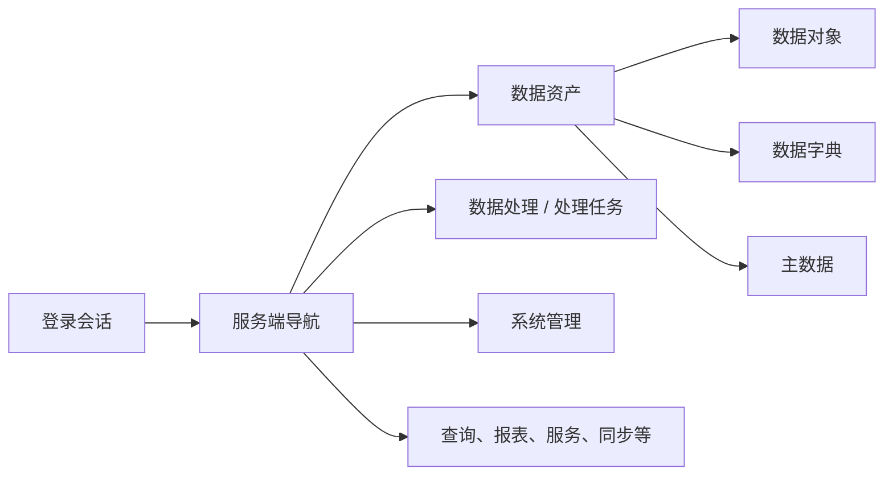

# 数据治理平台 — 前端界面设计说明书

| 文档属性 | 内容 |
|---|---|
| 文档编号 | DOC-06 |
| 文档版本 | 0.7（草稿） |
| 对应系统版本 | 0.1.0-SNAPSHOT |
| 源码基线 | fb41721778aa17cb7c9b949f9cb3787c9902312d，含未提交工作区更改 |
| 适用环境 | 当前仓库静态分析；实际部署环境另行确认 |
| 文档状态 | 草稿，待审核 |
| 编制日期 | 2026-11-26 |
| 更新日期 | 2026-11-27 |
| 编制 / 审核 / 批准 | 待确认 / 待审核 / 待批准 |

## 修订记录

| 版本 | 日期 | 修订内容 | 影响范围 | 修订人 |
|---|---|---|---|---|
| 0.1 | 2026-11-26 | 根据当前源码快照形成草稿 | 待核对 | 待确认 |
| 0.2 | 2026-11-26 | 补充工作流、查询、同步、服务与报表入口 | 待核对 | 待确认 |
| 0.5 | 2026-11-26 | 按交付模板调整章节结构 | 待核对 | 待确认 |
| 0.6 | 2026-11-27 | 根据源码补充架构、导航及公共交互 | 第 1、2、4—6 章 | 待确认 |
| 0.7 | 2026-11-27 | 补充数据源、数据服务、报表看板、系统管理及工作流页面详细设计 | 相关章节 | 待确认 |

## 1. 前端架构与范围

| 项目 | 内容 |
|---|---|
| 框架及版本 | Vue 3.5.30；Vite 7.3.1 为构建工具。 |
| 路由与状态管理 | `App.vue` 使用 section、groupPages 等响应式状态切换页面，菜单由 `/api/navigation` 返回；未发现本项目使用 Vue Router 进行这些页面切换。 |
| UI 组件库 | Element Plus 2.14.8；编排画布使用 Vue Flow，另依功能引入图表与编辑器。 |
| 请求及认证处理 | 登录后加载 `/api/session` 和 `/api/navigation`；业务请求使用同源会话，状态变更按 `auth.js` 获取 CSRF 信息。 |
| 布局与主题 | 顶部状态和账号、左侧导航、主内容工作区；字体与部分窄屏布局由全局样式控制。 |

依赖版本来自 `frontend/package.json`；页面和权限描述基于静态源码，实际菜单和访问结果受服务端数据及授权影响。

## 2. 导航菜单与页面结构

| 页面编号 | 菜单路径 | 路由 | 页面名称 | 可见条件 / 权限 |
|---|---|---|---|---|
| PAGE-SOURCE | 数据资产 / 数据源、数据集和驱动 | `assets` 分组中的相应视图标识 | 数据源管理 | 服务端导航及 `datasource.*` 权限控制 |
| PAGE-OBJECT | 数据资产 / 数据对象 | `assets/objects` 组件标识 | 数据对象 | 菜单及 `datasource.object.read` 等权限按实际授权控制 |
| PAGE-DICT | 数据资产 / 数据字典 | `assets/dictionary` 组件标识 | 数据字典 | 菜单及字典相关权限按实际授权控制 |
| PAGE-MD | 数据资产 / 主数据 | `assets/master-data` 组件标识 | 主数据 | 菜单及 `datasource.master_data.read` 等权限按实际授权控制 |
| PAGE-TASK | 数据处理 / 处理任务 | `processing` 及子组件标识 | 处理任务 | 服务端导航和任务权限控制 |
| PAGE-ORG | 系统管理 | `system` 及子组件标识 | 组织与权限 | 服务端导航和系统管理权限控制 |
| PAGE-QUERY | 数据查询入口 | `query` 组件标识 | 数据查询 | 服务端导航及数据访问权限控制 |
| PAGE-REPORT | 数据报表入口 | `reports` 组件标识 | 报表 | 服务端导航及报表权限控制 |
| PAGE-SERVICE | 数据服务入口 | `services` 组件标识 | 数据服务 | 服务端导航及服务权限控制 |
| PAGE-REALTIME | 实时同步入口 | `realtime` 组件标识 | 实时同步 | 服务端导航及实时同步权限控制 |
| PAGE-WORKFLOW | 工作流入口 | `tasks` 组件标识 | 工作流 | 服务端导航和工作流权限控制 |

此处是菜单组件标识，而非独立浏览器 URL；菜单名称及最终可见性以运行时返回值为准。

## 3. 页面详细设计

### 页面与交互

| 页面 | 主要操作 |
|---|---|
| 数据对象 | 目录、查询、登记、预览和结构管理 |
| 数据字典 | 目录浏览与字典维护 |
| 主数据 | 搜索对象、动态字段筛选、记录维护、导入导出和版本记录 |
| 处理任务 | 目录和任务列表，新建后进入空白编排画布 |
| 组织与权限 | 用户、角色、菜单、权限和审计管理 |

具体字段、按钮及可见性以组件和登录权限为准；本次未采集运行截图，尚未逐页面验证。

### 数据处理与数据应用入口

入口由服务端导航菜单和授权决定，前端用菜单的组件标识切换界面。

| 入口 | 组件 | 主要操作与 API |
|---|---|---|
| 工作流 | TaskStudio | 编辑工作流、触发运行并查看执行结果，使用 /api/workflows 及其子路径。 |
| 数据查询 | DataExplorer | 选择可访问数据集，配置预览与分析条件，使用 /api/accessible-datasets 和 /api/datasets/{id}/preview、/analysis。 |
| 实时同步 | Realtime | 建立轮询任务、启停和修改运行参数，使用 /api/realtime-jobs 及其子路径。 |
| 数据服务 | Services | 创建、提交、审批、配置调用方授权并查看调用统计，使用 /api/services、/api/service-callers、/api/service-grants、/api/service-usage。 |
| 数据报表 | Reports | 管理报表和看板、运行查询，使用 /api/reports、/api/dashboards 及其子路径。 |

### 3.1 主数据（PAGE-MD）

#### 3.1.1 页面概述

| 项目 | 内容 |
|---|---|
| 所属模块 | 数据资产 / 主数据 |
| 页面用途 | 主数据管理 |
| 页面入口 | 数据资产 / 主数据 |
| 访问条件 | 关联权限 `datasource.master_data.read`，实际菜单还受服务端导航配置控制。 |
| 关联功能 | 主数据的查询与维护。 |

#### 3.1.2 页面布局与截图

左侧对象目录和搜索，右侧对象信息、动态条件、数据表和分页。 本次根据源码静态分析，未采集运行截图。

#### 3.1.3 查询条件

| 控件名称 | 类型 | 默认值 | 校验 / 取值范围 | 对应请求参数 |
|---|---|---|---|---|
| 字段 | 下拉选择 | 未选择 | 选项来自当前对象字段，注释存在时同时展示名称 | `filters[].field` |
| 条件 | 下拉选择 | 第一行“包含”；新条件“等于” | 包含、开头为仅适用于文本字段；其他条件见操作符列表 | `filters[].operator` |
| 筛选内容 | 输入框 | 空 | 为空 / 不为空时隐藏；支持回车查询 | `filters[].value` |
| 页码 / 每页数量 | 分页器 | 1 / 20 | 每页可选 20、50、100；变更大小回第一页 | `page` / `size` |

#### 3.1.4 列表字段

| 序号 | 展示列 | 数据字段 | 格式化 / 枚举 | 排序 / 筛选 | 空值处理 |
|---|---|---|---|---|---|
| 1 | 对象字段 | 动态 `rows[].<field.name>` | 表头优先字段注释，提示显示字段名与类型 | 查询条件按所选字段 | null 显示 `NULL`，对象值 JSON 格式化 |
| 2 | 操作 | 当前记录的完整主键 | 根据权限展示编辑、删除 | 非排序列 | 无完整主键时禁用编辑和删除 |

#### 3.1.5 表单字段

| 字段标签 | 控件类型 | 数据字段 | 必填 | 默认值 | 校验与联动 |
|---|---|---|---|---|---|
| 业务字段 | 动态输入框 / 布尔选择框 | `values.<field.name>` | 非空且无默认值、非自增、非生成列时显示必填 | 新增为 null；编辑为当前行的值 | 依据 JDBC 类型与长度显示控件；后端再次校验。 |
| 主键 | 动态表单与隐藏 key | `key.<field.name>` | 修改 / 删除要求完整 | 编辑取自当前行 | 修改时不可编辑；新增时生成或自增列不可编辑。 |
| 导入文件 | 文件上传 | multipart `file` | 导入时必填 | 无 | `.xlsx` 且不超过 10 MB；服务端进一步校验内容。 |

#### 3.1.6 操作按钮与交互

| 操作 | 显示 / 禁用条件 | 触发行为 | 确认提示 | 成功 / 失败反馈 |
|---|---|---|---|---|
| 查询 | 显示 | 回到第 1 页并按有效条件查询 | 无 | 表格刷新，错误消息提示 |
| ＋ 条件 / 移除 | 显示；多条件时可移除 | 添加或移除筛选行 | 无 | 条件按 AND 组合 |
| 新增 | `datasource.master_data.create`，且 `detail.canInsert` | 打开动态表单并提交记录 | 无 | 成功提示并刷新 |
| 导入 | `datasource.master_data.import`，且 `detail.canInsert` | 下载模板、选择文件并导入 | 无 | 显示成功数、失败数与行错误 |
| 导出 | `datasource.master_data.export`，对象类型为表或视图 | 按当前有效筛选条件导出 XLSX | 无 | 下载文件或错误提示 |
| 版本记录 | `datasource.master_data.history` | 分页查询历史，点击条目查询详情 | 无 | 展示字段变更 |
| 编辑 | `datasource.master_data.update`；可编辑且记录主键完整 | 打开动态表单并提交修改 | 无 | 成功提示并刷新 |
| 删除 | `datasource.master_data.delete`；可编辑且记录主键完整 | 发送完整主键删除记录 | 弹出删除确认 | 成功提示并刷新 |
| 刷新 | 显示 | 保持当前页重新查询 | 无 | 更新表格或提示错误 |

#### 3.1.7 页面状态与异常处理

| 状态 / 场景 | 触发条件 | 展示与交互行为 |
|---|---|---|
| 空结果 | 无符合条件的记录 | 显示表格空状态。 |
| 读取或保存失败 | 接口返回错误 | 显示错误信息，具体内容取决于接口响应。 |

#### 3.1.8 接口映射

| 页面动作 | 接口编号 | 请求参数映射 | 响应字段映射 |
|---|---|---|---|
| 浏览对象 | API-MD-01、API-MD-02 | 对象树、选中对象 id | 目录 / 对象、字段元数据及写入能力 |
| 查询 | API-MD-03 | id、page、size、filters | rows、total、page、size |
| 新增 / 编辑 / 删除 | API-MD-04、API-MD-05、API-MD-06 | `key` 与 `values`；删除只发送 key | 影响行数和快照；成功后重查 |
| 下载模板 / 导入 / 导出 | API-MD-07、API-MD-08、API-MD-09 | id、file 或筛选条件 | XLSX 文件或导入结果 |
| 版本记录 | API-MD-10、API-MD-11 | 对象 id、页码或历史 id | 历史列表与快照 |

### 3.2 数据字典（PAGE-DICT）

#### 3.2.1 页面概述

| 项目 | 内容 |
|---|---|
| 所属模块 | 数据资产 / 数据字典 |
| 页面用途 | 数据字典管理 |
| 页面入口 | 数据资产 / 数据字典 |
| 访问条件 | 关联权限 `datasource.dictionary.read`，实际菜单还受服务端导航配置控制。 |
| 关联功能 | 数据字典的查询与维护。 |

#### 3.2.2 页面布局与截图

左侧目录树与目录搜索，右侧查询工具栏、字典列表和分页。 本次根据源码静态分析，未采集运行截图。

#### 3.2.3 查询条件

| 控件名称 | 类型 | 默认值 | 校验 / 取值范围 | 对应请求参数 |
|---|---|---|---|---|
| 目录树 | 树 | 根目录 | 选择后回第 1 页；服务端包含子目录 | `directoryId` |
| 搜索字典标识、名称或含义 | 输入框 | 空 | 点击查询或回车后去除首尾空格并应用 | `search` |
| 页码 / 条数 | 分页器 | 1 / 10 | 每页可选 10、20、50 条 | `page` / `size` |

#### 3.2.4 列表字段

| 序号 | 展示列 | 数据字段 | 格式化 / 枚举 | 排序 / 筛选 | 空值处理 |
|---|---|---|---|---|---|
| 1 | 序号 | 表格行索引 | Element Plus 索引列 | 不适用 | 不适用 |
| 2 | 字典标识 | `code` | 原值 | 搜索 | 组件默认 |
| 3 | 字典名 | `name` | 原值 | 搜索 | 组件默认 |
| 4 | 字典含义 | `meaning` | 原值 | 搜索 | 组件默认 |
| 5 | 类型 | `dataType` | 英文类型标识 | 不适用 | 组件默认 |
| 6 | 长度 | `length` | 数值 | 不适用 | 组件默认 |
| 7 | 操作 | 条目 ID 与当前权限 | 查看、编辑、删除 | 不适用 | 不适用 |

#### 3.2.5 表单字段

| 字段标签 | 控件类型 | 数据字段 | 必填 | 默认值 | 校验与联动 |
|---|---|---|---|---|---|
| 字典目录 | 下拉选择 | `directoryId` | 是 | 当前选中目录或 null | 从已有目录选择。 |
| 字典标识 | 输入框 | `code` | 是 | 空 | 最多 100 字符；编辑时禁用；后端限制格式与唯一性。 |
| 字典名 | 输入框 | `name` | 是 | 空 | 最多 200 字符。 |
| 字典含义 | 输入框 | `meaning` | 是 | 空 | 最多 200 字符。 |
| 字典类型 | 下拉选择 | `dataType` | 是 | `varchar` | 从代码中的 9 种类型选择。 |
| 字典长度 | 数字输入 | `length` | 否 | null | 最小为 1。 |
| 字典精度 | 数字输入 | `precision` | 否 | null | 仅 decimal / double 显示；最小为 0，后端检查不大于长度。 |
| 描述 | 文本域 | `description` | 否 | 空 | 最多 1000 字符。 |
| 导入文件 | 文件输入 | `file` | 导入时是 | 无 | XLSX、最多 5 MB 和 5000 行，服务端验证。 |

#### 3.2.6 操作按钮与交互

| 操作 | 显示 / 禁用条件 | 触发行为 | 确认提示 | 成功 / 失败反馈 |
|---|---|---|---|---|
| 查询 | 显示 | 应用搜索条件并回到第一页 | 无 | 显示列表或错误 |
| 新增 | `datasource.dictionary.create` | 打开空表单并保存 | 无 | 成功后刷新 |
| 导入 | `datasource.dictionary.import` | 下载模板、选择文件并导入 | 无 | 展示成功、失败及行错误 |
| 查看 | 显示 | 打开只读表单 | 无 | 展示当前条目 |
| 编辑 | `datasource.dictionary.update` | 打开表单，字典标识禁用 | 无 | 保存后刷新 |
| 删除 | `datasource.dictionary.delete` | 删除条目 | 确认对话框 | 成功后刷新或显示错误 |
| 刷新 | 显示 | 重新读取目录和条目 | 无 | 显示新数据或错误 |

#### 3.2.7 页面状态与异常处理

| 状态 / 场景 | 触发条件 | 展示与交互行为 |
|---|---|---|
| 空结果 | 无符合条件的记录 | 显示表格空状态。 |
| 读取或保存失败 | 接口返回错误 | 显示错误信息，具体内容取决于接口响应。 |

#### 3.2.8 接口映射

| 页面动作 | 接口编号 | 请求参数映射 | 响应字段映射 |
|---|---|---|---|
| 读取目录 / 条目 | API-DICT-01、API-DICT-02 | `directoryId`、`search`、`page`、`size` | 目录数组、`rows`、`total` |
| 新增 / 修改 / 删除目录 | API-DICT-03、API-DICT-04、API-DICT-05 | 目录 id、名称、父目录 | 编号或空响应 |
| 新增 / 修改 / 删除条目 | API-DICT-06、API-DICT-07、API-DICT-08 | 字典表单及条目 id | 编号或空响应 |
| 导入 / 模板 | API-DICT-09、API-DICT-10 | XLSX 文件 | 模板文件及 `success`、`failed`、`errors` |
| 目录排序 | 见接口设计第 4.60 节 | 完整目录树 `items` | 空响应 |

### 3.3 处理任务（PAGE-TASK）

#### 3.3.1 页面概述

| 项目 | 内容 |
|---|---|
| 所属模块 | 数据处理 / 处理任务 |
| 页面用途 | 处理任务管理 |
| 页面入口 | 数据处理 / 处理任务 |
| 访问条件 | 关联权限 `workflow.task.read`，实际菜单还受服务端导航配置控制。 |
| 关联功能 | 处理任务的查询与维护。 |

#### 3.3.2 页面布局与截图

左侧任务目录，右侧列表与操作；进入任务后显示组件库、画布和配置面板。 本次根据源码静态分析，未采集运行截图。

#### 3.3.3 查询条件

| 控件名称 | 类型 | 默认值 | 校验 / 取值范围 | 对应请求参数 |
|---|---|---|---|---|
| 任务目录 | 树 | 根节点 | 选择目录及子目录，回第 1 页 | 本地过滤已加载任务 |
| 任务名称 | 输入框 | 空 | 点击查询或回车后去空格并应用 | 本地 `nameFilter`，不作为 `/api/tasks` 查询参数 |
| 运行状态 | 下拉选择 | 空 | 运行中 / 停止；点击查询生效 | 本地 `stateFilter` |
| 页码 / 条数 | 分页器 | 依 `usePagination` 初始值 | 每页可选 10、20、50 | 本地分页，不传后端 |

#### 3.3.4 列表字段

| 序号 | 展示列 | 数据字段 | 格式化 / 枚举 | 排序 / 筛选 | 空值处理 |
|---|---|---|---|---|---|
| 1 | 选择 / 序号 | 当前页选择及索引 | 表格选择和索引列 | 不适用 | 不适用 |
| 2 | 任务名称 | `name` | 原值 | 按名称本地筛选 | 组件默认 |
| 3 | 状态 | `version` | 大于 0 显示已发布版本，否则显示草稿 | 不适用 | 组件默认 |
| 4 | 目录 | `directoryId` | 根据已加载目录转换名称 | 按目录本地筛选 | 显示未分类 |
| 5 | 运行状态 | `runState` | RUNNING 显示运行中，否则停止 | 按运行状态本地筛选 | 按代码默认展示 |
| 6 | 最近运行 | `lastRun.state`、时间 | 中文状态及结束或开始时间 | 不适用 | 显示未运行 |
| 7 | 操作 | 权限与任务状态 | 启动、停止、编辑、复制、删除、运行记录 | 不适用 | 不适用 |

#### 3.3.5 表单字段

| 字段标签 | 控件类型 | 数据字段 | 必填 | 默认值 | 校验与联动 |
|---|---|---|---|---|---|
| 任务名称 | 输入框 | `name` | 是 | 空 | 去首尾空格，前端最多 160 字符。 |
| 所属目录 | 下拉选择 | `directoryId` | 否 | 当前目录或 null | 支持清空为未分类。 |
| 描述 | 文本域 | `description` | 否 | 空 | 最多 500 字符。 |
| 起始定义 | 页面固定值 | `template` | 页面固定 | `BLANK` | 不显示模板选择，创建后进入空白画布。 |
| 业务日期 | 日期选择器 | `businessDate` | 启动时是 | 浏览器本地当天 | 不可清空；按 YYYY-MM-DD 发送。 |

#### 3.3.6 操作按钮与交互

| 操作 | 显示 / 禁用条件 | 触发行为 | 确认提示 | 成功 / 失败反馈 |
|---|---|---|---|---|
| 查询 / 刷新 | 显示 | 本地应用查询条件 / 从后端重新加载 | 无 | 更新列表或提示错误 |
| 新增 | 同时拥有 `workflow.task.create`、`datasource.source.read` | 创建空白任务后进入画布 | 无 | 提示错误或打开画布 |
| 启动 | `workflow.task.execute` 且未运行 | 选择业务日期并请求运行 | 业务日期对话框 | 批量结果按成功与失败展示 |
| 停止 | `workflow.task.execute` 且运行中 | 请求停止 | 提示可能已写入部分数据 | 更新列表或提示错误 |
| 编辑 / 查看 | 拥有 `workflow.task.update` 或任务运行中 | 打开画布；运行中显示查看 | 切换页面前检查未保存内容 | 显示画布或错误 |
| 复制 | `workflow.task.create` | 复制任务草稿 | 输入副本名称等 | 成功后刷新 |
| 删除 | `workflow.task.delete`，运行中禁用 | 删除任务 | 提示运行历史将清除 | 成功后刷新 |
| 运行记录 | `workflow.task.read` | 打开运行记录与详情 | 无 | 加载监控数据 |

#### 3.3.7 页面状态与异常处理

| 状态 / 场景 | 触发条件 | 展示与交互行为 |
|---|---|---|
| 空结果 | 无符合条件的记录 | 显示表格空状态。 |
| 读取或保存失败 | 接口返回错误 | 显示错误信息，具体内容取决于接口响应。 |

#### 3.3.8 接口映射

| 页面动作 | 接口编号 | 请求参数映射 | 响应字段映射 |
|---|---|---|---|
| 加载目录和任务 | `/api/task-directories`、接口设计第 4.64 节 | 无业务查询参数 | 目录列表、任务列表供本地筛选 |
| 创建 / 编辑 / 发布 | API-TASK-01、API-TASK-02、API-TASK-03、接口设计第 4.30 节 | 名称、目录、草稿 revision 和定义 | 任务编号、草稿和发布版本 |
| 启动 / 停止 / 重试 | API-TASK-04、接口设计第 4.31、4.32 节 | 任务 ID、业务日期或运行 ID | 运行编号、停止数或接受状态 |
| 运行监控 | API-TASK-RUN-DETAIL、API-TASK-RUN-LOG、API-TASK-NODE-PREVIEW | runId、日志筛选、节点标识 | 运行详情、日志、节点预览 |

### 3.4 数据对象（PAGE-OBJECT）

#### 3.4.1 页面概述

| 项目 | 内容 |
|---|---|
| 所属模块 | 数据资产 |
| 页面用途 | 按目录查找与管理数据对象登记，并提供建表及字段结构操作入口。 |
| 页面入口 | 数据资产 / 数据对象；组件标识 `assets/objects`。 |
| 访问条件 | 导航由服务端返回；对象列表及操作分别检查对应 `datasource.object.*` 权限。 |
| 关联功能 | 对象登记、资料维护、结构操作和预览。 |

#### 3.4.2 页面布局与截图

左侧为 `DirectoryTree` 对象目录；右侧依次是查询与操作工具栏、对象列表和分页。查看、编辑、预览、待处理操作及核对物理表均为对话框；新增、注册及字段编辑由子组件承载。小于 700px 时双栏调整为上下布局。本节依据 `DataObjects.vue` 的当前源码，未采集本轮运行截图。

#### 3.4.3 查询条件

| 控件名称 | 类型 | 默认值 | 校验 / 取值范围 | 对应请求参数 |
|---|---|---|---|---|
| 目录 | 树 | 根节点，selected=0 | 选中后回到第 1 页；根节点不传目录 ID | `directoryId` |
| 对象表名 | 输入框 | 空字符串 | 查询时去除首尾空格；支持回车 | `table` |
| 对象中文名 | 输入框 | 空字符串 | 查询时去除首尾空格；支持回车 | `name` |
| 页码 / 每页数量 | 分页器 | 1 / 10 | 可选择 10、20、50 条；调整大小回第 1 页 | `page` / `size` |

#### 3.4.4 列表字段

| 序号 | 展示列 | 数据字段 | 格式化 / 枚举 | 排序 / 筛选 | 空值处理 |
|---|---|---|---|---|---|
| 1 | 序号 | 页码及行索引计算 | `(page-1)*size+index+1` | 随分页变化 | 不适用 |
| 2 | 对象名称 | `identity.table` | 原值 | 表名查询 | 未见特殊处理 |
| 3 | 对象中文名 | `name` | 原值 | 中文名查询 | 未见特殊处理 |
| 4 | 数据源 | `identity.sourceId` | 通过数据源列表查名称 | 不适用 | 无 ID 显示 `—`；未匹配显示“数据源 ID” |
| 5 | 对象目录 | `directoryId` | 通过目录列表查名称 | 目录树筛选 | 无匹配显示 `—` |
| 6 | 更新时间 | `updatedAt` | 原值 | 不适用 | 组件默认行为 |
| 7 | 模式 | `identity.schema` / `identity.catalog` | schema 优先，否则 catalog | 不适用 | 显示 `—` |
| 8 | 操作 | 对象及当前权限 | 根据类型和权限显示按钮 | 不适用 | 不适用 |

#### 3.4.5 表单字段

| 字段标签 | 控件类型 | 数据字段 | 必填 | 默认值 | 校验与联动 |
|---|---|---|---|---|---|
| 对象名称 | 禁用输入框 | `detail.object.identity.table` | 不适用 | 当前对象表名 | 查看及编辑资料时不可修改。 |
| 对象中文名 | 输入框 | `editForm.name` | 后端校验 | 当前对象名称 | 编辑模式可输入，前端 maxlength 200。 |
| 对象目录 | 选择框 | `editForm.directoryId` | 后端校验 | 当前目录 | 选项由目录层级生成。 |
| 描述 | 输入框 | `editForm.description` | 待依后端规则确认 | 当前描述 | 前端 maxlength 1000。 |
| 预览权限数据集 | 选择框 | `datasetId` | 否 | 当前关联 | 具有 `datasource.dataset.manage_policy` 时显示；仅列出同数据源、同物理表的数据集。 |

新增表单及字段结构编辑的详细字段在 `ObjectEditor.vue`、`SchemaEditor.vue`，本小节未逐项展开。

#### 3.4.6 操作按钮与交互

| 操作 | 显示 / 禁用条件 | 触发行为 | 确认提示 | 成功 / 失败反馈 |
|---|---|---|---|---|
| 查询 | 显示 | 固化输入值、回到第 1 页并加载列表 | 无 | 失败显示错误信息 |
| 新增 | `datasource.object.create_table` | 打开新增对象编辑器 | 建表流程以编辑器为准 | 完成后重新加载 |
| 注册 | `datasource.object.register` | 打开登记向导 | 以向导为准 | 登记后重新加载 |
| 导出 | `datasource.object.export` | 以已应用条件访问导出地址 | 无 | 浏览器处理下载 |
| 待处理操作 | 具备建表或字段发布权限之一 | 读取相应待处理清单 | 核对及解除等动作单独确认 | 对话框显示处理结果或错误 |
| 刷新 | 显示 | 重新加载目录、数据源及列表 | 无 | 错误在页面展示 |
| 预览 | `datasource.object.preview` | 获取详情后请求最多 20 条预览 | 无 | 展示结果或错误 |
| 查看 / 编辑 | 查看显示；编辑需 `datasource.object.update` | 加载对象详情；编辑后保存 | 无 | 保存后刷新并提示 |
| 字段 | 对象为 TABLE 且有 `datasource.object.publish_schema` | 打开结构编辑器 | 以编辑器为准 | 发布后刷新 |
| 复制 | `datasource.object.create_table` | 读取详情并打开预填的新增编辑器 | 以编辑器为准 | 完成后刷新 |
| 删除 | `datasource.object.delete` | 删除对象登记 | 提示物理表和数据保留 | 成功提示并刷新 |

#### 3.4.7 页面状态与异常处理

| 状态 / 场景 | 触发条件 | 展示与交互行为 |
|---|---|---|
| 无对象 | 返回列表为空 | 表格提示“暂无数据对象”。 |
| 列表响应乱序 | 后发请求已返回，先前请求随后返回 | 使用递增序号忽略旧响应。 |
| 页码超出有效范围 | 非第一页为空且总数仍大于 0 | 跳至最后一页并重新读取。 |
| 建表或结构操作需核对 | 状态为执行中、未知或部分完成等 | 待处理操作显示状态和处理入口；核对实际结构不会再次执行 SQL，但读取接口可能把中断的 EXECUTING 状态改为 UNKNOWN。 |
| 加载或操作失败 | 请求异常 | 页面 alert 或消息提示；按具体操作实现。 |

#### 3.4.8 接口映射

| 页面动作 | 接口编号 | 请求参数映射 | 响应字段映射 |
|---|---|---|---|
| 目录加载和排序 | `/api/object-directories`、`/sort`；编号待逐接口核对 | 目录选择及排序 items | 目录树 `id`、`parentId`、`name` |
| 列表查询 | `/api/data-objects`；编号待逐接口核对 | `table`、`name`、`directoryId`、`page`、`size` | `rows`、`total` |
| 查看、编辑、删除 | `/api/data-objects/{id}`；编号待逐接口核对 | 详情 ID；编辑提交目录、名称、描述及 version | 详情及保存状态 |
| 数据预览 | `/api/data-objects/{id}/preview`；编号待逐接口核对 | `fields: []`、`limit: 20` | 返回行数组动态生成列 |
| 待处理及核对 | `/api/data-object-operations`、`/api/data-object-schema-operations`；编号待逐接口核对 | 操作 ID | 状态及物理字段 |

### 3.5 实时同步（PAGE-REALTIME）

#### 3.5.1 页面概述

| 项目 | 内容 |
|---|---|
| 所属模块 | 数据处理 / 实时同步 |
| 页面用途 | 维护基于数据库轮询和复合游标的同步任务。 |
| 页面入口 | 由服务端导航返回的 `realtime` 组件标识。 |
| 访问条件 | 导航与 `workflow.realtime.*` 等权限；新增还依赖数据源读取权限。 |
| 关联功能 | 创建、启停和设置轮询任务。 |

#### 3.5.2 页面布局与截图

页面上方为轮询限制提示，主区域为查询工具栏、任务表格和分页；新增和参数设置分别使用对话框。组件挂载后加载数据，并每 10 秒刷新；卸载时清除定时器。静态源码分析，未采集本轮运行截图。

#### 3.5.3 查询条件

| 控件名称 | 类型 | 默认值 | 校验 / 取值范围 | 对应请求参数 |
|---|---|---|---|---|
| 搜索实时任务名称或状态 | 输入框 | 空 | 查询或回车应用；去除首尾空格 | 对已加载任务本地过滤，无后端查询参数 |
| 页码 | 分页器 | 1 | 每页 10 项 | 本地分页 |

#### 3.5.4 列表字段

| 序号 | 展示列 | 数据字段 | 格式化 / 枚举 | 排序 / 筛选 | 空值处理 |
|---|---|---|---|---|---|
| 1 | 任务 | `name` | 原值 | 本地搜索 | 组件默认 |
| 2 | 状态 | `state` | RUNNING、ERROR 等以原值显示，并用标签区分 | 本地搜索 | 组件默认 |
| 3 | 增量游标 | `watermark` | 原值 | 不适用 | 组件默认 |
| 4 | 主键游标 | `tie` | 原值 | 不适用 | 组件默认 |
| 5 | 累计处理 | `processed` | 数值 | 不适用 | 组件默认 |
| 6 | 间隔 / 批次 | `intervalSeconds`、`batchSize` | 秒 / 行 | 不适用 | 组件默认 |
| 7 | 最近成功 / 错误 | `lastSuccess`、`lastError` | 原值 | 不适用 | 组件默认 |
| 8 | 操作 | `state` 及权限 | 启动、停止、设置 | 不适用 | 不适用 |

#### 3.5.5 表单字段

| 字段标签 | 控件类型 | 数据字段 | 必填 | 默认值 | 校验与联动 |
|---|---|---|---|---|---|
| 任务名称 | 输入框 | `name` | 后端要求 | 空 | 后端校验非空及长度。 |
| 增量类型 | 下拉框 | `config.mapping.watermarkType` | 是 | LONG | LONG 或 TIMESTAMP。 |
| 源 / 目标数据源 | 下拉框 | `config.sourceId` / `targetId` | 后端要求 | null | 选项来自可读数据源。 |
| 源表 / 目标表 | 输入框 | `mapping.sourceTable` / `targetTable` | 后端要求 | 空 | 后端校验合法标识符。 |
| 源字段 / 目标字段 | 输入框 | `mapping.sourceColumns` / `targetColumns` | 后端要求 | 空 | 按逗号拆分，顺序对应；后端检查等长及合法性。 |
| 增量字段 | 输入框 | `mapping.watermarkColumn` | 后端要求 | 空 | 应满足顺序要求。 |
| 源表单列主键 | 输入框 | `mapping.tieColumn` | 后端要求 | 空 | 页面提示使用数值型。 |
| 目标主键 | 输入框 | `mapping.targetKeys` | 后端要求 | 空 | 按逗号拆分，后端检查包含于目标字段。 |
| 每批最多行数 | 数字输入 | `mapping.batchSize` | 是 | 100 | 1–1000。 |
| 轮询间隔 | 数字输入 | `config.intervalSeconds` | 是 | 10 | 5–3600 秒。 |
| 轮询设置 | 数字输入 | `intervalSeconds`、`batchSize` | 是 | 当前任务值 | 仅 STOPPED / ERROR 时提供，不修改游标和映射。 |

#### 3.5.6 操作按钮与交互

| 操作 | 显示 / 禁用条件 | 触发行为 | 确认提示 | 成功 / 失败反馈 |
|---|---|---|---|---|
| 查询 / 刷新 | 显示 | 本地过滤 / 重新加载任务与数据源 | 无 | 列表更新或页面错误 |
| 新增 | `workflow.realtime.create` 且 `datasource.source.read` | 打开并提交任务表单 | 提示检查增量顺序 | 成功提示并刷新 |
| 启动 | `workflow.realtime.start` 且状态不是 RUNNING | 请求启动 | 无 | 提示并刷新 |
| 停止 | `workflow.realtime.stop` 且状态为 RUNNING | 请求停止 | 无 | 提示并刷新 |
| 设置 | `workflow.realtime.update` 且状态为 STOPPED / ERROR | 仅修改间隔和批次 | 页面说明游标和映射不变 | 提示并刷新 |

#### 3.5.7 页面状态与异常处理

| 状态 / 场景 | 触发条件 | 展示与交互行为 |
|---|---|---|
| 自动刷新 | 页面挂载 | 每 10 秒重新加载，离开时停止定时器。 |
| 读取或保存失败 | 权限、连接或输入异常 | 顶部错误提示；设置冲突提示先停止并刷新。 |
| 数据同步限制 | 页面展示 | 明确提示迟到 / 回拨更新和物理删除不会自动捕获，不等同 CDC。 |

#### 3.5.8 接口映射

| 页面动作 | 接口编号 | 请求参数映射 | 响应字段映射 |
|---|---|---|---|
| 加载任务及数据源 | API-REALTIME-LIST、接口设计第 4.54 节 | 无业务查询参数 | 任务与数据源数组 |
| 创建 | API-REALTIME-CREATE | `name` 和 `config` | 返回任务 ID；随后刷新 |
| 启动 / 停止 | 接口设计第 4.62、4.63 节 | 任务 ID | 空响应；随后刷新 |
| 保存设置 | 接口设计第 4.61 节 | `intervalSeconds`、`batchSize` | 空响应；随后刷新 |

### 3.6 数据查询（PAGE-QUERY）

#### 3.6.1 页面概述

| 项目 | 内容 |
|---|---|
| 所属模块 | 数据查询 |
| 页面用途 | 浏览获授权数据集，执行明细或分组聚合，并可保存最近一次成功查询为报表。 |
| 页面入口 | 服务端导航返回的 `query` 组件标识。 |
| 访问条件 | `datasource.query.read`；保存报表另需 `report.report.create` 及数据集权限。 |
| 关联功能 | FUNC-QUERY、FUNC-REPORT。 |

#### 3.6.2 页面布局与截图

主界面显示数据集查询工具栏、可访问数据集表和分页；点击“查询分析”打开对话框，内含查询配置、执行结果及可选的报表保存区。本节来自 `DataExplorer.vue` 静态分析，未采集本轮运行截图。

#### 3.6.3 查询条件

| 控件名称 | 类型 | 默认值 | 校验 / 取值范围 | 对应请求参数 |
|---|---|---|---|---|
| 搜索数据集 | 输入框 | 空 | 点击查询或回车生效，名称不区分大小写 | 对已加载数据集本地过滤 |
| 页码 / 每页数量 | 分页器 | `usePagination` 初始值 | 可选择 10、20、50 | 本地分页 |
| 查询方式 | 单选 | 明细 | 明细或分组聚合 | 决定调用 preview / analysis |
| 最大返回行数 | 数字输入 | 200 | 前端 1–1000，仍受后端实际配置上限约束 | `limit` |

#### 3.6.4 列表字段

| 序号 | 展示列 | 数据字段 | 格式化 / 枚举 | 排序 / 筛选 | 空值处理 |
|---|---|---|---|---|---|
| 1 | 数据集 | `name` | 原值 | 本地名称搜索 | 组件默认 |
| 2 | 可用字段 | `fields` | 以顿号连接 | 不适用 | 空列表显示空字符串 |
| 3 | 操作 | 数据集 ID | 查询分析 | 不适用 | 不适用 |
| 4 | 查询结果 | 动态返回行字段 | 根据首行字段或当前配置生成表头 | 分组查询支持指定排序 | 无结果显示空状态 |

#### 3.6.5 表单字段

| 字段标签 | 控件类型 | 数据字段 | 必填 | 默认值 | 校验与联动 |
|---|---|---|---|---|---|
| 选择字段 | 多选 | `fields` | 明细模式是 | 空 | 从可访问字段选择；后端检查数量及权限。 |
| 分组字段 | 多选 | `groups` | 聚合模式可为空 | 空 | 使用可访问字段；后端要求可进行明文分析。 |
| 统计方式 | 下拉框 | `metrics[].operation` | 聚合模式是 | COUNT | COUNT、SUM、AVG、MIN、MAX。 |
| 统计字段 | 下拉框 | `metrics[].field` | 除 COUNT 外是 | 空 | COUNT 可留空；后端校验字段权限。 |
| 筛选条件 | 多行字段 / 操作符 / 值 | `filters` | 否 | 空 | 最多 20 项，全部满足；支持文本、数字、布尔或空值判断。 |
| 排序字段 / 方向 | 下拉框 | `sort` | 否 | 字段空、方向 DESC | 字段取统计结果或已选分组，方向 ASC / DESC。 |
| 报表名称 / 图表类型 | 输入框 / 下拉框 | `name` / `chartType` | 保存时报表名必填 | 空 / TABLE | 类型 TABLE、BAR、LINE；保存最近一次成功查询配置。 |

#### 3.6.6 操作按钮与交互

| 操作 | 显示 / 禁用条件 | 触发行为 | 确认提示 | 成功 / 失败反馈 |
|---|---|---|---|---|
| 查询 / 刷新数据集 | 显示 | 本地筛选 / 重新获取可访问数据集 | 无 | 列表更新或错误提示 |
| 查询分析 | 每行显示 | 打开当前数据集查询对话框 | 无 | 重置原结果和条件 |
| 添加 / 删除条件 | 聚合模式；最多 20 条 | 修改筛选行 | 无 | 更新查询表单 |
| 执行查询 | 对话框内 | 提交明细或聚合请求 | 无 | 展示结果，失败显示权限或查询错误 |
| 保存为报表 | 有成功查询且 `report.report.create` | 保存最近一次成功查询和图表类型 | 无 | 成功或错误提示 |

#### 3.6.7 页面状态与异常处理

| 状态 / 场景 | 触发条件 | 展示与交互行为 |
|---|---|---|
| 数据集为空 | 当前账号没有可访问数据集 | 显示“暂无已授权数据集”。 |
| 切换或关闭查询 | 选择其他数据集或关闭对话框 | 清除结果和最近成功查询，并使旧请求结果失效。 |
| 权限不足或源库异常 | 查询接口失败 | 展示对应错误；脱敏字段不能用于筛选或聚合。 |

#### 3.6.8 接口映射

| 页面动作 | 接口编号 | 请求参数映射 | 响应字段映射 |
|---|---|---|---|
| 加载数据集 | 接口设计第 4.146 节 | 无业务参数 | `id`、`name`、`fields` |
| 明细查询 | 接口设计第 4.150 节 | 数据集 id、`fields`、`limit` | 动态行数组 |
| 分组聚合 | 接口设计第 4.151 节 | 数据集 id、`groups`、`metrics`、`filters`、`limit`、`sort` | 分组字段和 `metric_N` |
| 保存报表 | 接口设计第 4.119 节 | 最近一次成功查询、报表名和图表类型 | 新报表 id |

### 3.7 数据源、数据集与驱动（PAGE-SOURCE）

#### 3.7.1 页面概述

| 项目 | 内容 |
|---|---|
| 所属模块 | 数据源管理 |
| 页面用途 | 管理数据库连接，登记数据集、配置角色数据范围并管理 JDBC 驱动。 |
| 页面入口 | 应用导航中的数据源模块；组件 `DataSources.vue`。 |
| 访问条件 | 各列表和操作由对应的 `datasource.*` 权限控制；实际授权由后端校验。 |
| 关联功能 | 数据源连接、数据集登记、数据集角色权限、驱动管理。 |

#### 3.7.2 页面布局与截图

页面分数据源、数据集、驱动三个列表区域，每个区域包含查询工具栏、表格和分页；数据源编辑、表目录登记、字段详情、角色权限和驱动上传使用对话框。本节依据源码，未采集本轮运行截图。

#### 3.7.3 查询条件

| 控件名称 | 类型 | 默认值 | 校验 / 取值范围 | 对应请求参数 |
|---|---|---|---|---|
| 数据源搜索 | 文本输入 | 空 | 名称、主机或数据库；点击查询或回车 | 已加载数据源的本地过滤 |
| 数据集搜索 | 文本输入 | 空 | 名称或表名；点击查询或回车 | 已加载数据集的本地过滤 |
| 驱动搜索 | 文本输入 | 空 | 名称或驱动类；点击查询或回车 | 已加载驱动的本地过滤 |
| 登记表目录 | 数据源选择、Schema 输入及表名搜索 | 空 | 选定数据源后查询表；表名搜索通过按钮或回车应用 | 查询表请求传数据源 ID 和可选 Schema；表名在前端筛选 |

#### 3.7.4 列表字段

| 序号 | 展示列 | 数据字段 | 格式化 / 枚举 | 排序 / 筛选 | 空值处理 |
|---|---|---|---|---|---|
| 1 | 数据源 | `name`、`type`、`profileName`、`host`、`port`、`database`、`username` | 原值及连接测试状态 | 搜索条件见上表 | 组件默认 |
| 2 | 数据集 | `name`、`sourceId`、`schema` / `catalog`、`table`、`fields` | 字段显示数量；Schema 为空时使用 catalog | 名称或表名搜索 | 组件默认 |
| 3 | 驱动 | `name`、`dbType`、`driverClass`、`versionLabel`、`builtin` | 来源显示“内置”或“上传” | 名称或类名搜索 | 组件默认 |
| 4 | 可登记表 | `schema`、`name`、`type` | 表目录查询结果 | 表名搜索 | 未选择数据源时显示提示 |
| 5 | 数据集字段 | `name`、`dataType`、`nullable` | 可为空显示是或否 | 不适用 | 无字段时为空表 |

#### 3.7.5 表单字段

| 字段标签 | 控件类型 | 数据字段 | 必填 | 默认值 | 校验与联动 |
|---|---|---|---|---|---|
| 名称、数据库类型、大版本 | 输入 / 选择 | `name`、`type`、`profileId` | 按连接配置校验 | 由表单初始化 | 类型影响版本选项和驱动列表。 |
| 连接方式 | 单选 | `connectType` | 适用数据库类型时使用 | 由选定版本决定 | SID 或服务名；影响数据库字段标签。 |
| 主机、端口、数据库 / 服务名 | 输入 / 数字 | `host`、`port`、`database` | 按连接配置校验 | 由选定版本和表单决定 | 端口控件范围 1–65535。 |
| 用户名、密码 | 输入 | `username`、`password` | 按连接配置校验 | 编辑时具体口令处理以接口实现为准 | 密码使用密码输入，不在文档中记录实际凭据。 |
| JDBC 驱动、高级参数 | 选择 / 键值表 | `driverId`、高级参数 | 否 | 内置默认驱动；参数为空 | 参数候选来自当前数据库版本配置。 |
| 登记数据集 | 数据源选择、名称输入、表选择 | `sourceId`、`name`、`catalog`、`schema`、`table` | 按登记接口校验 | 空 | 从查询结果选表并登记。 |
| 角色数据范围 | 选择及单选 | `roleId`、`departmentField`、`scope`、`fields` | 保存前按接口校验 | 以当前编辑状态为准 | 范围为本部门或本部门及下级；字段权限为不允许、脱敏或明文。 |
| 上传驱动 | 输入 / 选择 / 文件 | `name`、`dbType`、`driverClass`、`versionLabel`、`file` | 版本标签可为空 | 空 | 页面限制选择一个 `.jar` 文件，提示不超过 50 MB；后端仍须独立校验。 |

#### 3.7.6 操作按钮与交互

| 操作 | 显示 / 禁用条件 | 触发行为 | 确认提示 | 成功 / 失败反馈 |
|---|---|---|---|---|
| 新增、编辑数据源 | 分别需要 `datasource.source.create`、`datasource.source.update` | 打开连接表单并保存 | 无 | 保存前页面要求连接测试通过；失败显示错误。 |
| 测试连接 | 需要 `datasource.source.test` | 测试已登记连接或表单配置 | 无 | 显示测试状态或错误。 |
| 删除 / 批量删除 | 需要 `datasource.source.delete` | 提交所选数据源 | 确认删除；批量提示被引用的数据源将保留 | 展示结果并刷新列表。 |
| 登记数据集 | 需创建、数据源读取和测试权限 | 选择数据源，查询表并登记 | 无 | 刷新数据集列表或展示错误。 |
| 字段详情、数据范围、重新采集、删除 | 分别依赖对应数据集权限 | 查看字段、保存或撤销授权、刷新元数据、删除登记 | 删除及撤销时确认；删除提示业务表不会删除 | 展示结果或错误。 |
| 上传 / 删除驱动 | 分别需要 `datasource.driver.upload` / `datasource.driver.delete`；内置驱动不可删除 | 上传 jar 或删除上传的驱动 | 删除时确认；上传对话框提示来源可信 | 展示结果或错误，刷新驱动列表。 |

#### 3.7.7 页面状态与异常处理

| 状态 / 场景 | 触发条件 | 展示与交互行为 |
|---|---|---|
| 未选择数据源 | 登记数据集前 | 表列表提示选择数据源，查询表按钮禁用。 |
| 测试未通过 | 新增或编辑连接 | 保存按钮禁用；配置发生变化后的测试状态以组件逻辑为准。 |
| 数据源被引用 | 批量删除 | 页面提示被引用的数据源将保留；具体失败项以服务端结果为准。 |
| 操作失败 | 请求或校验失败 | 在相应页面或对话框展示错误；不将前端限制视为服务端授权。 |

#### 3.7.8 接口映射

| 页面动作 | 接口编号 | 请求参数映射 | 响应字段映射 |
|---|---|---|---|
| 加载、创建、修改和删除数据源 | 详见接口设计 `/api/data-sources` 系列 | 表单字段或数据源 ID；批量删除提交 `ids` | 数据源列表、操作结果及错误 |
| 测试连接 / 查询表 | 详见接口设计 `/api/data-sources/test-config` 和 `/{id}/test`、`/{id}/tables` | 连接配置或数据源 ID、可选 Schema | 测试结果或表目录数组 |
| 登记、刷新、删除数据集 | 详见接口设计 `/api/datasets` 系列 | 数据源、表目录字段或数据集 ID | 数据集及字段列表、操作结果 |
| 查看和保存角色数据范围 | 详见接口设计 `/api/datasets/{id}/policies` 系列 | 数据集 ID、角色 ID、范围及字段权限 | 角色规则列表或操作结果 |
| 列出、上传和删除驱动 | 详见接口设计 `/api/drivers` 系列 | 驱动 ID 或 multipart 表单与 jar | 驱动列表及操作结果 |

### 3.8 数据服务（PAGE-SERVICE）

#### 3.8.1 页面概述

| 项目 | 内容 |
|---|---|
| 所属模块 | 数据服务 |
| 页面用途 | 创建并发布数据服务、管理调用方及授权、查看调用统计。 |
| 页面入口 | 导航中的数据服务页面，组件 `Services.vue`。 |
| 访问条件 | 各列表及操作依 `service.service.*`、`service.caller.*` 权限控制；创建服务还需 `datasource.query.read`。 |
| 关联功能 | 服务发布、调用方令牌、授权及调用统计。 |

#### 3.8.2 页面布局与截图

页面包含服务、调用方、授权、调用统计四个标签页，均有查询区和分页；前三页提供各自的创建对话框。本节依据组件源码，未采集本轮运行截图。

#### 3.8.3 查询条件

| 控件名称 | 类型 | 默认值 | 校验 / 取值范围 | 对应请求参数 |
|---|---|---|---|---|
| 服务搜索 | 输入框 | 空 | 名称或状态，点击查询或回车 | 本地过滤已加载服务 |
| 调用方搜索 | 输入框 | 空 | 名称或用户编号，点击查询或回车 | 本地过滤已加载调用方 |
| 授权 / 统计搜索 | 输入框 | 空 | 服务编号或调用方编号，点击查询或回车 | 本地过滤已加载记录 |
| 分页 | 分页器 | 第 1 页 | 每页 10 条 | 本地分页 |

#### 3.8.4 列表字段

| 序号 | 展示列 | 数据字段 | 格式化 / 枚举 | 排序 / 筛选 | 空值处理 |
|---|---|---|---|---|---|
| 1 | 服务、状态、接口 | `name`、`state`、`id` | 接口展示 `GET /api/service-call/{id}`；状态用标签展示 | 服务名称或状态搜索 | 组件默认 |
| 2 | 调用方、绑定用户、调用上限、状态 | `name`、`userId`、`limitPerMinute`、`enabled` | 状态显示启用或停用 | 名称或用户编号搜索 | 组件默认 |
| 3 | 授权服务与调用方 | `serviceId`、`callerId` | 原值 | 服务或调用方编号搜索 | 组件默认 |
| 4 | 调用统计 | `serviceId`、`callerId`、`total`、`successful`、`failed` | 已接收总数包含进行中或中断请求 | 服务或调用方编号搜索 | 组件默认 |

#### 3.8.5 表单字段

| 字段标签 | 控件类型 | 数据字段 | 必填 | 默认值 | 校验与联动 |
|---|---|---|---|---|---|
| 服务名称 | 输入框 | `name` | 由服务端校验 | 空 | 创建服务草稿。 |
| 授权数据集 | 选择器 | `datasetId` | 由服务端校验 | 空 | 选择变化时清空输出字段。 |
| 输出字段 | 多选 | `fields` | 由服务端校验 | 空 | 选项来自所选可访问数据集。 |
| 最多返回行数 | 数字输入 | `limit` | 有默认值 | 100 | 页面范围 1–1000。 |
| 调用方名称 | 输入框 | `name` | 由服务端校验 | 空 | 创建调用方。 |
| 绑定用户 | 选择器 / 数字输入 | `userId` | 由服务端校验 | 空 | 用户列表不可用时使用编号输入，最小值 1。 |
| 每分钟调用上限 | 数字输入 | `limitPerMinute` | 有默认值 | 60 | 页面范围 1–10000。 |
| 授权服务 / 调用方 | 选择器 | 路径中的服务 ID / 调用方 ID | 是 | 空 | 页面只列已发布服务及启用调用方。 |

#### 3.8.6 操作按钮与交互

| 操作 | 显示 / 禁用条件 | 触发行为 | 确认提示 | 成功 / 失败反馈 |
|---|---|---|---|---|
| 新建服务 | 有服务创建与数据集查询权限 | 提交服务配置创建草稿 | 无 | 显示成功或错误。 |
| 提交审批 / 审批并发布 | 分别有提交 / 审批权限，且服务处于相应状态 | 推进服务状态 | 无 | 显示结果并刷新。 |
| 下线 | 有提交权限且服务已发布 | 请求服务下线 | 提示下线后调用方无法访问 | 显示结果并刷新。 |
| 新建 / 停用调用方 | 对应创建 / 停用权限；停用要求当前启用 | 创建调用方或停用令牌 | 停用时提示令牌立即失效 | 创建时只展示一次令牌；不要记录到文档。 |
| 新增 / 撤销授权 | 对应授权管理及列表读取权限 | 提交或撤销服务与调用方关系 | 撤销时确认 | 显示结果并刷新。 |
| 查询 / 刷新 | 各标签页显示 | 本地筛选 / 重新请求可访问列表 | 无 | 更新列表或显示错误。 |

#### 3.8.7 页面状态与异常处理

| 状态 / 场景 | 触发条件 | 展示与交互行为 |
|---|---|---|
| 状态限制 | 服务尚未提交、待审批、已发布或下线 | 根据状态和权限显示相应按钮。 |
| 一次性令牌 | 创建调用方成功 | 提示立即安全保存；关闭提示后页面不再显示该令牌。 |
| 用户列表不可用 | 读取组织用户失败或列表为空 | 回退为输入用户编号；服务端仍执行权限和有效性校验。 |
| 无权限 / 操作失败 | 列表或写入请求失败 | 显示错误；受权限控制的列表不加载。 |

#### 3.8.8 接口映射

| 页面动作 | 接口编号 | 请求参数映射 | 响应字段映射 |
|---|---|---|---|
| 服务列表、创建与状态流转 | 接口设计 `/api/services` 系列 | 创建表单或服务 ID | 服务列表、创建及状态结果 |
| 调用方列表、创建与停用 | 接口设计 `/api/service-callers` 系列 | 调用方字段或 ID | 调用方列表；创建响应中的一次性 token |
| 授权与撤销 | 接口设计 `/api/service-grants`、`/api/services/{id}/callers/{callerId}` 系列 | 服务 ID、调用方 ID | 授权列表或操作结果 |
| 调用统计及数据集 | 接口设计 `/api/service-usage`、`/api/accessible-datasets` | 无业务参数 | 统计及可访问数据集列表 |

### 3.9 报表与看板（PAGE-REPORT）

#### 3.9.1 页面概述

| 项目 | 内容 |
|---|---|
| 所属模块 | 报表与看板 |
| 页面用途 | 查看、编辑已保存报表，创建看板并组合报表。 |
| 页面入口 | 导航中的报表页面，组件 `Reports.vue`。 |
| 访问条件 | 按 `report.report.*`、`report.dashboard.*` 权限控制；执行查询还需要 `datasource.query.read`。 |
| 关联功能 | 报表查询、结果展示及看板组合。 |

#### 3.9.2 页面布局与截图

页面包含报表和看板两个标签页，各含名称查询、列表和分页；查看、编辑报表以及新增、编辑、查看看板使用对话框。本节基于源码，未采集本轮运行截图。

#### 3.9.3 查询条件

| 控件名称 | 类型 | 默认值 | 校验 / 取值范围 | 对应请求参数 |
|---|---|---|---|---|
| 搜索报表名称 | 输入框 | 空 | 点击查询或回车 | 本地筛选已加载报表 |
| 搜索看板名称 | 输入框 | 空 | 点击查询或回车 | 本地筛选已加载看板 |
| 分页 | 分页器 | 第 1 页 | 按页面配置分页 | 本地分页 |

#### 3.9.4 列表字段

| 序号 | 展示列 | 数据字段 | 格式化 / 枚举 | 排序 / 筛选 | 空值处理 |
|---|---|---|---|---|---|
| 1 | 报表名称、展示方式、查询方式 | `name`、`chartType`、`kind` | 展示类型 TABLE / BAR / LINE | 名称搜索 | 无报表时提示先在数据查询中保存 |
| 2 | 看板名称 | `name` | 原值 | 名称搜索 | 组件默认 |
| 3 | 查看结果 | 查询结果动态字段 | 由报表配置决定表格或图表 | 受保存的查询条件约束 | 空结果由结果组件展示 |

#### 3.9.5 表单字段

| 字段标签 | 控件类型 | 数据字段 | 必填 | 默认值 | 校验与联动 |
|---|---|---|---|---|---|
| 报表名称、展示方式 | 输入 / 选择 | `name`、`chartType` | 服务端校验 | 编辑时加载现有值 | 展示方式为表格、柱状图或折线图。 |
| 最大返回行数 | 数字输入 | `query.limit` | 按查询接口 | 编辑时加载现有值 | 页面范围 1–1000，仍受平台上限约束。 |
| 展示字段 | 多选 | `query.fields` | 明细查询依接口校验 | 编辑时加载现有值 | 字段来自所选数据集。 |
| 分组、统计、筛选、排序 | 多行选择 | `query.groups`、`metrics`、`filters`、`sort` | 聚合查询依接口校验 | 编辑时加载现有值 | 指标 COUNT、SUM、AVG、MIN、MAX；筛选值支持文本、数字、布尔或空值操作。 |
| 看板名称、选择报表 | 输入 / 多选 | `name`、`reports` | 按看板接口校验 | 新建时为空 | 报表候选来自已加载列表。 |

#### 3.9.6 操作按钮与交互

| 操作 | 显示 / 禁用条件 | 触发行为 | 确认提示 | 成功 / 失败反馈 |
|---|---|---|---|---|
| 查看结果 | 有报表执行和数据集查询权限 | 打开报表结果 | 无 | 展示结果或错误。 |
| 编辑报表 | 有报表修改和数据集查询权限 | 编辑查询及展示配置并保存 | 无 | 保存或显示错误；查询规则由服务端再次验证。 |
| 删除报表 | 有报表删除权限 | 删除报表 | 确认删除 | 刷新列表或显示错误。 |
| 新增 / 编辑看板 | 有对应看板权限和报表读取权限 | 保存名称与选中的报表 | 无 | 保存期间禁用关闭和重复提交，完成后刷新。 |
| 查看看板 | 有报表执行、报表读取和数据集查询权限 | 打开看板结果 | 无 | 展示看板内容或错误。 |
| 删除看板 | 有看板删除权限 | 删除看板 | 提示报表将保留并确认 | 刷新列表或显示错误。 |

#### 3.9.7 页面状态与异常处理

| 状态 / 场景 | 触发条件 | 展示与交互行为 |
|---|---|---|
| 无报表 | 报表列表为空 | 提示先到数据查询保存报表。 |
| 保存中 | 看板提交未结束 | 禁止重复保存及通过常规对话框关闭方式中断。 |
| 失去数据访问权限 | 重新执行或编辑时报表绑定的数据集不可访问 | 显示权限或请求错误，不应视为历史配置仍有执行权限。 |

#### 3.9.8 接口映射

| 页面动作 | 接口编号 | 请求参数映射 | 响应字段映射 |
|---|---|---|---|
| 加载、编辑、删除报表 | 接口设计 `/api/reports` 系列 | 报表 ID、名称、图表类型、查询配置 | 报表列表及操作结果 |
| 查询预览 / 聚合 | 接口设计 `/api/datasets/{id}/preview`、`analysis` | 已保存或编辑中的查询配置 | 动态结果行 |
| 加载、创建、编辑、删除看板 | 接口设计 `/api/dashboards` 系列 | 看板 ID、名称、报表 ID 列表 | 看板列表及操作结果 |

### 3.10 系统管理：用户、部门、角色和菜单（PAGE-ORG）

#### 3.10.1 页面概述

| 项目 | 内容 |
|---|---|
| 所属模块 | 系统管理 |
| 页面用途 | 管理部门、用户、角色、菜单及操作权限，并查看审计记录。 |
| 页面入口 | 系统管理子菜单，`Organization.vue` 根据传入的 `view` 切换视图。 |
| 访问条件 | 各列表和操作由对应 `system.*` 权限控制；最终授权由后端实施。 |
| 关联功能 | 用户身份、组织结构、角色授权、菜单和审计。 |

#### 3.10.2 页面布局与截图

部门和菜单是树形表格；用户视图左侧为可搜索的组织树，右侧为用户列表；角色、权限和审计使用列表及分页。新增、修改、授权、导入与详情使用对话框。本节依据静态源码，未采集本轮运行截图。

#### 3.10.3 查询条件

| 控件名称 | 类型 | 默认值 | 校验 / 取值范围 | 对应请求参数 |
|---|---|---|---|---|
| 部门 / 角色 / 用户 / 菜单搜索 | 输入框 | 空 | 按名称、编号或各视图提示的其他字段搜索；查询按钮或回车应用 | 前端对已加载数据过滤 |
| 状态 | 选择器 | 空 | 启用、停用或不限制；用户状态筛选需读取权限 | 前端过滤 |
| 组织机构 | 树搜索与节点选择 | 空 | 可清除选中部门；停用部门有标记 | 用户列表前端部门过滤 |
| 权限搜索 | 输入框 | 空 | 模块、操作或权限码 | 前端过滤权限目录 |
| 审计筛选 | 操作类型、结果、账号、起止时间 | 空 | 结果 SUCCESS / FAILURE；点击查询或账号输入框回车 | 审计列表服务端查询参数 |
| 分页 | 分页器 | 第 1 页 | 审计分页触发请求；其他列表按组件分页 | 审计页码及每页条数；其他为本地分页 |

#### 3.10.4 列表字段

| 序号 | 展示列 | 数据字段 | 格式化 / 枚举 | 排序 / 筛选 | 空值处理 |
|---|---|---|---|---|---|
| 1 | 部门 | `name`、`id`、`parentId`、`leader`、`phone`、`sortOrder`、`enabled` | 树形展示及启停标签 | 名称、负责人、编号及状态 | 联系人或电话为空显示“—” |
| 2 | 角色 | `name`、`roleKey`、`sortOrder`、`enabled` | 启停标签 | 名称、权限字符、编号及状态 | 组件默认 |
| 3 | 用户 | `username`、`nickname`、`departmentId`、`phone`、`roles`、`enabled`、`createdAt`、`lastLoginAt` | 部门和角色显示名称；部分列按权限显示 | 账号、姓名、部门、手机号及状态 | 电话为空显示“—” |
| 4 | 菜单 | `name`、`menuType`、`icon`、`routePath`、`sortOrder`、`visible`、`enabled` | 树形展示、图标和开关 | 名称、路由及状态 | 图标或路由为空显示“—” |
| 5 | 权限 | `moduleName`、`actionName`、`code`、`description` | 权限码原样展示 | 模块、操作或权限码 | 无数据时显示空状态 |
| 6 | 审计 | `occurredAt`、`username`、`ip`、`actionLabel`、`objectTypeLabel`、`objectId`、`resultLabel` | 优先显示中文标签 | 操作、结果、账号、时间 | 无账号显示系统或未知账号 |

#### 3.10.5 表单字段

| 字段标签 | 控件类型 | 数据字段 | 必填 | 默认值 | 校验与联动 |
|---|---|---|---|---|---|
| 部门名称、上级、负责人、电话、邮箱 | 输入 / 选择 | `name`、`parentId`、`leader`、`phone`、`email` | 名称必填 | 新建时按表单初始化 | 上级选项通过 `allowedDepartmentParents` 过滤。 |
| 角色名称、权限字符、排序、状态、备注 | 输入 / 数字 / 开关 | `name`、`roleKey`、`sortOrder`、`enabled`、`description` | 名称及权限字符必填 | 新建时按表单初始化 | 排序范围 0–100000；备注最多 500 字符。 |
| 用户账号、姓名、密码、部门、手机、邮箱 | 输入 / 选择 | `username`、`nickname`、`password`、`departmentId`、`phone`、`email` | 新建时账号、密码和部门必填 | 按表单初始化 | 密码提示至少 8 位并满足字符类别规则；后端执行最终校验。 |
| 用户角色与状态 | 多选 / 开关 | `roles`、`enabled` | 依实际授权 | 新建默认启用 | 角色和状态控件受各自权限控制；内置管理员角色选择禁用。 |
| 菜单名称、上级、类型、路由、组件、图标 | 输入 / 树选择 / 选择 | `name`、`parentId`、`menuType`、`routePath`、`component`、`icon` | 名称和类型必填；菜单类型需路由和组件 | 按表单初始化 | 目录与菜单使用不同字段；部分内置项不可修改。 |
| 操作权限 | 复选树 | 角色的权限码集合 | 按授权需求 | 加载当前角色权限 | 支持搜索模块、操作名称和权限码。 |

#### 3.10.6 操作按钮与交互

| 操作 | 显示 / 禁用条件 | 触发行为 | 确认提示 | 成功 / 失败反馈 |
|---|---|---|---|---|
| 部门、角色、用户、菜单新增 / 修改 / 删除 | 对应资源的 create / update / delete 权限；部分内置菜单受保护 | 打开表单或提交删除 | 删除时确认 | 显示成功或错误并重新加载。 |
| 配置角色操作权限 | `system.role.assign_permissions` | 打开权限树并保存选中权限 | 以页面及接口实际提示为准 | 显示结果或错误。 |
| 用户角色、状态、密码 | 分别要求角色分配、状态设置、重置密码权限 | 分配角色、启停或重置密码 | 依操作对话框或确认提示 | 显示结果或错误。 |
| 用户导入 / 导出、在线用户 | 创建权限可导入；读取权限可导出和查看在线用户 | 上传或导出 CSV，查看在线会话 | 具体操作按对话框提示 | 导入结果显示逐行错误；踢下线另需状态设置权限。 |
| 审计查询 / 导出 / 查看 | 审计读取权限控制导出与服务端访问 | 查询筛选结果、下载或打开详情 | 无 | 失败显示错误；查询时分页禁用。 |

#### 3.10.7 页面状态与异常处理

| 状态 / 场景 | 触发条件 | 展示与交互行为 |
|---|---|---|
| 组织树为空 | 无可显示部门 | 显示暂无部门数据。 |
| 权限目录为空 | 无权限点或无查看权限 | 显示对应空状态提示。 |
| 审计账号为空 | 登录失败等记录未关联账号 | 显示系统或未知账号。 |
| 受保护菜单 | 平台内置菜单或特定组件标识 | 部分编辑、删除或显示开关被禁用；服务端权限仍为最终边界。 |
| 请求失败 | 加载、保存或导入失败 | 页面展示错误，不将隐藏按钮视为授权。 |

#### 3.10.8 接口映射

| 页面动作 | 接口编号 | 请求参数映射 | 响应字段映射 |
|---|---|---|---|
| 加载和维护组织数据 | 接口设计 `/api/organization` 及部门、用户、角色、菜单子路径 | 对应资源表单或 ID | 组织数据、操作结果及错误 |
| 用户导入 / 导出与在线会话 | 接口设计 `/api/organization/users/import`、`/users/export`、`/online` 系列 | 上传文件或会话标识 | 导入结果、下载文件、在线会话 |
| 审计目录、查询与导出 | 接口设计 `/api/organization/audit` 系列 | 操作、结果、账号、时间、分页 | 审计记录、中文标签和总数 |

### 3.11 工作流与定时计划（PAGE-WORKFLOW）

#### 3.11.1 页面概述

| 项目 | 内容 |
|---|---|
| 所属模块 | 工作流与调度 |
| 页面用途 | 将已发布任务组合成工作流，手动运行、查看历史、配置定时及按日期补跑。 |
| 页面入口 | 工作流菜单，组件 `TaskStudio.vue`。 |
| 访问条件 | 工作流和计划标签分别按 `workflow.workflow.*`、`workflow.schedule.*` 权限控制。 |
| 关联功能 | 工作流版本、运行实例、节点重试、计划及补跑。 |

#### 3.11.2 页面布局与截图

工作流与定时计划分别显示列表；进入编辑后在画布上排列任务并连线，也可使用选择框添加依赖。运行历史、实例、补跑和计划配置使用对话框。本节依据源码，未采集本轮运行截图。

#### 3.11.3 查询条件

| 控件名称 | 类型 | 默认值 | 校验 / 取值范围 | 对应请求参数 |
|---|---|---|---|---|
| 工作流搜索 | 输入框 | 空 | 名称或版本；查询或回车 | 已加载工作流本地过滤 |
| 定时计划搜索 | 输入框 | 空 | 工作流编号、Cron 或时区；查询或回车 | 已加载计划本地过滤 |
| 运行历史 | 状态、业务日期 | 空 | 状态包括 PENDING、RUNNING、WAITING、SUCCEEDED、FAILED、INTERRUPTED | 运行历史请求的筛选条件 |
| 列表分页 | 分页器 | 第 1 页 | 每页可选 10、20、50 | 本地分页；历史按服务端返回加载更多 |

#### 3.11.4 列表字段

| 序号 | 展示列 | 数据字段 | 格式化 / 枚举 | 排序 / 筛选 | 空值处理 |
|---|---|---|---|---|---|
| 1 | 工作流名称、版本 | `name`、`version` | 原值 | 名称或版本 | 无数据时提示暂无工作流 |
| 2 | 计划 | `workflowId`、`cron`、`zone`、`nextFireEpoch`、`enabled` | 按计划时区格式化下次触发时间；状态为启用或停用 | 工作流编号、Cron、时区 | 组件默认 |
| 3 | 运行历史 | `id`、`workflowVersion`、`businessDate`、`state`、`createdAt` | 原值 | 状态及业务日期 | 组件默认 |
| 4 | 运行详情 | `nodes[].key`、`state`、`attempts` | 展示每次尝试的状态及错误 | 不适用 | 错误为空时不显示错误文本 |

#### 3.11.5 表单字段

| 字段标签 | 控件类型 | 数据字段 | 必填 | 默认值 | 校验与联动 |
|---|---|---|---|---|---|
| 工作流名称 | 输入框 | `name` | 保存时按接口校验 | 空 | 编辑已有工作流时名称不可修改。 |
| 任务节点及依赖 | 选择器 / 画布 | `nodes`、`edges` | 依工作流校验 | 空图 | 只可选择已发布任务；记录固定任务版本和坐标。 |
| 业务日期 | 日期 | `businessDate` | 运行按接口校验 | 页面初始化值 | 与当前工作流版本一起提交。 |
| 补跑工作流及日期范围 | 选择 / 日期范围 | `version`、`startDate`、`endDate` | 创建时按接口校验 | 空 | 页面提示每次最多 31 天，任务须配置业务日期参数。 |
| 计划工作流、Cron、时区 | 选择 / 输入 | `version`、`cron`、`zone` | 保存时按接口校验 | 由页面初始化 | 页面提示六段 Cron；重新启用从当前时间计算。 |

#### 3.11.6 操作按钮与交互

| 操作 | 显示 / 禁用条件 | 触发行为 | 确认提示 | 成功 / 失败反馈 |
|---|---|---|---|---|
| 新增 / 编辑工作流 | 对应创建 / 修改权限；创建还需任务读取权限 | 添加节点及依赖后保存 | 离开编辑时检查未保存变更 | 刷新列表或显示错误。 |
| 运行 / 查看历史 | 分别需运行 / 读取权限 | 发起运行或加载运行历史 | 无 | 打开实例或历史对话框。 |
| 重试失败节点 | 有 `workflow.workflow.retry` 且实例失败或中断 | 请求重试 | 提示可能重复写入，需检查幂等策略 | 更新运行详情或显示错误。 |
| 创建补跑 | 有 `workflow.schedule.backfill` | 按日期范围创建多个运行 | 提示重复写入风险 | 展示创建的运行实例或错误。 |
| 新增 / 启停计划 | 对应计划创建 / 更新权限 | 保存 Cron 与时区或切换启停 | 无 | 显示结果并刷新计划列表。 |

#### 3.11.7 页面状态与异常处理

| 状态 / 场景 | 触发条件 | 展示与交互行为 |
|---|---|---|
| 空工作流 | 尚无记录 | 列表显示暂无工作流。 |
| 无已发布任务 | 创建工作流 | 任务选择器无可选节点；不能假设存在可用任务。 |
| 失败或中断实例 | 查看实例详情 | 有重试权限时显示重试按钮并提示重复写入风险。 |
| 请求失败 | 加载、保存、运行或调度请求失败 | 对话框或页面展示错误；实际状态以服务端为准。 |

#### 3.11.8 接口映射

| 页面动作 | 接口编号 | 请求参数映射 | 响应字段映射 |
|---|---|---|---|
| 加载及保存工作流 | 接口设计 `/api/workflows` 及版本子路径 | 名称、任务节点及依赖 | 列表、版本定义或保存结果 |
| 启动运行、历史、详情及重试 | 接口设计 `/api/workflows/{id}/runs`、`/api/runs/{id}` 系列 | 版本、业务日期、实例 ID 及历史筛选 | 实例 ID、状态、节点和尝试 |
| 创建补跑 | 接口设计 `/api/workflows/{id}/backfill` | 版本、起止业务日期 | 创建的运行实例编号 |
| 定时计划 | 接口设计 `/api/schedules`、`/api/workflows/{id}/schedules` 系列 | 工作流版本、Cron、时区及启用状态 | 计划列表与操作结果 |

## 4. 公共组件、布局及交互约定

| 组件 / 约定 | 职责 | 使用场景 | 实际行为 |
|---|---|---|---|
| `DirectoryTree.vue` | 目录树、选择与搜索 | 数据对象、字典及其他复用页面 | 目录与搜索状态在组件中管理；各页面通过事件处理选择和维护。 |
| Element Plus 表格 / 表单 / 对话框 | 表格、输入和操作反馈 | 各业务页面 | 具体列、校验及交互由页面实现。 |
| `auth.js` | 同源请求、CSRF 及认证失效处理 | 受保护写操作 | 具体安全边界由后端安全链执行，前端可见性不替代授权。 |
| `App.vue` 导航 | 按服务端菜单切换页面 | 平台主框架 | 切换任务和编排页面前检查未保存状态。 |

## 5. 前端权限及数据展示约束

`App.vue` 从会话响应取得 `permissions`，向子组件提供 `canPermission`；各业务页面据此控制按钮及加载。数据对象、字典、主数据及任务的操作仍由后端逐接口授权；浏览器隐藏按钮不能作为安全边界。会话失效事件会清除用户、权限和导航状态。实际角色菜单和数据范围须在目标环境核验。

## 6. 验证范围与待确认事项

| 编号 | 事项 | 当前结论 / 验证状态 | 影响 | 后续确认方式 |
|---|---|---|---|---|
| UI-GAP-01 | 页面详细设计覆盖 | 主数据、字典、处理任务、数据对象、实时同步、数据查询、数据源、数据服务、报表看板、系统管理及工作流已有逐页面章节；画布节点配置等仍须细化，其他页面仍需展开 | 尚不足以作为全量页面交付 | 对照各 Vue 组件按模板逐页补充 |
| UI-GAP-02 | 字段及按钮明细 | 已有页面部分表格采用合并描述 | 单控件的默认值与权限无法逐项追踪 | 按组件源码拆分并核验 |
| UI-GAP-03 | 运行截图与可访问性 | 当前无本轮脱敏实测截图和完整交互验收 | 无法证明实际展示与静态说明一致 | 在授权环境采集并验证桌面及窄屏 |

