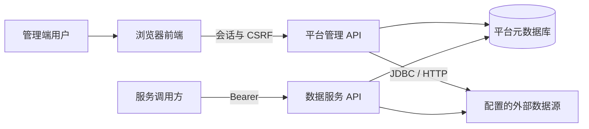
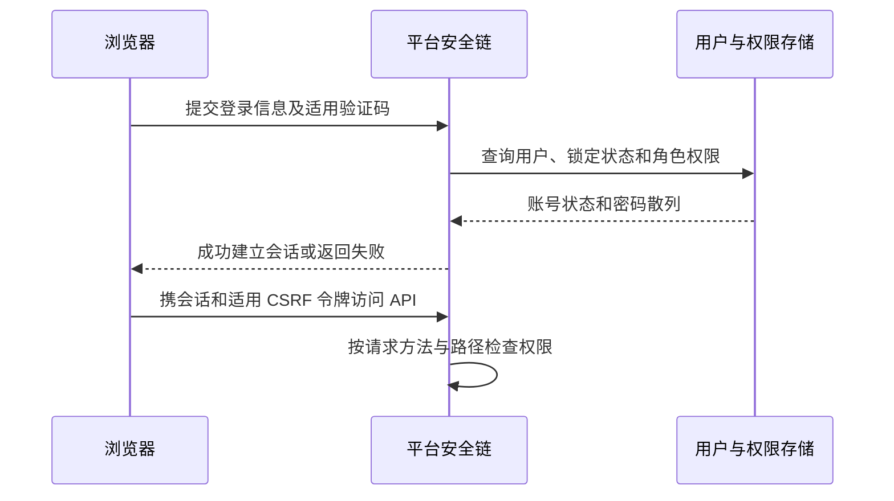

# 数据治理平台 — 安全设计说明书

| 文档属性 | 内容 |
|---|---|
| 文档编号 | DOC-07 |
| 文档版本 | 0.6（草稿） |
| 对应系统版本 | 0.1.0-SNAPSHOT |
| 源码基线 | fb41721778aa17cb7c9b949f9cb3787c9902312d，含未提交工作区更改 |
| 适用环境 | 当前仓库静态分析；实际部署环境另行确认 |
| 文档状态 | 草稿，待审核 |
| 编制日期 | 2026-11-26 |
| 更新日期 | 2026-11-27 |
| 编制 / 审核 / 批准 | 待确认 / 待审核 / 待批准 |

## 修订记录

| 版本 | 日期 | 修订内容 | 影响范围 | 修订人 |
|---|---|---|---|---|
| 0.1 | 2026-11-26 | 根据当前源码快照形成草稿 | 待核对 | 待确认 |
| 0.5 | 2026-11-26 | 按交付模板调整章节结构 | 待核对 | 待确认 |
| 0.6 | 2026-11-27 | 按源码补充认证、授权、审计、边界和待验证项 | 第 1—9 章 | 待确认 |

## 1. 安全设计范围与信任边界

本册覆盖平台前端到后端、平台到元数据库、外部数据源以及外部数据服务调用的源码设计；网络设备、网关及目标部署环境的安全配置不在本次静态证据范围。业务用户会话与服务调用方凭证使用不同安全链。

图只表达逻辑信任边界，不证明各链路已启用 TLS 或网络隔离。

## 2. 认证与会话管理

| 设计项 | 实际机制 | 配置及适用条件 | 验证状态 |
|---|---|---|---|
| 登录认证 | Spring Security 表单登录 `/api/login`；读取未删除用户和启用角色权限。 | 公开入口，成功响应 204；失败响应 401。 | `SecurityConfiguration` 静态核对；相关默认集测试通过。 |
| 密码存储与校验 | BCrypt；密码设置规则不少于 8 字符、最多 72 字节、四类字符中至少三类，不能含空白或账号名。 | 创建、重置、本人修改及初始化使用的规则见 `PasswordPolicy`。 | 静态核对；`PasswordPolicyTest` 默认集通过。 |
| Token / Session | 管理 API 使用会话；数据服务 GET 路径使用独立无状态链，在控制器校验 Bearer 凭证及授权。 | `/api/service-call/**` 安全链只允许 GET 进入控制器，并禁用该链 CSRF；其他方法拒绝。 | `SecurityConfiguration`、`ExternalServiceController` 静态核对。 |
| 有效期、刷新与注销 | 默认会话超时 30 分钟；限制同账号最多一个会话；`/api/logout` 注销后返回 204。 | `GOVERNANCE_SESSION_TIMEOUT` 可覆盖；会话策略以目标环境为准。 | 静态核对；真实部署和代理 Cookie 配置未验。 |
| 登录失败处理 | 同账号失败达到 2 次后要求验证码，达到 5 次锁定 15 分钟；成功后重置失败次数。 | `LoginGuardFilter` 和登录成功 / 失败处理器。 | 静态核对；登录安全相关默认集测试通过。 |

## 3. 授权与权限体系

### 3.1 用户、角色与权限关系

加载用户时读取启用角色对应权限；前端展示控制不替代后端校验。

### 3.2 权限矩阵

| 权限编号 / 标识 | 功能 / 接口 | 授权主体 | 校验位置 | 拒绝行为 |
|---|---|---|---|---|
| `datasource.master_data.read` | 主数据目录、对象详情和记录查询 | 角色授予的会话用户 | `PermissionCatalog` 及 `PermissionAuthorizationManager` | 无权限拒绝；未登录按安全链处理 |
| `datasource.master_data.create` / `update` / `delete` | 主数据记录新增 / 修改 / 删除 | 同上 | 主数据对应 POST / PUT / DELETE 路由 | 无对应权限拒绝 |
| `datasource.master_data.import` / `export` / `history` | 主数据导入模板与导入 / 导出 / 历史 | 同上 | 对应主数据路由 | 无对应权限拒绝 |
| `workflow.task.publish` | 任务发布 | 同上 | `POST /api/tasks/*/publish` | 无对应权限拒绝 |
| `workflow.task.execute` / `retry` | 任务运行、停止、试运行 / 重试 | 同上 | 任务及编排路由 | 无对应权限拒绝 |
| `system.audit.read` | 查询、导出审计 | 同上 | 审计 GET 路由 | 无对应权限拒绝 |
| 调用方服务授权 | `GET /api/service-call/{id}` | 已配置调用方 | 外部服务控制器和调用方授权逻辑 | 无效凭证或无授权时拒绝 |

以上为重点矩阵而非完整权限清单；完整路径和授权以源码与运行时角色配置为准。

### 3.3 数据权限与租户隔离

数据集查询通过数据集访问策略处理授权及行列范围；对象预览与数据集绑定相关。主数据具备独立操作权限，已授权用户可管理其主数据功能所覆盖的数据对象记录，不应误写为自动沿用数据集行列策略。是否存在其他路径与部署级租户隔离机制，需结合完整代码及目标环境验证；本次不宣称实现多租户隔离。

## 4. 敏感数据保护

| 数据类别 | 存储位置 | 传输保护 | 存储保护 / 脱敏 | 访问控制 |
|---|---|---|---|---|
| 用户密码 | 用户表的密码散列 | HTTPS / TLS 取决于目标部署，未验证 | BCrypt 散列；文档不记录密码 | 登录及账号管理授权 |
| 数据源凭据 | 平台元数据库的数据源配置 | 平台到数据库链路取决于部署 | `CredentialCipher` 使用 AES-256-GCM；密钥从应用配置注入 | 数据源相关操作权限；密钥访问由部署环境控制 |
| 调用方凭证 | 服务调用方配置 | 外部链路 TLS 未验证 | 具体存储机制需逐项复核；不在本文记录值 | 数据服务调用方授权 |
| 审计信息 | `audit_events` | 数据库链路取决于部署 | 包含操作上下文，不应公开敏感内容 | `system.audit.read` 控制查询与导出 |

## 5. 输入、文件与网络安全

| 安全场景 | 实际控制 | 生效范围 | 未验证或限制 |
|---|---|---|---|
| 参数校验 / 注入防护 | 部分查询使用参数绑定，编排定义及 SQL 节点有校验规则。 | 对应查询与节点实现。 | 不代表全量接口或第三方 SQL 已完成安全审计。 |
| 文件上传 / 路径访问 | 上传及驱动管理由相应控制器和存储实现处理。 | 字典、主数据导入及驱动等。 | 文件大小、内容校验和部署上传限制需逐接口复核。 |
| CORS / CSRF | 管理端状态变更使用 Spring Security CSRF；数据服务无状态链禁用 CSRF 且仅允许 GET。 | 各自匹配的安全链。 | CORS、反向代理与 Cookie 安全属性以目标环境核对。 |
| 网络访问 / TLS | HTTP 来源经 `HttpTargetGuard` 检查且不跟随重定向。 | 编排 HTTP 来源。 | 不代表其他出站路径具备相同保护；TLS 和网络隔离未实测。 |
| 限流 / 防滥用 | 登录失败验证码和锁定保护。 | 管理端登录。 | 未确认全局 API 限流、外部调用限频或生产网关策略。 |

## 6. 审计日志与安全事件

| 审计事件 | 记录字段 | 触发位置 | 存储及保留 | 访问权限 |
|---|---|---|---|---|
| 登录成功 / 失败 | actor_id、occurred_at、action、object_type、object_id、result、ip、user_agent、message | 登录成功 / 失败处理器及 `LoginGuardFilter` | `audit_events`；默认保留 180 天，可配置；定时清理 | 审计查询 / 导出 `system.audit.read` |
| 任务创建、修改、发布、调度等 | 同上，具体 action 和对象按调用处填写 | `TaskController` 等调用 `AuditLog` 的位置 | 同上；默认每天 03:30 清理，天数非正时跳过 | 同上 |
| 主数据操作 | 同上；记录内容和覆盖范围以实际控制器调用为准 | `MasterDataController` 及相关服务 | 同上；主数据版本历史另存储 | 审计查询权限和主数据历史权限独立 |

仅明确记录到 `AuditLog` 的调用可视为已实现，不能由上述示例推断所有操作和失败均被审计。

## 7. 安全配置与凭证管理

| 配置项名称 | 用途 | 配置来源 | 默认行为 | 敏感性 |
|---|---|---|---|---|
| `GOVERNANCE_CREDENTIAL_KEY` | 数据源凭据加密密钥 | 环境变量，经 `governance.credential-key` 使用 | 项目配置未提供默认值 | 高；不得写入交付文档或仓库 |
| `GOVERNANCE_DB_USER` / `GOVERNANCE_DB_PASSWORD` | 平台元数据库连接凭据 | 环境变量 | 项目配置未提供默认值 | 高；通过部署凭证机制管理 |
| `GOVERNANCE_SESSION_TIMEOUT` | 会话超时 | 环境变量 | 30m | 低；目标环境须核对 |
| `governance.audit-retention-days` | 审计保留天数 | Spring 配置 | 180；非正数不执行清理 | 中；应符合实际保留要求 |
| `governance.audit-retention-cron` | 审计清理调度 | Spring 配置 | `0 30 3 * * *` | 低；需结合运行时区确认 |

## 8. 已知安全限制与验证结果

| 编号 | 控制项 / 风险 | 证据状态 | 影响 | 当前措施 |
|---|---|---|---|---|
| SEC-01 | 生产网络及 TLS | 未提供目标环境证据 | 无法确认传输保护和入口隔离 | 建议在目标环境验证；不是已实现结论 |
| SEC-02 | 安全测试 | 登录及权限相关自动化测试本次在 H2 默认集中通过；未实施渗透测试 | 不能证明全部攻击路径安全 | 建议开展独立安全测试 |
| SEC-03 | 凭据轮换及备份加密 | 未提供运维制度和实测证据 | 不能确认泄漏后轮换及恢复能力 | 建议确认密钥管理流程 |
| SEC-04 | 外部源试运行 | 试运行仍可能真实读取 JDBC 来源或发起 HTTP 请求 | 测试可能触达外部系统 | 在隔离且授权环境执行 |

## 9. 验证范围与待确认事项

| 编号 | 事项 | 当前结论 / 验证状态 | 影响 | 后续确认方式 |
|---|---|---|---|---|
| SEC-GAP-01 | 所有权限和审计事件 | 仅重点路径已静态核对 | 未覆盖路径不可推断一致 | 全量对照 PermissionCatalog、控制器及审计调用 |
| SEC-GAP-02 | 部署侧安全 | TLS、Cookie、网络及凭据托管未验证 | 无法确认生产安全边界 | 在目标环境查阅配置并执行验证 |
| SEC-GAP-03 | 专项安全评估 | 未进行渗透测试和第三方安全审查 | 不能作为安全验收结论 | 项目方组织独立评估 |
