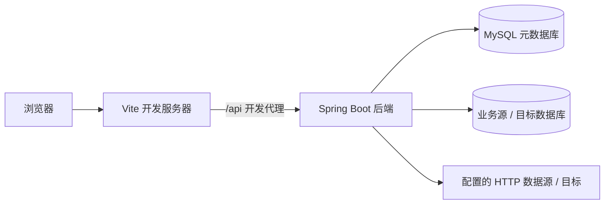

# 数据治理平台 — 部署运维说明书

| 文档属性 | 内容 |
|---|---|
| 文档编号 | DOC-08 |
| 文档版本 | 0.7（草稿） |
| 对应系统版本 | 0.1.0-SNAPSHOT |
| 源码基线 | fb41721778aa17cb7c9b949f9cb3787c9902312d，含未提交工作区更改 |
| 适用环境 | 当前仓库静态分析；实际部署环境另行确认 |
| 文档状态 | 草稿，待审核 |
| 编制日期 | 2026-11-26 |
| 更新日期 | 2026-11-27 |
| 编制 / 审核 / 批准 | 待确认 / 待审核 / 待批准 |

## 修订记录

| 版本 | 日期 | 修订内容 | 影响范围 | 修订人 |
|---|---|---|---|---|
| 0.1 | 2026-11-26 | 根据当前源码快照形成草稿 | 待核对 | 待确认 |
| 0.5 | 2026-11-26 | 按交付模板调整章节结构 | 待核对 | 待确认 |
| 0.6 | 2026-11-27 | 补充开发环境部署步骤、配置与运维限制 | 第 1—11 章 | 待确认 |
| 0.7 | 2026-11-27 | 补充受控查询与任务执行限制配置及验证边界 | 第 5 章 | 待确认 |

## 1. 部署概述与适用环境

项目为 Spring Boot 单节点后端与 Vue 前端，元数据使用 MySQL，业务数据访问配置的数据源。仓库 README 将当前版本标为开发版并明确不用于生产；本册记录仓库可确认的开发方式，生产拓扑和交付环境尚未确认。以下启动、初始化、迁移、恢复操作均未在本轮执行。

## 2. 部署架构与服务清单

| 服务编号 | 服务名称 | 部署形态 | 镜像 / 构建产物 | 依赖 | 实际实例配置 |
|---|---|---|---|---|---|
| SVC-FE | 前端 | Vite 开发服务器；生产托管方式未确定 | `frontend` 源码，构建输出由 Vite 生成 | Node.js、后端 API | 实际实例数未确认 |
| SVC-BE | 后端 | Spring Boot 单节点应用 | Maven 构建的应用包；版本以 POM 为准 | Java 21、元数据库、驱动和凭据密钥 | 实际实例数未确认 |
| SVC-META | 元数据库 | MySQL | 不适用 | 存储及备份系统 | 目标环境版本、实例和容量未确认 |

图中的 Vite 代理仅用于开发环境，不代表生产反向代理方案。

## 3. 运行环境与资源要求

| 项目 | 已确认要求 | 依据 / 验证状态 |
|---|---|---|
| 操作系统及架构 | 仓库未指定统一生产操作系统；本次测试在 Windows amd64 执行 | 目标部署兼容性待确认 |
| 运行时及版本 | Java 21；Maven；Node.js 20.19+ 或 22.12+，npm | `backend/pom.xml` 和 README；本次后端自动测试使用 Java 21、Maven 3.6.3 |
| CPU / 内存 / 磁盘 | 未经容量验证 | 未编造最小配置；需按目标负载测量 |
| 数据库及中间件 | MySQL 元数据库；业务数据源依配置 | 应用默认使用 `db/mysql` Flyway 迁移；目标版本与权限待验证 |

## 4. 网络与端口

| 服务 | 容器 / 内部端口 | 外部端口 | 协议 | 访问范围 | 用途 |
|---|---|---|---|---|---|
| 前端 Vite | 开发默认 5173，实际占用时可能变化 | 未确认 | HTTP，开发用途 | 依开发服务器实际绑定配置 | 开发界面 |
| 后端 | 开发代理目标 `localhost:8080` | 未确认 | HTTP，开发用途 | 依服务端和网络配置 | 平台 API |
| MySQL 元数据库 | 依 JDBC URL 确定 | 未确认 | MySQL / JDBC | 按目标网络策略 | 元数据和任务记录 |

生产 HTTPS、反向代理、外部端口和防火墙规则未核验；不能把开发地址视为生产入口。

## 5. 配置项及环境变量

| 配置键 | 类型 | 是否必需 | 默认值（脱敏） | 配置来源 | 用途 |
|---|---|---|---|---|---|
| `GOVERNANCE_DB_URL` | 字符串 | 是 | 无 | 环境变量 | 元数据库 JDBC URL |
| `GOVERNANCE_DB_USER` | 字符串 | 是 | 无 | 环境变量 | 元数据库账号 |
| `GOVERNANCE_DB_PASSWORD` | 敏感字符串 | 是 | 无 | 环境变量 | 元数据库密码 |
| `GOVERNANCE_CREDENTIAL_KEY` | 敏感字符串 | 是 | 无 | 环境变量 | Base64 编码的 32 字节数据源凭据加密密钥 |
| `GOVERNANCE_DRIVER_DIR` | 路径 | 否 | `./drivers` | 环境变量 | JDBC 驱动存放目录，具体相对位置取决于进程工作目录 |
| `GOVERNANCE_SESSION_TIMEOUT` | 时长 | 否 | `30m` | 环境变量 | 会话超时 |
| `GOVERNANCE_QUERY_MAX_CONCURRENCY` | 整数 | 否 | `8` | README 环境变量；代码读取 `governance.query.max-concurrency` | 数据集受控查询、报表和服务查询共享并发上限，范围 1–100；达到上限时获取许可立即失败。 |
| `GOVERNANCE_QUERY_TIMEOUT_SECONDS` | 整数 | 否 | `30` | README 环境变量；代码读取 `governance.query.timeout-seconds` | JDBC 查询超时，范围 1–3600 秒；驱动取消效果须实测。 |
| `GOVERNANCE_QUERY_MAX_ROWS` | 整数 | 否 | `1000` | README 环境变量；代码读取 `governance.query.max-rows` | 单次受控查询返回行数上限，范围 1–1000。 |
| `GOVERNANCE_EXECUTION_MAX_CONCURRENT` | 整数 | 否 | `8` | README 环境变量；代码读取 `governance.execution.max-concurrent` | 批任务与工作流节点共享执行并发，范围 1–64；获取许可可能等待。 |
| `spring.servlet.multipart.max-file-size` | 大小 | 否 | `50MB` | Spring 配置 | 单文件上传上限 |
| `spring.servlet.multipart.max-request-size` | 大小 | 否 | `52MB` | Spring 配置 | 上传请求总上限 |
| `spring.flyway.locations` | 位置 | 项目默认 | `classpath:db/mysql` | Spring 配置 | MySQL 元数据迁移脚本 |

凭据的真实值不应写入文档。密钥必须跨重启保持一致；丢失后历史数据源凭据无法解密。查询和执行限制的代码默认值已核对；README 列出的环境变量与目标部署实际覆盖情况尚未运行验证。

## 6. 构建与部署步骤

### 6.1 构建产物

仓库 README 提供前端验证构建 `npm --prefix frontend run build`；Maven 项目使用 Spring Boot Maven 插件。具体生产制品命名、签名、制品仓库及发布命令未确认。2026-11-27 本轮执行前端构建成功；构建有大文件分包及 `auth.js` 混合导入提示。后端 Maven 测试已执行，见第 09 册。

### 6.2 数据库初始化与迁移

启动时 Flyway 读取 `backend/src/main/resources/db/mysql` 中的迁移脚本并更新 Flyway 历史。首次管理员初始化需已完成迁移、数据库尚无用户，且在可信交互终端执行 README 中的 `BootstrapCommand`；该操作会写入元数据库。本轮没有对目标数据库执行初始化或迁移。已有环境先确认数据库、版本、备份及迁移影响，再由授权人员执行；不要把测试 H2 迁移结果视为 MySQL 通过。

### 6.3 应用部署与启动

| 步骤 | 操作 | 前置条件 | 预期结果 | 验证状态 |
|---|---|---|---|---|
| 1 | 配置上述元数据库连接和凭据密钥 | 已准备授权的隔离数据库和密钥 | 服务可读取配置 | 本轮未验证目标环境 |
| 2 | 在项目根目录运行 `mvn -f backend/pom.xml spring-boot:run` | Java 21、Maven、数据库连通；Flyway 可能写入数据库 | 后端启动 | 命令来自项目启动方式，本轮未执行 |
| 3 | 在 `frontend` 目录安装依赖并运行 `npm run dev` | Node / npm，后端地址与代理匹配 | 开发服务器提供前端 | 命令来自 README，本轮未执行 |
| 4 | 查看 `GET /api/health`，再使用授权账号验证菜单 | 后端及元数据库可访问 | 健康响应 UP；按账号权限加载菜单 | 控制器静态确认，目标环境未验 |

### 6.4 停止、重启与健康检查

仓库未提供统一的生产服务管理脚本；应由运维按实际服务管理器优雅停止并确认进程退出，再以既定配置启动，避免误启动多个实例。`GET /api/health` 尝试校验元数据库连接，有效时返回 200 和 `{"status":"UP"}`，失败返回 503 和 `{"status":"DOWN"}`。该健康检查不覆盖所有业务数据源、外部 HTTP、任务执行和页面权限。

## 7. 日志、监控及告警

| 项目 | 实际配置 / 入口 | 检查方式 | 说明 |
|---|---|---|---|
| 日志 | 应用运行日志；任务运行及节点日志通过任务 API 提供 | 服务日志或 `/api/task-runs/{runId}/logs` | 集中采集、保留和脱敏策略未确认 |
| 健康检查 | `GET /api/health` | 检查 HTTP 状态及 status | 仅检查元数据库连接有效性 |
| 指标与告警 | 仓库未确认独立生产告警方案 | 待运维提供平台及阈值 | 不将健康检查等同于告警覆盖 |

## 8. 备份与恢复

| 对象 | 实际备份方式 | 恢复步骤 / 依据 | 已验证情况 | 注意事项 |
|---|---|---|---|---|
| 元数据库及 Flyway 历史 | 未提供现场备份方案 | 待项目方提供并在隔离环境演练 | 未验证 | 备份需要覆盖任务、权限及审计等元数据，迁移前确认可恢复 |
| 凭据密钥 | 未提供现场保管及备份方案 | 使用受控密钥管理方案恢复同一密钥 | 未验证 | 密钥泄漏和丢失均有影响；不得在文档记录真实值 |
| 驱动目录 | 未提供现场备份方案 | 按实际目录及驱动清单恢复 | 未验证 | 上传驱动需持久保存；确认权限及文件完整性 |
| 业务数据库 | 由业务系统管理，具体方式未确认 | 依据业务系统恢复方案 | 未验证 | 任务可能写入外部业务库，不可仅恢复平台元库即假定业务一致 |

## 9. 升级与回滚

| 阶段 | 实际步骤 | 前置条件 | 风险 / 限制 | 验证方式 |
|---|---|---|---|---|
| 升级前 | 仓库未提供已验证的生产升级流程 | 项目方确认版本、备份、停机窗口和责任人 | 启动会自动执行 Flyway 迁移 | 先在隔离环境核对迁移和恢复演练 |
| 发布 | 使用目标环境实际部署机制；本册未确认命令 | 已确认制品与配置 | 单节点更新会中断服务和任务 | 健康、权限及关键业务链路核验 |
| 回滚 | 未确认自动回滚机制 | 制品、数据库和密钥恢复方案已演练 | 代码回退不等同于数据库迁移回退 | 项目方审批并验证恢复后的业务一致性 |

## 10. 常见故障与排查

| 故障现象 | 已知或可能原因（区分） | 排查方式 | 处理方法 |
|---|---|---|---|
| 健康接口返回 DOWN | 已知实现会在元数据库连接无效或异常时返回 DOWN | 检查服务日志、数据库连接及网络；避免输出凭据 | 根据实际原因恢复连接后复查 |
| 页面无可访问模块 | 可能是会话角色权限、导航菜单或所连接环境不匹配；需确认 | 核对当前账号、`/api/session`、`/api/navigation` 及后端实例 | 由授权管理员按实际角色与菜单配置处理 |
| 前端可访问但没有数据 | 可能连接到不同后端或目标数据源不可用；需确认 | 核对开发服务器端口、`/api` 代理目标与后端环境 | 停止多余开发实例并按正确配置启动；勿盲目切换数据库 |
| 数据源密码无法解密 | 可能是凭据密钥与加密时不一致；需确认 | 安全核对密钥来源、部署版本和加密数据 | 使用正确密钥或按授权流程重新配置凭据 |

## 11. 验证范围与待确认事项

| 编号 | 事项 | 当前结论 / 验证状态 | 影响 | 后续确认方式 |
|---|---|---|---|---|
| OPS-GAP-01 | 目标环境与生产拓扑 | 未提供实际配置，项目为开发版 | 无法作为生产部署批准依据 | 明确环境后进行部署与安全验证 |
| OPS-GAP-02 | 备份、恢复、升级 | 无经过演练的方案和记录 | 无法保证恢复时间或数据一致性 | 制定方案并在隔离环境演练 |
| OPS-GAP-03 | 容量、监控与告警 | 无目标负载及告警基线 | 无法确定资源要求及可用性 | 性能测试并建立告警阈值 |
